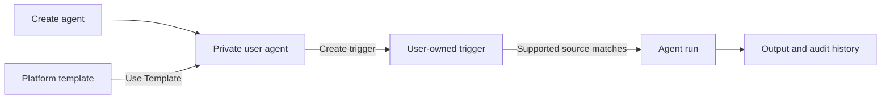

# Agent V1 Frontend Integration Flow

This document defines the frontend-to-backend flow for creating an agent directly or from a shared
platform template, attaching triggers, and viewing runs. It describes application state and API
sequencing, not page layout or component implementation.

Detailed endpoint contracts:

- [Agent Templates API](./v1-agent-templates-api.md)
- [Agent Definitions API](./v1-agent-definitions-api.md)
- [Agent Triggers API](../automation/v1-agent-triggers-api.md)
- [Agent Runs API](../automation/v1-agent-runs-api.md)

## Core Product Model



The boundaries are intentional:

- A template is read-only catalog metadata. It cannot execute and cannot own a trigger or run.
- A user may create a private agent directly without selecting or creating a template.
- `Use Template` copies one exact template version into a normal private agent owned by the
  authenticated user.
- The copied agent is independent. The user can edit it without changing the platform template or
  another user's copy.
- A trigger belongs to the copied agent and is pinned to one agent revision.
- A run stores snapshots of the agent, trigger, and input used for that execution.
- A later platform-template change never silently changes an existing user agent.

## Recommended Agents Tab Flow

The Agents tab should expose **Create Agent** plus two logical collections: **My Agents** and
**Templates**. They may be shown as sections or views, but templates and agents must remain
different resource types in frontend state.

On first load, fetch these two collections in parallel:

```http
GET /users/v1/agents?limit=20&offset=0
GET /users/v1/agent-templates
```

Use the returned agent list for **My Agents** and the template list for **Templates**. Do not merge
template records into the owned-agent collection: a `template_id` is not an `agent_id`.

Do not fetch triggers once for every agent on initial load. V1 exposes triggers under one agent at
a time, so eager loading would create an N+1 request pattern. Fetch triggers when the user opens or
expands an owned agent:

```http
GET /users/v1/agents/{agent_id}/triggers?limit=20&offset=0
```

If the product later requires trigger counts on every agent row, add a backend summary/bulk
contract instead of issuing one trigger request per listed agent.

The capability catalog is useful when labels are needed for tool and skill keys. It can be loaded
when the template detail or agent editor opens:

```http
GET /users/v1/agent-capability-catalog
```

## Create Agent Directly

Direct creation is an independent V1 entry path and does not require a template:

```http
POST /users/v1/agents
Content-Type: application/json
```

Submit the complete `AgentCreateRequest` documented in the Agent Definitions API. On `201 Created`,
insert the returned `AgentDetail` into **My Agents** or refetch the list, then open the
owned-agent editor. Creating the agent does not create a trigger or run; trigger configuration is
an optional next action after the user has reviewed or tested the definition.

The frontend must not create a hidden template before this request. Direct agents use
`source_type = "user"`; agents materialised from platform templates use `source_type = "system"`.
Both follow the same edit, trigger, run, pause, and archive APIs after creation.

## Template Discovery And Detail

### 1. List template summaries

```http
GET /users/v1/agent-templates
```

Each summary contains the stable `template_id`, exact `version`, display fields, tool and skill
keys, model name, output mode, and publication time. Use `(template_id, version)` as the frontend
identity for a catalog item.

### 2. Open a template

```http
GET /users/v1/agent-templates/{template_id}
```

The detail adds the complete fields that will be copied:

- `prompt`
- `agent_model_config`
- `max_turns`
- `input_schema`
- `output_schema`
- complete `allowed_tools` and `allowed_skills`

The template detail is read-only. The frontend may show the prompt, tools, skills, model settings,
and input/output contract before the user decides to copy it.

## Use Template Flow

The frontend must post the version the user actually viewed:

```http
POST /users/v1/agent-templates/{template_id}/use
Content-Type: application/json
```

```json
{
  "version": 1
}
```

On `201 Created`:

1. Read the created `AgentDetail` from `data`.
2. Insert that returned object into local **My Agents** state or refetch the agent list.
3. Use the response `Location` header or `data.agent_id` as the owned-agent URL.
4. Move the user to the owned-agent detail/editor flow.
5. Offer trigger configuration as the next action.

The created agent has `source_type = "system"`, the template ID in `source_agent_id`, and the
copied version in `source_version`. These fields are provenance only; the new agent follows the
same edit, trigger, run, pause, and archive flows as any user-created agent.

The use endpoint is not idempotent. Every successful request creates another independent agent.
Disable the action while it is pending and do not automatically retry it after an ambiguous
network failure. Multiple deliberate copies are allowed.

If the selected ID/version is no longer available, the backend returns `404 Agent template not
found`. Refresh the template catalog instead of silently submitting a newer version.

## Configure The First Trigger

Load the trigger-builder contract when the user begins configuring a trigger:

```http
GET /users/v1/automation-trigger-catalog
```

The catalog is the source of truth for supported trigger definitions, default JSON configuration,
field rendering metadata, and organization-owned CRM pipeline/stage options. The frontend should
not maintain its own duplicate list of event types, pipeline options, or stage options. The current
CRM catalog includes deal creation, deal stage changes, contact creation/deletion, and account
creation/deletion. Render each `categories[].triggers[]` entry from its `fields` and default config.

For the current `Deal Stage Health Review` template, the operational trigger path is:

```text
trigger_key: crm.deal.stage_changed
trigger_type: event
source_domain: crm
event_type: crm.deal.stage_changed
schema_key: crm.deal.stage_changed.v1
```

Create the trigger under the materialised agent, never under the template:

```http
POST /users/v1/agents/{agent_id}/triggers
Content-Type: application/json
```

```json
{
  "name": "Review deals after stage changes",
  "status": "active",
  "trigger_type": "event",
  "source_domain": "crm",
  "event_type": "crm.deal.stage_changed",
  "trigger_config": {},
  "filter_config": {
    "schema_key": "crm.deal.stage_changed.v1",
    "pipeline_ids": [],
    "stage_change_mode": "any_change",
    "from_stage_ids": [],
    "to_stage_ids": [],
    "outcome": "any"
  },
  "scope_config": {},
  "task_config": {
    "goal": "Review the deal and recommend the next best actions."
  }
}
```

The successful response is the saved `AutomationTriggerDetail`. Saving an active trigger does not
run the agent immediately. A matching persisted supported CRM event creates the run and the worker
executes it.

### Current schedule boundary

The catalog currently also describes schedule configuration, and schedule definitions can be
validated and stored. This worktree does not yet contain the due-schedule dispatcher that turns
`next_trigger_at` into an agent run. The frontend should not present scheduled execution as an
operational V1 path until that worker/service is implemented and verified.

## Owned Agent Detail Flow

When an owned agent is opened, these reads are independent and may run in parallel:

```http
GET /users/v1/agents/{agent_id}
GET /users/v1/agents/{agent_id}/triggers?limit=20&offset=0
GET /users/v1/agent-runs?agent_id={agent_id}&limit=20
```

The first response is the editable definition, the second is trigger configuration and health,
and the third is execution history. An agent may exist with no trigger and a trigger may exist with
no runs yet; both are valid empty states.

## Editing Agents And Pinned Triggers

Agent writes use the integer `revision` as an optimistic-concurrency token. `PUT` is a complete
replacement, so submit every mutable definition field plus `expected_revision` and `status`:

```http
PUT /users/v1/agents/{agent_id}
```

After an agent edit, existing triggers intentionally continue using their saved agent snapshot.
The next trigger-list/detail response reports `target_update_available = true` when the trigger's
`target_revision` is older than the current agent revision.

Only repin after an explicit user action:

```http
POST /users/v1/agents/{agent_id}/triggers/{trigger_id}/refresh-target
Content-Type: application/json
```

```json
{
  "expected_updated_at": "2026-07-14T09:30:00Z"
}
```

Trigger writes use the last-read timezone-aware `updated_at` timestamp as their concurrency token:

- `PUT /users/v1/agents/{agent_id}/triggers/{trigger_id}` sends a complete trigger definition plus
  `expected_updated_at`.
- `DELETE /users/v1/agents/{agent_id}/triggers/{trigger_id}?expected_updated_at=...` archives it.
- `POST .../refresh-target` sends `expected_updated_at` in the body.

On `409`, discard the pending mutation, refetch the resource, and ask the user to review the newer
state before resubmitting.

## Run History Flow

List runs globally or filter them by agent, trigger, and status:

```http
GET /users/v1/agent-runs?agent_id={agent_id}&trigger_id={trigger_id}&status=succeeded&limit=20
```

Run pagination is cursor-based. Pass the returned `next_cursor` as `cursor` on the next request.
Use the detail endpoint only when the user opens a run because it includes full snapshots, output,
usage, cost, errors, and timing:

```http
GET /users/v1/agent-runs/{run_id}
```

V1 has no manual-run endpoint and no frontend push/stream contract for run updates. A frontend that
shows live execution state must poll the list or detail endpoint while a run is non-terminal and
stop at `succeeded`, `failed`, `delivery_failed`, `validation_failed`, or `cancelled`.

## Complete V1 Endpoint Map

| Area | Method | Endpoint | Frontend use |
| --- | --- | --- | --- |
| Templates | `GET` | `/users/v1/agent-templates` | List available template summaries |
| Templates | `GET` | `/users/v1/agent-templates/{template_id}` | View the complete template |
| Templates | `POST` | `/users/v1/agent-templates/{template_id}/use` | Materialise an exact version |
| Agents | `GET` | `/users/v1/agents` | List owned agents |
| Agents | `POST` | `/users/v1/agents` | Create an agent without a template |
| Agents | `GET` | `/users/v1/agents/{agent_id}` | Read an owned agent |
| Agents | `PUT` | `/users/v1/agents/{agent_id}` | Replace an agent definition |
| Agents | `PUT` | `/users/v1/agents/{agent_id}/capabilities` | Replace only tools and skills |
| Agents | `DELETE` | `/users/v1/agents/{agent_id}` | Archive an agent |
| Capabilities | `GET` | `/users/v1/agent-capability-catalog` | Resolve selectable tool/skill metadata |
| Triggers | `GET` | `/users/v1/automation-trigger-catalog` | Build trigger forms and CRM options |
| Triggers | `GET` | `/users/v1/agents/{agent_id}/triggers` | List one agent's triggers |
| Triggers | `POST` | `/users/v1/agents/{agent_id}/triggers` | Create and pin a trigger |
| Triggers | `GET` | `/users/v1/agents/{agent_id}/triggers/{trigger_id}` | Read one trigger |
| Triggers | `PUT` | `/users/v1/agents/{agent_id}/triggers/{trigger_id}` | Replace a trigger |
| Triggers | `POST` | `/users/v1/agents/{agent_id}/triggers/{trigger_id}/refresh-target` | Repin to current agent revision |
| Triggers | `DELETE` | `/users/v1/agents/{agent_id}/triggers/{trigger_id}` | Archive a trigger |
| Runs | `GET` | `/users/v1/agent-runs` | List execution history |
| Runs | `GET` | `/users/v1/agent-runs/{run_id}` | Read full execution details |

All endpoints require the normal authenticated user context. Ownership and organization IDs come
from authentication and must never be accepted from frontend form state.

## Response And Error Handling

Except for `204 No Content`, successful and failed API bodies use the common envelope:

```json
{
  "status": "SUCCESS",
  "message": "Request successful",
  "data": {}
}
```

Frontend handling:

| Status | Meaning | Expected frontend action |
| --- | --- | --- |
| `400` | Valid shape but invalid domain/configuration | Show the backend message near the action/form |
| `404` | Missing, archived, or inaccessible owned resource | Remove stale local state and return to the relevant list |
| `409` | Stale revision/timestamp or duplicate trigger | Refetch; never overwrite silently |
| `422` | Malformed request or field bounds | Treat as a frontend contract/validation error |
| `429` | User rate limit exceeded | Respect retry behavior and avoid request loops |
| `500` | Sanitized unexpected failure | Keep current state and offer a deliberate retry |

## State Invalidation After Writes

| Successful write | Refresh or update |
| --- | --- |
| Use template | Owned-agent list; insert returned `AgentDetail` immediately |
| Create/update/archive agent | Owned-agent list and that agent's detail |
| Create/update/archive trigger | Trigger list for that agent |
| Edit agent | Agent detail/list and trigger rows because `target_update_available` may change |
| Refresh trigger target | That trigger detail/list row |

Runs are created asynchronously by supported trigger activation. They are not invalidated by the
definition write itself.

## V1 Limitations The Frontend Must Not Hide

- There is no combined agents-plus-trigger-count endpoint; use lazy trigger loading.
- `Use Template` permits multiple copies and has no idempotency key.
- Templates have no create/update/admin API and no upgrade flow in V1.
- Template metadata does not yet expose an explicit `compatible_trigger_keys` field. The current
  Deal Stage Health Review product flow must use `crm.deal.stage_changed`.
- Scheduled trigger definitions do not yet have a runtime dispatcher.
- Templates cannot execute directly; only the materialised user agent can own triggers and runs.
