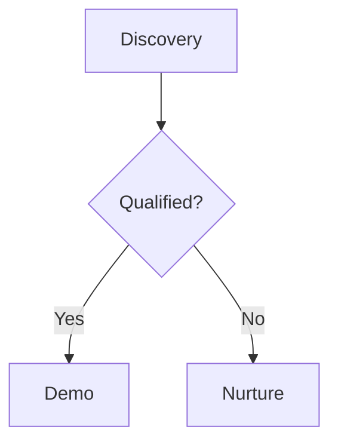

# Chat API Documentation

## Base URL

```text
/users/chats
```

---

## Response Envelope

- All endpoints return a consistent envelope:

```json
{
  "status": "SUCCESS | ERROR",
  "message": "Human-readable message",
  "data": { ... } | null
}
```

- Timestamps use ISO 8601 with `Z` suffix (UTC), e.g. `2025-10-05T10:30:00Z`.

## Authentication

- Required — Bearer token
- Header: `Authorization: Bearer <access_token>`

## Rate Limiting (defaults)

- Write endpoints (POST/PATCH/DELETE): ~15/min, 100/hour per user
- Read endpoints (GET): ~60/min, 1000/hour per user
- On limit breach: `429 Too Many Requests` with `Retry-After` header

---

## Integration Overview

- For a unified flow with uploads and SSE, see: `docs/API Documentation/chat-apis-integration-diagram.md`

---

## Production Conventions

- Authentication: Bearer JWT in `Authorization: Bearer <token>`
- Content Type: `Content-Type: application/json`; `Accept: application/json`
- Idempotency: Create/send endpoints are not idempotent. Clients should guard against duplicate submissions (disable submit while in-flight; de-dupe using a client-generated UUID).
- Pagination: Cursor-based; treat `cursor` as opaque and pass back verbatim.
- Stability/Versioning: No explicit version path today. Non-breaking changes are additive; breaking changes will be announced.
- Time & Timestamps: ISO 8601 UTC with `Z` suffix.

### Rate Limits

- Write: ~15/min, 100/hour per user (configurable)
- Read: ~60/min, 1000/hour per user (configurable)
- Exceeding returns `429 Too Many Requests` with `Retry-After` header (seconds)

### Error Model

- Envelope always present with HTTP status aligned to error:
  - 400: invalid input (empty content/title, bad filters)
  - 401: missing/invalid token
  - 403: forbidden (invalid user context)
  - 404: resource not found (chat not found)
  - 409/422: validation/conflict (rare)
  - 429: rate limited
  - 500: unhandled server error

```json
{
  "status": "ERROR",
  "message": "Human-readable reason",
  "data": null
}
```

### Security & Tenancy

- All operations are evaluated against the authenticated `user_id` and `organisation_id`.
- Queries exclude soft-deleted items; writes are scoped to the caller.

### SSE Guidance (Message Events)

- Transport: Server-Sent Events; events: `ready`, `frame`, `ping`, `complete`, `timeout`, `error`.
- Timeouts/Heartbeats: timeout ~15 minutes; heartbeats ~25s. Reconnect with backoff on `timeout` or transient `error`.
- Resume: Provide `Last-Event-ID` header to resume (legacy replay mode supported).
- Auth caveat: Native `EventSource` cannot attach `Authorization` headers. Options:
  - Use an SSE polyfill that supports headers
  - Have a reverse proxy inject the header based on a secure cookie
  - Implement an app bridge that exchanges a cookie/session for an auth header

## Data Types

### Enums

- `ChatMessageRole`: `"user" | "assistant" | "system"`
- `ChatMessageType`: `"GENERAL_MESSAGE" | "TECHNICAL_DECK" | "RFP_SHEET"`

### Request Models (TypeScript)

```ts
type UUID = string;

export interface ChatSessionCreate {
  title: string;
  tags?: string[]; // optional labels
}

export interface DeleteChat {
  session_id: UUID;
}

export interface RenameChat {
  session_id: UUID;
  title: string; // 1..100 chars
}

export interface FavoriteChat {
  session_id: UUID;
  favorite: boolean;
}

export interface SendMessageRequest {
  session_id: UUID;
  content: string; // non-empty
  attachments?: UUID[]; // attachment_ids from Attachments API
  message_type?: ChatMessageType; // default: GENERAL_MESSAGE
  role: "user"; // must be "user"
  is_edited?: boolean; // default: false
  edited_message_id?: UUID; // required if is_edited === true
}
```

### Response Models (TypeScript)

```ts
export interface ChatSessionOut {
  session_id: UUID;
  title: string;
  chat_type: string; // e.g., "GENERAL_CHAT"
  is_favorite: boolean;
  tags: string[];
  created_at: string; // ISO8601
  updated_at: string; // ISO8601
}

export interface ChatSessionsPage {
  items: ChatSessionOut[];
  cursor?: string | null; // opaque
}

export interface SendMessageResponse {
  job_id: UUID;
  user_message_id: UUID;
  assistant_message_id: UUID;
}

export interface ChatAttachmentView {
  attachment_id: UUID;
  filename: string;
  mimetype: string;
  thumbnail_small_url?: string | null;
}

export interface ChatMessageListItem {
  message_id: UUID;
  session_id: UUID;
  role: ChatMessageRole;
  message_type: ChatMessageType;
  content: string;
  is_edited: boolean;
  created_at: string; // ISO8601
  updated_at: string; // ISO8601
  attachments: ChatAttachmentView[];
  confidence_score?: string | null; // "low"|"medium"|"high"|"neutral" or null
  sources?: Array<Record<string, any>> | null;
  suggestions?: string[] | null;
  feedback_score?: number | null; // 1 (thumbs up), -1 (thumbs down), null (no feedback)
}

export interface ChatMessagesPage {
  items: ChatMessageListItem[];
  cursor?: string | null;
}

export interface MessageFeedbackRequest {
  message_id: UUID;
  feedback_score: number; // -1 (thumbs down), 0 (clear), or 1 (thumbs up)
}

export interface MessageFeedbackResponse {
  message_id: UUID;
  feedback_score: number | null; // null if cleared
}

// Standard envelope used by all endpoints
export interface ApiEnvelope<T> {
  status: "SUCCESS" | "ERROR";
  message: string;
  data: T | null;
}

// Task list types for real-time task tracking
export type TaskStatus = "pending" | "in_progress" | "completed";

export interface TaskItem {
  id: string;                    // Unique task identifier
  task: string;                  // Task description
  status: TaskStatus;            // Current task status
}

export interface TaskUpdate {
  id: string;                    // Task identifier to update
  status?: TaskStatus;           // New status (for status-only updates)
  task?: string;                 // Task description (for new tasks)
  is_new?: boolean;              // True if this is a newly added task
}

export interface TaskListFrame {
  type: "task_list";
  job_id: string;
  assistant_message_id: string;
  tasks?: TaskItem[];            // Full task list (initial or reset)
  updates?: TaskUpdate[];        // Delta updates (efficient status changes)
}
```

### SSE Event Frames (Message Events)

- Events: `ready`, `frame`, `ping`, `complete`, `timeout`, `error`
- `frame.data` examples:

```json
{ "type": "answer.delta", "content": "partial markdown ...", "format": "markdown", "sequence": 3 }
{ "type": "answer.replace", "content": "full answer ...", "format": "markdown" }
{ "type": "answer.metrics", "confidence": "high" }  // values: "high"|"medium"|"low"|"neutral"
{ "type": "suggestions.replace", "items": ["Follow-up A", "B"] }
{ "type": "sources.replace", "sources": [{"title":"Doc","url":"..."}] }
{ "type": "progress.update", "stage":"retrieval", "progress": 0.7 }
{ "type": "tool.usage", "tool_name":"search", "status":"ok" }
{ "type": "thinking.update", "thought": "...", "stage":"plan" }
{ "type": "task_list", "tasks": [{"id":"1","task":"Search knowledge base","status":"completed"},{"id":"2","task":"Analyze results","status":"in_progress"}] }
{ "type": "task_list", "updates": [{"id":"1","status":"completed"},{"id":"2","status":"in_progress"}] }
{ "type": "finalize", "reason": "done" }
```

### Retry & Backoff Recommendations

- Non-idempotent writes (create_chat, send_message): do not auto-retry without user confirmation; prefer manual retry to avoid duplicates.
- Reads (list/search): retry with exponential backoff (200ms → 400ms → 800ms; jitter) up to a small cap.
- SSE: on `timeout`/network errors, reconnect with backoff (1s → 5s → 10s; cap 30s). Stop on `complete`.

---

## Security & Compliance (SOC 2 Alignment)

- Transport Security
  - Enforce TLS 1.2+; recommend HSTS at the edge. All API access over HTTPS only.
  - CORS: restrict in production to trusted origins.
- Authentication & Authorization
  - Bearer JWT on every call. Endpoints enforce user/org scoping for all reads/writes.
  - Prefer role-based authorization at the gateway (future extension) for admin vs user scopes.
- Input Validation & Integrity
  - Pydantic validation rejects empty content and invalid roles/types.
  - Cursor-based pagination guards against numeric enumeration; cursors are opaque.
  - SSE consumer groups provide exactly-once delivery semantics in consume-once mode for message jobs.
- Logging & Auditability
  - Log request outcomes and resource IDs (session_id, message_id, job_id) without storing content or tokens.
  - Redact potentially sensitive fields; apply log retention and access controls.
- Availability & Resilience
  - Per-user rate limiting (read/write budgets) with `429` + `Retry-After`.
  - SSE heartbeats and reconnect guidance provide graceful degradation on network interruptions.
- Privacy & Data Handling
  - Message content is application data; treat as confidential. Avoid logging content. Support future purge/retention policies at the org level.
- Change Management & Versioning
  - Document non-breaking additions; coordinate breaking changes. Maintain compatibility for event frames and payloads.

## 1) Create Chat

### Create Chat Endpoint

```http
POST /users/chats/create_chat
```

### Create Chat Description

Creates a new chat session owned by the current user in their organisation.

```json
{
  "title": "My First Chat",
  "tags": ["alpha", "demo"]
}
```

### Create Chat Success Response (200)

```json
{
  "status": "SUCCESS",
  "message": "Chat created",
  "data": {
    "session_id": "f3c8c3f2-1f5a-4a6f-94e4-7a7f0e05e2a0",
    "title": "My First Chat",
    "chat_type": "GENERAL_CHAT",
    "is_favorite": false,
    "tags": ["alpha", "demo"],
    "created_at": "2025-10-06T08:12:00Z",
    "updated_at": "2025-10-06T08:12:00Z"
  }
}
```

### Create Chat Error Responses

- 400 Bad Request — "Title cannot be null or empty", "Title cannot exceed 100 characters"
- 500 Internal Server Error — "Unable to create chat session"

### Create Chat Example cURL

```bash
curl -X POST "$BASE_URL/users/chats/create_chat" \
  -H "Authorization: Bearer $TOKEN" \
  -H "Content-Type: application/json" \
  -d '{"title":"My First Chat","tags":["alpha","demo"]}'
```

---

## 2) Delete Chat (soft delete)

### Delete Chat Endpoint

```http
DELETE /users/chats/delete_chat
```

### Delete Chat Description

Soft-deletes a chat session owned by the current user.

```json
{ "session_id": "f3c8c3f2-1f5a-4a6f-94e4-7a7f0e05e2a0" }
```

### Delete Chat Success Response (200)

```json
{
  "status": "SUCCESS",
  "message": "Chat deleted",
  "data": {
    "session_id": "f3c8c3f2-1f5a-4a6f-94e4-7a7f0e05e2a0",
    "title": "My First Chat",
    "chat_type": "GENERAL_CHAT",
    "is_favorite": false,
    "tags": [],
    "created_at": "2025-10-06T08:12:00Z",
    "updated_at": "2025-10-06T08:15:00Z"
  }
}
```

### Delete Chat Error Responses

- 404 Not Found — "Chat session not found"
- 500 Internal Server Error — "Unable to delete chat session"

---

## 3) Rename Chat

### Rename Chat Endpoint

```http
PATCH /users/chats/rename_chat
```

```json
{ "session_id": "<UUID>", "title": "New Title" }
```

### Rename Chat Success Response (200)

```json
{
  "status": "SUCCESS",
  "message": "Chat renamed",
  "data": {
    "session_id": "<UUID>",
    "title": "New Title",
    "chat_type": "GENERAL_CHAT",
    "is_favorite": false,
    "tags": [],
    "created_at": "2025-10-06T08:12:00Z",
    "updated_at": "2025-10-06T08:16:00Z"
  }
}
```

### Rename Chat Error Responses

- 400 Bad Request — invalid title
- 404 Not Found — "Chat session not found"
- 500 Internal Server Error — "Unable to rename chat session"

---

## 4) List Chats (paginated)

### List Chats Endpoint

```http
GET /users/chats/list_chats?limit=20&cursor=<opaque>
```

### List Chats Description

Returns your chat sessions ordered by recency. Use `cursor` from the previous response to fetch the next page.

### List Chats Success Response (200)

```json
{
  "status": "SUCCESS",
  "message": "Chats listed",
  "data": {
    "items": [
      {
        "session_id": "<UUID>",
        "title": "My First Chat",
        "chat_type": "GENERAL_CHAT",
        "is_favorite": false,
        "tags": [],
        "created_at": "2025-10-06T08:12:00Z",
        "updated_at": "2025-10-06T08:12:00Z"
      }
    ],
    "cursor": "<opaque-cursor-or-null>"
  }
}
```

### List Chats Error Responses

- 500 Internal Server Error — "Unable to list chat sessions"

---

## 5) Search Chats (typeahead)

### Search Chats Endpoint

```http
GET /users/chats/search_chats?q=<text>&limit=10
```

### Search Chats Description

Searches chat sessions by title. Best-effort, not paginated; intended for typeahead.

### Search Chats Success Response (200)

Same shape as List Chats, with `cursor: null`.

### Search Chats Error Responses

- 500 Internal Server Error — "Unable to search chat sessions"

---

## 6) Toggle Favorite

### Toggle Favorite Endpoint

```http
PATCH /users/chats/favorite_chat
```

```json
{ "session_id": "<UUID>", "favorite": true }
```

### Toggle Favorite Success Response (200)

```json
{
  "status": "SUCCESS",
  "message": "Chat favorited",
  "data": {
    "session_id": "<UUID>",
    "title": "...",
    "chat_type": "GENERAL_CHAT",
    "is_favorite": true,
    "tags": [],
    "created_at": "2025-10-06T08:12:00Z",
    "updated_at": "2025-10-06T08:18:00Z"
  }
}
```

### Toggle Favorite Error Responses

- 404 Not Found — "Chat session not found"
- 400 Bad Request — validation issues
- 500 Internal Server Error — "Unable to update favorite state"

---

## 7) Send Message

### Send Message Endpoint

```http
POST /users/chats/send_message
```

### Send Message Description

Persists a user message (with optional attachments) and enqueues a background job to generate the assistant reply.

```json
{
  "session_id": "<UUID>",
  "content": "How do I...",
  "attachments": ["<ATTACHMENT_UUID>"],
  "message_type": "GENERAL_MESSAGE",
  "role": "user",
  "is_edited": false,
  "edited_message_id": null
}
```

Notes

- `role` must be `user`.
- `attachments` are IDs from the Chat Attachments API once uploaded/finalized.

### Send Message Success Response (200)

```json
{
  "status": "SUCCESS",
  "message": "Message accepted",
  "data": {
    "job_id": "0f49b5d8-...",
    "user_message_id": "f1b9e0a8-...",
    "assistant_message_id": "a2c7d1e9-..."
  }
}
```

Notes

- `job_id`: Use this to connect to the SSE stream at `/message_events`
- `user_message_id`: The persisted ID of the user's message
- `assistant_message_id`: Pre-generated ID for the assistant's response (message will be created by worker)

### Send Message Error Responses

- 400 Bad Request — invalid content, role not `user`, or session not found
- 500 Internal Server Error — scheduling/processing issue

### Send Message Example cURL

```bash
curl -X POST "$BASE_URL/users/chats/send_message" \
  -H "Authorization: Bearer $TOKEN" \
  -H "Content-Type: application/json" \
  -d '{
        "session_id":"<UUID>",
        "content":"Show me recent updates",
        "attachments":[],
        "message_type":"GENERAL_MESSAGE",
        "role":"user"
      }'
```

---

## 8) Message Events (SSE)

### Message Events Endpoint

```http
GET /users/chats/message_events?job_id=<UUID>
```

### Message Events Description

Streams Server-Sent Events for a specific message job. Includes reconnection support via `Last-Event-ID`.

### Event Types

- `ready` — stream initialized
- `frame` — data payload (see `type` field below)
- `ping` — heartbeat
- `complete` — job finished (client may close the stream)
- `timeout` — stream timed out; reconnect allowed
- `error` — internal stream error; reconnect allowed

### Frame `data` (representative examples)

```json
{ "type": "answer.delta", "content": "partial markdown ...", "format": "markdown", "sequence": 3 }
{ "type": "answer.replace", "content": "full answer ...", "format": "markdown" }
{ "type": "answer.metrics", "confidence": "high" }  // values: "high"|"medium"|"low"|"neutral"
{ "type": "suggestions.replace", "items": ["Follow-up A", "B"] }
{ "type": "sources.replace", "sources": [{"title":"Doc","url":"..."}] }
{ "type": "progress.update", "stage":"retrieval", "progress": 0.7 }
{ "type": "tool.usage", "tool_name":"search", "status":"ok" }
{ "type": "thinking.update", "thought": "...", "stage":"plan" }
{ "type": "task_list", "tasks": [{"id":"1","task":"Search knowledge base","status":"completed"},{"id":"2","task":"Analyze results","status":"in_progress"}] }
{ "type": "task_list", "updates": [{"id":"1","status":"completed"},{"id":"2","status":"in_progress"}] }
{ "type": "finalize", "reason": "done" }
```

### SSE Semantics (Worker, Delta, Ordering)

- Producer and delivery
  - Frames originate from the chat worker processing the job. The worker publishes structured frames to a per-job Redis Stream; the API's SSE endpoint relays those frames to the client.
  - Delivery uses Redis consumer groups for consume-once semantics by default, minimizing duplicates. Legacy replay mode is used when consumer groups are unavailable.

- Base frame schema (always included)
  - `job_id`: the job identifier (string) for SSE stream correlation
  - `assistant_message_id`: the pre-generated ID for the assistant message being created
  - `version`: frame schema version (e.g., "1.0")
  - `timestamp`: float seconds since epoch
  - `sequence`: 0-based, monotonically increasing per job
  - `type`: one of the known frame types listed above

- Ordering and resume
  - Ordering: frames are emitted in order; use `sequence` (preferred) or the SSE `id` to ensure monotonic processing.
  - Resume: pass `Last-Event-ID` on reconnect. In consume-once mode, the server tracks position; in legacy mode, the server replays from the provided ID.
  - Heartbeats/Timeouts: you will receive `ping` heartbeats ~25s. After ~15 minutes idle, a `timeout` with `{ "reconnect": true }` is sent — reconnect with backoff.

- Content streaming contract (delta vs replace)
  - `answer.delta`: append-only partial content. Render incrementally by concatenating `content` chunks in order.
  - `answer.replace`: full current answer. If received, treat this as the canonical text and replace the accumulated buffer.
  - Finalization: a `finalize` frame is followed by an `event: complete`. After `complete`, close the stream and optionally refresh with `GET /messages/list` to show the persisted assistant message.

- Diagnostics / "autopsy" frames (what the frontend can expect)
  - `answer.metrics`: confidence signal for the answer (e.g., `low|medium|high|neutral`). May also include `citations` in some cases.
  - `sources.replace`: full replacement list of sources/citations to display alongside the answer.
  - `suggestions.replace`: full replacement list of suggested follow-ups.
  - `progress.update`: background status such as `{ stage, message?, progress [0..1], eta_seconds? }` to drive progress UI.
  - `tool.usage`: instrumentation about tools used `{ tool_name, status, duration_ms?, result_summary? }`.
  - `thinking.update`: optional thinking/planning breadcrumbs `{ thought, stage }` for debug or dev UIs.
  - `task_list`: real-time task tracking for multi-step agent work. Has `tasks` (full list) or `updates` (delta changes). Display in fixed UI position.
  - `agent.switch` and `question.prompt`: advanced flows for agent handoff or asking the user for more info.

- Frontend handling (practical expectations)
  - Stream only from `answer.delta` (append) and apply `answer.replace` when present to ensure the UI shows the canonical answer.
  - Merge diagnostics frames live: update confidence, sources, suggestions, progress bars, tool/thinking panes, and task lists as frames arrive.
  - For `task_list` frames: maintain task state in a fixed UI position (sidebar, banner, or floating card). See "Task List Frontend Integration Guide" section for details.
  - Stop on `event: complete` (or on `finalize` shortly followed by `complete`). On `timeout` or `error` where `reconnect` is true, reconnect with backoff and include `Last-Event-ID`.
  - After completion, call `GET /users/chats/messages/list` for the session to render the stored assistant message and any enriched metadata.

### Frontend Handling Tips

- Use `answer.delta` to append and `answer.replace` to overwrite the current answer.
- Update confidence, suggestions, sources, and progress bars from corresponding frames.
- Stop streaming when you receive an `event: complete` (or a `finalize` frame followed by `complete`).

### Minimal Browser Example

```js
// After sending message, you receive: { job_id, user_message_id, assistant_message_id }
// Create assistant message placeholder in UI with assistant_message_id

const src = new EventSource(`/users/chats/message_events?job_id=${jobId}`, {
  withCredentials: true
});

src.addEventListener('ready', () => console.log('ready'));
src.addEventListener('ping', () => {/* keep-alive */});
src.addEventListener('frame', (e) => {
  const frame = JSON.parse(e.data);
  // frame.job_id - correlate with your request
  // frame.assistant_message_id - update this message in your UI

  switch(frame.type){
    case 'answer.delta':
      // Append frame.content to assistant message
      updateMessage(frame.assistant_message_id, { content: append(frame.content) });
      break;
    case 'answer.replace':
      // Replace full content
      updateMessage(frame.assistant_message_id, { content: frame.content });
      break;
    case 'suggestions.replace':
      // Update suggestions
      updateMessage(frame.assistant_message_id, { suggestions: frame.items });
      break;
    case 'sources.replace':
      // Update sources
      updateMessage(frame.assistant_message_id, { sources: frame.sources });
      break;
    case 'task_list':
      // Update task list UI (show in fixed position)
      if (frame.tasks) {
        // Full task list - replace all tasks
        updateTaskList(frame.tasks);
      } else if (frame.updates) {
        // Delta updates - apply changes
        applyTaskUpdates(frame.updates);
      }
      break;
    case 'finalize':
      // Mark complete
      updateMessage(frame.assistant_message_id, { status: 'completed' });
      break;
  }
});
src.addEventListener('complete', () => src.close());
```

---

## 9) Provide Message Feedback

### Provide Message Feedback Endpoint

```http
POST /users/chats/messages/feedback
```

### Provide Message Feedback Description

Allows users to provide feedback (thumbs up/down) on chat messages. This is useful for collecting user satisfaction data and improving the assistant's responses.

```json
{
  "message_id": "<UUID>",
  "feedback_score": 1
}
```

Notes

- `feedback_score` must be one of: `1` (thumbs up), `-1` (thumbs down), or `0` (clear/remove feedback)
- Users can only provide feedback on messages from their own chat sessions
- Feedback can be updated multiple times for the same message

### Provide Message Feedback Success Response (200)

```json
{
  "status": "SUCCESS",
  "message": "Feedback updated successfully",
  "data": {
    "message_id": "f1b9e0a8-...",
    "feedback_score": 1
  }
}
```

Notes

- If `feedback_score` was `0` (clear), the response will show `feedback_score: null`
- The feedback is immediately persisted to the database

### Provide Message Feedback Error Responses

- 400 Bad Request — Invalid feedback score (must be -1, 0, or 1), message not found, or permission denied
- 500 Internal Server Error — "Unable to update feedback"

### Provide Message Feedback Example cURL

```bash
# Thumbs up
curl -X POST "$BASE_URL/users/chats/messages/feedback" \
  -H "Authorization: Bearer $TOKEN" \
  -H "Content-Type: application/json" \
  -d '{"message_id":"f1b9e0a8-...","feedback_score":1}'

# Thumbs down
curl -X POST "$BASE_URL/users/chats/messages/feedback" \
  -H "Authorization: Bearer $TOKEN" \
  -H "Content-Type: application/json" \
  -d '{"message_id":"f1b9e0a8-...","feedback_score":-1}'

# Clear feedback
curl -X POST "$BASE_URL/users/chats/messages/feedback" \
  -H "Authorization: Bearer $TOKEN" \
  -H "Content-Type: application/json" \
  -d '{"message_id":"f1b9e0a8-...","feedback_score":0}'
```

### Frontend Integration Example

```typescript
// Thumbs up handler
async function handleThumbsUp(messageId: string) {
  const response = await fetch('/users/chats/messages/feedback', {
    method: 'POST',
    headers: {
      'Authorization': `Bearer ${token}`,
      'Content-Type': 'application/json',
    },
    body: JSON.stringify({
      message_id: messageId,
      feedback_score: 1
    })
  });
  const result = await response.json();
  // Update UI with result.data.feedback_score
}

// Thumbs down handler
async function handleThumbsDown(messageId: string) {
  const response = await fetch('/users/chats/messages/feedback', {
    method: 'POST',
    headers: {
      'Authorization': `Bearer ${token}`,
      'Content-Type': 'application/json',
    },
    body: JSON.stringify({
      message_id: messageId,
      feedback_score: -1
    })
  });
  const result = await response.json();
  // Update UI with result.data.feedback_score
}

// Toggle feedback (clear if already set to same value)
async function toggleFeedback(messageId: string, currentScore: number | null, newScore: number) {
  const feedbackScore = currentScore === newScore ? 0 : newScore;
  // ... make API call with feedbackScore
}
```

---

## 10) List Messages (cursor-based)

### List Messages Endpoint

```http
GET /users/chats/messages/list?session_id=<UUID>&limit=20&cursor=<opaque>&role=<role>&message_type=<type>
```

### List Messages Description

Returns chat messages for a session with lightweight enrichment (attachments, sources, suggestions, confidence, and feedback).

Notes

- Each message includes a `feedback_score` field showing user feedback: `1` (thumbs up), `-1` (thumbs down), or `null` (no feedback)
- Use this field to display the correct thumbs up/down icon state in your UI
- Feedback scores are set via the `POST /messages/feedback` endpoint

### List Messages Success Response (200)

```json
{
  "status": "SUCCESS",
  "message": "Messages listed",
  "data": {
    "items": [
      {
        "message_id": "<UUID>",
        "session_id": "<UUID>",
        "role": "assistant",
        "message_type": "GENERAL_MESSAGE",
        "content": "Rendered text",
        "is_edited": false,
        "created_at": "2025-10-06T08:12:00Z",
        "updated_at": "2025-10-06T08:12:00Z",
        "attachments": [
          {
            "attachment_id": "<UUID>",
            "filename": "file.pdf",
            "mimetype": "application/pdf",
            "thumbnail_small_url": "https://...sas..."
          }
        ],
        "confidence_score": "high",
        "sources": [{"title":"Doc","url":"..."}],
        "suggestions": ["Next question A"],
        "feedback_score": 1
      }
    ],
    "cursor": null
  }
}
```

### List Messages Error Responses

- 400 Bad Request — invalid session or filters
- 500 Internal Server Error — "Unable to list messages"

---

## Tool Usage Frontend Integration Guide

This section explains how to properly handle `tool.usage` frames in the frontend and the recommended UX patterns.

### The Two Information Streams

When the agent executes tools, the frontend receives information through **two different channels**:

1. **`tool.usage` frames** — Structured events specifically for tool execution lifecycle
2. **`answer.delta` frames** — The LLM's natural language response (may include tool execution summaries)

### Understanding `tool.usage` Frames

The backend sends `tool.usage` frames at each stage of tool execution:

```typescript
interface ToolUsageFrame {
  type: "tool.usage";
  job_id: string;
  assistant_message_id: string;
  version: string;
  timestamp: number;
  sequence: number;
  tool_name: string;                    // e.g., "search_internal_knowledge", "search_internet"
  tool_description?: string;            // Human-readable description
  status: "starting" | "in_progress" | "completed" | "failed";
  parameters?: Record<string, any>;     // Sanitized parameters (sessions replaced with placeholders)
  result_summary?: string;              // Truncated result on completion
  duration_ms?: number;                 // Execution time on completion
}
```

### Tool Execution Lifecycle Example

For a single tool call, you will receive **3-4 frames** in sequence:

```json
// 1. Starting - tool is about to execute
{ "type": "tool.usage", "tool_name": "search_internal_knowledge", "status": "starting", "parameters": { "query": "pricing information" } }

// 2. In Progress - tool is executing
{ "type": "tool.usage", "tool_name": "search_internal_knowledge", "status": "in_progress" }

// 3. Completed - tool finished successfully
{ "type": "tool.usage", "tool_name": "search_internal_knowledge", "status": "completed", "duration_ms": 9718, "result_summary": "Found 3 relevant documents..." }

// OR 3. Failed - tool encountered an error
{ "type": "tool.usage", "tool_name": "search_internal_knowledge", "status": "failed", "result_summary": "Error: Connection timeout" }
```

### Multiple Tool Calls

The agent may execute multiple tools for a single query. Each tool goes through its own lifecycle:

```json
// Tool 1: Internal knowledge search
{ "type": "tool.usage", "tool_name": "search_internal_knowledge", "status": "starting" }
{ "type": "tool.usage", "tool_name": "search_internal_knowledge", "status": "completed", "duration_ms": 9718 }

// Tool 2: Internet search (may start concurrently or after Tool 1)
{ "type": "tool.usage", "tool_name": "search_internet", "status": "starting" }
{ "type": "tool.usage", "tool_name": "search_internet", "status": "completed", "duration_ms": 465 }
```

### The `answer.delta` Tool Summary Issue (Handled Server-Side)

**Background**: The Agno framework injects tool execution summaries into the content stream when tools complete. These messages look like:

```json
{ "type": "answer.delta", "content": "search_internal_knowledge(query=...) completed in 9.7185s." }
```

**Server-side handling**: The backend now filters these out automatically by detecting Agno's `ToolCallCompleted` events in the `StreamingAnswerBuffer`. The frontend should **not** receive these polluted `answer.delta` frames.

**If filtering fails** (edge cases), the frontend can optionally strip them:
rpt
const toolSummaryPattern = /\w+\([^)]*\)\s+completed\s+in\s+[\d.]+s\.?/g;
const cleanContent = content.replace(toolSummaryPattern, '').trim();
```

### Recommended Frontend UX Patterns

#### Pattern 1: Expandable Research Panel (Recommended)

Show a collapsible "Research" section above or beside the answer:

```
┌─────────────────────────────────────────────┐
│ 🔍 Research                          [▼]    │
├─────────────────────────────────────────────┤
│ ✓ Searched internal knowledge (9.7s)        │
│ ✓ Searched internet (0.5s)                  │
└─────────────────────────────────────────────┘
│                                             │
│ CopilotGTM is your AI-powered partner...    │
│                                             │
```

**State Management**:

```typescript
interface ToolState {
  tool_name: string;
  status: "pending" | "running" | "completed" | "failed";
  duration_ms?: number;
  started_at?: number;
}

const [tools, setTools] = useState<Map<string, ToolState>>(new Map());

// Update on tool.usage frames
function handleToolUsage(frame: ToolUsageFrame) {
  setTools(prev => {
    const updated = new Map(prev);
    updated.set(frame.tool_name, {
      tool_name: frame.tool_name,
      status: frame.status === "starting" ? "running" 
             : frame.status === "in_progress" ? "running"
             : frame.status,
      duration_ms: frame.duration_ms,
      started_at: frame.status === "starting" ? Date.now() : prev.get(frame.tool_name)?.started_at
    });
    return updated;
  });
}
```

#### Pattern 2: Inline Status Indicators

Show tool status inline before the answer starts streaming:

```
🔄 Searching internal knowledge...
✓ Searched internal knowledge (9.7s)
🔄 Searching the web...
✓ Searched the web (0.5s)

CopilotGTM is your AI-powered partner...
```

#### Pattern 3: Side Panel (Advanced)

For detailed research transparency, show a side panel with full tool details:

```
┌────────────────────┬───────────────────────────────┐
│ Research Panel     │  Answer                       │
├────────────────────┼───────────────────────────────┤
│                    │                               │
│ 🔍 Internal Search │  CopilotGTM is your          │
│   Query: "pricing" │  AI-powered partner for      │
│   Found: 3 docs    │  go-to-market execution...   │
│   Time: 9.7s       │                               │
│                    │                               │
│ 🌐 Web Search      │                               │
│   Query: "pricing" │                               │
│   Results: 10      │                               │
│   Time: 0.5s       │                               │
│                    │                               │
└────────────────────┴───────────────────────────────┘
```

### Complete Frontend Handler Example

```typescript
interface ChatState {
  content: string;
  tools: Map<string, ToolState>;
  sources: Source[];
  suggestions: string[];
  confidence?: string;
  isComplete: boolean;
}

function handleFrame(frame: Frame, setState: SetState<ChatState>) {
  switch (frame.type) {
    case "tool.usage":
      setState(prev => ({
        ...prev,
        tools: updateToolState(prev.tools, frame)
      }));
      break;
      
    case "answer.delta":
      // Option: Filter out tool summaries
      const cleanContent = filterToolSummaries(frame.content);
      setState(prev => ({
        ...prev,
        content: prev.content + cleanContent
      }));
      break;
      
    case "answer.replace":
      setState(prev => ({
        ...prev,
        content: filterToolSummaries(frame.content)
      }));
      break;
      
    case "sources.replace":
      setState(prev => ({ ...prev, sources: frame.sources }));
      break;
      
    case "suggestions.replace":
      setState(prev => ({ ...prev, suggestions: frame.items }));
      break;
      
    case "answer.metrics":
      setState(prev => ({ ...prev, confidence: frame.confidence }));
      break;
      
    case "finalize":
      setState(prev => ({ ...prev, isComplete: true }));
      break;
  }
}

function filterToolSummaries(content: string): string {
  // Remove LLM's tool execution acknowledgments
  return content
    .replace(/\w+\([^)]*\)\s+completed\s+in\s+[\d.]+s\.?\s*/g, '')
    .trim();
}

function updateToolState(tools: Map<string, ToolState>, frame: ToolUsageFrame): Map<string, ToolState> {
  const updated = new Map(tools);
  updated.set(frame.tool_name, {
    tool_name: frame.tool_name,
    displayName: getToolDisplayName(frame.tool_name),
    status: mapStatus(frame.status),
    duration_ms: frame.duration_ms,
    parameters: frame.parameters,
    result_summary: frame.result_summary
  });
  return updated;
}

function getToolDisplayName(toolName: string): string {
  const names: Record<string, string> = {
    "search_internal_knowledge": "Internal Knowledge",
    "search_internet": "Web Search"
  };
  return names[toolName] || toolName;
}
```

### Production Recommendation

**Use Pattern 1 (Expandable Research Panel)** with tool summary filtering:

1. **Show `tool.usage` frames** in a collapsible "Research" section
2. **Filter `answer.delta`** to remove tool execution summaries
3. **Keep both streams** — `tool.usage` for structured UI, `answer.delta` for the actual answer

This gives users:

- Clear visibility into what research the agent performed
- A clean answer without technical noise
- Optional deep-dive into research details

---

## Task List Frontend Integration Guide

This section explains how to handle `task_list` frames for displaying real-time task progress during agent execution.

### Overview

The agent tracks multi-step work using inline task lists that are streamed to the frontend via `task_list` frames. This provides users visibility into what the agent is currently working on.

### Frame Format

The `task_list` frame has two modes:

**1. Full Task List** — Initial task list or complete reset:

```json
{
  "type": "task_list",
  "job_id": "abc-123",
  "assistant_message_id": "msg-456",
  "tasks": [
    { "id": "1", "task": "Search knowledge base", "status": "in_progress" },
    { "id": "2", "task": "Analyze results", "status": "pending" },
    { "id": "3", "task": "Generate summary", "status": "pending" }
  ]
}
```

**2. Delta Updates** — Efficient status updates (token-efficient):

```json
{
  "type": "task_list",
  "job_id": "abc-123",
  "assistant_message_id": "msg-456",
  "updates": [
    { "id": "1", "status": "completed" },
    { "id": "2", "status": "in_progress" }
  ]
}
```

**3. Adding New Tasks** — When agent discovers additional work:

```json
{
  "type": "task_list",
  "updates": [
    { "id": "4", "task": "Verify data accuracy", "status": "pending", "is_new": true }
  ]
}
```

### Task Status Values

| Status | Description | Icon Suggestion |
|--------|-------------|-----------------|
| `pending` | Task not yet started | ○ (empty circle) |
| `in_progress` | Currently working | ◐ (spinner) or ● (filled) |
| `completed` | Task finished | ✓ (checkmark) |

### Recommended UI Layout

The task list should be displayed in a **fixed position** that doesn't interfere with the main chat content. Choose one of these patterns:

#### Pattern 1: Right Sidebar (Recommended for Desktop)

```
┌──────────────────────────────────┬─────────────────────┐
│                                  │ ⚡ Agent Tasks       │
│  Chat Content                    │                     │
│                                  │ ✓ Search KB         │
│  User: What's our pricing?       │ ◐ Analyze results   │
│                                  │ ○ Generate summary  │
│  Assistant: [streaming...]       │                     │
│                                  │                     │
└──────────────────────────────────┴─────────────────────┘
```

**CSS Example:**

```css
.chat-container {
  display: flex;
  gap: 1rem;
}
.chat-content {
  flex: 1;
  overflow-y: auto;
}
.task-sidebar {
  width: 250px;
  flex-shrink: 0;
  position: sticky;
  top: 0;
  max-height: 100vh;
  overflow-y: auto;
}
```

#### Pattern 2: Top Banner (Works on Mobile)

```
┌─────────────────────────────────────────────────────────┐
│ ⚡ Tasks: ✓ Search KB  ◐ Analyze results  ○ Summary     │
├─────────────────────────────────────────────────────────┤
│                                                         │
│  Chat Content                                           │
│                                                         │
│  User: What's our pricing?                              │
│                                                         │
│  Assistant: [streaming...]                              │
│                                                         │
└─────────────────────────────────────────────────────────┘
```

**CSS Example:**

```css
.task-banner {
  position: sticky;
  top: 0;
  z-index: 100;
  background: var(--bg-secondary);
  padding: 0.5rem 1rem;
  border-bottom: 1px solid var(--border);
  display: flex;
  gap: 1rem;
  flex-wrap: wrap;
}
```

#### Pattern 3: Floating Card (Minimal)

```
┌─────────────────────────────────────────────────────────┐
│                                                         │
│  Chat Content                     ┌───────────────────┐ │
│                                   │ ⚡ Tasks           │ │
│  User: What's our pricing?        │ ✓ Search KB       │ │
│                                   │ ◐ Analyzing...    │ │
│  Assistant: [streaming...]        └───────────────────┘ │
│                                                         │
└─────────────────────────────────────────────────────────┘
```

**CSS Example:**

```css
.task-card {
  position: fixed;
  bottom: 100px;
  right: 20px;
  width: 200px;
  background: var(--bg-elevated);
  border-radius: 8px;
  box-shadow: 0 4px 12px rgba(0,0,0,0.15);
  padding: 1rem;
  z-index: 1000;
}
```

### Display Rules

1. **Only show when tasks exist** — Hide the task UI entirely when there are no tasks
2. **Auto-hide on completion** — Optionally fade out 2-3 seconds after all tasks complete
3. **Smooth transitions** — Animate status changes for better UX
4. **Collapse on mobile** — Use a compact view or expandable drawer on small screens

### State Management

```typescript
interface TaskListState {
  tasks: Map<string, TaskItem>;
  isVisible: boolean;
}

function handleTaskListFrame(frame: TaskListFrame, setState: SetState<TaskListState>) {
  setState(prev => {
    const tasks = new Map(prev.tasks);

    // Handle full task list
    if (frame.tasks) {
      tasks.clear();
      for (const task of frame.tasks) {
        tasks.set(task.id, task);
      }
    }

    // Handle delta updates
    if (frame.updates) {
      for (const update of frame.updates) {
        if (update.is_new && update.task) {
          // Add new task
          tasks.set(update.id, {
            id: update.id,
            task: update.task,
            status: update.status || "pending"
          });
        } else if (tasks.has(update.id)) {
          // Update existing task
          const existing = tasks.get(update.id)!;
          tasks.set(update.id, {
            ...existing,
            status: update.status || existing.status
          });
        }
      }
    }

    return {
      tasks,
      isVisible: tasks.size > 0
    };
  });
}
```

### Complete Integration Example

```typescript
interface ChatState {
  content: string;
  tasks: Map<string, TaskItem>;
  showTasks: boolean;
  // ... other state
}

function handleFrame(frame: Frame, setState: SetState<ChatState>) {
  switch (frame.type) {
    case "task_list":
      handleTaskListFrame(frame, setState);
      break;

    case "answer.delta":
      setState(prev => ({
        ...prev,
        content: prev.content + frame.content
      }));
      break;

    case "finalize":
      // Optionally hide tasks after a delay
      setTimeout(() => {
        setState(prev => ({ ...prev, showTasks: false }));
      }, 3000);
      break;

    // ... handle other frames
  }
}

// React component example
function TaskListPanel({ tasks, isVisible }: { tasks: Map<string, TaskItem>, isVisible: boolean }) {
  if (!isVisible || tasks.size === 0) return null;

  return (
    <div className="task-sidebar">
      <h4>⚡ Agent Tasks</h4>
      <ul>
        {Array.from(tasks.values()).map(task => (
          <li key={task.id} className={`task-item task-${task.status}`}>
            <span className="task-icon">
              {task.status === "completed" ? "✓" :
               task.status === "in_progress" ? "◐" : "○"}
            </span>
            <span className="task-label">{task.task}</span>
          </li>
        ))}
      </ul>
    </div>
  );
}
```

### Animation CSS

```css
.task-item {
  display: flex;
  align-items: center;
  gap: 0.5rem;
  padding: 0.25rem 0;
  transition: opacity 0.3s, color 0.3s;
}

.task-pending {
  color: var(--text-muted);
}

.task-in_progress {
  color: var(--text-primary);
  font-weight: 500;
}

.task-in_progress .task-icon {
  animation: pulse 1.5s infinite;
}

.task-completed {
  color: var(--color-success);
}

@keyframes pulse {
  0%, 100% { opacity: 1; }
  50% { opacity: 0.5; }
}
```

---

## Markdown Content Rendering

### Tables and Mermaid Diagrams

The assistant's response may include **tables** and **Mermaid diagrams** directly in the markdown content. These are rendered as part of the `answer.delta`/`answer.replace` frames and should be handled by your markdown renderer.

**Tables** — Render using standard markdown table syntax:

```markdown
| Feature | Us | Competitor |
|---------|-----|------------|
| AI Analysis | Advanced | Basic |
| Price | $10/mo | $15/mo |
```

**Mermaid Diagrams** — Render using fenced code blocks with `mermaid` language hint:

```markdown


```

### Frontend Markdown Library Recommendations

Use a markdown library that supports:
1. **GFM tables** — GitHub Flavored Markdown table syntax
2. **Mermaid rendering** — Either built-in or via plugin

Popular options:
- **react-markdown** + **remark-gfm** + **mermaid** plugin
- **marked** + mermaid integration
- **markdown-it** + **markdown-it-mermaid**

### Example: React Markdown with Mermaid

```tsx
import ReactMarkdown from 'react-markdown';
import remarkGfm from 'remark-gfm';
import mermaid from 'mermaid';
import { useEffect, useRef } from 'react';

function MermaidBlock({ code }: { code: string }) {
  const ref = useRef<HTMLDivElement>(null);

  useEffect(() => {
    if (ref.current) {
      mermaid.render('mermaid-' + Date.now(), code).then(({ svg }) => {
        ref.current!.innerHTML = svg;
      });
    }
  }, [code]);

  return <div ref={ref} className="mermaid-diagram" />;
}

function AssistantMessage({ content }: { content: string }) {
  return (
    <ReactMarkdown
      remarkPlugins={[remarkGfm]}
      components={{
        code({ node, inline, className, children, ...props }) {
          const match = /language-(\w+)/.exec(className || '');
          if (!inline && match?.[1] === 'mermaid') {
            return <MermaidBlock code={String(children)} />;
          }
          return <code className={className} {...props}>{children}</code>;
        }
      }}
    >
      {content}
    </ReactMarkdown>
  );
}
```

---

## Implementation Notes (Frontend)

- Always include the Bearer token header.
- Typical flow:
  1) `POST /create_chat`
  2) [Optional] Upload attachments via Chat Attachments API (see separate doc)
  3) `POST /send_message` (include attachment IDs)
  4) Open SSE `/message_events?job_id=...` and render frames in real time
  5) Refresh UI via `GET /messages/list` when complete to show persisted assistant message
  6) [Optional] User provides feedback via `POST /messages/feedback` with thumbs up/down
- Use pagination cursors as opaque strings; pass them back verbatim.
- Store feedback scores in your UI state and show the selected icon (thumbs up/down) based on the `feedback_score` field returned in message lists.
