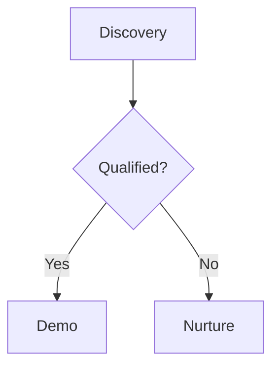

# Chat API Documentation

This document covers all Chat-related APIs including chat sessions, messages, attachments, and real-time streaming.

## Base URLs

```text
/users/chats           # Chat sessions and messages
/users/chats/upload    # Attachment uploads
```

---

## Response Envelope

All endpoints return a consistent envelope:

```json
{
  "status": "SUCCESS | ERROR",
  "message": "Human-readable message",
  "data": { ... } | null
}
```

- Timestamps use ISO 8601 with `Z` suffix (UTC), e.g. `2025-10-05T10:30:00Z`.

## Authentication

- Required — Bearer token
- Header: `Authorization: Bearer <access_token>`

## Rate Limiting (defaults)

- Write endpoints (POST/PATCH/DELETE): ~15/min, 100/hour per user
- Read endpoints (GET): ~60/min, 1000/hour per user
- On limit breach: `429 Too Many Requests` with `Retry-After` header

---

## Integration Overview

- For a unified flow with uploads and SSE, see: `docs/API Documentation/chat-apis-integration-diagram.md`

---

## Production Conventions

- Authentication: Bearer JWT in `Authorization: Bearer <token>`
- Content Type: `Content-Type: application/json`; `Accept: application/json`
- Idempotency: Create/send endpoints are not idempotent. Clients should guard against duplicate submissions (disable submit while in-flight; de-dupe using a client-generated UUID). Presign/finalize are also not idempotent — avoid automatic retries without user confirmation.
- Pagination: Cursor-based; treat `cursor` as opaque and pass back verbatim.
- Upload Model: Direct-to-storage via short-lived SAS URL; server never proxies file bytes.
- Stability/Versioning: No explicit version path today. Non-breaking changes are additive; breaking changes will be announced.
- Time & Timestamps: ISO 8601 UTC with `Z` suffix.

### Error Model

- Envelope always present with HTTP status aligned to error:
  - 400: invalid input (empty content/title, bad filters, invalid mimetype/size, invalid state)
  - 401: missing/invalid token
  - 403: forbidden (invalid user context)
  - 404: resource not found
  - 409/422: validation/conflict (rare)
  - 429: rate limited
  - 500: unhandled server error

```json
{
  "status": "ERROR",
  "message": "Human-readable reason",
  "data": null
}
```

### Security & Tenancy

- All operations are evaluated against the authenticated `user_id` and `organisation_id`.
- Queries exclude soft-deleted items; writes are scoped to the caller.
- Batch operations keep partial successes when possible; failures are reported per item.

### SSE Guidance

**Message Events Stream:**
- Transport: Server-Sent Events; events: `ready`, `frame`, `ping`, `complete`, `timeout`, `error`.
- Timeouts/Heartbeats: timeout ~15 minutes; heartbeats ~25s. Reconnect with backoff on `timeout` or transient `error`.
- Resume: Provide `Last-Event-ID` header to resume (legacy replay mode supported).

**Attachment Status Stream:**
- Events: `status` (array of attachments), `ping`, `complete`, `timeout`, `error`.
- Scope: If `attachment_ids` omitted, server streams all non-terminal attachments for the user.
- Timeouts/Heartbeats: default timeout ~30 minutes; heartbeats ~25s.

**Auth caveat:** Native `EventSource` cannot attach headers. Options:
- Use an SSE polyfill that supports headers
- Have a reverse proxy inject the header based on a secure cookie
- Implement an app bridge that exchanges a cookie/session for an auth header

### Retry & Backoff Recommendations

- Non-idempotent writes (create_chat, send_message, presign, finalize): do not auto-retry without user confirmation; prefer manual retry to avoid duplicates.
- Reads (list/search): retry with exponential backoff (200ms → 400ms → 800ms; jitter) up to a small cap.
- Download URL: safe to retry on network errors with exponential backoff.
- SSE: on `timeout`/network errors, reconnect with backoff (1s → 5s → 10s; cap 30s). Stop on `complete`.

---

## Security & Compliance (SOC 2 Alignment)

### Transport Security
- Enforce TLS 1.2+; recommend HSTS at the edge. All API access over HTTPS only.
- CORS: restrict in production to trusted origins. Never serve over plaintext HTTP.

### Storage Security
- Attachments stored in private containers with server-side encryption at rest (cloud-managed keys by default; CMK/KMS recommended for higher assurance).
- No public ACLs; access only via time-bound SAS URLs.
- SAS URLs are path-scoped and short-lived (upload ~15m; download 30–120m). Clients must not persist SAS URLs in logs or databases.

### Authentication & Authorization
- Bearer JWT on every call. Endpoints enforce user/org scoping for all reads/writes.
- Follow least privilege: presign grants write to a single blob; download grants read to a single blob.
- Prefer role-based authorization at the gateway (future extension) for admin vs user scopes.

### Input Validation & Content Controls
- Pydantic validation rejects empty content and invalid roles/types.
- MIME type allowlist and strict max size enforced server-side; reject on violation.
- Finalize enforces valid state transitions (e.g., cannot download before `completed`).
- Background antivirus/inspection pipeline (see `virus_scan_status`) marks/blocks infected files and publishes failure.
- Cursor-based pagination guards against numeric enumeration; cursors are opaque.
- SSE consumer groups provide exactly-once delivery semantics in consume-once mode for message jobs.

### Secrets & Key Management
- Service credentials are loaded from a secret manager; keys are never embedded in code or responses.
- Rotate credentials regularly; restrict access via least privilege.

### Logging & Auditability
- Log request outcomes and resource IDs (session_id, message_id, job_id, attachment_id) without storing content or tokens.
- Do not log raw SAS URLs, tokens, or user content. Redact potentially sensitive fields; apply log retention and access controls.
- Emit audit events for presign/finalize/download (who, what, when, org/user, outcome).

### Data Retention & Deletion
- Attachment model includes `retention_policy`, `is_deleted`, `deleted_at`. Enforce org policy for retention and secure deletion. Avoid indefinite retention of failed uploads.
- Message content is application data; treat as confidential. Support future purge/retention policies at the org level.

### Availability & Resilience
- Per-user rate limiting (read/write budgets) with `429` + `Retry-After`.
- SSE heartbeats and reconnect guidance provide graceful degradation on network interruptions.
- Dependencies: Redis (pub/sub) and Cloud Storage. Operate with health checks/alerts; document incident response paths outside this spec.

### Change Management & Versioning
- Document non-breaking additions; coordinate breaking changes. Maintain compatibility for event frames and payloads.

---

## Data Types

### Enums

- `ChatMessageRole`: `"user" | "assistant" | "system"`
- `ChatMessageType`: `"GENERAL_MESSAGE" | "TECHNICAL_DECK" | "RFP_SHEET"`
- `AttachmentStatus`: `"pending_upload" | "uploaded" | "processing" | "completed" | "failed"`

### Request Models (TypeScript)

```ts
type UUID = string;

// Chat Session
export interface ChatSessionCreate {
  title: string;
  tags?: string[]; // optional labels
}

export interface DeleteChat {
  session_id: UUID;
}

export interface RenameChat {
  session_id: UUID;
  title: string; // 1..100 chars
}

export interface FavoriteChat {
  session_id: UUID;
  favorite: boolean;
}

// Messages
export interface SendMessageRequest {
  session_id: UUID;
  content: string; // non-empty
  attachments?: UUID[]; // attachment_ids from Attachments API
  message_type?: ChatMessageType; // default: GENERAL_MESSAGE
  role: "user"; // must be "user"
  is_edited?: boolean; // default: false
  edited_message_id?: UUID; // required if is_edited === true
}

export interface MessageFeedbackRequest {
  message_id: UUID;
  feedback_score: number; // -1 (thumbs down), 0 (clear), or 1 (thumbs up)
}

// Attachments
export interface PresignRequest {
  filename: string; // 1..255 chars
  mimetype: string; // must be allowed by config
  size_bytes: number; // > 0 and <= MAX_UPLOAD_FILE_SIZE_BYTES
}

export interface FinalizeRequest {
  attachment_id: UUID;
  checksum?: string | null; // optional
}

export interface AttachmentBatchPresignRequest {
  files: PresignRequest[]; // length >= 1
}

export interface AttachmentBatchFinalizeRequest {
  files: FinalizeRequest[]; // length >= 1
}
```

### Response Models (TypeScript)

```ts
// Chat Session
export interface ChatSessionOut {
  session_id: UUID;
  title: string;
  chat_type: string; // e.g., "GENERAL_CHAT"
  is_favorite: boolean;
  tags: string[];
  created_at: string; // ISO8601
  updated_at: string; // ISO8601
}

export interface ChatSessionsPage {
  items: ChatSessionOut[];
  cursor?: string | null; // opaque
}

// Messages
export interface SendMessageResponse {
  job_id: UUID;
  user_message_id: UUID;
  assistant_message_id: UUID;
}

export interface ChatAttachmentView {
  attachment_id: UUID;
  filename: string;
  mimetype: string;
  thumbnail_small_url?: string | null;
}

export interface ChatMessageListItem {
  message_id: UUID;
  session_id: UUID;
  role: ChatMessageRole;
  message_type: ChatMessageType;
  content: string;
  is_edited: boolean;
  created_at: string; // ISO8601
  updated_at: string; // ISO8601
  attachments: ChatAttachmentView[];
  confidence_score?: string | null; // "low"|"medium"|"high"|"neutral" or null
  sources?: Array<Record<string, any>> | null;
  suggestions?: string[] | null;
  feedback_score?: number | null; // 1 (thumbs up), -1 (thumbs down), null (no feedback)
}

export interface ChatMessagesPage {
  items: ChatMessageListItem[];
  cursor?: string | null;
}

export interface MessageFeedbackResponse {
  message_id: UUID;
  feedback_score: number | null; // null if cleared
}

// Attachments
export interface PresignResponse {
  attachment_id: UUID;
  filename: string;
  mimetype: string;
  upload_url: string; // HttpUrl
  size_bytes: number;
  expires_in_seconds: number; // e.g., 900
  status: AttachmentStatus; // usually "pending_upload"
  success: true;
  error_message: null;
}

export interface UploadedAttachmentResponse {
  attachment_id: UUID;
  uploaded_at: string; // ISO8601
  status: AttachmentStatus; // processing|completed|failed
}

export interface AttachmentDownloadResponse {
  attachment_id: UUID;
  download_url: string; // HttpUrl
  expires_in_seconds: number; // default ~1800
}

export interface AttachmentPresignFileResponse {
  attachment_id?: UUID | null;
  filename: string;
  mimetype?: string | null;
  upload_url?: string | null;
  size_bytes?: number | null;
  success: boolean;
  error_message?: string | null;
  expires_in_seconds: number; // 0 if failed
  status?: AttachmentStatus | null; // "pending_upload" on success; "failed" on failure
}

export interface AttachmentBatchPresignResponse {
  files: AttachmentPresignFileResponse[];
  errors: Array<Record<string, any>>; // diagnostic items (index, filename, reason, error_message)
}

export interface AttachmentBatchFinalizeResult {
  attachment_id: UUID;
  status?: string | null;
  error?: string | null;
  updated_at?: string | null; // ISO8601
}

export interface AttachmentBatchFinalizeResponse {
  results: AttachmentBatchFinalizeResult[];
  errors: Array<Record<string, any>>;
}

// Standard envelope
export interface ApiEnvelope<T> {
  status: "SUCCESS" | "ERROR";
  message: string;
  data: T | null;
}

// Task list types for real-time task tracking
export type TaskStatus = "pending" | "in_progress" | "completed";

export interface TaskItem {
  id: string;
  task: string;
  status: TaskStatus;
}

export interface TaskUpdate {
  id: string;
  status?: TaskStatus;
  task?: string;
  is_new?: boolean;
}

export interface TaskListFrame {
  type: "task_list";
  job_id: string;
  assistant_message_id: string;
  tasks?: TaskItem[];
  updates?: TaskUpdate[];
}
```

### SSE Event Frames

**Message Events Stream:**
- Events: `ready`, `frame`, `ping`, `complete`, `timeout`, `error`
- `frame.data` examples:

```json
{ "type": "answer.delta", "content": "partial markdown ...", "format": "markdown", "sequence": 3 }
{ "type": "answer.replace", "content": "full answer ...", "format": "markdown" }
{ "type": "answer.metrics", "confidence": "high" }
{ "type": "suggestions.replace", "items": ["Follow-up A", "B"] }
{ "type": "sources.replace", "sources": [{"title":"Doc","url":"..."}] }
{ "type": "progress.update", "stage":"retrieval", "progress": 0.7 }
{ "type": "tool.usage", "tool_name":"search", "status":"ok" }
{ "type": "thinking.update", "thought": "...", "stage":"plan" }
{ "type": "task_list", "tasks": [{"id":"1","task":"Search knowledge base","status":"completed"}] }
{ "type": "task_list", "updates": [{"id":"1","status":"completed"}] }
{ "type": "finalize", "reason": "done" }
```

**Attachment Status Stream:**
- Events: `status`, `ping`, `complete`, `timeout`, `error`
- `status.data` payload:

```json
[
  {
    "attachment_id": "...",
    "status": "processing",
    "updated_at": "2025-10-06T08:12:15Z",
    "error_message": null,
    "thumbnail_small_url": null
  }
]
```

---

# Chat Session Endpoints

## 1) Create Chat

### Endpoint

```http
POST /users/chats/create_chat
```

### Description

Creates a new chat session owned by the current user in their organisation.

### Request Body

```json
{
  "title": "My First Chat",
  "tags": ["alpha", "demo"]
}
```

### Success Response (200)

```json
{
  "status": "SUCCESS",
  "message": "Chat created",
  "data": {
    "session_id": "f3c8c3f2-1f5a-4a6f-94e4-7a7f0e05e2a0",
    "title": "My First Chat",
    "chat_type": "GENERAL_CHAT",
    "is_favorite": false,
    "tags": ["alpha", "demo"],
    "created_at": "2025-10-06T08:12:00Z",
    "updated_at": "2025-10-06T08:12:00Z"
  }
}
```

### Error Responses

- 400 Bad Request — "Title cannot be null or empty", "Title cannot exceed 100 characters"
- 500 Internal Server Error — "Unable to create chat session"

### Example cURL

```bash
curl -X POST "$BASE_URL/users/chats/create_chat" \
  -H "Authorization: Bearer $TOKEN" \
  -H "Content-Type: application/json" \
  -d '{"title":"My First Chat","tags":["alpha","demo"]}'
```

---

## 2) Delete Chat (soft delete)

### Endpoint

```http
DELETE /users/chats/delete_chat
```

### Description

Soft-deletes a chat session owned by the current user.

### Request Body

```json
{ "session_id": "f3c8c3f2-1f5a-4a6f-94e4-7a7f0e05e2a0" }
```

### Success Response (200)

```json
{
  "status": "SUCCESS",
  "message": "Chat deleted",
  "data": {
    "session_id": "f3c8c3f2-1f5a-4a6f-94e4-7a7f0e05e2a0",
    "title": "My First Chat",
    "chat_type": "GENERAL_CHAT",
    "is_favorite": false,
    "tags": [],
    "created_at": "2025-10-06T08:12:00Z",
    "updated_at": "2025-10-06T08:15:00Z"
  }
}
```

### Error Responses

- 404 Not Found — "Chat session not found"
- 500 Internal Server Error — "Unable to delete chat session"

---

## 3) Rename Chat

### Endpoint

```http
PATCH /users/chats/rename_chat
```

### Request Body

```json
{ "session_id": "<UUID>", "title": "New Title" }
```

### Success Response (200)

```json
{
  "status": "SUCCESS",
  "message": "Chat renamed",
  "data": {
    "session_id": "<UUID>",
    "title": "New Title",
    "chat_type": "GENERAL_CHAT",
    "is_favorite": false,
    "tags": [],
    "created_at": "2025-10-06T08:12:00Z",
    "updated_at": "2025-10-06T08:16:00Z"
  }
}
```

### Error Responses

- 400 Bad Request — invalid title
- 404 Not Found — "Chat session not found"
- 500 Internal Server Error — "Unable to rename chat session"

---

## 4) List Chats (paginated)

### Endpoint

```http
GET /users/chats/list_chats?limit=20&cursor=<opaque>
```

### Description

Returns your chat sessions ordered by recency. Use `cursor` from the previous response to fetch the next page.

### Success Response (200)

```json
{
  "status": "SUCCESS",
  "message": "Chats listed",
  "data": {
    "items": [
      {
        "session_id": "<UUID>",
        "title": "My First Chat",
        "chat_type": "GENERAL_CHAT",
        "is_favorite": false,
        "tags": [],
        "created_at": "2025-10-06T08:12:00Z",
        "updated_at": "2025-10-06T08:12:00Z"
      }
    ],
    "cursor": "<opaque-cursor-or-null>"
  }
}
```

### Error Responses

- 500 Internal Server Error — "Unable to list chat sessions"

---

## 5) Search Chats (typeahead)

### Endpoint

```http
GET /users/chats/search_chats?q=<text>&limit=10
```

### Description

Searches chat sessions by title. Best-effort, not paginated; intended for typeahead.

### Success Response (200)

Same shape as List Chats, with `cursor: null`.

### Error Responses

- 500 Internal Server Error — "Unable to search chat sessions"

---

## 6) Toggle Favorite

### Endpoint

```http
PATCH /users/chats/favorite_chat
```

### Request Body

```json
{ "session_id": "<UUID>", "favorite": true }
```

### Success Response (200)

```json
{
  "status": "SUCCESS",
  "message": "Chat favorited",
  "data": {
    "session_id": "<UUID>",
    "title": "...",
    "chat_type": "GENERAL_CHAT",
    "is_favorite": true,
    "tags": [],
    "created_at": "2025-10-06T08:12:00Z",
    "updated_at": "2025-10-06T08:18:00Z"
  }
}
```

### Error Responses

- 404 Not Found — "Chat session not found"
- 400 Bad Request — validation issues
- 500 Internal Server Error — "Unable to update favorite state"

---

# Message Endpoints

## 7) Send Message

### Endpoint

```http
POST /users/chats/send_message
```

### Description

Persists a user message (with optional attachments) and enqueues a background job to generate the assistant reply.

### Request Body

```json
{
  "session_id": "<UUID>",
  "content": "How do I...",
  "attachments": ["<ATTACHMENT_UUID>"],
  "message_type": "GENERAL_MESSAGE",
  "role": "user",
  "is_edited": false,
  "edited_message_id": null
}
```

Notes:
- `role` must be `user`.
- `attachments` are IDs from the Attachment endpoints once uploaded/finalized.

### Success Response (200)

```json
{
  "status": "SUCCESS",
  "message": "Message accepted",
  "data": {
    "job_id": "0f49b5d8-...",
    "user_message_id": "f1b9e0a8-...",
    "assistant_message_id": "a2c7d1e9-..."
  }
}
```

Notes:
- `job_id`: Use this to connect to the SSE stream at `/message_events`
- `user_message_id`: The persisted ID of the user's message
- `assistant_message_id`: Pre-generated ID for the assistant's response (message will be created by worker)

### Error Responses

- 400 Bad Request — invalid content, role not `user`, or session not found
- 500 Internal Server Error — scheduling/processing issue

### Example cURL

```bash
curl -X POST "$BASE_URL/users/chats/send_message" \
  -H "Authorization: Bearer $TOKEN" \
  -H "Content-Type: application/json" \
  -d '{
        "session_id":"<UUID>",
        "content":"Show me recent updates",
        "attachments":[],
        "message_type":"GENERAL_MESSAGE",
        "role":"user"
      }'
```

---

## 8) Message Events (SSE)

### Endpoint

```http
GET /users/chats/message_events?job_id=<UUID>
```

### Description

Streams Server-Sent Events for a specific message job. Includes reconnection support via `Last-Event-ID`.

### Event Types

- `ready` — stream initialized
- `frame` — data payload (see `type` field below)
- `ping` — heartbeat
- `complete` — job finished (client may close the stream)
- `timeout` — stream timed out; reconnect allowed
- `error` — internal stream error; reconnect allowed

### Frame `data` (representative examples)

```json
{ "type": "answer.delta", "content": "partial markdown ...", "format": "markdown", "sequence": 3 }
{ "type": "answer.replace", "content": "full answer ...", "format": "markdown" }
{ "type": "answer.metrics", "confidence": "high" }
{ "type": "suggestions.replace", "items": ["Follow-up A", "B"] }
{ "type": "sources.replace", "sources": [{"title":"Doc","url":"..."}] }
{ "type": "progress.update", "stage":"retrieval", "progress": 0.7 }
{ "type": "tool.usage", "tool_name":"search", "status":"ok" }
{ "type": "thinking.update", "thought": "...", "stage":"plan" }
{ "type": "task_list", "tasks": [{"id":"1","task":"Search knowledge base","status":"completed"}] }
{ "type": "task_list", "updates": [{"id":"1","status":"completed"}] }
{ "type": "finalize", "reason": "done" }
```

### SSE Semantics (Worker, Delta, Ordering)

**Producer and delivery:**
- Frames originate from the chat worker processing the job. The worker publishes structured frames to a per-job Redis Stream; the API's SSE endpoint relays those frames to the client.
- Delivery uses Redis consumer groups for consume-once semantics by default, minimizing duplicates. Legacy replay mode is used when consumer groups are unavailable.

**Base frame schema (always included):**
- `job_id`: the job identifier (string) for SSE stream correlation
- `assistant_message_id`: the pre-generated ID for the assistant message being created
- `version`: frame schema version (e.g., "1.0")
- `timestamp`: float seconds since epoch
- `sequence`: 0-based, monotonically increasing per job
- `type`: one of the known frame types listed above

**Ordering and resume:**
- Ordering: frames are emitted in order; use `sequence` (preferred) or the SSE `id` to ensure monotonic processing.
- Resume: pass `Last-Event-ID` on reconnect. In consume-once mode, the server tracks position; in legacy mode, the server replays from the provided ID.
- Heartbeats/Timeouts: you will receive `ping` heartbeats ~25s. After ~15 minutes idle, a `timeout` with `{ "reconnect": true }` is sent — reconnect with backoff.

**Content streaming contract (delta vs replace):**
- `answer.delta`: append-only partial content. Render incrementally by concatenating `content` chunks in order.
- `answer.replace`: full current answer. If received, treat this as the canonical text and replace the accumulated buffer.
- Finalization: a `finalize` frame is followed by an `event: complete`. After `complete`, close the stream and optionally refresh with `GET /messages/list` to show the persisted assistant message.

**Diagnostics / "autopsy" frames:**
- `answer.metrics`: confidence signal for the answer (e.g., `low|medium|high|neutral`). May also include `citations` in some cases.
- `sources.replace`: full replacement list of sources/citations to display alongside the answer.
- `suggestions.replace`: full replacement list of suggested follow-ups.
- `progress.update`: background status such as `{ stage, message?, progress [0..1], eta_seconds? }` to drive progress UI.
- `tool.usage`: instrumentation about tools used `{ tool_name, status, duration_ms?, result_summary? }`.
- `thinking.update`: optional thinking/planning breadcrumbs `{ thought, stage }` for debug or dev UIs.
- `task_list`: real-time task tracking for multi-step agent work. Has `tasks` (full list) or `updates` (delta changes). Display in fixed UI position.
- `agent.switch` and `question.prompt`: advanced flows for agent handoff or asking the user for more info.

**Frontend handling:**
- Stream only from `answer.delta` (append) and apply `answer.replace` when present to ensure the UI shows the canonical answer.
- Merge diagnostics frames live: update confidence, sources, suggestions, progress bars, tool/thinking panes, and task lists as frames arrive.
- For `task_list` frames: maintain task state in a fixed UI position (sidebar, banner, or floating card).
- Stop on `event: complete` (or on `finalize` shortly followed by `complete`). On `timeout` or `error` where `reconnect` is true, reconnect with backoff and include `Last-Event-ID`.
- After completion, call `GET /users/chats/messages/list` for the session to render the stored assistant message and any enriched metadata.

### Minimal Browser Example

```js
// After sending message, you receive: { job_id, user_message_id, assistant_message_id }
// Create assistant message placeholder in UI with assistant_message_id

const src = new EventSource(`/users/chats/message_events?job_id=${jobId}`, {
  withCredentials: true
});

src.addEventListener('ready', () => console.log('ready'));
src.addEventListener('ping', () => {/* keep-alive */});
src.addEventListener('frame', (e) => {
  const frame = JSON.parse(e.data);
  switch(frame.type){
    case 'answer.delta':
      updateMessage(frame.assistant_message_id, { content: append(frame.content) });
      break;
    case 'answer.replace':
      updateMessage(frame.assistant_message_id, { content: frame.content });
      break;
    case 'suggestions.replace':
      updateMessage(frame.assistant_message_id, { suggestions: frame.items });
      break;
    case 'sources.replace':
      updateMessage(frame.assistant_message_id, { sources: frame.sources });
      break;
    case 'task_list':
      if (frame.tasks) updateTaskList(frame.tasks);
      else if (frame.updates) applyTaskUpdates(frame.updates);
      break;
    case 'finalize':
      updateMessage(frame.assistant_message_id, { status: 'completed' });
      break;
  }
});
src.addEventListener('complete', () => src.close());
```

---

## 9) Provide Message Feedback

### Endpoint

```http
POST /users/chats/messages/feedback
```

### Description

Allows users to provide feedback (thumbs up/down) on chat messages.

### Request Body

```json
{
  "message_id": "<UUID>",
  "feedback_score": 1
}
```

Notes:
- `feedback_score` must be one of: `1` (thumbs up), `-1` (thumbs down), or `0` (clear/remove feedback)
- Users can only provide feedback on messages from their own chat sessions
- Feedback can be updated multiple times for the same message

### Success Response (200)

```json
{
  "status": "SUCCESS",
  "message": "Feedback updated successfully",
  "data": {
    "message_id": "f1b9e0a8-...",
    "feedback_score": 1
  }
}
```

### Error Responses

- 400 Bad Request — Invalid feedback score (must be -1, 0, or 1), message not found, or permission denied
- 500 Internal Server Error — "Unable to update feedback"

### Example cURL

```bash
# Thumbs up
curl -X POST "$BASE_URL/users/chats/messages/feedback" \
  -H "Authorization: Bearer $TOKEN" \
  -H "Content-Type: application/json" \
  -d '{"message_id":"f1b9e0a8-...","feedback_score":1}'

# Thumbs down
curl -X POST "$BASE_URL/users/chats/messages/feedback" \
  -H "Authorization: Bearer $TOKEN" \
  -H "Content-Type: application/json" \
  -d '{"message_id":"f1b9e0a8-...","feedback_score":-1}'

# Clear feedback
curl -X POST "$BASE_URL/users/chats/messages/feedback" \
  -H "Authorization: Bearer $TOKEN" \
  -H "Content-Type: application/json" \
  -d '{"message_id":"f1b9e0a8-...","feedback_score":0}'
```

---

## 10) List Messages (cursor-based)

### Endpoint

```http
GET /users/chats/messages/list?session_id=<UUID>&limit=20&cursor=<opaque>&role=<role>&message_type=<type>
```

### Description

Returns chat messages for a session with lightweight enrichment (attachments, sources, suggestions, confidence, and feedback).

Notes:
- Each message includes a `feedback_score` field showing user feedback: `1` (thumbs up), `-1` (thumbs down), or `null` (no feedback)
- Feedback scores are set via the `POST /messages/feedback` endpoint

### Success Response (200)

```json
{
  "status": "SUCCESS",
  "message": "Messages listed",
  "data": {
    "items": [
      {
        "message_id": "<UUID>",
        "session_id": "<UUID>",
        "role": "assistant",
        "message_type": "GENERAL_MESSAGE",
        "content": "Rendered text",
        "is_edited": false,
        "created_at": "2025-10-06T08:12:00Z",
        "updated_at": "2025-10-06T08:12:00Z",
        "attachments": [
          {
            "attachment_id": "<UUID>",
            "filename": "file.pdf",
            "mimetype": "application/pdf",
            "thumbnail_small_url": "https://...sas..."
          }
        ],
        "confidence_score": "high",
        "sources": [{"title":"Doc","url":"..."}],
        "suggestions": ["Next question A"],
        "feedback_score": 1
      }
    ],
    "cursor": null
  }
}
```

### Error Responses

- 400 Bad Request — invalid session or filters
- 500 Internal Server Error — "Unable to list messages"

---

# Attachment Endpoints

## Attachment Lifecycle & States

- `pending_upload` → `uploaded` → `processing` → `completed | failed`
- `finalize` transitions from `pending_upload` to `processing` and enqueues background work.
- `download` allowed only when `status = completed`.

---

## 11) Presign Single Upload

### Endpoint

```http
POST /users/chats/upload/presign
```

### Description

Creates an attachment record and returns a short-lived SAS URL for direct browser upload to storage.

### Request Body

```json
{
  "filename": "report.pdf",
  "mimetype": "application/pdf",
  "size_bytes": 123456
}
```

Validation:
- Allowed types are configured via environment `ALLOWED_MIMETYPES`.
- Max size is configured via `MAX_UPLOAD_FILE_SIZE_BYTES` (default: 52428800 ~ 50MB).

### Success Response (200)

```json
{
  "status": "SUCCESS",
  "message": "Presigned upload URL created",
  "data": {
    "attachment_id": "2b5a4d8e-...",
    "filename": "report.pdf",
    "mimetype": "application/pdf",
    "upload_url": "https://.../container/attachments/...sas...",
    "size_bytes": 123456,
    "expires_in_seconds": 900,
    "status": "pending_upload",
    "success": true,
    "error_message": null
  }
}
```

### Error Responses

- 400 Bad Request — invalid/unsupported mimetype or size exceeds limit
- 500 Internal Server Error — failure to create record or generate URL

### Example cURL

```bash
curl -X POST "$BASE_URL/users/chats/upload/presign" \
  -H "Authorization: Bearer $TOKEN" \
  -H "Content-Type: application/json" \
  -d '{"filename":"report.pdf","mimetype":"application/pdf","size_bytes":123456}'
```

---

## 12) Upload Bytes to SAS URL (browser)

Use the `upload_url` from presign to PUT the bytes directly to storage.

```js
async function uploadToSAS(file, uploadUrl){
  const res = await fetch(uploadUrl, {
    method: 'PUT',
    headers: { 'Content-Type': file.type },
    body: file
  });
  if(!res.ok) throw new Error('Upload failed');
}
```

---

## 13) Finalize Single Upload

### Endpoint

```http
POST /users/chats/upload/finalize
```

### Description

Signals the server that the upload completed; verifies blob and enqueues background processing (checksum, thumbnails when applicable).

### Request Body

```json
{ "attachment_id": "2b5a4d8e-...", "checksum": null }
```

### Success Response (200)

```json
{
  "status": "SUCCESS",
  "message": "Attachment finalized",
  "data": {
    "attachment_id": "2b5a4d8e-...",
    "uploaded_at": "2025-10-06T08:12:00Z",
    "status": "processing"
  }
}
```

### Error Responses

- 404 Not Found — attachment not found or not owned by user
- 400 Bad Request — invalid state (e.g., not in `pending_upload`)
- 500 Internal Server Error — finalize failure

---

## 14) Get Attachment Status

### Endpoint

```http
GET /users/chats/upload/attachment/{attachment_id}
```

### Description

Polls the current status of an attachment.

### Success Response (200)

```json
{
  "status": "SUCCESS",
  "message": "Attachment status retrieved",
  "data": {
    "attachment_id": "2b5a4d8e-...",
    "uploaded_at": "2025-10-06T08:12:00Z",
    "status": "processing"
  }
}
```

### Error Responses

- 404 Not Found — not found or not accessible
- 500 Internal Server Error — retrieval error

---

## 15) Generate Download URL (SAS)

### Endpoint

```http
GET /users/chats/upload/attachment/{attachment_id}/download?expires_minutes=30
```

### Description

Returns a short-lived read SAS URL for the original attachment. Only available when `status` is `completed`.

### Success Response (200)

```json
{
  "status": "SUCCESS",
  "message": "Download URL generated",
  "data": {
    "attachment_id": "2b5a4d8e-...",
    "download_url": "https://...sas...",
    "expires_in_seconds": 1800
  }
}
```

### Error Responses

- 400 Bad Request — "Attachment is not ready" (not `completed`)
- 404 Not Found — not found or not accessible
- 500 Internal Server Error — URL generation failure

---

## 16) Stream Attachment Status (SSE)

### Endpoint

```http
GET /users/chats/upload/attachments/stream?attachment_ids=<UUID>&attachment_ids=<UUID>
```

### Description

Streams real-time status updates for specific attachments (if `attachment_ids` provided) or all non-terminal attachments owned by the user.

### Event Types

- `status` — array of attachments with fields: `attachment_id`, `status`, `updated_at`, `error_message`, `thumbnail_small_url` (when available)
- `ping` — heartbeat
- `complete` — all watched attachments reached `completed` or `failed`
- `timeout` — stream timeout; reconnect allowed
- `error` — internal stream error; reconnect allowed

### Minimal Browser Example

```js
const params = new URLSearchParams();
attachmentIds.forEach(id => params.append('attachment_ids', id));
const es = new EventSource(`/users/chats/upload/attachments/stream?${params.toString()}`);
es.addEventListener('status', (e) => {
  const list = JSON.parse(e.data); // array
  // update per-attachment UI
});
es.addEventListener('complete', () => es.close());
```

---

## 17) Presign Batch

### Endpoint

```http
POST /users/chats/upload/presign/batch
```

### Request Body

```json
{
  "files": [
    { "filename": "a.pdf", "mimetype": "application/pdf", "size_bytes": 1000 },
    { "filename": "b.jsonl", "mimetype": "application/jsonl", "size_bytes": 2000 }
  ]
}
```

### Success Response (200)

```json
{
  "status": "SUCCESS",
  "message": "Batch presign completed",
  "data": {
    "files": [
      {
        "attachment_id": "...",
        "filename": "a.pdf",
        "mimetype": "application/pdf",
        "upload_url": "https://...sas...",
        "size_bytes": 1000,
        "success": true,
        "error_message": null,
        "expires_in_seconds": 900,
        "status": "pending_upload"
      },
      {
        "attachment_id": null,
        "filename": "b.jsonl",
        "mimetype": null,
        "upload_url": null,
        "size_bytes": null,
        "success": false,
        "error_message": "MIME type 'application/jsonl' is not allowed.",
        "expires_in_seconds": 0,
        "status": "failed"
      }
    ],
    "errors": []
  }
}
```

---

## 18) Finalize Batch

### Endpoint

```http
POST /users/chats/upload/finalize/batch
```

### Request Body

```json
{ "files": [ { "attachment_id": "...", "checksum": null } ] }
```

### Success Response (200)

```json
{
  "status": "SUCCESS",
  "message": "Batch finalize completed",
  "data": {
    "results": [
      {
        "attachment_id": "...",
        "status": "processing",
        "error": null,
        "updated_at": "2025-10-06T08:12:10Z"
      }
    ],
    "errors": []
  }
}
```

### Error Responses

- 500 Internal Server Error — "All finalize operations failed" (if none succeeded)

---

# Configuration & Limits

## Allowed MIME Types (default)

`application/pdf`, `text/plain`, `text/csv`, `text/tab-separated-values`, `text/tsv`, `text/markdown`, `text/x-markdown`, `application/x-ndjson`, `application/ndjson`, `application/jsonl`, `application/json`.

## Max File Size (default)

`52428800` bytes (~50MB).

## Environment Variables

- `ALLOWED_MIMETYPES`
- `MAX_UPLOAD_FILE_SIZE_BYTES`

---

# Thumbnail Generation

Thumbnails are automatically generated during post-upload processing for supported MIME types. The `thumbnail_small_url` field in SSE status events and message responses provides a time-limited SAS URL for the thumbnail.

## Supported MIME Types for Thumbnails

| Category | MIME Types | Thumbnail Type |
|----------|-----------|----------------|
| **Images** | `image/jpeg`, `image/png`, `image/webp`, `image/gif` | Resized preview image |
| **PDF** | `application/pdf` | First page rendered as image |
| **Text/Data** | `text/plain`, `text/csv`, `text/tab-separated-values`, `text/tsv`, `text/markdown`, `text/x-markdown`, `application/x-ndjson`, `application/ndjson`, `application/jsonl`, `application/json` | Label placeholder (e.g., "TXT", "CSV", "JSON") |
| **Office Documents** | `application/msword`, `application/vnd.openxmlformats-officedocument.wordprocessingml.document` (DOCX), `application/vnd.ms-powerpoint`, `application/vnd.openxmlformats-officedocument.presentationml.presentation` (PPTX), `application/vnd.ms-excel`, `application/vnd.openxmlformats-officedocument.spreadsheetml.sheet` (XLSX) | Label placeholder (e.g., "DOC", "XLSX") |
| **Markup** | `text/html`, `application/xml`, `text/xml`, `application/x-yaml`, `text/yaml`, `text/x-yaml` | Label placeholder |

## Thumbnail URL Properties

- **Expiration**: Thumbnail SAS URLs expire after **120 minutes** (2 hours).
- **Availability**: `thumbnail_small_url` is `null` until processing completes successfully.
- **Sizes**: Two thumbnail sizes are generated internally (`thumbnail_small_path`, `thumbnail_medium_path`), but only the small thumbnail URL is currently exposed via SSE events.

## Thumbnail Environment Variables

- `THUMBNAIL_IMAGE_MIMETYPES`: Override default image MIME types (comma-separated)
- `THUMBNAIL_ENABLE_IMAGE_PREFIX_FALLBACK`: Set to `true` to allow all `image/*` types
- `ENABLE_TEXT_PLACEHOLDERS`: Enable/disable text placeholder generation (default: `true`)
- `ENABLE_PDF_PLACEHOLDER_FALLBACK`: Use placeholder for PDF if rendering fails (default: `false`)

---

# Frontend Integration Guides

## Tool Usage Frontend Integration Guide

This section explains how to handle `tool.usage` frames in the frontend and the recommended UX patterns.

### The Two Information Streams

When the agent executes tools, the frontend receives information through **two different channels**:

1. **`tool.usage` frames** — Structured events specifically for tool execution lifecycle
2. **`answer.delta` frames** — The LLM's natural language response (may include tool execution summaries)

### Understanding `tool.usage` Frames

The backend sends `tool.usage` frames at each stage of tool execution:

```typescript
interface ToolUsageFrame {
  type: "tool.usage";
  job_id: string;
  assistant_message_id: string;
  version: string;
  timestamp: number;
  sequence: number;
  tool_name: string;                    // e.g., "search_internal_knowledge", "search_internet"
  tool_description?: string;            // Human-readable description
  status: "starting" | "in_progress" | "completed" | "failed";
  parameters?: Record<string, any>;     // Sanitized parameters
  result_summary?: string;              // Truncated result on completion
  duration_ms?: number;                 // Execution time on completion
}
```

### Tool Execution Lifecycle Example

For a single tool call, you will receive **3-4 frames** in sequence:

```json
// 1. Starting
{ "type": "tool.usage", "tool_name": "search_internal_knowledge", "status": "starting", "parameters": { "query": "pricing information" } }

// 2. In Progress
{ "type": "tool.usage", "tool_name": "search_internal_knowledge", "status": "in_progress" }

// 3. Completed
{ "type": "tool.usage", "tool_name": "search_internal_knowledge", "status": "completed", "duration_ms": 9718, "result_summary": "Found 3 relevant documents..." }

// OR 3. Failed
{ "type": "tool.usage", "tool_name": "search_internal_knowledge", "status": "failed", "result_summary": "Error: Connection timeout" }
```

### Recommended Frontend UX Patterns

#### Pattern 1: Expandable Research Panel (Recommended)

Show a collapsible "Research" section above or beside the answer:

```
┌─────────────────────────────────────────────┐
│ 🔍 Research                          [▼]    │
├─────────────────────────────────────────────┤
│ ✓ Searched internal knowledge (9.7s)        │
│ ✓ Searched internet (0.5s)                  │
└─────────────────────────────────────────────┘
│                                             │
│ CopilotGTM is your AI-powered partner...    │
│                                             │
```

**State Management:**

```typescript
interface ToolState {
  tool_name: string;
  status: "pending" | "running" | "completed" | "failed";
  duration_ms?: number;
  started_at?: number;
}

const [tools, setTools] = useState<Map<string, ToolState>>(new Map());

function handleToolUsage(frame: ToolUsageFrame) {
  setTools(prev => {
    const updated = new Map(prev);
    updated.set(frame.tool_name, {
      tool_name: frame.tool_name,
      status: frame.status === "starting" ? "running"
             : frame.status === "in_progress" ? "running"
             : frame.status,
      duration_ms: frame.duration_ms,
      started_at: frame.status === "starting" ? Date.now() : prev.get(frame.tool_name)?.started_at
    });
    return updated;
  });
}
```

---

## Task List Frontend Integration Guide

This section explains how to handle `task_list` frames for displaying real-time task progress during agent execution.

### Frame Format

**1. Full Task List** — Initial task list or complete reset:

```json
{
  "type": "task_list",
  "job_id": "abc-123",
  "assistant_message_id": "msg-456",
  "tasks": [
    { "id": "1", "task": "Search knowledge base", "status": "in_progress" },
    { "id": "2", "task": "Analyze results", "status": "pending" },
    { "id": "3", "task": "Generate summary", "status": "pending" }
  ]
}
```

**2. Delta Updates** — Efficient status updates:

```json
{
  "type": "task_list",
  "job_id": "abc-123",
  "assistant_message_id": "msg-456",
  "updates": [
    { "id": "1", "status": "completed" },
    { "id": "2", "status": "in_progress" }
  ]
}
```

**3. Adding New Tasks:**

```json
{
  "type": "task_list",
  "updates": [
    { "id": "4", "task": "Verify data accuracy", "status": "pending", "is_new": true }
  ]
}
```

### Task Status Values

| Status | Description | Icon Suggestion |
|--------|-------------|-----------------|
| `pending` | Task not yet started | ○ (empty circle) |
| `in_progress` | Currently working | ◐ (spinner) or ● (filled) |
| `completed` | Task finished | ✓ (checkmark) |

### Recommended UI Layout

#### Pattern 1: Right Sidebar (Recommended for Desktop)

```
┌──────────────────────────────────┬─────────────────────┐
│                                  │ ⚡ Agent Tasks       │
│  Chat Content                    │                     │
│                                  │ ✓ Search KB         │
│  User: What's our pricing?       │ ◐ Analyze results   │
│                                  │ ○ Generate summary  │
│  Assistant: [streaming...]       │                     │
│                                  │                     │
└──────────────────────────────────┴─────────────────────┘
```

#### Pattern 2: Top Banner (Works on Mobile)

```
┌─────────────────────────────────────────────────────────┐
│ ⚡ Tasks: ✓ Search KB  ◐ Analyze results  ○ Summary     │
├─────────────────────────────────────────────────────────┤
│  Chat Content                                           │
└─────────────────────────────────────────────────────────┘
```

### State Management

```typescript
interface TaskListState {
  tasks: Map<string, TaskItem>;
  isVisible: boolean;
}

function handleTaskListFrame(frame: TaskListFrame, setState: SetState<TaskListState>) {
  setState(prev => {
    const tasks = new Map(prev.tasks);

    // Handle full task list
    if (frame.tasks) {
      tasks.clear();
      for (const task of frame.tasks) {
        tasks.set(task.id, task);
      }
    }

    // Handle delta updates
    if (frame.updates) {
      for (const update of frame.updates) {
        if (update.is_new && update.task) {
          tasks.set(update.id, {
            id: update.id,
            task: update.task,
            status: update.status || "pending"
          });
        } else if (tasks.has(update.id)) {
          const existing = tasks.get(update.id)!;
          tasks.set(update.id, {
            ...existing,
            status: update.status || existing.status
          });
        }
      }
    }

    return {
      tasks,
      isVisible: tasks.size > 0
    };
  });
}
```

---

## Markdown Content Rendering

### Tables and Mermaid Diagrams

The assistant's response may include **tables** and **Mermaid diagrams** directly in the markdown content.

**Tables** — Render using standard markdown table syntax:

```markdown
| Feature | Us | Competitor |
|---------|-----|------------|
| AI Analysis | Advanced | Basic |
| Price | $10/mo | $15/mo |
```

**Mermaid Diagrams** — Render using fenced code blocks with `mermaid` language hint:

```markdown

```

### Frontend Markdown Library Recommendations

Use a markdown library that supports:
1. **GFM tables** — GitHub Flavored Markdown table syntax
2. **Mermaid rendering** — Either built-in or via plugin

Popular options:
- **react-markdown** + **remark-gfm** + **mermaid** plugin
- **marked** + mermaid integration
- **markdown-it** + **markdown-it-mermaid**

---

# Suggested Frontend Flow

1. `POST /users/chats/create_chat` to create a new chat session
2. [Optional] Upload attachments:
   - `POST /users/chats/upload/presign` (or `/presign/batch`) for selected file(s)
   - `PUT` file bytes to each `upload_url` (direct to storage)
   - `POST /users/chats/upload/finalize` (or `/finalize/batch`)
   - Open SSE `/users/chats/upload/attachments/stream?attachment_ids=...` to observe progress until `complete`
3. `POST /users/chats/send_message` with content and attachment IDs
4. Open SSE `/users/chats/message_events?job_id=...` and render frames in real time
5. Refresh UI via `GET /users/chats/messages/list` when complete to show persisted assistant message
6. [Optional] User provides feedback via `POST /users/chats/messages/feedback` with thumbs up/down
7. Once attachment `completed`, include the `attachment_id` in chat message payloads and/or fetch a download URL when user clicks download
8. Message lists return `thumbnail_small_url` for rendering previews

---

# Implementation Notes (Frontend)

- Always include the Bearer token header.
- Use pagination cursors as opaque strings; pass them back verbatim.
- Store feedback scores in your UI state and show the selected icon (thumbs up/down) based on the `feedback_score` field returned in message lists.
- For SSE, use polyfills if native `EventSource` cannot attach headers.
- Handle both `answer.delta` (append) and `answer.replace` (overwrite) for content streaming.
- Display tool usage in a collapsible research panel for transparency.
- Show task lists in a fixed UI position (sidebar, banner, or floating card).
