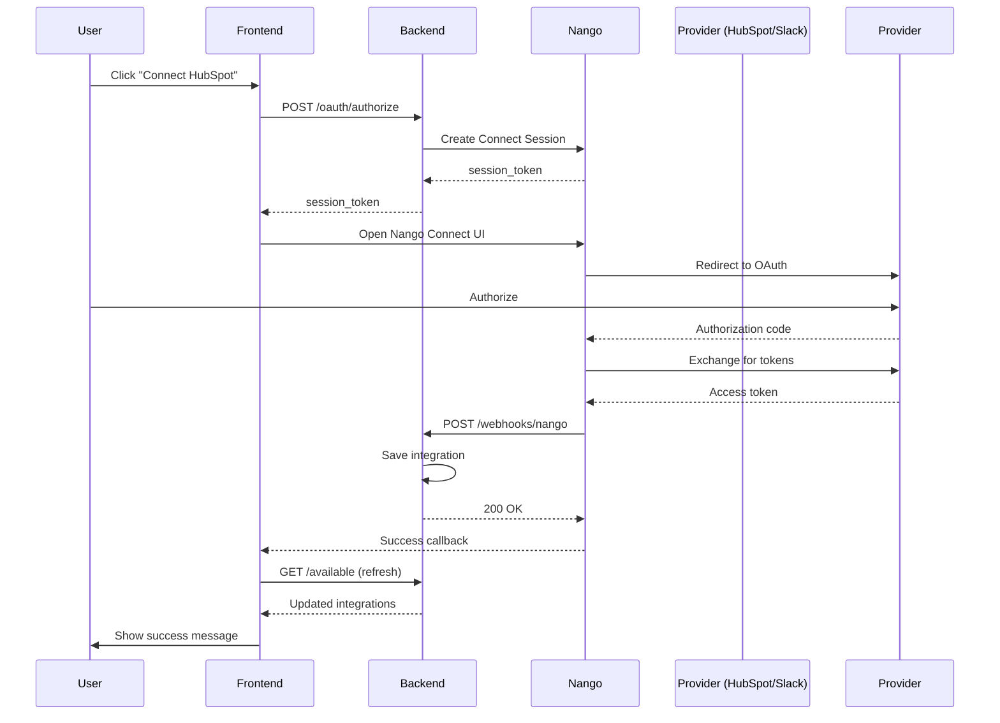

# Integrations API Documentation

## Base URL
```
/users/integrations
```

---

## 1. List Available Integrations

### Endpoint
```http
GET /users/integrations/available
```

### Description
Returns all available integration types with their connection status. Shows which integrations the user has already connected.

### Authentication
Required - Bearer token

### Request
No request body or query parameters required.

### Response (200 OK)
```json
{
  "status": "success",
  "message": "Available integrations retrieved successfully",
  "data": {
    "integrations": [
      {
        "integration_type": "hubspot",
        "name": "HubSpot",
        "description": "Sync contacts, deals, and sales activities from HubSpot CRM",
        "logo_url": "https://www.hubspot.com/hubfs/HubSpot_Logos/HubSpot-Inversed-Favicon.png",
        "category": "crm",
        "category_name": "CRM & Sales",
        "availability_status": "available",
        "is_connected": true,
        "connected_integrations": [
          {
            "integration_id": "123e4567-e89b-12d3-a456-426614174000",
            "organisation_id": "org-uuid",
            "integration_type": "hubspot",
            "name": "My HubSpot Account",
            "sync_frequency": "daily",
            "auto_sync_enabled": true,
            "is_active": true,
            "last_synced_at": "2025-10-05T10:30:00Z",
            "last_sync_status": "success",
            "last_sync_error": null,
            "access_token_expires_at": "2025-11-05T10:30:00Z",
            "connection_metadata": {},
            "created_at": "2025-10-01T08:00:00Z",
            "updated_at": "2025-10-05T10:30:00Z"
          }
        ]
      },
      {
        "integration_type": "slack",
        "name": "Slack",
        "description": "Sync messages, files, and channel data from Slack workspaces",
        "logo_url": "https://a.slack-edge.com/80588/marketing/img/icons/icon_slack_hash_colored.png",
        "category": "collaboration",
        "category_name": "Collaboration & Communication",
        "availability_status": "available",
        "is_connected": false,
        "connected_integrations": []
      },
      {
        "integration_type": "google_drive",
        "name": "Google Drive",
        "description": "Sync documents, spreadsheets, and files from Google Drive",
        "logo_url": "https://ssl.gstatic.com/images/branding/product/2x/drive_2020q4_48dp.png",
        "category": "storage",
        "category_name": "Cloud Storage",
        "availability_status": "coming_soon",
        "is_connected": false,
        "connected_integrations": []
      }
    ],
    "total_available": 7,
    "total_connected": 1
  }
}
```

### Response Fields

| Field | Type | Description |
|-------|------|-------------|
| `integration_type` | string | Unique identifier for the integration type |
| `name` | string | Display name of the integration |
| `description` | string | Brief description of what the integration does |
| `logo_url` | string | URL to integration provider's logo |
| `category` | string | Category slug (crm, collaboration, storage) |
| `category_name` | string | Human-readable category name |
| `availability_status` | string | `available`, `coming_soon`, `beta`, `deprecated` |
| `is_connected` | boolean | Whether user has connected this integration |
| `connected_integrations` | array | List of user's connected instances |
| `total_available` | integer | Total number of integration types |
| `total_connected` | integer | Total connected integrations |

### Availability Status Values

| Status | Description | Action |
|--------|-------------|--------|
| `available` | Integration is ready to use | Show "Connect" button |
| `coming_soon` | Integration not yet available | Show "Coming Soon" badge, disable button |
| `beta` | Integration in beta testing | Show "Beta" badge, allow connection |
| `deprecated` | Integration being phased out | Show warning message |

### Error Response (500)
```json
{
  "status": "error",
  "message": "Failed to retrieve available integrations",
  "data": null
}
```

### Implementation Notes

**Frontend Display:**
1. **Group by category** - Use `category_name` to group integrations
2. **Connection status** - Use `is_connected` to show badges or different UI states
3. **Connected instances** - Display list of connected accounts if `is_connected` is true
4. **Availability** - Disable connect button if `availability_status` is `coming_soon`

**Example UI Logic:**
```typescript
// Check if integration can be connected
const canConnect = integration.availability_status === 'available' || 
                   integration.availability_status === 'beta';

// Show connection badge
const showConnectedBadge = integration.is_connected;

// Show "Add Another" button
const showAddAnother = integration.is_connected && canConnect;

// Display coming soon badge
const showComingSoon = integration.availability_status === 'coming_soon';
```

**Performance:**
- Single API call gets all data (available types + connections)
- No need for separate requests
- Cache response for 5 minutes

**Error Handling:**
```typescript
try {
  const response = await fetch('/users/integrations/available', {
    headers: {
      'Authorization': `Bearer ${token}`
    }
  });
  
  if (!response.ok) {
    throw new Error('Failed to fetch integrations');
  }
  
  const data = await response.json();
  // Handle data.data.integrations
} catch (error) {
  // Show error message to user
  console.error('Integration fetch error:', error);
}
```

### Example cURL
```bash
curl -X GET "https://api.example.com/users/integrations/available" \
  -H "Authorization: Bearer YOUR_TOKEN_HERE" \
  -H "Content-Type: application/json"
```

---

## 2. Initiate OAuth Flow (Create Nango Connect Session)

### Endpoint
```http
POST /users/integrations/oauth/authorize
```

### Description
Creates a Nango Connect Session for the selected integration and returns a `session_token` that the frontend uses with the Nango Connect UI. 

**New Flow (Post July 31, 2025):**
1. Frontend calls this endpoint to get session token
2. Frontend uses Nango Connect UI with the session token
3. User authorizes on provider's site via Nango UI
4. Nango sends webhook to backend with connection details
5. Backend stores connection and you can refresh the integrations list

**Note:** This is the modern Nango Connect flow - no callback endpoint is involved.

### Authentication
Required - Bearer token

**What Backend Extracts Automatically from JWT:**
- `user_id` - Your internal user ID
- `organisation_id` - Your internal organization ID
- `email` - User's email address (from User model)
- `first_name` and `last_name` - User's name (from User model)

These are automatically sent to Nango and will be returned in the webhook.

### Request Body
```json
{
  "integration_type": "hubspot",
  "integration_name": "Sales HubSpot Account"
}
```

### Request Fields

| Field | Type | Required | Description |
|-------|------|----------|-------------|
| `integration_type` | string | Yes | Integration type (hubspot, slack, etc.) from available list |
| `integration_name` | string | No | Custom name for this connection (auto-generated if not provided) |

**Frontend Does NOT Need to Send:**
- ❌ `user_id` - Extracted from JWT automatically
- ❌ `organisation_id` - Extracted from JWT automatically
- ❌ `email` - Retrieved from User model automatically
- ❌ `display_name` - Generated from User model automatically

### Response (200 OK)
```json
{
  "status": "success",
  "message": "Connect session created successfully. Use session_token with Nango Connect UI.",
  "data": {
    "session_token": "ngc_sess_abc123...",
    "integration_type": "hubspot",
    "expires_at": "2025-10-09T00:45:00Z"
  }
}
```

### Response Fields

| Field | Type | Description |
|-------|------|-------------|
| `session_token` | string | Token for initializing Nango Connect UI on the frontend |
| `integration_type` | string | Integration type being connected |
| `expires_at` | string | ISO 8601 timestamp when session token expires |

### Error Responses
```json
{
  "status": "error",
  "message": "Failed to initiate OAuth flow",
  "data": null
}
```

### Frontend Implementation (Nango Connect UI)

**Step 1: Request session token from backend**
```typescript
const initiateOAuth = async (integrationType: string) => {
  try {
    const res = await fetch('/users/integrations/oauth/authorize', {
      method: 'POST',
      headers: { 
        'Authorization': `Bearer ${token}`, 
        'Content-Type': 'application/json' 
      },
      body: JSON.stringify({ integration_type: integrationType })
    });
    
    const response = await res.json();
    
    if (response.status === 'success') {
      // Open Nango Connect UI with session token
      openNangoConnect(response.data.session_token);
    }
  } catch (error) {
    console.error('Failed to initiate OAuth:', error);
    showError('Failed to start authorization');
  }
};
```

**Step 2: Use Nango Connect UI**
```typescript
import Nango from '@nangohq/frontend';

const openNangoConnect = (sessionToken: string) => {
  const nango = new Nango({ publicKey: 'YOUR_NANGO_PUBLIC_KEY' });
  
  nango
    .auth(sessionToken)
    .then((result) => {
      console.log('Authorization successful:', result);
      
      // Show success message
      showNotification('Integration connected successfully!');
      
      // Refresh integrations list
      refreshIntegrations();
    })
    .catch((error) => {
      console.error('Authorization failed:', error);
      showError('Failed to authorize integration');
    });
};
```

**Step 3: Handle completion**
```typescript
const refreshIntegrations = async () => {
  // Reload the integrations list to show the newly connected integration
  const response = await fetch('/users/integrations/available', {
    headers: { 'Authorization': `Bearer ${token}` }
  });
  const data = await response.json();
  setIntegrations(data.data.integrations);
};
```

### 🔄 Data Flow: How User & Organization Information is Handled

**See complete data flow documentation:** [`oauth-data-flow.md`](./oauth-data-flow.md)

**Quick Summary:**

1. **Frontend sends** (to backend):
   - `integration_type` in request body
   - JWT token in Authorization header

2. **Backend automatically extracts** (from JWT + User model):
   - `user_id`, `organisation_id` (from JWT)
   - `email`, `first_name`, `last_name` (from User model)

3. **Backend sends to Nango**:
   ```json
   {
     "end_user": {
       "id": "user_id",
       "email": "user@example.com",
       "display_name": "John Doe",
       "tags": { "organizationId": "org_id" }
     }
   }
   ```

4. **Nango returns in webhook** (to backend):
   ```json
   {
     "endUser": {
       "id": "user_id",
       "tags": { "organizationId": "org_id" }
     }
   }
   ```

5. **Backend creates integration** for the correct user/organization

**Frontend developers do NOT need to:**
- ❌ Send `user_id` or `organisation_id` explicitly
- ❌ Extract these from JWT themselves
- ❌ Handle webhook responses

**Everything is handled automatically by the backend!**

### OAuth Scopes (Backend Managed)

OAuth scopes are managed server-side based on integration requirements; the frontend does not pass scopes.

**Why backend manages scopes:**
- Security, consistency, simplicity, and maintenance.

**Examples:**
- HubSpot: `crm.objects.contacts.read`, `crm.objects.deals.read`, `crm.objects.companies.read`, `files`
- Slack: `channels:read`, `channels:history`, `files:read`, `users:read`

### Pydantic Models (Backend)

```python
from pydantic import BaseModel, Field
from typing import Optional
from src.domain.models.organisation_tables.knowledge_models import IntegrationType


class OAuthInitiateRequest(BaseModel):
    """Request to initiate OAuth (create Connect Session)."""

    integration_type: IntegrationType = Field(
        ..., description="Integration to connect (e.g., HUBSPOT, SLACK, GOOGLE_DRIVE)"
    )
    integration_name: Optional[str] = Field(
        default=None,
        min_length=1,
        max_length=100,
        description="Optional user-defined name for this connection",
    )


class OAuthInitiateResponse(BaseModel):
    """Response with Nango Connect session token for the frontend."""

    session_token: str = Field(
        ..., description="Token for initializing Nango Connect UI on the frontend"
    )
    integration_type: IntegrationType = Field(
        ..., description="Integration type being connected"
    )
    expires_at: Optional[str] = Field(
        default=None, description="ISO 8601 expiry timestamp for the session token"
    )
```

### TypeScript Interfaces (Frontend)

```ts
interface OAuthInitiateRequest {
  integration_type: string; // e.g., 'hubspot', 'slack'
  integration_name?: string;
}

interface OAuthInitiateResponse {
  session_token: string;
  integration_type: string;
  expires_at?: string; // ISO 8601
}
```

---

## 3. OAuth Callback (Automatic - Provider Calls This)

### Endpoint
```http
GET /users/integrations/oauth/callback
```

### Description
**⚠️ This endpoint is NOT called by the frontend.** It's called automatically by the OAuth provider (HubSpot, Slack, etc.) after the user authorizes your application. This is part of the standard OAuth 2.0 flow.

### How It Works

```
1. User authorizes on HubSpot → HubSpot redirects to this callback
2. Callback receives authorization code
3. Backend exchanges code for access tokens (via Nango)
4. Backend saves integration to database
5. Backend redirects user back to your frontend
```

### Authentication
OAuth provider validates this request using registered callback URL and state parameter.

### Query Parameters (Sent by OAuth Provider)

| Parameter | Type | Required | Description |
|-----------|------|----------|-------------|
| `code` | string | Yes | Authorization code from OAuth provider |
| `state` | string | No | State parameter for CSRF protection |
| `connection_id` | string | Yes | Connection identifier (format: `org_{org_id}_{type}_{timestamp}`) |

### Example Request (Called by HubSpot)
```
GET /users/integrations/oauth/callback
  ?code=abc123xyz789
  &state=random-security-token
  &connection_id=org_12345_hubspot_20251005103000
```

### Response
Redirects user to frontend with status:

**Success Redirect:**
```
https://yourfrontend.com/settings/integrations
  ?status=success
  &integration_id=123e4567-e89b-12d3-a456-426614174000
```

**Error Redirect:**
```
https://yourfrontend.com/settings/integrations
  ?status=error
  &message=Error+description
```

### Frontend Implementation

**Listen for OAuth completion:**
```typescript
// In your integrations settings page
useEffect(() => {
  const params = new URLSearchParams(window.location.search);
  const status = params.get('status');
  const integrationId = params.get('integration_id');
  const errorMessage = params.get('message');
  
  if (status === 'success') {
    // Show success message
    showNotification('Integration connected successfully!');
    
    // Refresh integrations list
    fetchIntegrations();
    
    // Clean URL
    window.history.replaceState({}, '', '/settings/integrations');
  } else if (status === 'error') {
    // Show error message
    showError(`Failed to connect: ${errorMessage}`);
    
    // Clean URL
    window.history.replaceState({}, '', '/settings/integrations');
  }
}, []);
```

### What Happens Behind the Scenes

1. **Extract Integration Type**
   - Parses `connection_id` to identify which integration (HubSpot, Slack, etc.)

2. **Exchange Code for Tokens**
   - Backend calls Nango to exchange authorization code for access token
   - Nango stores encrypted tokens securely

3. **Save Integration**
   - Creates integration record in database with:
     - `integration_type`: Type of integration
     - `name`: Auto-generated name (user can change later)
     - `connection_id`: Unique identifier for this connection
     - `connection_metadata`: Provider-specific metadata
     - `scopes`: Granted OAuth scopes

4. **Redirect User**
   - Sends user back to frontend with success/error status
   - Frontend shows notification and refreshes integration list

### Configuration Required

**Register Callback URL with OAuth Provider:**

You must register this callback URL with each OAuth provider (HubSpot, Slack, etc.):

```
Production: https://api.yourapp.com/users/integrations/oauth/callback
Development: http://localhost:8000/users/integrations/oauth/callback
```

**Environment Variable:**
```bash
OAUTH_CALLBACK_BASE_URL=https://yourfrontend.com
```

This tells the backend where to redirect users after OAuth completion.

### Security Notes

- ✅ **HTTPS Required** - OAuth providers reject non-HTTPS callbacks in production
- ✅ **State Validation** - State parameter prevents CSRF attacks
- ✅ **Connection ID** - Unique per-user to prevent hijacking
- ✅ **Registered URL** - Only pre-registered callbacks are accepted by providers

### Error Scenarios

| Error | Cause | User Sees |
|-------|-------|-----------|
| Invalid `connection_id` | Malformed or missing | Redirected with error message |
| Code exchange failed | Invalid/expired code | Redirected with error message |
| Database error | Failed to save integration | Redirected with error message |
| Token expired | User took too long | Redirected with timeout message |

### Testing

**You cannot test this endpoint directly.** It must be called by the OAuth provider. To test:

1. Call `POST /users/integrations/oauth/authorize` to get authorization URL
2. Visit the authorization URL in browser
3. Complete OAuth flow on provider's site
4. Provider automatically calls callback endpoint
5. You're redirected back to frontend

---

## 4. Disconnect Integration

### Endpoint
```http
DELETE /users/integrations/oauth/disconnect/{integration_id}
```

### Description
Disconnects and deletes an integration, revoking OAuth tokens and removing all associated data.

### Authentication
Required - Bearer token

### Path Parameters

| Parameter | Type | Required | Description |
|-----------|------|----------|-------------|
| `integration_id` | UUID | Yes | ID of the integration to disconnect |

### Response (200 OK)
```json
{
  "status": "success",
  "message": "Integration disconnected successfully",
  "data": null
}
```

### Error Responses

**404 Not Found:**
```json
{
  "status": "error",
  "message": "Integration not found",
  "data": null
}
```

**500 Internal Server Error:**
```json
{
  "status": "error",
  "message": "Failed to disconnect integration",
  "data": null
}
```

### What Gets Deleted

When you disconnect an integration:
1. ✅ **Nango Connection** - OAuth tokens revoked with provider
2. ✅ **Integration Record** - Deleted from database
3. ✅ **Sync History** - All sync records cascade deleted
4. ✅ **Connection Metadata** - All stored metadata removed

⚠️ **Warning:** This action is irreversible. User will need to re-authorize to reconnect.

### Frontend Implementation

```typescript
const disconnectIntegration = async (integrationId: string) => {
  if (!confirm('Are you sure you want to disconnect? This cannot be undone.')) {
    return;
  }
  
  try {
    const response = await fetch(
      `/users/integrations/oauth/disconnect/${integrationId}`,
      {
        method: 'DELETE',
        headers: {
          'Authorization': `Bearer ${token}`,
          'Content-Type': 'application/json'
        }
      }
    );
    
    const data = await response.json();
    
    if (data.status === 'success') {
      showNotification('Integration disconnected successfully');
      refreshIntegrations(); // Reload integrations list
    } else {
      showError(data.message);
    }
  } catch (error) {
    console.error('Failed to disconnect:', error);
    showError('Failed to disconnect integration');
  }
};
```

---

## OAuth Flow Summary

### Complete Flow (Nango Connect UI)



### Key Differences from Old Flow

**Old Flow (Deprecated):**
- Backend provides authorization URL
- User redirects through provider
- Provider calls backend callback endpoint
- Backend redirects user back to frontend

**New Flow (Current - Nango Connect UI):**
- Backend provides session token ✅
- Frontend opens Nango Connect UI ✅
- Nango handles entire OAuth flow ✅
- Nango calls webhook endpoint ✅
- Frontend receives success via Nango SDK ✅

**Benefits:**
- 🎯 Better UX - Modal UI instead of full redirects
- 🔒 More secure - Tokens never touch your backend
- ⚡ Faster - No page reloads
- 🛠️ Easier - Less code to maintain

---

## Common Error Codes

| Status Code | Message | Solution |
|-------------|---------|----------|
| 401 | Unauthorized | Check bearer token is valid |
| 404 | Integration not found | Verify integration_id exists |
| 500 | Internal Server Error | Retry request or contact support |

---

## Best Practices

### Frontend Best Practices

1. **Cache the response** - Integration list changes rarely, cache for 5 minutes
2. **Handle empty states** - Check if `connected_integrations` array is empty
3. **Show loading states** - API call may take 1-2 seconds
4. **Group by category** - Better UX when integrations are grouped
5. **Check availability** - Don't show connect button for `coming_soon` integrations
6. **Confirmation dialogs** - Always confirm before disconnecting
7. **Refresh after connect** - Reload integrations list after successful OAuth

### Backend Best Practices

1. **Webhook signature verification** - Always verify `X-Nango-Signature` header
2. **Idempotent webhook handling** - Handle duplicate webhook deliveries
3. **Return 200 for webhooks** - Even on processing errors (log them instead)
4. **Secure token storage** - Tokens stored by Nango, never in your database
5. **Monitor webhook logs** - Check Nango dashboard for failed deliveries

---

## TypeScript Interface

```typescript
interface Integration {
  integration_type: string;
  name: string;
  description: string;
  logo_url: string;
  category: string;
  category_name: string;
  availability_status: 'available' | 'coming_soon' | 'beta' | 'deprecated';
  is_connected: boolean;
  connected_integrations: ConnectedIntegration[];
}

interface ConnectedIntegration {
  integration_id: string;
  organisation_id: string;
  integration_type: string;
  name: string;
  sync_frequency: string;
  auto_sync_enabled: boolean;
  is_active: boolean;
  last_synced_at: string | null;
  last_sync_status: string | null;
  last_sync_error: string | null;
  access_token_expires_at: string | null;
  connection_metadata: Record<string, any>;
  created_at: string;
  updated_at: string;
}

interface AvailableIntegrationsResponse {
  integrations: Integration[];
  total_available: number;
  total_connected: number;
}
```
