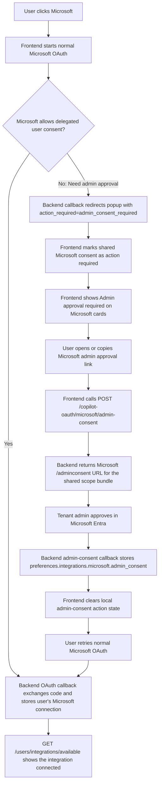
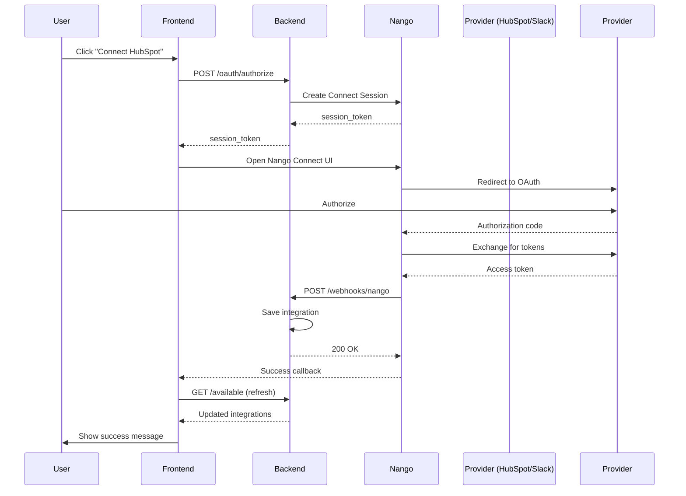

# Integrations API Documentation

## Base URL

```text
/users/integrations
```

---

## HubSpot Webhook Notes

HubSpot note webhooks are handled through expanded generic object webhooks. HubSpot sends
note changes as `object.*` events with `objectTypeId = 0-46`; the backend normalizes these
to internal `note.*` events before queueing work for the integrations worker.

Supported note webhook events:

| HubSpot event | Required objectTypeId | Internal event | Behavior |
|---------------|-----------------------|----------------|----------|
| `object.creation` | `0-46` | `note.creation` | Debounced full note fetch and upsert |
| `object.propertyChange` | `0-46` | `note.propertyChange` | Debounced full note fetch and upsert |
| `object.associationChange` | `0-46` | `note.associationChange` | Debounced full note fetch and association refresh |
| `object.deletion` | `0-46` | `note.deletion` | Immediate idempotent local soft delete |

Supported note property-change subscriptions:

- `hs_note_body`
- `hubspot_owner_id`
- `hs_attachment_ids`
- `hs_timestamp`

Do not subscribe to `hs_lastmodifieddate`. The backend fetches it with the full note snapshot
and uses it for stale-write protection, while `hs_timestamp` is treated as the note's timeline
timestamp.

Operational checklist:

- Enable expanded or generic object webhook support for the HubSpot Note object.
- Confirm the app has the required note/activity read scope before rollout.
- Reauthorize existing installs if the note read scope changes.
- Keep polling/reconciliation enabled as the safety net for missed webhook deliveries.
- Treat HubSpot 403 during note fetch as app scope or authorization failure, not as deletion.

---

## HubSpot Webhook Tasks

HubSpot task webhooks are handled through expanded generic object webhooks. HubSpot sends
task changes as `object.*` events with `objectTypeId = 0-27`; the backend normalizes these
to internal `task.*` events before queueing work for the integrations worker.

Supported task webhook events:

| HubSpot event | Required objectTypeId | Internal event | Behavior |
|---------------|-----------------------|----------------|----------|
| `object.creation` | `0-27` | `task.creation` | Debounced full task fetch and upsert |
| `object.propertyChange` | `0-27` | `task.propertyChange` | Debounced full task fetch and upsert |
| `object.associationChange` | `0-27` | `task.associationChange` | Debounced full task fetch and association refresh |
| `object.deletion` | `0-27` | `task.deletion` | Immediate idempotent local soft delete |

Supported task property-change subscriptions:

- `hs_task_subject`
- `hs_task_body`
- `hs_task_status`
- `hs_task_priority`
- `hs_task_type`
- `hs_timestamp`
- `hubspot_owner_id`

Do not subscribe to `hs_lastmodifieddate`. The backend fetches it with the full task snapshot
and uses it for stale-write protection.

Operational checklist:

- Enable expanded or generic object webhook support for the HubSpot Task object.
- Confirm the app has the required task/activity read scope before rollout.
- Reauthorize existing installs if the task read scope changes.
- Keep polling/reconciliation enabled as the safety net for missed webhook deliveries.
- Treat HubSpot 403 during task fetch as app scope or authorization failure, not as deletion.

---

## Deprecated / Future Use: Calendar Invite Creation API

This API is intentionally not registered right now. Calendar invite creation is currently owned by
the LLM/agent tool path, which calls the backend calendar invite service directly.

Keep this contract as a restoration note. If product later needs a first-class HTTP API for manual
calendar invite creation, restore the router/schema/test around this shape and wire it back into
`src/api/routers/integrations/__init__.py`.

The underlying implementation still creates an Outlook calendar event from the current user's
connected Microsoft integration. The event is created with `isOnlineMeeting=true` and
`onlineMeetingProvider=teamsForBusiness`, so Microsoft sends normal calendar invites and includes a
Teams join link.

If the current user has multiple writable Microsoft integrations, the active agent/tool path
must ask which sender email to use before creating the invite. The selected `sender_email` must
match a connected Microsoft account owned by the current user, and that selected account must
pass scope, reauth, and token checks before any Microsoft Graph write is attempted.

### Endpoint

```http
POST /users/integrations/calendar-invites
```

Status: deprecated/not registered.

### Required Permission

The current user must have an active `microsoft` integration connected with delegated
`Calendars.ReadWrite`. This is a user-delegated Microsoft OAuth scope, not a Teams bot permission
and not an application/admin permission.

### Request Body

```json
{
  "title": "Discovery call",
  "start_at": "2026-05-12T14:30:00Z",
  "end_at": "2026-05-12T15:00:00Z",
  "timezone": "Asia/Kolkata",
  "attendees": [
    { "email": "buyer@example.com", "name": "Buyer" }
  ],
  "sender_email": "seller@contoso.com",
  "body": "Discuss rollout plan",
  "location": "Teams",
  "deal_id": "123e4567-e89b-12d3-a456-426614174000",
  "idempotency_key": "client-generated-key"
}
```

| Field | Type | Required | Description |
|-------|------|----------|-------------|
| `title` | string | Yes | Calendar event subject |
| `start_at` | datetime | Yes | Meeting start time; timezone-aware ISO 8601 |
| `end_at` | datetime | Yes | Meeting end time; must be after `start_at` |
| `timezone` | string | No | IANA timezone. Defaults to the authenticated user's timezone, then UTC |
| `attendees` | array | Yes | Invitees; at least one email is required |
| `sender_email` | string | No | Required when the user has more than one writable Microsoft account |
| `body` | string | No | Event description |
| `location` | string | No | Display location |
| `deal_id` | UUID | No | Optional deal association; validated inside the current organisation |
| `idempotency_key` | string | No | Stable client key; Graph receives it as `transactionId` |

### Success Response (201)

```json
{
  "status": "SUCCESS",
  "message": "Calendar invite created successfully",
  "data": {
    "request_id": "33333333-3333-3333-3333-333333333333",
    "event_id": "44444444-4444-4444-4444-444444444444",
    "provider_event_id": "AAMkAG...",
    "subject": "Discovery call",
    "conference_link": "https://teams.microsoft.com/l/meetup-join/...",
    "web_link": "https://outlook.office.com/calendar/item/..."
  }
}
```

### Common Error Codes

| Code | Meaning |
|------|---------|
| `calendar_integration_required` | User has not connected Microsoft |
| `calendar_sender_selection_required` | Multiple writable Microsoft accounts exist; ask which sender email to use |
| `calendar_sender_not_found` | Selected sender email is not one of the current user's Microsoft connections |
| `calendar_write_scope_required` | Existing Microsoft connection lacks `Calendars.ReadWrite` |
| `calendar_reauth_required` | OAuth token is missing, expired, or revoked |
| `unsupported_online_meeting_provider` | Mailbox cannot create Teams calendar meetings |
| `deal_not_found` | Provided `deal_id` is not visible in the current organisation |

---

## 1. List Available Integrations (General)

### Endpoint

```http
GET /users/integrations/available
```

| `connected_integrations` | array | List of user's connected instances (see Connected Integration Fields below) |
| `total_available` | integer | Total number of integration types |
| `total_connected` | integer | Total connected integrations |

### Available Integration Fields

Each item in `data.integrations` includes:

| Field | Type | Description |
|-------|------|-------------|
| `integration_type` | string | Provider key, for example `salesforce`, `hubspot`, `google`, or `microsoft`. |
| `name` | string | Display name for the integration. |
| `description` | string | Brief description of what the integration does. |
| `logo_url` | string\|null | Provider logo URL. |
| `category` | string | Category slug. |
| `category_name` | string | Human-readable category name. |
| `availability_status` | string | One of `available`, `coming_soon`, `beta`, or `deprecated`. |
| `is_connected` | boolean | Whether the current user can see an active connection for this provider. |
| `has_action_required` | boolean | Whether any visible instance needs reconnect or additional permissions. |
| `connected_integrations` | array | Active visible instances of this integration type. |
| `action_required_integrations` | array | Inactive or reconnect-required instances needing user attention. |
| `linked_channels` | array | Channels linked to the current deal context, if requested by a deal-specific route. |
| `admin_prerequisite` | object\|null | Optional admin action to complete before starting normal provider OAuth. |

### Admin Prerequisite

`admin_prerequisite` is a generic provider-level signal. It is `null` for providers
that do not need a backend-configured admin setup step. When present, the frontend
should present the action before starting the provider's normal OAuth flow.

Current Salesforce behavior:

- Salesforce returns an `install_url` prerequisite only when
  `SALESFORCE_EXTERNAL_CLIENT_APP_INSTALL_URL` is configured.
- Dev and prod are configured with `login.salesforce.com` install URLs so
  production Salesforce org admins can install the package from the prerequisite CTA.
  Use a `test.salesforce.com` package URL only when the environment is intended for
  sandbox-only install testing.
- Salesforce client ID and client secret remain secret-backed and are not returned by this API.
- The operational package IDs and install URLs remain documented in
  `docs/Technical Documentation/integrations/salesforce-external-client-app-packaging.md`.

Example:

```json
{
  "type": "install_url",
  "required_before_connect": true,
  "url": "https://login.salesforce.com/packaging/installPackage.apexp?p0=04tdM000000U44bQAC",
  "label": "Install CopilotGTM in Salesforce"
}
```

### Connected Integration Fields

Each item in `connected_integrations` array includes:

| Field | Type | Description |
|-------|------|-------------|
| `integration_id` | UUID | Unique identifier for this integration connection |
| `created_by_user_id` | UUID | User who created/connected this integration |
| `created_by_admin` | boolean | Whether this was created by an admin user |
| `integration_email` | string\|null | Email/username of the connected account (e.g., '<sales@acme.com>' for HubSpot, '<john@company.com>' for Google Drive) |
| `integration_scope` | string | Access scope: `organization` (all users), `user` (creator only), `team`, or `role_based` |
| `name` | string | User-defined name for this connection |
| `is_active` | boolean | Whether the integration is currently active |
| `last_synced_at` | string\|null | ISO 8601 timestamp of last sync |
| `last_sync_status` | string\|null | Status: `success`, `failed`, `partial`, `in_progress` |
| `connection_metadata` | object | Provider-specific metadata |
| `created_at` | string | ISO 8601 timestamp when connected |
| `updated_at` | string | ISO 8601 timestamp of last update |

### Availability Status Values

| Status | Description | Action |
|--------|-------------|--------|
| `available` | Integration is ready to use | Show "Connect" button |
| `coming_soon` | Integration not yet available | Show "Coming Soon" badge, disable button |
| `beta` | Integration in beta testing | Show "Beta" badge, allow connection |
| `deprecated` | Integration being phased out | Show warning message |

### Error Response (500)

```json
{
  "status": "error",
  "message": "Failed to retrieve available integrations",
  "data": null
}
```

### Implementation Notes

**Frontend Display:**

1. **Group by category** - Use `category_name` to group integrations
2. **Connection status** - Use `is_connected` to show badges or different UI states
3. **Connected instances** - Display list of connected accounts if `is_connected` is true
4. **Availability** - Disable connect button if `availability_status` is `coming_soon`
5. **Access scope indicators** - Show badges for `organization` vs `user` scoped integrations
6. **Connected account email** - Display `integration_email` to show which account is connected (e.g., "Connected as: <sales@acme.com>")
7. **Creator information** - Show who created the integration using `created_by_user_id` and `created_by_admin`

**Example UI Logic:**

```typescript
// Check if integration can be connected
const canConnect = integration.availability_status === 'available' || 
                   integration.availability_status === 'beta';

// Show connection badge
const showConnectedBadge = integration.is_connected;

// Show "Add Another" button (for user-scoped integrations like Google Drive)
const showAddAnother = integration.is_connected && canConnect;

// Display coming soon badge
const showComingSoon = integration.availability_status === 'coming_soon';

// Display connected account info
const getConnectionDisplay = (conn: ConnectedIntegration) => {
  const scopeBadge = conn.integration_scope === 'user' ? '👤 Personal' : '🏢 Organization';
  const accountInfo = conn.integration_email 
    ? `Connected as: ${conn.integration_email}` 
    : 'Connected';
  const creatorInfo = conn.created_by_admin ? '(Created by Admin)' : '';
  
  return `${scopeBadge} ${accountInfo} ${creatorInfo}`;
};
```

**Performance:**

- Single API call gets all data (available types + connections)
- No need for separate requests
- Cache response for 5 minutes

**Error Handling:**

```typescript
try {
  const response = await fetch('/users/integrations/available', {
    headers: {
      'Authorization': `Bearer ${token}`
    }
  });
  
  if (!response.ok) {
    throw new Error('Failed to fetch integrations');
  }
  
  const data = await response.json();
  // Handle data.data.integrations
} catch (error) {
  // Show error message to user
  console.error('Integration fetch error:', error);
}
```

### Example cURL

```bash
curl -X GET "https://api.example.com/users/integrations/available" \
  -H "Authorization: Bearer YOUR_TOKEN_HERE" \
  -H "Content-Type: application/json"
```

---

## 2. List Available Bot Integrations

### Endpoint

```http
GET /users/integrations/bots/available
```

Returns bot providers that can be connected from the Integrations > Bots section. The
current implementation returns Slack and WhatsApp bot cards with workspace/install
status and the current user's identity-link status.

### Success Response

```json
{
  "status": "SUCCESS",
  "message": "Available bots retrieved successfully",
  "data": {
    "bots": [
      {
        "provider": "slack",
        "name": "Slack Bot",
        "display_name": "CopilotGTM Slack Bot",
        "description": "Chat with CopilotGTM from Slack DMs, mentions, and supported workflows.",
        "logo_url": "/integrations/slack.png",
        "category": "bots",
        "category_name": "Bots",
        "availability_status": "available",
        "connection_mode": "oauth_install",
        "connect_url": null,
        "installed": false,
        "installation": null,
        "identity_linked": false,
        "identity_mapping_id": null,
        "action_required": "install_required"
      },
      {
        "provider": "whatsapp",
        "name": "WhatsApp Bot",
        "display_name": "CopilotGTM WhatsApp Bot",
        "description": "Chat with CopilotGTM from WhatsApp after linking your mobile number.",
        "logo_url": "https://upload.wikimedia.org/wikipedia/commons/6/6b/WhatsApp.svg",
        "category": "bots",
        "category_name": "Bots",
        "availability_status": "available",
        "connection_mode": "qr_deep_link",
        "connect_url": null,
        "installed": true,
        "installation": null,
        "identity_linked": false,
        "identity_mapping_id": null,
        "action_required": "identity_link_required"
      }
    ],
    "total_available": 2,
    "total_installed": 1,
    "total_linked": 0
  }
}
```

### Bot Card Fields

| Field | Type | Description |
|-------|------|-------------|
| `provider` | string | Bot provider. Currently `slack` or `whatsapp`. |
| `display_name` | string | User-facing bot name. |
| `connection_mode` | string | How the provider connects. `oauth_install` for Slack, `qr_deep_link` for WhatsApp. |
| `installed` | boolean | Whether this organization has an active workspace installation. |
| `installation` | object\|null | Workspace details if installed. |
| `identity_linked` | boolean | Whether the current CopilotGTM user has linked their Slack identity. |
| `action_required` | string | One of `install_required`, `identity_link_required`, `setup_required`, or `none`. |

---

## 3. Get Slack Bot Connect URL

### Endpoint

```http
GET /users/integrations/bots/slack/connect
```

Generates the Slack OAuth v2 install URL for the CopilotGTM Slack bot. The frontend
should redirect the browser to `data.connect_url`.

### Success Response

```json
{
  "status": "SUCCESS",
  "message": "Slack bot connect URL generated successfully",
  "data": {
    "provider": "slack",
    "connect_url": "https://slack.com/oauth/v2/authorize?...",
    "expires_at": null
  }
}
```

### Error Response (500)

```json
{
  "status": "error",
  "message": "Failed to start Slack bot connection",
  "data": null
}
```

---

## 4. Get WhatsApp Bot Connect URL

### Endpoint

```http
GET /users/integrations/bots/whatsapp/connect
```

Generates a WhatsApp click-to-chat URL for the configured CopilotGTM WhatsApp bot
number. The frontend should render this URL as a QR code on desktop and as an
"Open WhatsApp" button on mobile.

### Success Response

```json
{
  "status": "SUCCESS",
  "message": "WhatsApp bot connect URL generated successfully",
  "data": {
    "provider": "whatsapp",
    "connect_url": "https://wa.me/15556300848?text=hi",
    "expires_at": null
  }
}
```

The user must send the prefilled `hi` message. The existing WhatsApp webhook then
replies with the secure CopilotGTM login/link URL if the WhatsApp number is not
already linked.

### Error Response (500)

```json
{
  "status": "error",
  "message": "Failed to start WhatsApp bot connection",
  "data": null
}
```

---

## Understanding Access Control Fields

### New Fields Explained

Starting from the latest version, all integrations include access control fields that determine who can see and use each integration:

#### 1. `created_by_user_id` (UUID)

- **What it is:** The ID of the user who connected this integration
- **Use case:** Track who created the integration for audit purposes
- **Example:** `"123e4567-e89b-12d3-a456-426614174000"`

#### 2. `created_by_admin` (boolean)

- **What it is:** Whether the integration was created by an admin user
- **Use case:** Differentiate between admin-created (org-wide) and member-created (personal) integrations
- **Example:** `true` for HubSpot connected by admin, `false` for personal Google Drive

#### 3. `integration_email` (string | null)

- **What it is:** The email/username of the **connected external account** (not your user's email)
- **Use case:** Show which external account is connected; helps with multiple accounts of same type
- **Examples:**
  - HubSpot: `"sales@acme.com"` (the HubSpot account email)
  - Google Drive: `"john@company.com"` (the Google account)
  - Slack: `"workspace@company.slack.com"` (the Slack workspace)
  - Can be `null` if provider doesn't share email

#### 4. `integration_scope` (string)

- **What it is:** Access level for the integration data
- **Possible values:**
  - `"organization"` - All users in org can see this data (e.g., HubSpot, Salesforce)
  - `"user"` - Only the creator can see this data (e.g., personal Google Drive)
  - `"team"` - Only specific team members (future feature)
  - `"role_based"` - Based on user roles (future feature)

### Access Scope Examples

**Organization-Wide (HubSpot, Salesforce, Slack):**

```json
{
  "integration_type": "hubspot",
  "name": "Company HubSpot",
  "created_by_user_id": "admin-uuid",
  "created_by_admin": true,
  "integration_email": "sales@acme.com",
  "integration_scope": "organization"
  // ✅ All users in org can search HubSpot data
}
```

**User-Level (Google Drive, Personal Dropbox):**

```json
{
  "integration_type": "google_drive",
  "name": "John's Google Drive",
  "created_by_user_id": "john-uuid",
  "created_by_admin": false,
  "integration_email": "john@company.com",
  "integration_scope": "user"
  // ✅ Only John can search his Google Drive data
}
```

### Frontend Implementation Guidelines

**Displaying Integration Email:**

```typescript
const IntegrationCard = ({ integration }) => {
  return (
    <div className="integration-card">
      <h3>{integration.name}</h3>
      
      {/* Show connected account email */}
      {integration.integration_email && (
        <p className="connected-as">
          Connected as: <strong>{integration.integration_email}</strong>
        </p>
      )}
      
      {/* Show scope badge */}
      <span className={`scope-badge ${integration.integration_scope}`}>
        {integration.integration_scope === 'organization' ? '🏢 Organization' : '👤 Personal'}
      </span>
      
      {/* Show creator info */}
      {integration.created_by_admin && (
        <span className="creator-badge">Created by Admin</span>
      )}
    </div>
  );
};
```

**Filtering Integrations by Scope:**

```typescript
// Show only user's personal integrations
const personalIntegrations = allIntegrations.filter(
  (int) => int.integration_scope === 'user' && 
           int.created_by_user_id === currentUser.id
);

// Show org-wide integrations (visible to all)
const orgIntegrations = allIntegrations.filter(
  (int) => int.integration_scope === 'organization'
);
```

---

## 2. Initiate OAuth Flow (Create Nango Connect Session)

### Initiate OAuth Flow Endpoint

```http
POST /users/integrations/oauth/authorize
```

### Initiate OAuth Flow Description

Creates a Nango Connect Session for the selected integration and returns a `session_token` that the frontend uses with the Nango Connect UI.

**New Flow (Post July 31, 2025):**

1. Frontend calls this endpoint to get session token
2. Frontend uses Nango Connect UI with the session token
3. User authorizes on provider's site via Nango UI
4. Nango sends webhook to backend with connection details
5. Backend stores connection and you can refresh the integrations list

**Note:** This is the modern Nango Connect flow - no callback endpoint is involved.

### Initiate OAuth Flow Authentication

Required - Bearer token

**What Backend Extracts Automatically from JWT:**

- `user_id` - Your internal user ID
- `organisation_id` - Your internal organization ID
- `user_role` - User's role (ADMIN or MEMBER) - determines `created_by_admin`
- `email` - User's email address (from User model)
- `first_name` and `last_name` - User's name (from User model)

These are automatically sent to Nango and will be returned in the webhook.

**What Backend Determines from Integration Metadata:**

- `integration_scope` - Set based on integration type (ORGANIZATION for HubSpot/Salesforce, USER for Google Drive)
- `integration_email` - Extracted from OAuth provider's response (e.g., connected account email)

### Initiate OAuth Flow Request Body

```json
{
  "integration_type": "hubspot",
  "integration_name": "Sales HubSpot Account"
}
```

### Initiate OAuth Flow Request Fields

| Field | Type | Required | Description |
|-------|------|----------|-------------|
| `integration_type` | string | Yes | Integration type (hubspot, slack, etc.) from available list |
| `integration_name` | string | No | Custom name for this connection (auto-generated if not provided) |

**Frontend Does NOT Need to Send:**

- ❌ `user_id` - Extracted from JWT automatically
- ❌ `organisation_id` - Extracted from JWT automatically
- ❌ `email` - Retrieved from User model automatically
- ❌ `display_name` - Generated from User model automatically

### Initiate OAuth Flow Response (200 OK)

```json
{
  "status": "success",
  "message": "Connect session created successfully. Use session_token with Nango Connect UI.",
  "data": {
    "session_token": "ngc_sess_abc123...",
    "integration_type": "hubspot",
    "expires_at": "2025-10-09T00:45:00Z"
  }
}
```

### Initiate OAuth Flow Response Fields

| Field | Type | Description |
|-------|------|-------------|
| `session_token` | string | Token for initializing Nango Connect UI on the frontend |
| `integration_type` | string | Integration type being connected |
| `expires_at` | string | ISO 8601 timestamp when session token expires |

### Initiate OAuth Flow Error Responses

```json
{
  "status": "error",
  "message": "Failed to initiate OAuth flow",
  "data": null
}
```

### Initiate OAuth Flow Frontend Implementation (Nango Connect UI)

### Step 1: Request session token from backend

```typescript
const initiateOAuth = async (integrationType: string) => {
  try {
    const res = await fetch('/users/integrations/oauth/authorize', {
      method: 'POST',
      headers: { 
        'Authorization': `Bearer ${token}`, 
        'Content-Type': 'application/json' 
      },
      body: JSON.stringify({ integration_type: integrationType })
    });
    
    const response = await res.json();
    
    if (response.status === 'success') {
      // Open Nango Connect UI with session token
      openNangoConnect(response.data.session_token);
    }
  } catch (error) {
    console.error('Failed to initiate OAuth:', error);
    showError('Failed to start authorization');
  }
};
```

### Step 2: Use Nango Connect UI

```typescript
import Nango from '@nangohq/frontend';

const openNangoConnect = (sessionToken: string) => {
  const nango = new Nango({ publicKey: 'YOUR_NANGO_PUBLIC_KEY' });
  
  nango
    .auth(sessionToken)
    .then((result) => {
      console.log('Authorization successful:', result);
      
      // Show success message
      showNotification('Integration connected successfully!');
      
      // Refresh integrations list
      refreshIntegrations();
    })
    .catch((error) => {
      console.error('Authorization failed:', error);
      showError('Failed to authorize integration');
    });
};
```

### Step 3: Handle Completion

```typescript
const refreshIntegrations = async () => {
  // Reload the integrations list to show the newly connected integration
  const response = await fetch('/users/integrations/available', {
    headers: { 'Authorization': `Bearer ${token}` }
  });
  const data = await response.json();
  setIntegrations(data.data.integrations);
};
```

### Initiate OAuth Flow Data Flow

**See complete data flow documentation:** [`oauth-data-flow.md`](./oauth-data-flow.md)

**Quick Summary:**

1. **Frontend sends** (to backend):
   - `integration_type` in request body
   - JWT token in Authorization header

2. **Backend automatically extracts** (from JWT + User model):
   - `user_id`, `organisation_id` (from JWT)
   - `email`, `first_name`, `last_name` (from User model)

3. **Backend sends to Nango**:

   ```json
   {
     "end_user": {
       "id": "user_id",
       "email": "user@example.com",
       "display_name": "John Doe",
       "tags": { "organizationId": "org_id" }
     }
   }
   ```

4. **Nango returns in webhook** (to backend):

   ```json
   {
     "endUser": {
       "id": "user_id",
       "tags": { "organizationId": "org_id" }
     }
   }
   ```

5. **Backend creates integration** for the correct user/organization

**Frontend developers do NOT need to:**

- ❌ Send `user_id` or `organisation_id` explicitly
- ❌ Extract these from JWT themselves
- ❌ Handle webhook responses

**Everything is handled automatically by the backend!**

### Initiate OAuth Flow Scopes (Backend Managed)

OAuth scopes are managed server-side based on integration requirements; the frontend does not pass scopes.

**Why backend manages scopes:**

- Security, consistency, simplicity, and maintenance.

**Examples:**

- HubSpot: `oauth`, `automation`, `conversations.read`, `sales-email-read`, `crm.objects.companies.read`, `crm.objects.companies.write`, `crm.objects.contacts.read`, `crm.objects.contacts.write`, `crm.objects.deals.read`, `crm.objects.deals.write`, `crm.objects.leads.read`, `crm.objects.leads.write`, `crm.objects.line_items.read`, `crm.objects.line_items.write`, `crm.objects.products.read`, `crm.objects.products.write`, `crm.objects.owners.read`, `crm.objects.users.read`, `crm.schemas.companies.read`, `crm.schemas.contacts.read`, `crm.schemas.deals.read`
- Slack: `channels:read`, `channels:history`, `files:read`, `users:read`
- Google: requests Google identity, Calendar, and Gmail send scopes. The Gmail
  read scope (`gmail.readonly`) is requested only when the organisation has
  `public.organisations.preferences.integrations.google.gmail_read_enabled = true`.

### Initiate OAuth Flow Pydantic Models (Backend)

```python
from pydantic import BaseModel, Field
from typing import Optional
from src.domain.models.organisation_tables.knowledge_models import IntegrationType


class OAuthInitiateRequest(BaseModel):
    """Request to initiate OAuth (create Connect Session)."""

    integration_type: IntegrationType = Field(
        ..., description="Integration to connect (e.g., HUBSPOT, SLACK, GOOGLE_DRIVE)"
    )
    integration_name: Optional[str] = Field(
        default=None,
        min_length=1,
        max_length=100,
        description="Optional user-defined name for this connection",
    )


class OAuthInitiateResponse(BaseModel):
    """Response with Nango Connect session token for the frontend."""

    session_token: str = Field(
        ..., description="Token for initializing Nango Connect UI on the frontend"
    )
    integration_type: IntegrationType = Field(
        ..., description="Integration type being connected"
    )
    expires_at: Optional[str] = Field(
        default=None, description="ISO 8601 expiry timestamp for the session token"
    )
```

### Initiate OAuth Flow TypeScript Interfaces (Frontend)

```ts
interface OAuthInitiateRequest {
  integration_type: string; // e.g., 'hubspot', 'slack'
  integration_name?: string;
}

interface OAuthInitiateResponse {
  session_token: string;
  integration_type: string;
  expires_at?: string; // ISO 8601
}
```

---

## 3. OAuth Callback (Automatic - Provider Calls This)

### OAuth Callback Endpoint

```http
GET /users/integrations/oauth/callback
```

### OAuth Callback Description

**⚠️ This endpoint is NOT called by the frontend.** It's called automatically by the OAuth provider (HubSpot, Slack, etc.) after the user authorizes your application. This is part of the standard OAuth 2.0 flow.

### How It Works

```text
1. User authorizes on HubSpot → HubSpot redirects to this callback
2. Callback receives authorization code
3. Backend exchanges code for access tokens (via Nango)
4. Backend saves integration to database
5. Backend redirects user back to your frontend
```

### Authentication

OAuth provider validates this request using registered callback URL and state parameter.

### Query Parameters (Sent by OAuth Provider)

| Parameter | Type | Required | Description |
|-----------|------|----------|-------------|
| `code` | string | Yes | Authorization code from OAuth provider |
| `state` | string | No | State parameter for CSRF protection |
| `connection_id` | string | Yes | Connection identifier (format: `org_{org_id}_{type}_{timestamp}`) |

### Example Request (Called by HubSpot)

```http
GET /users/integrations/oauth/callback
  ?code=abc123xyz789
  &state=random-security-token
  &connection_id=org_12345_hubspot_20251005103000
```

### Response

Redirects user to frontend with status:

**Success Redirect:**

```text
https://yourfrontend.com/settings/integrations
  ?status=success
  &integration_id=123e4567-e89b-12d3-a456-426614174000
```

**Error Redirect:**

```text
https://yourfrontend.com/settings/integrations
  ?status=error
  &message=Error+description
```

### Disconnect Integration Frontend Implementation

**Listen for OAuth completion:**

```typescript
// In your integrations settings page
useEffect(() => {
  const params = new URLSearchParams(window.location.search);
  const status = params.get('status');
  const integrationId = params.get('integration_id');
  const errorMessage = params.get('message');
  
  if (status === 'success') {
    // Show success message
    showNotification('Integration connected successfully!');
    
    // Refresh integrations list
    fetchIntegrations();
    
    // Clean URL
    window.history.replaceState({}, '', '/settings/integrations');
  } else if (status === 'error') {
    // Show error message
    showError(`Failed to connect: ${errorMessage}`);
    
    // Clean URL
    window.history.replaceState({}, '', '/settings/integrations');
  }
}, []);
```

### What Happens Behind the Scenes

1. **Extract Integration Type**
   - Parses `connection_id` to identify which integration (HubSpot, Slack, etc.)

2. **Exchange Code for Tokens**
   - Backend calls Nango to exchange authorization code for access token
   - Nango stores encrypted tokens securely

3. **Extract Integration Email**
   - Backend retrieves connection details from Nango
   - Extracts the connected account email from provider-specific metadata:
     - **Google Drive**: `metadata.email` or `metadata.user_email`
     - **HubSpot**: `metadata.user` or `metadata.hub_email`
     - **Slack**: `metadata.user.email`
     - **Salesforce**: `metadata.email` or `metadata.username`
   - Stores in `integration_email` field for display

4. **Determine Access Control**
   - `created_by_user_id`: From JWT token
   - `created_by_admin`: From user's role (ADMIN or MEMBER)
   - `integration_scope`: From integration metadata:
     - `organization` for HubSpot, Salesforce, Slack (all users see data)
     - `user` for Google Drive, Dropbox (only creator sees data)
   - `integration_email`: Extracted from OAuth provider response

5. **Save Integration**
   - Creates integration record in database with:
     - `integration_type`: Type of integration
     - `name`: Auto-generated name (user can change later)
     - `connection_id`: Unique identifier for this connection
     - `created_by_user_id`: User who connected
     - `created_by_admin`: Whether user is admin
     - `integration_email`: Connected account email
     - `integration_scope`: Access level (organization/user)
     - `connection_metadata`: Provider-specific metadata
     - `scopes`: Granted OAuth scopes

6. **Redirect User**
   - Sends user back to frontend with success/error status
   - Frontend shows notification and refreshes integration list

### Configuration Required

**Register Callback URL with OAuth Provider:**

You must register this callback URL with each OAuth provider (HubSpot, Slack, etc.):

```text
Production: https://api.yourapp.com/users/integrations/oauth/callback
Development: http://localhost:8000/users/integrations/oauth/callback
```

**Environment Variable:**

```bash
OAUTH_CALLBACK_BASE_URL=https://yourfrontend.com
```

This tells the backend where to redirect users after OAuth completion.

### Security Notes

- ✅ **HTTPS Required** - OAuth providers reject non-HTTPS callbacks in production
- ✅ **State Validation** - State parameter prevents CSRF attacks
- ✅ **Connection ID** - Unique per-user to prevent hijacking
- ✅ **Registered URL** - Only pre-registered callbacks are accepted by providers

### Error Scenarios

| Error | Cause | User Sees |
|-------|-------|-----------|
| Invalid `connection_id` | Malformed or missing | Redirected with error message |
| Code exchange failed | Invalid/expired code | Redirected with error message |
| Database error | Failed to save integration | Redirected with error message |
| Token expired | User took too long | Redirected with timeout message |

### Testing

**You cannot test this endpoint directly.** It must be called by the OAuth provider. To test:

1. Call `POST /users/integrations/oauth/authorize` to get authorization URL
2. Visit the authorization URL in browser
3. Complete OAuth flow on provider's site
4. Provider automatically calls callback endpoint
5. You're redirected back to frontend

---

## 4. Custom OAuth Authorization URL

### Endpoint

```http
POST /users/integrations/copilot-oauth/authorize
```

Returns a provider authorization URL that the frontend opens in an OAuth popup.

### Request Body

```json
{
  "integration_type": "salesforce",
  "oauth_base_url": "https://ameyo--gtmcopilot.sandbox.my.salesforce.com"
}
```

| Field | Type | Required | Description |
|-------|------|----------|-------------|
| `integration_type` | string | Yes | Integration to connect. |
| `integration_name` | string | No | Optional display name for the connection. |
| `oauth_base_url` | string | No | Optional provider login host. Salesforce defaults to `https://login.salesforce.com` when omitted. For sandbox or My Domain, send the Salesforce login/My Domain host, not a Lightning URL. |

### Response

```json
{
  "status": "SUCCESS",
  "message": "Authorization URL generated successfully.",
  "data": {
    "auth_url": "https://ameyo--gtmcopilot.sandbox.my.salesforce.com/services/oauth2/authorize?...",
    "attempt_id": "7e31f..."
  }
}
```

For Salesforce, the selected OAuth base URL is signed into the state token and
reused during callback token exchange. After OAuth succeeds, sync uses the
`instance_url` returned by Salesforce.

---

## 5. Microsoft Admin Consent Authorization URL

### Endpoint

```http
POST /users/integrations/copilot-oauth/microsoft/admin-consent
```

Returns one Microsoft Entra admin-consent URL for CopilotGTM's Microsoft integration
app. The request is triggered from the Microsoft provider card, and the consent URL
always requests the shared Microsoft scope bundle for all current user-owned
Microsoft integrations:

- `offline_access`
- `User.Read`
- `Mail.Read`
- `Mail.Send`
- `Calendars.ReadWrite`
- `OnlineMeetings.Read`
- `Team.ReadBasic.All`
- `Channel.ReadBasic.All`
- `Chat.Read`

Use this when a user sees Microsoft's "Need admin approval" page during the normal
Microsoft OAuth flow. Do not require this before every Microsoft connection attempt:
some tenants allow user consent and some admins can complete normal delegated consent
without a separate admin-consent step.

### Runtime Flow



| Situation | Backend Signal | Frontend Behavior |
|-----------|----------------|-------------------|
| Microsoft has not rejected OAuth | No admin-consent signal | Show normal `Connect`; let Microsoft decide whether admin approval is needed. |
| Normal Microsoft OAuth succeeds | Popup redirect has `success=true`; `/available` returns connected integration row | Refresh integrations and show the connected account. |
| Microsoft rejects normal OAuth with admin approval required, including a bare Microsoft `access_denied` callback without provider detail | Popup redirect has `success=false`, `action_required=admin_consent_required`, and `integration_type=<provider>` | Show `Admin approval required` for Microsoft cards, explain that only a Microsoft tenant admin can approve, and offer open/copy actions for the approval link. |
| Admin consent succeeds | Admin-consent callback redirects with `success=true` | Hide admin-consent CTA and tell the original user to connect again to create their delegated connection. |
| Admin consent is denied from the Microsoft admin-consent flow | Popup redirect has `success=false`, `action_required=admin_consent_required`, `integration_type=<provider>`, and a message telling the user to sign in with a Microsoft tenant admin account or send the approval link to an admin | Keep the Microsoft card in the admin-required state and show the specific denial guidance. |

The frontend should show an explanatory modal before navigating to the returned
`auth_url`. Do not collect Microsoft admin credentials in CopilotGTM. Microsoft owns
credential entry, and the copied approval link can be opened by a different Microsoft
tenant admin in their own browser or session because the signed state carries the
CopilotGTM organization/user context. After an Entra administrator approves the app,
Microsoft redirects back to the existing OAuth callback URL with `admin_consent=True`.
The backend records the consent result once under
`preferences.integrations.microsoft.admin_consent`, then redirects the popup to
`/integrations/oauth/popup-complete`.

Admin consent does not create a user integration token. After approval, the user must
retry the normal Microsoft connect flow so CopilotGTM can receive that user's delegated
OAuth tokens.

### Request Body

```json
{
  "integration_type": "microsoft"
}
```

| Field | Type | Required | Description |
|-------|------|----------|-------------|
| `integration_type` | string | Yes | Must be `microsoft`. |

### Response

```json
{
  "status": "SUCCESS",
  "message": "Microsoft admin consent URL generated successfully.",
  "data": {
    "auth_url": "https://login.microsoftonline.com/organizations/v2.0/adminconsent?...",
    "attempt_id": "7e31f..."
  }
}
```

### Error Responses

| Status | Cause |
|--------|-------|
| `400` | Requested integration is not a Microsoft integration. |
| `500` | Microsoft OAuth credentials or backend configuration are unavailable. |

When Microsoft rejects a normal OAuth callback with an admin-approval error, or returns
a bare `access_denied` callback for a Microsoft user-owned integration without provider
detail, the popup completion redirect includes `action_required=admin_consent_required`
and `integration_type=microsoft`. The frontend should then
surface the admin approval required state for Microsoft instead of guessing from stored
organization preference state. If Microsoft returns `access_denied` for a signed
Microsoft admin-consent state, the backend preserves
`action_required=admin_consent_required` and returns the message:
`Admin consent was not granted. Sign in with a Microsoft tenant admin account or send the approval link to your admin.`

---

## 6. Disconnect Integration

### Disconnect Integration Endpoint

```http
DELETE /users/integrations/copilot-oauth/disconnect/{integration_id}
```

### Disconnect Integration Description

Disconnects an integration by revoking the provider OAuth token and marking the
integration inactive. The integration row is retained for audit/history and for
safe reconnect/reactivation flows.

### Disconnect Integration Authentication

Required - Bearer token

### Path Parameters

| Parameter | Type | Required | Description |
|-----------|------|----------|-------------|
| `integration_id` | UUID | Yes | ID of the integration to disconnect |

### Response (200 OK)

```json
{
  "status": "SUCCESS",
  "message": "Integration disconnected and marked as inactive successfully",
  "data": null
}
```

### Error Responses

**404 Not Found:**

```json
{
  "status": "ERROR",
  "message": "Integration not found",
  "data": null
}
```

**500 Internal Server Error:**

```json
{
  "status": "ERROR",
  "message": "Failed to disconnect integration",
  "data": null
}
```

### What Changes

When you disconnect an integration:

1. **Provider OAuth token** - Revoked where the provider supports revocation
2. **Integration record** - Retained and marked inactive
3. **Reauth state** - Cleared so the row no longer appears as action required
4. **Sync error** - Updated to show the integration was disconnected by the user

The frontend should treat a `SUCCESS` response with `data: null` as a completed
disconnect and refresh the integrations list. It should not expect a
`disconnected: true` response payload.

### Frontend Implementation

```typescript
const disconnectIntegration = async (integrationId: string) => {
  if (!confirm('Are you sure you want to disconnect? This cannot be undone.')) {
    return;
  }
  
  try {
    const response = await fetch(
      `/users/integrations/copilot-oauth/disconnect/${integrationId}`,
      {
        method: 'DELETE',
        headers: {
          'Authorization': `Bearer ${token}`,
          'Content-Type': 'application/json'
        }
      }
    );
    
    const data = await response.json();
    
    if (data.status === 'SUCCESS') {
      showNotification('Integration disconnected successfully');
      refreshIntegrations(); // Reload integrations list
    } else {
      showError(data.message);
    }
  } catch (error) {
    console.error('Failed to disconnect:', error);
    showError('Failed to disconnect integration');
  }
};
```

---

## OAuth Flow Summary

### Complete Flow (Nango Connect UI)



### Key Differences from Old Flow

**Old Flow (Deprecated):**

- Backend provides authorization URL
- User redirects through provider
- Provider calls backend callback endpoint
- Backend redirects user back to frontend

**New Flow (Current - Nango Connect UI):**

- Backend provides session token ✅
- Frontend opens Nango Connect UI ✅
- Nango handles entire OAuth flow ✅
- Nango calls webhook endpoint ✅
- Frontend receives success via Nango SDK ✅

**Benefits:**

- 🎯 Better UX - Modal UI instead of full redirects
- 🔒 More secure - Tokens never touch your backend
- ⚡ Faster - No page reloads
- 🛠️ Easier - Less code to maintain

---

## Common Error Codes

| Status Code | Message | Solution |
|-------------|---------|----------|
| 401 | Unauthorized | Check bearer token is valid |
| 404 | Integration not found | Verify integration_id exists |
| 500 | Internal Server Error | Retry request or contact support |

---

## Best Practices

### Frontend Best Practices

1. **Cache the response** - Integration list changes rarely, cache for 5 minutes
2. **Handle empty states** - Check if `connected_integrations` array is empty
3. **Show loading states** - API call may take 1-2 seconds
4. **Group by category** - Better UX when integrations are grouped
5. **Check availability** - Don't show connect button for `coming_soon` integrations
6. **Confirmation dialogs** - Always confirm before disconnecting
7. **Refresh after connect** - Reload integrations list after successful OAuth

### Backend Best Practices

1. **Webhook signature verification** - Always verify `X-Nango-Signature` header
2. **Idempotent webhook handling** - Handle duplicate webhook deliveries
3. **Return 200 for webhooks** - Even on processing errors (log them instead)
4. **Secure token storage** - Tokens stored by Nango, never in your database
5. **Monitor webhook logs** - Check Nango dashboard for failed deliveries

---

## 5. Refresh Teams Channels

### Endpoint

```http
POST /users/integrations/{integration_id}/refresh-channels
```

### Description

Triggers a manual refresh of Microsoft Teams channels and chats for a specific integration. This dispatches a background Celery task to fetch the latest channels from Microsoft Graph API.

**Use Cases:**
- User wants to see newly created Teams channels immediately
- Troubleshooting sync issues
- On-demand refresh instead of waiting for daily scheduled sync

**Note:** The scheduled sync runs once daily at 6 AM UTC (per Microsoft Graph API polling guidelines). This endpoint allows users to trigger a refresh on-demand.

### Authentication

Required - Bearer token

### Path Parameters

| Parameter | Type | Required | Description |
|-----------|------|----------|-------------|
| `integration_id` | UUID | Yes | ID of the Teams integration to refresh |

### Response (200 OK)

```json
{
  "status": "success",
  "message": "Channel refresh started",
  "data": {
    "task_id": "abc123-def456-ghi789",
    "integration_id": "123e4567-e89b-12d3-a456-426614174000",
    "message": "Channel refresh started successfully"
  }
}
```

### Response Fields

| Field | Type | Description |
|-------|------|-------------|
| `task_id` | string | Celery task ID for tracking the background job |
| `integration_id` | UUID | The integration being refreshed |
| `message` | string | Status message |

### Error Responses

**404 Not Found:**

```json
{
  "status": "error",
  "message": "Integration not found",
  "data": null
}
```

**400 Bad Request (Not Teams):**

```json
{
  "status": "error",
  "message": "Channel refresh is only supported for Teams integrations",
  "data": null
}
```

**400 Bad Request (Not Active):**

```json
{
  "status": "error",
  "message": "Integration is not active",
  "data": null
}
```

**400 Bad Request (Not Connected):**

```json
{
  "status": "error",
  "message": "Integration is not connected",
  "data": null
}
```

**500 Internal Server Error:**

```json
{
  "status": "error",
  "message": "Failed to trigger channel refresh",
  "data": null
}
```

### Frontend Implementation

```typescript
const refreshTeamsChannels = async (integrationId: string) => {
  try {
    const response = await fetch(
      `/users/integrations/${integrationId}/refresh-channels`,
      {
        method: 'POST',
        headers: {
          'Authorization': `Bearer ${token}`,
          'Content-Type': 'application/json'
        }
      }
    );

    const data = await response.json();

    if (data.status === 'success') {
      showNotification('Channel refresh started. This may take a few moments.');

      // Optionally poll for completion or wait and refresh
      setTimeout(() => {
        refreshIntegrationsList();
      }, 5000);
    } else {
      showError(data.message);
    }
  } catch (error) {
    console.error('Failed to refresh channels:', error);
    showError('Failed to start channel refresh');
  }
};
```

### Example cURL

```bash
curl -X POST "https://api.example.com/users/integrations/123e4567-e89b-12d3-a456-426614174000/refresh-channels" \
  -H "Authorization: Bearer YOUR_TOKEN_HERE" \
  -H "Content-Type: application/json"
```

### Sync History Tracking

Each channel refresh creates an `IntegrationSyncHistory` record that can be queried for observability:

| Field | Description |
|-------|-------------|
| `status` | `in_progress` → `success` or `failed` |
| `started_at` | When the sync started |
| `completed_at` | When the sync finished |
| `records_processed` | Number of channels + chats synced |
| `sync_metadata.entity` | `"messaging_channels"` |
| `sync_metadata.provider` | `"teams"` |
| `sync_metadata.channels_synced` | Count of team channels synced |
| `sync_metadata.chats_synced` | Count of 1:1/group chats synced |

### Rate Limiting Notes

- **Microsoft Graph API Limits:** 4 requests/second per app per team, 1 request/second per channel
- **Polling Restrictions:** Microsoft recommends polling once per day for resource changes
- **Manual Refresh:** This endpoint is for user-initiated refreshes and is not subject to the once-per-day polling rule

### Scheduler Ownership

The fixed integrations schedules are now owned by Kubernetes CronJobs that enqueue the existing Tier 1 Celery tasks. This replaces the previous `integrations-beat` deployment for:

- token refresh
- messaging channel refresh
- deal message sync
- calendar reconciliation sync
- email sync

---

## TypeScript Interface

```typescript
interface Integration {
  integration_type: string;
  name: string;
  description: string;
  logo_url: string;
  category: string;
  category_name: string;
  availability_status: 'available' | 'coming_soon' | 'beta' | 'deprecated';
  is_connected: boolean;
  has_action_required: boolean;
  connected_integrations: ConnectedIntegration[];
  action_required_integrations: ConnectedIntegration[];
  admin_prerequisite: AdminPrerequisite | null;
}

interface AdminPrerequisite {
  type: 'install_url';
  required_before_connect: boolean;
  url: string;
  label: string;
}

interface ConnectedIntegration {
  integration_id: string;
  organisation_id: string;
  integration_type: string;
  name: string;
  
  // Access Control Fields (New)
  created_by_user_id: string;  // UUID of user who created this integration
  created_by_admin: boolean;   // Whether created by an admin user
  integration_email: string | null;  // Email/username of connected account (e.g., 'sales@acme.com')
  integration_scope: 'organization' | 'user' | 'team' | 'role_based';  // Access scope
  
  sync_frequency: string;
  auto_sync_enabled: boolean;
  is_active: boolean;
  last_synced_at: string | null;
  last_sync_status: string | null;
  last_sync_error: string | null;
  access_token_expires_at: string | null;
  connection_metadata: Record<string, any>;
  created_at: string;
  updated_at: string;
}

interface AvailableIntegrationsResponse {
  integrations: Integration[];
  total_available: number;
  total_connected: number;
}

interface RefreshChannelsResponse {
  task_id: string;           // Celery task ID for tracking
  integration_id: string;    // UUID of the integration
  message: string;           // Status message
}
```
