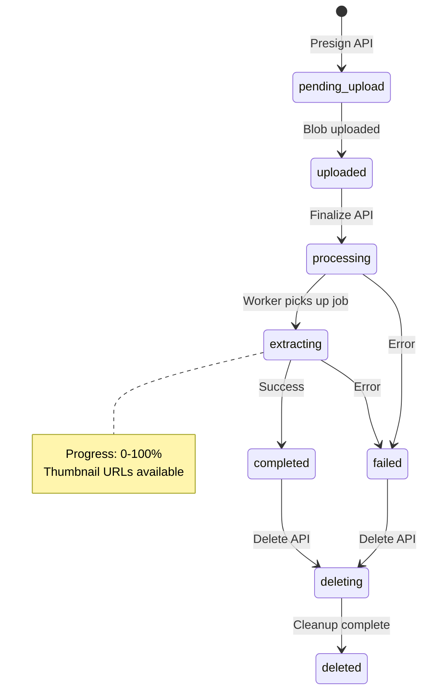

# Knowledge Base API Documentation

## Base URL

```text
/users/knowledge
```

---

## Response Envelope

All endpoints return the shared `GenericResponse` envelope.

```json
{
  "status": "SUCCESS | ERROR",
  "message": "Human-readable message",
  "data": { ... } | null
}
```

---

## Authentication

- Required: Bearer token (`Authorization: Bearer <access_token>`)
- User identity (organisation, user, role) resolved from the token; clients never pass these explicitly

---

## Rate Limiting (defaults)

- Write endpoints (`POST`, `DELETE`): ~15/min, 100/hour per user
- Read endpoints (`GET`): ~60/min, 1000/hour per user
- On limit breach: `429 Too Many Requests` with `Retry-After`

---

## Status Lifecycle

### Status Values

| Status            | Meaning                                                     | Terminal? | UI Guidance                           |
|-------------------|-------------------------------------------------------------|-----------|----------------------------------------|
| `pending_upload`  | File registered, waiting for blob upload                    | No        | Show "Waiting for upload" badge        |
| `uploaded`        | Blob present, ready for finalize                            | No        | Enable "Finalize" action               |
| `processing`      | Initial processing (checksum, thumbnails) started           | No        | Show "Preparing..." indicator          |
| `extracting`      | Text extraction in progress with progress updates           | No        | Display progress bar (0-100%)          |
| `completed`       | Document ready for search and download                      | Yes       | Mark as available, show thumbnail      |
| `failed`          | Processing error; see `error_message` for cause             | Yes       | Show error state with retry option     |
| `deleting`        | Deletion in progress (background cleanup running)           | Yes*      | Show "Deleting..." indicator           |
| `deleted`         | Source permanently removed (SSE event only)                 | Yes       | Remove from UI state immediately       |

> **Note:** `deleting` is terminal for SSE streaming purposes (no further status updates expected), but the source still exists until `deleted` event.

### Status Flow Diagram



### Terminal Status Handling

Frontend should stop polling/watching when a source reaches a terminal status:

```javascript
const TERMINAL_STATUSES = ['completed', 'failed', 'deleting', 'deleted'];
const isTerminal = (status) => TERMINAL_STATUSES.includes(status);
```

---

## 1. Batch Presign Upload URLs

### Batch Presign Upload URLs Endpoint

```http
POST /users/knowledge/presign/batch
```

### Batch Presign Upload URLs Description

Registers one or more files and returns SAS upload URLs so the browser can upload directly to storage. Partial success is supported.

### Batch Presign Upload URLs Authentication

Required

### Batch Presign Upload URLs Request Body

```json
{
  "files": [
    { "filename": "report.pdf", "mimetype": "application/pdf", "size_bytes": 5242880 }
  ],
  "default_filters": { "department": "sales" },
  "client_batch_id": "batch-123"
}
```

### Request Fields

| Field             | Type    | Required | Description                                      |
|-------------------|---------|----------|--------------------------------------------------|
| `files`           | array   | Yes      | File descriptors; at least one required          |
| `filename`        | string  | Yes      | 1..255 characters                                |
| `mimetype`        | string  | Yes      | Detected MIME type                               |
| `size_bytes`      | integer | Yes      | File size in bytes (> 0)                          |
| `default_filters` | object  | No       | Metadata auto-applied to each source             |
| `client_batch_id` | string  | No       | Client correlation token (<= 100 characters)    |

### Batch Presign Upload URLs Success Response (200)

```json
{
  "status": "SUCCESS",
  "message": "Batch presign completed",
  "data": {
    "files": [
      {
        "source_id": "d7b2f0cd-4c9c-44a8-9f2a-998af8db6c34",
        "filename": "report.pdf",
        "mimetype": "application/pdf",
        "size_bytes": 5242880,
        "upload_url": "https://...",
        "expires_in_seconds": 600,
        "status": "pending_upload",
        "success": true
      }
    ],
    "errors": []
  }
}
```

### Error Response (200 with partial errors)

```json
{
  "status": "SUCCESS",
  "message": "Batch presign completed with 1 errors",
  "data": {
    "files": [
      {
        "source_id": "00000000-0000-0000-0000-000000000000",
        "filename": "bad.exe",
        "mimetype": "",
        "size_bytes": 0,
        "upload_url": null,
        "expires_in_seconds": 0,
        "status": "failed",
        "error_message": "Unsupported mimetype",
        "success": false
      }
    ],
    "errors": [
      { "filename": "bad.exe", "reason": "Unsupported mimetype" }
    ]
  }
}
```

### Error Response (400)

```json
{
  "status": "ERROR",
  "message": "File list cannot be empty",
  "data": null
}
```

---

## 2. Batch Finalize Uploads

### Batch Finalize Uploads Endpoint

```http
POST /users/knowledge/finalize/batch
```

### Batch Finalize Uploads Description

Marks uploaded files as ready for processing and enqueues extraction jobs. Returns per-file success and error details.

### Batch Finalize Uploads Authentication

Required

### Request Body

```json
{
  "files": [
    { "source_id": "d7b2f0cd-4c9c-44a8-9f2a-998af8db6c34", "checksum": "abc123" }
  ]
}
```

### Batch Finalize Uploads Success Response (200)

```json
{
  "status": "SUCCESS",
  "message": "Batch finalize completed",
  "data": {
    "results": [
      {
        "source_id": "d7b2f0cd-4c9c-44a8-9f2a-998af8db6c34",
        "status": "processing",
        "error": null
      }
    ],
    "errors": []
  }
}
```

### Partial Error Response (200)

```json
{
  "status": "SUCCESS",
  "message": "Batch finalize completed",
  "data": {
    "results": [],
    "errors": [
      { "source_id": "7c153f76-1bf3-4b5b-9f96-1af9a5bf8a70", "reason": "missing_upload" }
    ]
  }
}
```

### Error Response (500)

Returned when all finalize operations fail.

---

## 3. Get Source Status

### Get Source Status Endpoint

```http
GET /users/knowledge/source/{source_id}
```

### Get Source Status Description

Returns the latest status, metadata, and optional read SAS for a single knowledge source.

### Get Source Status Success Response (200)

```json
{
  "status": "SUCCESS",
  "message": "Source status retrieved",
  "data": {
    "source_id": "d7b2f0cd-4c9c-44a8-9f2a-998af8db6c34",
    "filename": "report.pdf",
    "mimetype": "application/pdf",
    "size_bytes": 5242880,
    "status": "completed",
    "created_at": "2025-10-10T10:00:00Z",
    "updated_at": "2025-10-10T10:05:00Z",
    "error_message": null,
    "storage_path": "org/123/report.pdf",
    "read_url": "https://...",
    "filters": { "department": "sales" },
    "checksum": "abc123",
    "thumbnail_small_path": "thumbnails/small.png",
    "thumbnail_medium_path": "thumbnails/medium.png"
  }
}
```

### Get Source Status Error Responses

- `404` when the source does not exist or access is denied
- `500` for unexpected errors

---

## 4. Stream Source Updates (SSE)

### Stream Source Updates Endpoint

```http
GET /users/knowledge/sources/stream?source_ids=<uuid>&source_ids=<uuid>
```

### Stream Source Updates Description

Streams real-time status updates for knowledge sources using Server-Sent Events (SSE). This is the **primary mechanism** for tracking upload progress, extraction status, and deletion events.

> **Important:** Always use `source_id` for SSE tracking - for uploads, extractions, AND deletions. The delete API returns both `source_id` and `job_id`, but SSE events are keyed by `source_id`. Ignore `job_id` for SSE purposes.

### Stream Source Updates Query Parameters

| Parameter    | Type        | Required | Description                                           |
|--------------|-------------|----------|-------------------------------------------------------|
| `source_ids` | array[UUID] | No       | Restrict stream to specific sources (repeat param)    |

When `source_ids` is omitted, the stream returns updates for all **non-terminal** sources belonging to the user.

### Stream Configuration

| Setting            | Value      | Description                                    |
|--------------------|------------|------------------------------------------------|
| Heartbeat interval | 25 seconds | `ping` events sent to keep connection alive    |
| Stream timeout     | 900 seconds (15 min) | Stream closes with `timeout` event    |
| Redis channel      | `kb:{org_id}:sources` | Internal pub/sub channel pattern     |

---

### SSE Event Types

The stream emits six distinct event types. Each event has `event:` and `data:` fields per SSE spec.

| Event Type | Purpose                                      | When Emitted                              |
|------------|----------------------------------------------|-------------------------------------------|
| `status`   | Source status/progress update                | Status change or progress increment       |
| `deleted`  | Source permanently removed                   | After deletion cleanup completes          |
| `complete` | All watched sources reached terminal status  | Stream can be closed                      |
| `ping`     | Heartbeat to keep connection alive           | Every 25 seconds                          |
| `timeout`  | Stream timeout reached                       | After 15 minutes                          |
| `error`    | Server-side error occurred                   | On internal error (reconnect recommended) |

---

### Event Payload Schema

#### `status` Event

Emitted when a source's status changes or processing progress updates.

```
event: status
data: [{...}]
```

**Payload Fields:**

| Field                 | Type        | Nullable | Description                                        |
|-----------------------|-------------|----------|----------------------------------------------------|
| `source_id`           | string(UUID)| No       | Unique identifier of the source                    |
| `status`              | string      | No       | Current status (see Status Lifecycle)              |
| `updated_at`          | string(ISO) | Yes      | Timestamp of the update                            |
| `error_message`       | string      | Yes      | Error details if `status` is `failed`              |
| `progress`            | integer     | Yes      | Processing progress 0-100 (only during `extracting`)|
| `thumbnail_small_url` | string      | Yes      | SAS URL for small thumbnail (120min expiry)        |
| `thumbnail_medium_url`| string      | Yes      | SAS URL for medium thumbnail (120min expiry)       |

**Example - Processing Started:**

```json
{
  "event": "status",
  "data": [{
    "source_id": "d7b2f0cd-4c9c-44a8-9f2a-998af8db6c34",
    "status": "processing",
    "updated_at": "2025-10-10T10:02:00Z",
    "progress": null,
    "error_message": null,
    "thumbnail_small_url": null,
    "thumbnail_medium_url": null
  }]
}
```

**Example - Extraction in Progress:**

```json
{
  "event": "status",
  "data": [{
    "source_id": "d7b2f0cd-4c9c-44a8-9f2a-998af8db6c34",
    "status": "extracting",
    "updated_at": "2025-10-10T10:03:15Z",
    "progress": 45,
    "error_message": null,
    "thumbnail_small_url": "https://storage.blob.core.windows.net/...",
    "thumbnail_medium_url": "https://storage.blob.core.windows.net/..."
  }]
}
```

**Example - Completed:**

```json
{
  "event": "status",
  "data": [{
    "source_id": "d7b2f0cd-4c9c-44a8-9f2a-998af8db6c34",
    "status": "completed",
    "updated_at": "2025-10-10T10:05:00Z",
    "progress": 100,
    "error_message": null,
    "thumbnail_small_url": "https://storage.blob.core.windows.net/...",
    "thumbnail_medium_url": "https://storage.blob.core.windows.net/..."
  }]
}
```

**Example - Failed:**

```json
{
  "event": "status",
  "data": [{
    "source_id": "d7b2f0cd-4c9c-44a8-9f2a-998af8db6c34",
    "status": "failed",
    "updated_at": "2025-10-10T10:04:30Z",
    "progress": 35,
    "error_message": "PDF extraction failed: Encrypted document",
    "thumbnail_small_url": null,
    "thumbnail_medium_url": null
  }]
}
```

---

#### `deleted` Event

Emitted when a source has been permanently removed from the system. Frontend should remove this source from local state.

```
event: deleted
data: [{...}]
```

**Example:**

```json
{
  "event": "deleted",
  "data": [{
    "source_id": "d7b2f0cd-4c9c-44a8-9f2a-998af8db6c34",
    "status": "deleted",
    "progress": 100
  }]
}
```

---

#### `complete` Event

Emitted when all watched sources have reached terminal status. Frontend can safely close the connection.

```
event: complete
data: {...}
```

**Example:**

```json
{
  "event": "complete",
  "data": {
    "message": "all_sources_completed"
  }
}
```

**Messages:**
- `all_sources_completed` - All watched sources reached terminal status
- `all_sources_terminal` - Initial snapshot shows all sources already terminal
- `no_sources_to_watch` - No non-terminal sources found for this user

---

#### `ping` Event

Heartbeat sent every 25 seconds to keep the connection alive. No action required.

```
event: ping
data: {...}
```

**Example:**

```json
{
  "event": "ping",
  "data": {
    "timestamp": 1733587200
  }
}
```

---

#### `timeout` Event

Emitted when the stream reaches its maximum duration (15 minutes). Frontend should reconnect.

```
event: timeout
data: {...}
```

**Example:**

```json
{
  "event": "timeout",
  "data": {
    "message": "Stream timeout reached. Please reconnect.",
    "timeout_seconds": 900,
    "reconnect": true
  }
}
```

---

#### `error` Event

Emitted on server-side errors. Frontend should attempt reconnection with exponential backoff.

```
event: error
data: {...}
```

**Example:**

```json
{
  "event": "error",
  "data": {
    "message": "Internal stream error. Please reconnect.",
    "error_type": "ConnectionError",
    "reconnect": true
  }
}
```

---

### Extraction Progress Stages

During document extraction, the `progress` field updates through these stages:

| Progress | Stage                      | Description                                |
|----------|----------------------------|--------------------------------------------|
| 5%       | Job started                | Task picked up by worker                   |
| 20%      | Document parsed            | PDF/DOC parsed, pages extracted            |
| 20-80%   | Chunk processing           | Per-chunk embedding and multimodal analysis|
| 90%      | Storing results            | Writing chunks to knowledge base           |
| 100%     | Complete                   | Extraction finished successfully           |

> **Note:** Thumbnail URLs become available at ~20% progress when the first page has been processed.

**Progress Calculation During Chunk Processing:**

For N chunks, progress increments linearly from 20% to 80%:
```
progress = 20 + (chunk_index / total_chunks) * 60
```

---

### Frontend Integration: Complete Example

```javascript
/**
 * Knowledge Base SSE Client
 * Handles real-time source status updates with reconnection logic
 */
class KnowledgeSSEClient {
  constructor(baseUrl, accessToken) {
    this.baseUrl = baseUrl;
    this.accessToken = accessToken;
    this.eventSource = null;
    this.reconnectAttempts = 0;
    this.maxReconnectAttempts = 5;
    this.listeners = new Map();
  }

  /**
   * Connect to SSE stream for specific sources
   * @param {string[]} sourceIds - Optional array of source UUIDs to watch
   */
  connect(sourceIds = []) {
    const params = new URLSearchParams();
    sourceIds.forEach(id => params.append('source_ids', id));
    
    const url = `${this.baseUrl}/users/knowledge/sources/stream?${params}`;
    
    this.eventSource = new EventSource(url, {
      headers: { 'Authorization': `Bearer ${this.accessToken}` }
    });

    // Handle status updates (most common event)
    this.eventSource.addEventListener('status', (event) => {
      const updates = JSON.parse(event.data);
      this.handleStatusUpdates(updates);
    });

    // Handle deletion completions
    this.eventSource.addEventListener('deleted', (event) => {
      const updates = JSON.parse(event.data);
      updates.forEach(update => {
        this.emit('sourceDeleted', update.source_id);
      });
    });

    // Handle stream completion
    this.eventSource.addEventListener('complete', (event) => {
      const data = JSON.parse(event.data);
      console.log('SSE stream complete:', data.message);
      this.emit('streamComplete', data);
      this.close();
    });

    // Handle heartbeats (optional logging)
    this.eventSource.addEventListener('ping', () => {
      this.reconnectAttempts = 0; // Reset on successful ping
    });

    // Handle timeout - reconnect
    this.eventSource.addEventListener('timeout', (event) => {
      const data = JSON.parse(event.data);
      console.warn('SSE timeout:', data.message);
      if (data.reconnect) {
        this.reconnect(sourceIds);
      }
    });

    // Handle errors - reconnect with backoff
    this.eventSource.addEventListener('error', (event) => {
      console.error('SSE error:', event);
      this.reconnect(sourceIds);
    });

    // Native error handler for connection issues
    this.eventSource.onerror = () => {
      if (this.eventSource.readyState === EventSource.CLOSED) {
        this.reconnect(sourceIds);
      }
    };
  }

  handleStatusUpdates(updates) {
    updates.forEach(update => {
      const { source_id, status, progress, error_message, 
              thumbnail_small_url, thumbnail_medium_url } = update;

      // Emit progress update
      this.emit('progress', {
        sourceId: source_id,
        status,
        progress: progress ?? 0,
        errorMessage: error_message,
        thumbnailSmall: thumbnail_small_url,
        thumbnailMedium: thumbnail_medium_url
      });

      // Emit specific status events
      switch (status) {
        case 'extracting':
          this.emit('extracting', { sourceId: source_id, progress });
          break;
        case 'completed':
          this.emit('completed', { sourceId: source_id });
          break;
        case 'failed':
          this.emit('failed', { sourceId: source_id, error: error_message });
          break;
        case 'deleting':
          this.emit('deleting', { sourceId: source_id });
          break;
      }
    });
  }

  reconnect(sourceIds) {
    if (this.reconnectAttempts >= this.maxReconnectAttempts) {
      console.error('Max reconnect attempts reached');
      this.emit('maxReconnectsReached');
      return;
    }

    this.close();
    this.reconnectAttempts++;
    
    // Exponential backoff: 1s, 2s, 4s, 8s, 16s
    const delay = Math.pow(2, this.reconnectAttempts - 1) * 1000;
    console.log(`Reconnecting in ${delay}ms (attempt ${this.reconnectAttempts})`);
    
    setTimeout(() => this.connect(sourceIds), delay);
  }

  on(event, callback) {
    if (!this.listeners.has(event)) {
      this.listeners.set(event, []);
    }
    this.listeners.get(event).push(callback);
  }

  emit(event, data) {
    const callbacks = this.listeners.get(event) || [];
    callbacks.forEach(cb => cb(data));
  }

  close() {
    if (this.eventSource) {
      this.eventSource.close();
      this.eventSource = null;
    }
  }
}

// Usage Example:
const client = new KnowledgeSSEClient('/api', accessToken);

// Listen for progress updates
client.on('progress', ({ sourceId, status, progress, thumbnailSmall }) => {
  updateProgressBar(sourceId, progress);
  if (thumbnailSmall) {
    showThumbnail(sourceId, thumbnailSmall);
  }
});

// Listen for completion
client.on('completed', ({ sourceId }) => {
  markSourceComplete(sourceId);
});

// Listen for failures
client.on('failed', ({ sourceId, error }) => {
  showError(sourceId, error);
});

// Listen for deletions
client.on('sourceDeleted', (sourceId) => {
  removeSourceFromUI(sourceId);
});

// Connect to watch specific sources after upload
const sourceIds = ['uuid-1', 'uuid-2'];
client.connect(sourceIds);
```

---

### React Hook Example

```typescript
import { useEffect, useState, useCallback } from 'react';

interface SourceProgress {
  sourceId: string;
  status: string;
  progress: number;
  errorMessage?: string;
  thumbnailSmall?: string;
  thumbnailMedium?: string;
}

export function useKnowledgeSSE(sourceIds: string[], accessToken: string) {
  const [sources, setSources] = useState<Map<string, SourceProgress>>(new Map());
  const [isConnected, setIsConnected] = useState(false);
  const [error, setError] = useState<string | null>(null);

  const updateSource = useCallback((update: SourceProgress) => {
    setSources(prev => new Map(prev).set(update.sourceId, update));
  }, []);

  const removeSource = useCallback((sourceId: string) => {
    setSources(prev => {
      const next = new Map(prev);
      next.delete(sourceId);
      return next;
    });
  }, []);

  useEffect(() => {
    if (sourceIds.length === 0) return;

    const params = sourceIds.map(id => `source_ids=${id}`).join('&');
    const eventSource = new EventSource(
      `/api/users/knowledge/sources/stream?${params}`,
      { headers: { Authorization: `Bearer ${accessToken}` } }
    );

    eventSource.onopen = () => {
      setIsConnected(true);
      setError(null);
    };

    eventSource.addEventListener('status', (e) => {
      const updates = JSON.parse(e.data);
      updates.forEach((u: any) => {
        updateSource({
          sourceId: u.source_id,
          status: u.status,
          progress: u.progress ?? 0,
          errorMessage: u.error_message,
          thumbnailSmall: u.thumbnail_small_url,
          thumbnailMedium: u.thumbnail_medium_url,
        });
      });
    });

    eventSource.addEventListener('deleted', (e) => {
      const updates = JSON.parse(e.data);
      updates.forEach((u: any) => removeSource(u.source_id));
    });

    eventSource.addEventListener('complete', () => {
      setIsConnected(false);
      eventSource.close();
    });

    eventSource.onerror = () => {
      setIsConnected(false);
      setError('Connection lost. Reconnecting...');
    };

    return () => eventSource.close();
  }, [sourceIds.join(','), accessToken]);

  return { sources: Array.from(sources.values()), isConnected, error };
}

// Usage in component:
function UploadProgress({ sourceIds }: { sourceIds: string[] }) {
  const { sources, isConnected, error } = useKnowledgeSSE(sourceIds, accessToken);

  return (
    <div>
      {error && <Alert>{error}</Alert>}
      {sources.map(source => (
        <div key={source.sourceId}>
          <ProgressBar value={source.progress} />
          <span>{source.status}</span>
          {source.thumbnailSmall && }
          {source.errorMessage && <ErrorText>{source.errorMessage}</ErrorText>}
        </div>
      ))}
    </div>
  );
}
```

---

## 5. List Sources (Paginated)

### List Sources Endpoint

```http
GET /users/knowledge/sources?limit=20&cursor=<opaque>&statuses=completed&source_types=file&q=report&include_urls=true
```

### List Sources Description

Returns a cursor-paginated list of knowledge sources with optional filters.

> **Important:** By default, `failed` sources are **excluded** from results to keep normal browsing clean. To retrieve failed files, explicitly pass `statuses=failed`.

### List Sources Query Parameters

| Parameter      | Type           | Required | Description                                                       |
|----------------|----------------|----------|-------------------------------------------------------------------|
| `limit`        | integer        | No       | Items per page (1..100, default 20)                               |
| `cursor`       | string         | No       | Opaque cursor from previous response                              |
| `statuses`     | array[string]  | No       | Filter by status. **If omitted, `failed` is excluded by default** |
| `source_types` | array[string]  | No       | Filter by type (`file`, `integration`)                            |
| `q`            | string         | No       | Case-insensitive substring match on filename                      |
| `updated_after`| datetime (ISO) | No       | Filter sources updated after this timestamp. Useful for recent failures |
| `include_urls` | boolean        | No       | Include signed URLs in payload (default `false`)                  |

### Fetching Recent Failures

To get failed files from the last 7 days (after page refresh):

```http
GET /users/knowledge/sources?statuses=failed&updated_after=2025-11-30T00:00:00Z&limit=10
```

**Frontend example:**
```javascript
// Calculate 7 days ago
const sevenDaysAgo = new Date(Date.now() - 7 * 24 * 60 * 60 * 1000).toISOString();

// Fetch recent failures
const failures = await fetch(
  `/api/users/knowledge/sources?statuses=failed&updated_after=${sevenDaysAgo}&limit=10`
);
```

### List Sources Success Response (200)

```json
{
  "status": "SUCCESS",
  "message": "Sources listed",
  "data": {
    "items": [
      {
        "source_id": "d7b2f0cd-4c9c-44a8-9f2a-998af8db6c34",
        "filename": "report.pdf",
        "mimetype": "application/pdf",
        "size_bytes": 5242880,
        "status": "completed",
        "created_at": "2025-10-10T10:00:00Z",
        "updated_at": "2025-10-10T10:05:00Z",
        "error_message": null,
        "checksum": "abc123",
        "thumbnail_small_url": null,
        "thumbnail_medium_url": null,
        "is_active": false
      },
      {
        "source_id": "a1b2c3d4-e5f6-7890-abcd-ef1234567890",
        "filename": "processing.pdf",
        "mimetype": "application/pdf",
        "size_bytes": 1024000,
        "status": "extracting",
        "created_at": "2025-10-10T10:10:00Z",
        "updated_at": "2025-10-10T10:10:30Z",
        "error_message": null,
        "checksum": null,
        "thumbnail_small_url": "https://...",
        "thumbnail_medium_url": "https://...",
        "is_active": true
      }
    ],
    "cursor": null
  }
}
```

### List Sources Response Fields

| Field | Type | Description |
|-------|------|-------------|
| `source_id` | UUID | Unique identifier for the source |
| `filename` | string | Original filename |
| `mimetype` | string | MIME type of the file |
| `size_bytes` | integer | File size in bytes |
| `status` | string | Current processing status |
| `created_at` | datetime | When the source was created |
| `updated_at` | datetime | Last status update time |
| `error_message` | string | Error details (if status is `failed`) |
| `checksum` | string | File checksum (if computed) |
| `thumbnail_small_url` | string | SAS URL for small thumbnail (if `include_urls=true`) |
| `thumbnail_medium_url` | string | SAS URL for medium thumbnail (if `include_urls=true`) |
| `is_active` | boolean | **True if source needs SSE monitoring** (see below) |

### The `is_active` Field

The `is_active` field indicates whether a source is still being processed and should be monitored via SSE. This simplifies frontend logic by moving status categorization to the backend.

**Active statuses (is_active = true):**
- `pending_upload` - Waiting for blob upload
- `uploaded` - Blob uploaded, waiting for finalize
- `processing` - Initial processing (checksum, thumbnails)
- `extracting` - Text extraction in progress
- `deleting` - Deletion in progress

**Terminal statuses (is_active = false):**
- `completed` - Processing finished successfully
- `failed` - Processing failed (check `error_message`)

**Frontend usage:**
```javascript
// Get all active sources for SSE monitoring
const activeSources = sources.items.filter(s => s.is_active);
const activeSourceIds = activeSources.map(s => s.source_id);

// Connect SSE only for active sources
if (activeSourceIds.length > 0) {
  connectSSE(activeSourceIds);
}
```

### List Sources Error Responses

- `400` for invalid filters or cursor
- `500` for unexpected errors

---

## 6. Generate Download URL

### Generate Download URL Endpoint

```http
GET /users/knowledge/source/{source_id}/download?expires_minutes=120
```

### Generate Download URL Description

Generates a temporary read SAS URL for the original file.

### Generate Download URL Query Parameters

| Parameter        | Type    | Required | Description                              |
|------------------|---------|----------|------------------------------------------|
| `expires_minutes`| integer | No       | 1..720, default 120 minutes               |

### Generate Download URL Success Response (200)

```json
{
  "status": "SUCCESS",
  "message": "Download URL generated",
  "data": {
    "source_id": "d7b2f0cd-4c9c-44a8-9f2a-998af8db6c34",
    "download_url": "https://...",
    "expires_in_seconds": 7200
  }
}
```

### Generate Download URL Error Responses

- `404` if source missing or access denied
- `500` unexpected

---

## 7. Retrieve Aggregated Stats

### Retrieve Aggregated Stats Endpoint

```http
GET /users/knowledge/sources/stats
```

### Retrieve Aggregated Stats Description

Returns aggregate counts for dashboard widgets, including active sources count and recent failures.

### Retrieve Aggregated Stats Success Response (200)

```json
{
  "status": "SUCCESS",
  "message": "Source stats retrieved",
  "data": {
    "total": 42,
    "by_status": {
      "pending_upload": 1,
      "processing": 2,
      "extracting": 2,
      "completed": 30,
      "failed": 7
    },
    "by_type": {
      "file": 33,
      "integration": 9
    },
    "active_count": 5,
    "recent_failures_24h": 2
  }
}
```

### Stats Response Fields

| Field | Type | Description |
|-------|------|-------------|
| `total` | integer | Total number of sources (excluding soft-deleted) |
| `by_status` | object | Count of sources per status |
| `by_type` | object | Count of sources per type (`file`, `integration`) |
| `active_count` | integer | **Count of sources needing SSE monitoring** |
| `recent_failures_24h` | integer | **Count of sources that failed in the last 24 hours** |

### Dashboard Badge Usage

```javascript
const stats = await fetchStats();

// Show "In Progress" badge
if (stats.active_count > 0) {
  showBadge('in-progress', stats.active_count);
}

// Show "Recent Issues" badge
if (stats.recent_failures_24h > 0) {
  showBadge('issues', stats.recent_failures_24h);
}
```

---

## 8. Delete Sources

### Delete Sources Endpoint

```http
DELETE /users/knowledge/sources
```

### Delete Sources Description

Delete one or more knowledge sources in a single request. This unified endpoint handles both single file and batch deletion - simply pass one or more source IDs. The endpoint:

1. **Validates ownership** - Each source must belong to the authenticated user's organisation
2. **Creates deletion jobs** - A `KnowledgeProcessingJob` record is created for each source to track deletion progress
3. **Updates source status** - Source status changes to `deleting` and `is_deleted` flag is set
4. **Enqueues background tasks** - Celery tasks are dispatched to perform actual cleanup (blob deletion, document removal)
5. **Returns immediately** - Returns `202 Accepted` with job tracking information

Supports partial success for batch operations - some sources may be deleted while others fail validation.

### Delete Sources Request Body

```json
{
  "source_ids": [
    "d7b2f0cd-4c9c-44a8-9f2a-998af8db6c34"
  ],
  "client_batch_id": "optional-correlation-id"
}
```

For batch deletion:

```json
{
  "source_ids": [
    "d7b2f0cd-4c9c-44a8-9f2a-998af8db6c34",
    "e8c3f1de-5d0a-55b9-0f3b-009bf9ec7d45",
    "f9d4g2ef-6e1b-66ca-1g4c-110cg0fd8e56"
  ],
  "client_batch_id": "optional-correlation-id"
}
```

### Delete Sources Request Fields

| Field             | Type         | Required | Description                                      |
|-------------------|--------------|----------|--------------------------------------------------|
| `source_ids`      | array[UUID]  | Yes      | List of source IDs to delete (1-100 items)       |
| `client_batch_id` | string       | No       | Client correlation token (<= 100 characters)     |

### Delete Sources Success Response (202)

Single source:

```json
{
  "status": "SUCCESS",
  "message": "Deletion enqueued",
  "data": {
    "batch_id": "b1234567-89ab-cdef-0123-456789abcdef",
    "results": [
      {
        "source_id": "d7b2f0cd-4c9c-44a8-9f2a-998af8db6c34",
        "status": "deleting",
        "job_id": "a1b2c3d4-e5f6-7890-abcd-ef1234567890"
      }
    ],
    "errors": []
  }
}
```

Multiple sources:

```json
{
  "status": "SUCCESS",
  "message": "Batch deletion enqueued (3 sources)",
  "data": {
    "batch_id": "b1234567-89ab-cdef-0123-456789abcdef",
    "results": [
      {
        "source_id": "d7b2f0cd-4c9c-44a8-9f2a-998af8db6c34",
        "status": "deleting",
        "job_id": "a1b2c3d4-e5f6-7890-abcd-ef1234567890"
      },
      {
        "source_id": "e8c3f1de-5d0a-55b9-0f3b-009bf9ec7d45",
        "status": "already_deleted",
        "job_id": null
      }
    ],
    "errors": []
  }
}
```

### Delete Sources Response Fields

| Field                  | Type        | Description                                              |
|------------------------|-------------|----------------------------------------------------------|
| `batch_id`             | UUID        | Server-generated ID for this deletion batch              |
| `results`              | array       | Successfully processed sources                           |
| `results[].source_id`  | UUID        | **The source ID - use this for SSE tracking**            |
| `results[].status`     | string      | `"deleting"` or `"already_deleted"`                      |
| `results[].job_id`     | UUID\|null  | Job tracking ID (internal use only, not for SSE)         |
| `errors`               | array       | Sources that failed validation                           |
| `errors[].source_id`   | UUID        | The source ID that failed                                |
| `errors[].reason`      | string      | Error code: `"not_found"`, `"already_deleted"`, `"db_error"` |
| `errors[].message`     | string      | Human-readable error description                         |

> **SSE Tracking:** Use `source_id` (not `job_id`) when connecting to SSE to track deletion progress. The SSE stream will emit `status` events with `status: "deleting"` and finally a `deleted` event when cleanup completes.

### Delete Sources Partial Error Response (202)

```json
{
  "status": "SUCCESS",
  "message": "Batch deletion enqueued (2 sources) with 1 errors",
  "data": {
    "batch_id": "b1234567-89ab-cdef-0123-456789abcdef",
    "results": [
      {
        "source_id": "d7b2f0cd-4c9c-44a8-9f2a-998af8db6c34",
        "status": "deleting",
        "job_id": "a1b2c3d4-e5f6-7890-abcd-ef1234567890"
      }
    ],
    "errors": [
      {
        "source_id": "f9d4g2ef-6e1b-66ca-1g4c-110cg0fd8e56",
        "reason": "not_found",
        "message": "Source not found or access denied"
      }
    ]
  }
}
```

### Delete Sources Idempotent Behavior

- If a source is already deleted, it appears in `errors` with `reason: "already_deleted"`
- If a source is currently being deleted (status = `deleting`), it appears in `results` with the existing `job_id`
- Repeated deletion requests for the same source are safe and will not cause errors

### Delete Sources Error Responses

- `400` when request validation fails (empty source_ids, exceeds 100 limit)
- `400` when all deletion requests failed (all sources not found or already deleted)
- `500` unexpected server error

### Delete Sources Background Processing

After the API returns `202 Accepted`, background workers perform the actual cleanup:

1. **Delete derived documents** - Removes all chunks from `knowledge_base` table
2. **Delete associated jobs** - Cleans up `KnowledgeProcessingJob` records
3. **Delete blobs** - Removes original file and thumbnails from Azure storage
4. **Hard-delete source** - Permanently removes the `OrganisationSource` record

Progress is published via Redis pub/sub and can be monitored through SSE (see below).

- `500` unexpected server error

---

## 9. Deletion Status via SSE

To track deletion progress in real-time, subscribe to the SSE stream endpoint with the source IDs being deleted.

### SSE Stream Endpoint for Deletion

```http
GET /users/knowledge/sources/stream?source_ids=<uuid>&source_ids=<uuid>
```

Pass the `source_id` values from the deletion response to track specific sources. When subscribed to `/sources/stream`, deletion progress is streamed as follows:

### Deletion Progress Event

During deletion, the worker publishes progress updates:

| Progress | Stage Description                        |
|----------|------------------------------------------|
| 0%       | Deletion job started                     |
| 100%     | Deletion complete, source removed        |

```json
{
  "event": "status",
  "data": [{
    "source_id": "d7b2f0cd-4c9c-44a8-9f2a-998af8db6c34",
    "status": "deleting",
    "progress": 50,
    "error_message": null
  }]
}
```

### Deletion Completed Event

When deletion completes successfully, a special `deleted` event type is emitted to signal the UI should remove the source from its state:

```json
{
  "event": "deleted",
  "data": [{
    "source_id": "d7b2f0cd-4c9c-44a8-9f2a-998af8db6c34",
    "status": "deleted",
    "progress": 100
  }]
}
```

### Deletion Failed Event

If deletion fails at any stage, the source status changes to `failed` with an error message:

```json
{
  "event": "status",
  "data": [{
    "source_id": "d7b2f0cd-4c9c-44a8-9f2a-998af8db6c34",
    "status": "failed",
    "progress": 60,
    "error_message": "Blob deletion failed: Azure storage timeout"
  }]
}
```

### Frontend Integration Example

```javascript
// After calling DELETE /users/knowledge/sources
const response = await deleteSourcesAPI({ source_ids: [...] });
const sourceIds = response.data.results.map(r => r.source_id);

// Subscribe to SSE for deletion progress
const params = sourceIds.map(id => `source_ids=${id}`).join('&');
const eventSource = new EventSource(`/users/knowledge/sources/stream?${params}`);

eventSource.addEventListener('status', (event) => {
  const updates = JSON.parse(event.data);
  updates.forEach(update => {
    if (update.status === 'deleting') {
      updateProgressUI(update.source_id, update.progress);
    } else if (update.status === 'failed') {
      showErrorUI(update.source_id, update.error_message);
    }
  });
});

eventSource.addEventListener('deleted', (event) => {
  const updates = JSON.parse(event.data);
  updates.forEach(update => {
    removeSourceFromUI(update.source_id);
  });
});
```

---

## Error Codes Summary

| HTTP Code | Reason                                              | Suggested Action                         |
|-----------|------------------------------------------------------|------------------------------------------|
| 400       | Validation failure (missing fields, invalid cursor)  | Fix request payload                      |
| 401       | Missing/invalid token                                | Ensure valid bearer token                |
| 403       | Access denied (ownership)                            | Confirm user permissions                 |
| 404       | Source not found                                     | Verify `source_id`                       |
| 409/422   | Conflicting state (rare)                             | Retry after resolving conflict           |
| 429       | Rate limit exceeded                                  | Respect `Retry-After` header             |
| 500       | Unexpected server error                              | Retry with backoff; contact support      |

---

## Frontend Integration Notes

### Upload Flow

1. **Presign → Upload → Finalize** sequence is required per file
2. After `presign/batch`, upload directly to Azure using the SAS URL
3. After blob upload completes, call `finalize/batch` to trigger processing
4. Connect to SSE stream immediately after finalize to track progress

### SSE Best Practices

1. **Connect after finalize**: Subscribe to SSE with returned `source_ids` immediately after `finalize/batch`
2. **Reconnect with exponential backoff**: On disconnect/error, retry at 1s, 2s, 4s, 8s intervals
3. **Handle all event types**: At minimum handle `status`, `deleted`, `complete`, and `error`
4. **Close on completion**: Disconnect when receiving `complete` event or when all sources reach terminal status
5. **Timeout handling**: Stream times out after 15 minutes; reconnect if user is still on page

### State Management

1. **Initial state**: Use `GET /sources` list endpoint to fetch current state on page load
2. **Real-time updates**: Use SSE for live updates; merge into local state
3. **Terminal status caching**: Once a source reaches `completed`/`failed`, no further SSE updates expected
4. **Thumbnail display**: SAS URLs expire after 2 hours; refresh via list API if needed

### Deletion Handling

1. **Confirm with user**: Deletion is irreversible once cleanup completes
2. **Optimistic UI**: Show "Deleting..." state immediately on API success
3. **SSE for completion**: Listen for `deleted` event to confirm removal
4. **Remove from state**: On `deleted` event, remove source from UI completely

### Error Handling

| Scenario | Recommended Action |
|----------|-------------------|
| SSE `error` event | Reconnect with backoff |
| SSE `timeout` event | Reconnect immediately |
| HTTP 429 (rate limit) | Wait for `Retry-After` header value |
| HTTP 401 (unauthorized) | Refresh token and retry |
| Source status `failed` | Show error message, offer retry option |

### Complete Upload + Track Flow

```javascript
async function uploadAndTrack(files) {
  // 1. Presign
  const presignRes = await fetch('/api/users/knowledge/presign/batch', {
    method: 'POST',
    headers: { 'Authorization': `Bearer ${token}` },
    body: JSON.stringify({ files })
  });
  const { data: { files: presigned } } = await presignRes.json();
  
  // 2. Upload blobs to Azure
  await Promise.all(presigned.map(async (file) => {
    await fetch(file.upload_url, {
      method: 'PUT',
      headers: { 'x-ms-blob-type': 'BlockBlob' },
      body: fileContents[file.filename]
    });
  }));
  
  // 3. Finalize
  const finalizeRes = await fetch('/api/users/knowledge/finalize/batch', {
    method: 'POST',
    headers: { 'Authorization': `Bearer ${token}` },
    body: JSON.stringify({
      files: presigned.map(f => ({ source_id: f.source_id, checksum: computedChecksums[f.filename] }))
    })
  });
  const { data: { results } } = await finalizeRes.json();
  
  // 4. Connect SSE for progress tracking
  const sourceIds = results.map(r => r.source_id);
  const params = sourceIds.map(id => `source_ids=${id}`).join('&');
  const eventSource = new EventSource(`/api/users/knowledge/sources/stream?${params}`);
  
  eventSource.addEventListener('status', (e) => {
    const updates = JSON.parse(e.data);
    updates.forEach(u => updateUI(u.source_id, u.status, u.progress));
  });
  
  eventSource.addEventListener('complete', () => {
    eventSource.close();
    showUploadComplete();
  });
}
```

---

## Related References

- Functional overview: `docs/Functional Documentation/knowledge-base.md`
- Technical implementation: `docs/Technical Documentation/knowledge-base.md`
