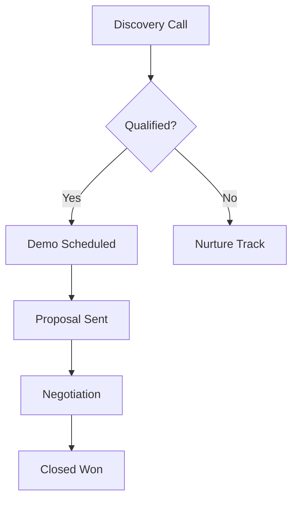
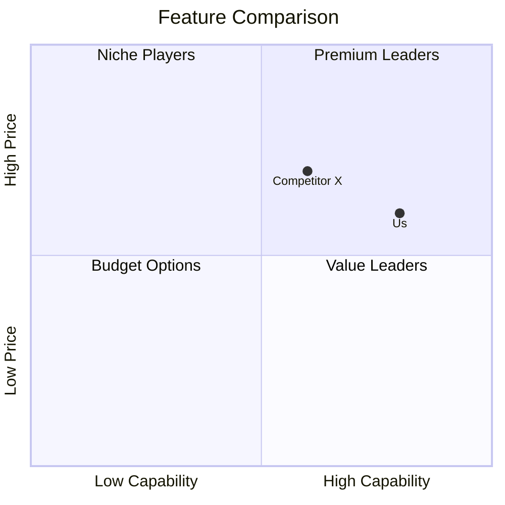

# GeneralAgent Enhancement Plan - Rich Output & Prompt Improvements

## Overview

This document outlines enhancements to the GeneralAgent to improve output quality, add visualization capabilities, and enhance the system prompt for better sales intelligence assistance.

---

## Research Summary

### Industry Best Practices (2025)

| Area | Best Practice |
|------|---------------|
| **Mermaid Diagrams** | Use two-step approach (structured JSON to Mermaid syntax) for reliability |
| **Structured Outputs** | Essential for production - predictable data formats improve downstream processing |
| **Agent Prompts** | Need clear identity, instructions, examples, and context sections |
| **Sales AI** | Map flows to sales funnel stages, use context engineering with prospect profiles |

### Current Gaps Identified

- No Mermaid/diagram rendering support in Frame types
- Prompt lacks persona depth, examples, and sales frameworks
- No structured data visualization beyond Markdown tables
- Missing chain-of-thought reasoning guidance

---

## Enhancement Categories

### 1. Rich Output Enhancements

#### 1.1 Add Mermaid Diagram Support

**New Frame Type:** `VisualizationFrame`

```python
class VisualizationFrame(BaseStreamFrame):
    type: Literal["visualization"] = "visualization"
    visualization_type: Literal["mermaid", "table", "timeline", "chart"]
    content: str  # Mermaid syntax or structured data
    title: str | None = None
    description: str | None = None
```

**Files to modify:**
- `src/api/schemas/chat_stream_models.py` - Add VisualizationFrame
- `src/agents/common/metadata_parser.py` - Parse visualization metadata
- `src/agents/workflows/general/prompts/general_prompt.py` - Add diagram instructions

**Use Cases:**
- Deal pipeline flowcharts
- Stakeholder relationship maps
- Meeting timeline visualization
- Sales process diagrams
- Org charts

#### 1.2 Add Structured Data Frame

**New Frame Type:** `StructuredDataFrame`

```python
class StructuredDataFrame(BaseStreamFrame):
    type: Literal["structured_data"] = "structured_data"
    data_type: Literal["table", "comparison", "timeline", "list"]
    columns: list[str] | None = None
    rows: list[dict] | None = None
    metadata: dict | None = None
```

**Use Cases:**
- Feature comparisons
- Stakeholder lists with details
- Meeting summaries in tabular format
- Email thread timelines

---

### 2. Prompt Engineering Enhancements

#### 2.1 Enhanced Identity Section

```markdown
## Identity

You are **Kai**, an AI Sales Intelligence Assistant created by CopilotGTM.

**Core Expertise:**
- Enterprise B2B sales strategy and deal management
- Stakeholder mapping and relationship intelligence
- Meeting preparation and follow-up optimization
- Competitive intelligence and market analysis
- Sales methodology frameworks (MEDDIC, BANT, Challenger Sale)

**Personality Traits:**
- Professional yet approachable
- Data-driven with actionable insights
- Proactive in surfacing relevant information
- Concise but thorough when needed

**Communication Style:**
- Clear, structured responses with visual hierarchy
- Uses diagrams and tables when they aid understanding
- Provides context before recommendations
- Always cites sources for factual claims
```

#### 2.2 Chain-of-Thought Reasoning

```markdown
## Reasoning Approach

For complex queries, use structured reasoning:

1. **Understand**: What is the user actually asking? What's their underlying goal?
2. **Gather**: What information do I need? Which tools should I use?
3. **Analyze**: What patterns or insights emerge from the data?
4. **Synthesize**: How do I present this most effectively?
5. **Recommend**: What actionable next steps can I suggest?

When dealing with ambiguity, make reasonable assumptions and state them clearly.
```

#### 2.3 Sales Framework Guidance

```markdown
## Sales Intelligence Frameworks

Apply these frameworks when relevant:

**MEDDIC Analysis:**
- Metrics: Quantified business impact
- Economic Buyer: Decision maker with budget authority
- Decision Criteria: Requirements for evaluation
- Decision Process: Steps to purchase
- Identify Pain: Business problems being solved
- Champion: Internal advocate

**Stakeholder Mapping:**
- Power/Interest grid for prioritization
- Identify champions, blockers, and neutral parties
- Track engagement levels and sentiment

**Deal Health Indicators:**
- Activity recency and frequency
- Stakeholder coverage
- Next steps clarity
- Competitive positioning
```

#### 2.4 Visualization Instructions

```markdown
## Visual Output Guidelines

Use Mermaid diagrams for:
- **Flowcharts**: Sales processes, decision trees
- **Sequence Diagrams**: Communication flows, meeting interactions
- **Gantt Charts**: Deal timelines, milestone tracking
- **Org Charts**: Stakeholder hierarchies
- **Mind Maps**: Topic exploration, strategy mapping

**Mermaid Syntax Example:**


Use tables for:
- Feature comparisons
- Stakeholder summaries
- Meeting action items
- Competitive analysis
```

#### 2.5 Few-Shot Examples

```markdown
## Response Examples

**Example 1: Deal Overview Request**
User: "Give me a summary of the Acme deal"

Response:
## Acme Corp Deal Summary

| Metric | Value |
|--------|-------|
| Stage | Negotiation |
| Value | $150,000 |
| Close Date | March 15, 2025 |
| Health | Good |

### Key Stakeholders
- **John Smith** (Champion) - VP Engineering
- **Sarah Jones** (Economic Buyer) - CFO

### Recent Activity
- Demo completed Jan 10 - positive feedback
- Proposal sent Jan 12 - awaiting review

### Next Steps
1. Follow up with CFO on budget approval
2. Schedule technical validation call

[Sources: Internal CRM, Meeting notes from Jan 10]

---

**Example 2: Competitive Analysis**
User: "How do we compare to Competitor X?"

Response:
## Competitive Comparison: Us vs Competitor X



| Feature | Us | Competitor X |
|---------|-----|--------------|
| AI Analysis | Advanced | Basic |
| Integration | 50+ | 20+ |
| Pricing | $$/user | $$$/user |

**Key Differentiators:**
- Our AI provides deeper insights
- Better value at lower price point
- More extensive integrations

[Sources: G2 Reviews, Internal competitive intel]
```

---

### 3. Metadata Enhancements

#### 3.1 Extended AEP Schema

```json
{
  "version": "aep/1",
  "confidence_score": "high",
  "reasoning_summary": "Brief explanation of approach taken",
  "visualizations": [
    {
      "type": "mermaid",
      "diagram_type": "flowchart",
      "content": "flowchart TD\n    A-->B"
    }
  ],
  "structured_data": [
    {
      "type": "table",
      "title": "Comparison",
      "columns": ["Feature", "Us", "Them"],
      "rows": [...]
    }
  ],
  "suggested_questions": [...],
  "sources": [...]
}
```

---

## Implementation Order

### Phase 1: Prompt Enhancements (Quick Wins)

| Step | Task | File |
|------|------|------|
| 1 | Add enhanced identity/persona section | `general_prompt.py` |
| 2 | Add chain-of-thought reasoning guidance | `general_prompt.py` |
| 3 | Add sales frameworks (MEDDIC, etc.) | `general_prompt.py` |
| 4 | Add few-shot examples | `general_prompt.py` |
| 5 | Add Mermaid diagram instructions | `general_prompt.py` |
| 6 | Reorganize prompt structure with clear sections | `general_prompt.py` |

### Phase 2: Output Frame Enhancements

| Step | Task | File |
|------|------|------|
| 1 | Add VisualizationFrame type | `chat_stream_models.py` |
| 2 | Add StructuredDataFrame type | `chat_stream_models.py` |
| 3 | Update MetadataParser to handle new types | `metadata_parser.py` |
| 4 | Update prompt to include visualization metadata | `general_prompt.py` |

### Phase 3: Advanced Features

| Step | Task | File |
|------|------|------|
| 1 | Add diagram validation/repair logic | New utility |
| 2 | Add structured data rendering hints | `metadata_parser.py` |
| 3 | Add response templates for common queries | `general_prompt.py` |

---

## Files to Modify

| File | Changes |
|------|---------|
| `src/agents/workflows/general/prompts/general_prompt.py` | Reorganize and enhance all sections |
| `src/api/schemas/chat_stream_models.py` | Add VisualizationFrame, StructuredDataFrame |
| `src/agents/common/metadata_parser.py` | Parse visualization/structured_data fields |

---

## Verification Plan

### Prompt Testing
- Test with sample queries: deal overview, stakeholder analysis, competitive comparison
- Verify Mermaid diagrams are generated correctly
- Check that sales frameworks are applied appropriately

### Frame Testing
- Verify new frame types serialize correctly to JSON
- Test SSE streaming with visualization frames
- Ensure backward compatibility with existing frames

### Integration Testing
- End-to-end test with real tool outputs
- Verify citations and sources work with new format
- Test with frontend to ensure diagrams render

---

## References

- [Structured Data Generation Best Practices](https://www.matt-adams.co.uk/2025/02/12/structured-data-generation.html)
- [LLMermaid Framework](https://github.com/fladdict/llmermaid)
- [AI for UML Diagrams](https://addjam.com/blog/2025-03-31/ai-llm-system-design-uml-diagrams/)
- [OpenAI Prompt Engineering Guide](https://platform.openai.com/docs/guides/prompt-engineering)
- [Prompt Engineering for AI Agents](https://www.prompthub.us/blog/prompt-engineering-for-ai-agents)
- [Building Reliable AI Agents 2025](https://www.uipath.com/blog/ai/agent-builder-best-practices)
