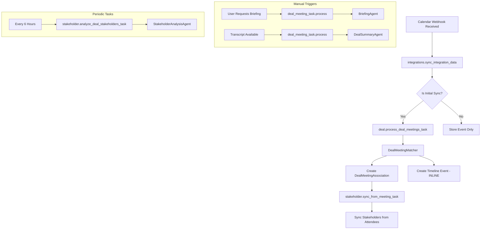
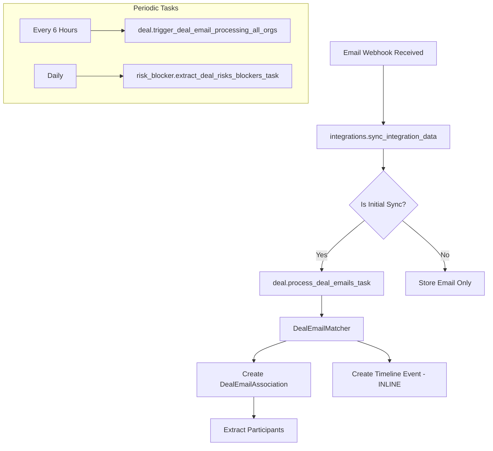
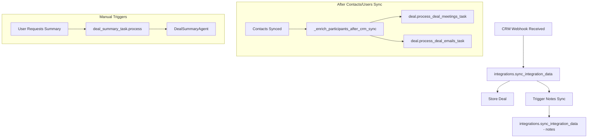
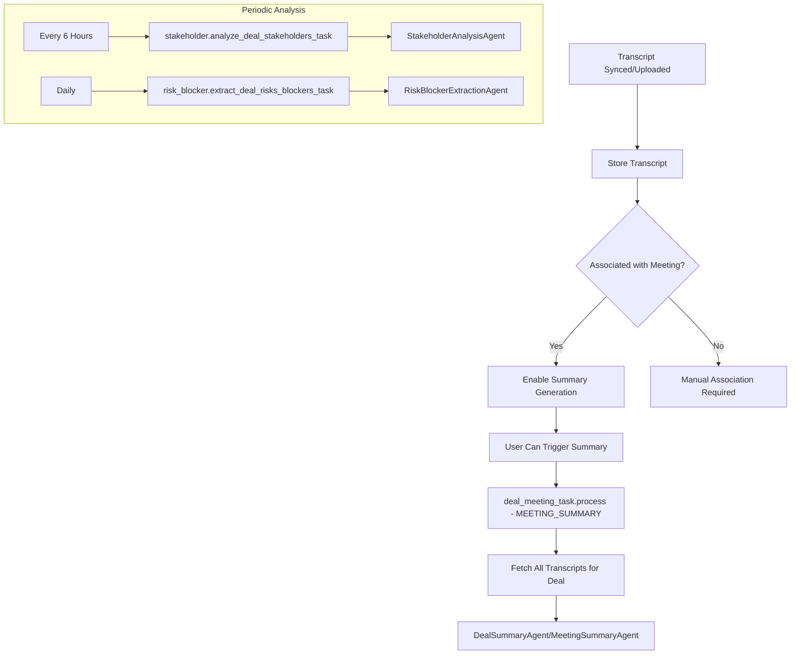

# Task Orchestration Implementation

## Overview

This task document describes the implementation plan for automated task orchestration in the CopilotGTM backend. The goal is to ensure that when one entity is updated (e.g., new meeting received, new email synced), all dependent tasks are automatically triggered to keep the system data consistent and up-to-date.

## Current State Analysis

### Celery Workers

The application has the following Celery workers:

| Worker | Purpose | Queue(s) |
|--------|---------|----------|
| `integrations_worker` | External data sync (Nango webhooks) | `integrations`, `integrations_priority` |
| `deal_worker` | Deal processing and AI tasks | `deal`, `deal_jobs` |
| `knowledge_worker` | Document extraction and processing | `knowledge`, `knowledge_heavy` |
| `chat_worker` | Chat message processing | `chat`, `chat_priority` |

---

## Identified Entities and Their Tasks

### 1. **Meeting (CalendarEvent)**

**Source**: Calendar integration sync (Google Calendar, Microsoft Outlook)

**Celery Task**: `integrations.sync_integration_data` (category: `calendar`, sync_name: `events`)

**Associated AI Agents**:

- `BriefingAgent` - Pre-meeting preparation briefing
- `DealSummaryAgent` - Post-meeting summary (via transcripts)
- `StakeholderAnalysisAgent` - Analyze stakeholders from transcripts

**Downstream Tasks When Meeting is Created/Updated**:

| Downstream Task | Task Name | Trigger Condition |
|-----------------|-----------|-------------------|
| Match meeting to deals | `deal.process_deal_meetings_task` | After calendar sync |
| Sync stakeholders from attendees | `stakeholder.sync_from_meeting_task` | After meeting-deal association |
| Update timeline | Timeline created INLINE in `DealMeetingMatcher` | After meeting-deal association |
| Generate briefing | `deal_meeting_task.process` (MEETING_BRIEFING) | Manual trigger (frontend) |
| Generate summary | `deal_meeting_task.process` (MEETING_SUMMARY) | Manual trigger (requires transcript) |
| Analyze stakeholders | `stakeholder.analyze_deal_stakeholders_task` | After transcript available |
| Extract risks/blockers | `risk_blocker.extract_deal_risks_blockers_task` | After transcript available |

---

### 2. **Email (EmailMessage)**

**Source**: Email integration sync (Google Gmail, Microsoft Outlook)

**Celery Task**: `integrations.sync_integration_data` (category: `email`, sync_name: `emails`/`messages`)

**Downstream Tasks When Email is Created/Updated**:

| Downstream Task | Task Name | Trigger Condition |
|-----------------|-----------|-------------------|
| Match email to deals | `deal.process_deal_emails_task` | After email sync |
| Update timeline | Timeline created INLINE in `DealEmailMatcher` | After email-deal association |
| Update stakeholders | Part of email matching (extracts participants) | After email-deal association |
| Extract risks/blockers | `risk_blocker.extract_deal_risks_blockers_task` | Part of periodic extraction |

---

### 3. **Deal (CRMDeal)**

**Source**: CRM integration sync (HubSpot, Salesforce)

**Celery Task**: `integrations.sync_integration_data` (category: `crm`, sync_name: `deals`/`opportunities`)

**Downstream Tasks When Deal is Created/Updated**:

| Downstream Task | Task Name | Trigger Condition |
|-----------------|-----------|-------------------|
| Match meetings to deal | `deal.process_single_deal_task` | After deal created |
| Match emails to deal | Part of `process_deal_emails_task` | After deal created |
| Sync deal timeline | `deal.sync_deal_timeline` | Batch backfill only |
| Sync CRM notes | `integrations.sync_integration_data` (notes) | After deal sync |
| Generate deal summary | `deal_summary_task.process` | Manual trigger (frontend) |

---

### 4. **Contact (CRMContact)**

**Source**: CRM integration sync (HubSpot, Salesforce)

**Celery Task**: `integrations.sync_integration_data` (category: `crm`, sync_name: `contacts`)

**Downstream Tasks When Contact is Created/Updated**:

| Downstream Task | Task Name | Trigger Condition |
|-----------------|-----------|-------------------|
| Re-enrich deal participants | `_enrich_participants_after_crm_sync` | After contacts sync |
| Trigger deal-meeting matching | `deal.process_deal_meetings_task` | After participants enriched |
| Trigger deal-email matching | `deal.process_deal_emails_task` | After participants enriched |
| Re-enrich CRM activities | `_enrich_activities_after_crm_sync` | After contacts sync |

---

### 5. **Stakeholder (DealStakeholder)**

**Source**: Derived from meeting attendees, email participants, CRM contacts

**Celery Tasks**:

- `stakeholder.sync_from_meeting_task` - Sync from specific meeting
- `stakeholder.analyze_deal_stakeholders_task` - AI analysis for a deal
- `stakeholder.analyze_org_stakeholders_task` - AI analysis for entire org

**AI Agent**: `StakeholderAnalysisAgent`

**Downstream Tasks When Stakeholder is Updated**:

| Downstream Task | Task Name | Trigger Condition |
|-----------------|-----------|-------------------|
| Analyze stakeholder insights | `stakeholder.analyze_deal_stakeholders_task` | After new transcript available |
| Update deal summary | Included in next summary generation | Manual trigger |

---

### 6. **Transcript (MeetingTranscript)**

**Source**: Teams integration, manual upload

**Celery Task**: Part of meeting sync or document extraction

**Downstream Tasks When Transcript is Available**:

| Downstream Task | Task Name | Trigger Condition |
|-----------------|-----------|-------------------|
| Generate meeting summary | `deal_meeting_task.process` (MEETING_SUMMARY) | Manual trigger |
| Analyze stakeholders | `stakeholder.analyze_deal_stakeholders_task` | After transcript sync |
| Extract risks/blockers | `risk_blocker.extract_deal_risks_blockers_task` | After transcript sync |
| Update deal summary | `deal_summary_task.process` | Manual trigger |

---

### 7. **Knowledge Document (OrganisationSource)**

**Source**: File upload, Teams sync, SharePoint

**Celery Tasks**:

- `knowledge.post_upload` - Initial processing after upload
- `knowledge.document_extraction` - Heavy extraction (PDF/DOC)

**Downstream Tasks When Document is Processed**:

| Downstream Task | Task Name | Trigger Condition |
|-----------------|-----------|-------------------|
| Extract content | `knowledge.document_extraction` | After upload |
| Generate embeddings | Part of extraction pipeline | After extraction |
| Available for RAG | Automatic | After embeddings stored |

---

### 8. **Teams Channel/Chat Messages**

**Source**: Teams integration sync

**Celery Tasks**:

- `integrations.sync_teams_channels` - Sync channels and chats
- `integrations.sync_integration_data` (category: `messaging`) - Message sync

**Downstream Tasks**:

| Downstream Task | Task Name | Trigger Condition |
|-----------------|-----------|-------------------|
| Update timeline (future) | TBD | After message sync |
| Extract risks/blockers | Part of extraction | After message sync |

---

## AI Agents Summary

| Agent | Purpose | Input | Output | Used By Task |
|-------|---------|-------|--------|--------------|
| `BriefingAgent` | Pre-meeting preparation | deal_id, event_id | BriefingData | `deal_meeting_task.process` (MEETING_BRIEFING) |
| `DealSummaryAgent` | Comprehensive deal summary | deal_id, transcripts | DealSummaryData | `deal_summary_task.process` |
| `StakeholderAnalysisAgent` | Stakeholder insights from transcripts | deal context, transcripts | DealStakeholdersAnalysisData | `stakeholder.analyze_deal_stakeholders_task` |
| `RiskBlockerExtractionAgent` | Identify risks/blockers from content | deal_id, timeline content | RiskBlockerExtractionResult | `risk_blocker.extract_deal_risks_blockers_task` |

---

## Current Periodic Schedules (Celery Beat)

### Integration Worker

| Schedule Name | Task | Cron | Purpose |
|---------------|------|------|---------|
| `refresh-expiring-oauth-tokens` | `integrations.refresh_expiring_tokens` | Every hour at :00 | Token refresh |
| `sync-teams-channels-all-orgs` | `integrations.sync_teams_channels` | Every 3 hours | Teams sync |

### Deal Worker

| Schedule Name | Task | Cron | Purpose |
|---------------|------|------|---------|
| `process-deal-meetings-all-orgs` | `deal.trigger_deal_meeting_processing_all_orgs` | Every 6 hours | Meeting-deal matching |
| `process-deal-emails-all-orgs` | `deal.trigger_deal_email_processing_all_orgs` | Every 6 hours | Email-deal matching |
| `analyze-stakeholders-all-orgs` | `stakeholder.trigger_analysis_all_orgs` | Every 6 hours | Stakeholder analysis |
| `extract-risks-blockers-all-orgs` | `risk_blocker.trigger_extraction_all_orgs` | Daily at 5:25 UTC | Risk extraction |
| `sync-timeline-all-orgs` | `deal.trigger_timeline_sync_all_orgs` | Every hour at :30 | Timeline backfill |

---

## Task Orchestration Flow Diagrams

### Flow 1: New Meeting Received



### Flow 2: New Email Received



### Flow 3: New Deal Created



### Flow 4: Transcript Available



---

## Implementation Tasks

### Phase 1: Document Current State (COMPLETED)

- [x] Identify all Celery tasks across workers
- [x] Identify all AI agents
- [x] Map current trigger points
- [x] Document periodic schedules

### Phase 2: Implement Event-Driven Triggers

#### 2.1 Post-Meeting Sync Automation

**Goal**: When a new meeting is synced, automatically trigger dependent tasks.

**Current**: Meetings are matched to deals via periodic task (every 6 hours).

**Proposed**: Add event-driven triggers in the dispatcher.

```python
# In dispatcher.py - after calendar events sync
if category == "calendar" and sync_name == "events":
    # Already triggers: deal.process_deal_meetings_task
    # TODO: Add trigger for stakeholder sync after association
```

**Changes Required**:

1. In `DealMeetingMatcher`, after creating association, trigger stakeholder sync task
2. Add option to trigger stakeholder analysis after sync completes

#### 2.2 Post-Email Sync Automation

**Goal**: When new emails are synced, trigger stakeholder updates.

**Current**: Emails are matched to deals via periodic task (every 6 hours).

**Proposed**: Ensure stakeholder tracking is updated from email participants.

```python
# In DealEmailMatcher - after creating association
# Participants are already extracted from email
# Timeline is already created inline
# TODO: Consider triggering stakeholder analysis if significant new participants
```

#### 2.3 Post-Transcript Availability

**Goal**: When a transcript becomes available, trigger analysis tasks.

**Current**: No automatic trigger.

**Proposed**: Add webhook handler or post-sync trigger.

```python
# After transcript is stored for a meeting
async def trigger_post_transcript_tasks(org_id: UUID, deal_id: UUID, event_id: UUID):
    # 1. Trigger stakeholder analysis for the deal
    stakeholder.analyze_deal_stakeholders_task.apply_async(
        args=[str(org_id), str(deal_id)],
        headers=correlation_headers(),
    )
    
    # 2. Optionally trigger risk/blocker extraction
    risk_blocker.extract_deal_risks_blockers_task.apply_async(
        args=[str(org_id), str(deal_id)],
        headers=correlation_headers(),
    )
```

#### 2.4 Briefing Auto-Generation (Future)

**Goal**: Automatically generate briefing when meeting is upcoming.

**Current**: Manual trigger from frontend.

**Proposed**: Schedule briefing generation 24h/4h before meeting.

```python
# New scheduled task
@app.task(name="deal.auto_generate_briefings")
def auto_generate_briefings():
    """Generate briefings for meetings happening in next 24 hours."""
    # 1. Find meetings in next 24 hours without briefing
    # 2. Create DealJob for each
    # 3. Enqueue deal_meeting_task.process (MEETING_BRIEFING)
```

### Phase 3: Implement Task Chaining

#### 3.1 Meeting Processing Chain

```python
from celery import chain

def create_meeting_processing_chain(org_id: str, deal_id: str, event_id: str):
    """Chain of tasks after meeting-deal association."""
    return chain(
        # 1. Sync stakeholders from meeting
        sync_stakeholders_from_meeting_task.s(org_id, deal_id, event_id),
        # 2. If transcript available, analyze stakeholders
        analyze_deal_stakeholders_task.s(org_id, deal_id),
    )
```

#### 3.2 Deal Creation Chain

```python
def create_deal_processing_chain(org_id: str, deal_id: str):
    """Chain of tasks after new deal is created."""
    return chain(
        # 1. Match meetings to deal
        process_single_deal_task.s(org_id, deal_id),
        # 2. Sync timeline
        sync_deal_timeline_task.s(org_id, deal_id),
    )
```

### Phase 4: Implement Orchestration Service

Create a centralized orchestration service to manage task dependencies:

```python
# src/service/orchestration/task_orchestrator.py

class TaskOrchestrator:
    """Centralized task orchestration based on entity events."""
    
    async def on_meeting_synced(self, org_id: UUID, event_ids: list[UUID]):
        """Trigger tasks when meetings are synced."""
        # Trigger deal matching
        process_deal_meetings_task.apply_async(args=[str(org_id)])
    
    async def on_meeting_associated(self, org_id: UUID, deal_id: UUID, event_id: UUID):
        """Trigger tasks when meeting is associated with deal."""
        # Sync stakeholders
        sync_stakeholders_from_meeting_task.apply_async(
            args=[str(org_id), str(deal_id), str(event_id)]
        )
    
    async def on_email_synced(self, org_id: UUID, email_ids: list[UUID]):
        """Trigger tasks when emails are synced."""
        # Trigger deal matching
        process_deal_emails_task.apply_async(args=[str(org_id)])
    
    async def on_transcript_available(self, org_id: UUID, deal_id: UUID, event_id: UUID):
        """Trigger tasks when transcript becomes available."""
        # Trigger stakeholder analysis
        analyze_deal_stakeholders_task.apply_async(args=[str(org_id), str(deal_id)])
        # Trigger risk extraction
        extract_deal_risks_blockers_task.apply_async(args=[str(org_id), str(deal_id)])
    
    async def on_deal_created(self, org_id: UUID, deal_id: UUID):
        """Trigger tasks when new deal is created."""
        # Trigger meeting matching
        process_single_deal_task.apply_async(args=[str(org_id), str(deal_id)])
```

---

## Dependency Matrix

This matrix shows what tasks should run when each entity type is updated:

| When This Updates ↓ | Match Meetings | Match Emails | Sync Stakeholders | Analyze Stakeholders | Extract Risks | Update Timeline | Generate Briefing | Generate Summary |
|---------------------|----------------|--------------|-------------------|---------------------|---------------|-----------------|-------------------|------------------|
| **New Meeting** | ✅ | - | ✅ | ⏰ (periodic) | ⏰ (periodic) | ✅ (inline) | 👤 (manual) | 👤 (manual) |
| **New Email** | - | ✅ | Partial | ⏰ (periodic) | ⏰ (periodic) | ✅ (inline) | - | - |
| **New Deal** | ✅ | ✅ | ✅ | ⏰ (periodic) | ⏰ (periodic) | ⏰ (backfill) | - | 👤 (manual) |
| **New Contact** | ✅ | ✅ | - | - | - | - | - | - |
| **Transcript Available** | - | - | - | ✅ | ✅ | - | - | 👤 (manual) |
| **CRM Notes Sync** | - | - | - | - | ✅ | - | - | - |

Legend:

- ✅ = Should trigger immediately
- ⏰ = Currently periodic/scheduled
- 👤 = Manual trigger (frontend)
- `-` = Not applicable

---

## Success Criteria

1. **No Stale Data**: When a meeting is synced, stakeholders should be updated within minutes, not hours
2. **Automatic Enrichment**: When transcript is available, analysis tasks should run automatically
3. **Audit Trail**: All triggered tasks should be logged with correlation IDs
4. **Graceful Failure**: If one task fails, others should still execute
5. **Idempotency**: Tasks should be safe to retry without duplicating data

---

## Files to Modify

| File | Changes |
|------|---------|
| `src/workers/integrations_worker/services/dispatcher.py` | Add post-sync task triggers |
| `src/workers/deal_worker/services/deal_meeting_matcher.py` | Trigger stakeholder sync after association |
| `src/workers/deal_worker/services/deal_email_matcher.py` | Trigger stakeholder sync after association |
| `src/service/integrations/transcript_service.py` | Add post-transcript-available triggers |
| `src/service/orchestration/task_orchestrator.py` | **NEW** - Centralized orchestration |
| `src/workers/deal_worker/config.py` | Update beat schedules if needed |

---

## Testing Plan

1. **Unit Tests**: Test each trigger point individually
2. **Integration Tests**: Test full chains (e.g., meeting sync → deal match → stakeholder sync)
3. **Load Tests**: Ensure task queues handle burst of webhooks
4. **Manual Tests**: Verify end-to-end flow in staging environment

---

## References

- [Celery Worker Creation Guide](../Technical%20Documentation/celery-worker-creation-guide.md)
- [Deal Meeting Automation](../Technical%20Documentation/deal/deal-meeting-automation.md)
- [Deal Email Matching](../Technical%20Documentation/deal/deal-email-matching-automation.md)
- [Stakeholder Analysis Tasks](../Technical%20Documentation/deal/stakeholder-analysis-tasks.md)
- [Deal Timeline Feature](../Development%20Documentation/deal-timeline-feature.md)
