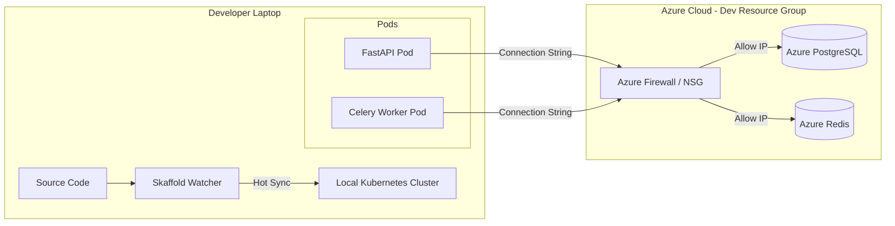

# Local Development with Skaffold & Remote Azure Resources

## Overview

This document details the "Local Compute, Remote Data" development strategy for the Copilot Backend. This approach leverages **Skaffold** to orchestrate a local Kubernetes cluster (running the API and Workers) while connecting to real, persistent infrastructure (Postgres, Redis) hosted in a dedicated Azure Resource Group.

This hybrid model offers a balance between development speed, environment realism, and resource efficiency.

## The Architecture: Local Compute, Remote Data

In this setup, the heavy "stateful" services are offloaded to the cloud, while the "stateless" application code runs on your machine.

1. **Local Environment (Compute)**:
    * **Tooling**: Docker Desktop (Kubernetes enabled) or Minikube.
    * **Orchestrator**: Skaffold.
    * **Workload**: The FastAPI Backend and Celery Workers run as Pods in your local cluster.
    * **Code Sync**: Skaffold watches your source code. When you save a file, it syncs the changes directly to the running containers in seconds, bypassing full image rebuilds.

2. **Remote Environment (Data)**:
    * **Infrastructure**: A dedicated Azure Resource Group (e.g., `rg-copilot-dev-local`).
    * **Services**: Azure Database for PostgreSQL, Azure Cache for Redis, Azure Storage Accounts.
    * **Connectivity**: Services are exposed via public endpoints but secured via strict IP whitelisting.

### Conceptual Diagram

## Why Skaffold?

Skaffold is a command-line tool that facilitates continuous development for Kubernetes applications.

* **Fast Feedback Loop**: It detects changes in your source code and handles the workflow of building, pushing, and deploying your application automatically.
* **File Syncing**: For interpreted languages like Python, Skaffold can copy changed files directly into running containers. This reduces the "edit-test" cycle from minutes (rebuilding Docker images) to seconds.
* **Log Streaming**: It aggregates logs from all deployed pods and streams them to your terminal, making debugging easier.

## Benefits (Pros)

1. **Environment Realism**:
    * You test against **real Azure services**, not Docker emulations. This catches cloud-specific issues (e.g., SSL modes, connection timeouts, specific Redis configurations) early in the dev cycle.
    * It mimics the production environment topology more closely than Docker Compose.

2. **Resource Efficiency**:
    * Running production-grade databases (Postgres, Redis, Vector DBs) locally consumes significant RAM and CPU. Offloading these to Azure frees up your local machine for IDEs and browser tabs.

3. **Data Persistence**:
    * Local Docker volumes can be flaky or get wiped during resets. Azure data persists until you explicitly delete it. You can maintain a stable set of test data.

4. **Unified Configuration**:
    * You use the **same Helm charts** for local development as you do for Production. This ensures your Helm templates are constantly tested and validated.

## Drawbacks (Cons)

1. **Network Latency**:
    * Every database query must travel over the internet. While usually fast, it will be slower than a `localhost` connection (milliseconds vs. microseconds). This might make bulk data operations feel sluggish.

2. **Internet Dependency**:
    * You cannot work offline. A stable internet connection is required to reach the Azure resources.

3. **Cost**:
    * Unlike local containers, Azure resources incur a cost. However, using "Basic" tiers or "Serverless" options for Dev resources can minimize this.

4. **Setup Complexity**:
    * Requires initial setup of Azure resources and configuring IP whitelisting rules.

## Security Model

Since we are exposing database endpoints publicly, security is paramount.

1. **IP Whitelisting**:
    * The Azure resources must **NOT** be open to `0.0.0.0/0`.
    * Firewall rules must be configured to accept traffic **only** from the specific public IP addresses of the developers.

2. **Separate Credentials**:
    * Do not use Production or Shared Dev credentials.
    * Use a dedicated set of credentials for this "Local-Dev" environment.

3. **Data Privacy**:
    * **NEVER** load real customer PII (Personally Identifiable Information) into this environment. Use synthetic or anonymized seed data only.

## Implementation Plan

To adopt this strategy, we will:

1. **Infrastructure Setup**:
    * Create the `rg-copilot-dev-local` resource group.
    * Provision the necessary databases.
    * Configure firewall rules for developer IPs.

2. **Configuration**:
    * Create a `skaffold.yaml` file in the project root to define the build and deploy pipeline.
    * Create a `values-local.yaml` file to override Helm values (pointing to the Azure resources instead of in-cluster services).

3. **Developer Workflow**:
    * Developer runs `az login` (if needed for ACR access).
    * Developer runs `skaffold dev`.
    * Skaffold deploys the app to the local cluster.
    * Developer edits code -> Skaffold syncs -> App updates instantly.
