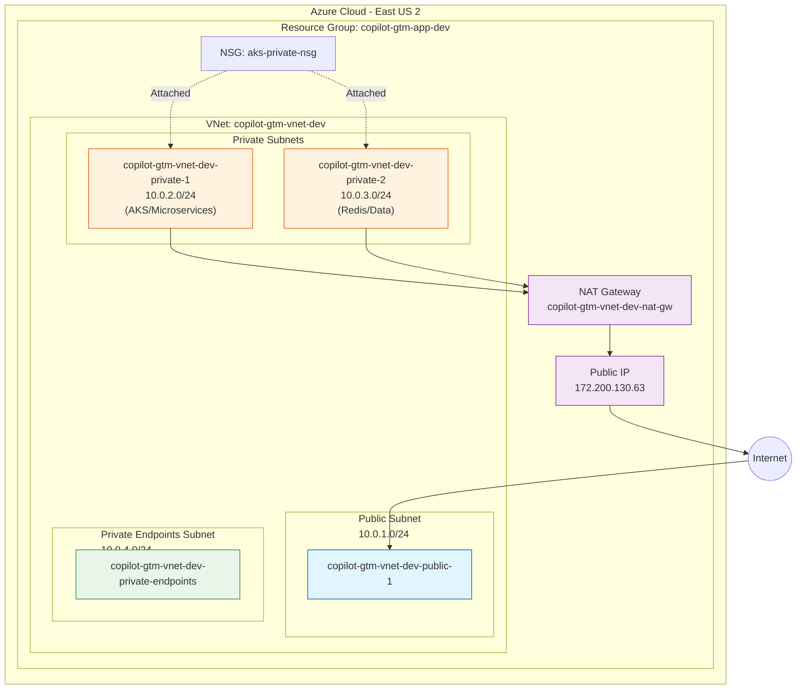

# VNet Module Documentation

## Overview

The VNet (Virtual Network) module creates and manages the core networking infrastructure for the CopilotGTM platform on Azure. It provides network isolation, security, and connectivity for all Azure resources.

## Architecture Diagram



## Network Configuration (Dev Environment)

| Component | Name | CIDR/Value | Purpose |
|-----------|------|------------|---------|
| **VNet** | copilot-gtm-vnet-dev | 10.0.0.0/16 | Main virtual network |
| **Public Subnet** | copilot-gtm-vnet-dev-public-1 | 10.0.1.0/24 | Internet-facing resources |
| **Private Subnet 1** | copilot-gtm-vnet-dev-private-1 | 10.0.2.0/24 | AKS cluster & microservices |
| **Private Subnet 2** | copilot-gtm-vnet-dev-private-2 | 10.0.3.0/24 | Redis cache & data services |
| **Private Endpoints Subnet** | copilot-gtm-vnet-dev-private-endpoints | 10.0.4.0/24 | Azure Private Link endpoints |
| **NAT Gateway** | copilot-gtm-vnet-dev-nat-gw | 172.200.130.63 | Outbound internet for private subnets |

## Subnet Details

### Public Subnet (10.0.1.0/24)

- **Purpose**: Hosts internet-facing resources
- **Resources**: Load balancers, App Gateway (if used)
- **Internet Access**: Direct inbound/outbound

### Private Subnet 1 - AKS (10.0.2.0/24)

- **Purpose**: Hosts AKS cluster nodes and microservices
- **Resources**: AKS node pools, backend services
- **Internet Access**: Outbound only via NAT Gateway
- **Security**: NSG with controlled inbound rules

### Private Subnet 2 - Data (10.0.3.0/24)

- **Purpose**: Hosts data-tier services
- **Resources**: Redis cache, database connections
- **Internet Access**: Outbound only via NAT Gateway
- **Security**: NSG with controlled inbound rules

### Private Endpoints Subnet (10.0.4.0/24) - NEW (SOC2)

- **Purpose**: Dedicated subnet for Azure Private Link endpoints
- **Resources**: Private endpoints for Key Vault, Storage, ACR, PostgreSQL, Redis
- **Special Config**: `private_endpoint_network_policies = "Disabled"`
- **SOC2 Compliance**: Enables services to be accessed over private network only

## Network Security Group (NSG) Rules

The `aks-private-nsg` is attached to all private subnets with the following rules:

| Priority | Name | Direction | Protocol | Ports | Source | Description |
|----------|------|-----------|----------|-------|--------|-------------|
| 1000 | Allow-Azure-LB-Health-Probe | Inbound | TCP | * | AzureLoadBalancer | Health probes |
| 1001 | Allow-Public-Ingress | Inbound | TCP | 80, 443 | Internet | HTTP/HTTPS traffic |
| 1003 | Allow-NodePorts-Debug | Inbound | TCP | 30000-32767 | * | AKS NodePort debugging |

## NAT Gateway

The NAT Gateway provides outbound internet connectivity for all private subnets:

- **Public IP**: Static IP for consistent egress
- **Association**: Attached to both private subnets
- **Purpose**: Enables private resources to reach external APIs, container registries, etc.

## Module Inputs

| Variable | Type | Required | Default | Description |
|----------|------|----------|---------|-------------|
| `vnet_name` | string | Yes | - | Name of the Virtual Network |
| `address_space` | list(string) | Yes | - | VNet address space (e.g., ["10.0.0.0/16"]) |
| `location` | string | Yes | - | Azure region |
| `resource_group_name` | string | Yes | - | Resource group name |
| `public_subnets` | list(string) | Yes | - | List of public subnet CIDRs |
| `private_subnets` | list(string) | Yes | - | List of private subnet CIDRs |
| `env` | string | Yes | - | Environment identifier |
| `private_endpoints_subnet_prefix` | string | No | "" | CIDR for private endpoints subnet |
| `private_subnet_dependencies` | any | No | [] | Resources subnets depend on |

## Module Outputs

| Output | Description |
|--------|-------------|
| `vnet_id` | ID of the created VNet |
| `vnet_name` | Name of the created VNet |
| `address_space` | VNet address space |
| `public_subnet_ids` | List of public subnet IDs |
| `private_subnet_ids` | List of private subnet IDs |
| `public_subnet_names` | List of public subnet names |
| `private_subnet_names` | List of private subnet names |
| `nat_gateway_public_ip` | NAT Gateway public IP |
| `private_endpoints_subnet_id` | Private endpoints subnet ID |
| `private_endpoints_subnet_name` | Private endpoints subnet name |

---

## SOC2 Compliance Changes (December 2025)

### What Was Added

1. **Private Endpoints Subnet** (`10.0.4.0/24`)
   - New dedicated subnet for Azure Private Link endpoints
   - Configured with `private_endpoint_network_policies = "Disabled"` (required for Private Link)
   - Enables secure private connectivity to Azure PaaS services

2. **Key Vault Private Endpoint Support**
   - Key Vault module updated to support private endpoints
   - Toggle: `enable_key_vault_private_endpoints` (currently `false` in dev)
   - When enabled: creates private endpoint + disables public access

3. **Azure DevOps PAT Key Vault Integration**
   - PAT can now be sourced from Key Vault via `azuredevops_pat_secret_name`
   - Backwards compatible: still works with tfvars-based PAT

### How It Will Be Used

```hcl
# Current state (safe, public access)
enable_key_vault_private_endpoints = false

# Future state (SOC2 compliant, after agent is in VNet)
enable_key_vault_private_endpoints = true
```

When `enable_key_vault_private_endpoints = true`:

1. Private DNS zone for Key Vault is created (`privatelink.vaultcore.azure.net`)
2. Private endpoint is created in the `private-endpoints` subnet
3. Key Vault public network access is disabled
4. All Key Vault access happens over private network

### Rollout Plan

| Service | Status | Toggle Variable |
|---------|--------|-----------------|
| Key Vault | Ready (toggle off) | `enable_key_vault_private_endpoints` |
| Storage Account | Planned | `enable_storage_private_endpoints` |
| ACR | Planned | `enable_acr_private_endpoints` |
| PostgreSQL | Planned | `enable_postgres_private_endpoints` |
| Redis | Planned | `enable_redis_private_endpoints` |

### Prerequisites Before Enabling

1. **Terraform Runner Access**: Must run Terraform from inside the VNet (self-hosted agent in AKS or VM)
2. **DNS Resolution**: Private DNS zones must be linked to VNet
3. **Network Connectivity**: Workloads must be in same VNet or peered network

---

## Usage Example

```hcl
module "vnet" {
  source = "../modules/vnet"

  vnet_name           = "${var.vnet_name}-${var.env}"
  address_space       = var.vnet_address_space
  location            = module.resource_group.resource_group_location
  resource_group_name = module.resource_group.resource_group_name
  public_subnets      = var.vnet_public_subnets
  private_subnets     = var.vnet_private_subnets
  env                 = var.env

  # SOC2: Enable private endpoints subnet
  private_endpoints_subnet_prefix = var.vnet_private_endpoints_subnet

  depends_on = [module.resource_group]
}
```

---

## Related Resources

- [Private Access Implementation Tracker](../private-access-implementation-tracker.md)
- [SOC2 Infrastructure Production Readiness](../soc2-infra-production-readiness.md)
- [Key Vault Module](./key-vault-module.md) *(to be created)*

---

## FAQ

**Q: Why do we have a separate subnet for Private Endpoints when we already have two private subnets?**  
A: Azure Private Endpoints require network policies disabled on their subnet; isolating them prevents weakening NSG/UDR behavior on app/data subnets and keeps Private Link IPs/DNS clean and predictable. It also reduces blast radius if PE policies change.

**Q: Are the two “private” subnets actually private?**  
A: Yes. They have no public IPs, egress via NAT Gateway, and are behind the AKS NSG. They’re non-Internet-routable; inbound is controlled by NSG rules and service front-doors (LB/AGW) in the public subnet.

**Q: Is AKS really in a private subnet?**  
A: Yes. AKS node pools are placed in `10.0.2.0/24` (private-1). Nodes have no public IPs; they egress via NAT. Control plane is Azure-managed.

**Q: What is in the public subnet?**  
A: It is reserved for internet-facing entry points (e.g., load balancers, App Gateway). Core workloads and data stay in private subnets.

**Q: How is traffic routed between the private endpoints subnet and the private subnets?**  
A: Private Endpoints live in the dedicated PE subnet; AKS/workloads in private subnets reach Azure PaaS via the private endpoint’s NIC inside the VNet. No peering is needed—routing is intra-VNet. DNS points service FQDNs to the PE IP in the PE subnet.

**Q: Do we need DNS changes for Private Endpoints?**  
A: Yes. Private DNS zones (e.g., `privatelink.vaultcore.azure.net`) must be created and linked to the VNet so lookups resolve to the PE IPs instead of public endpoints.
