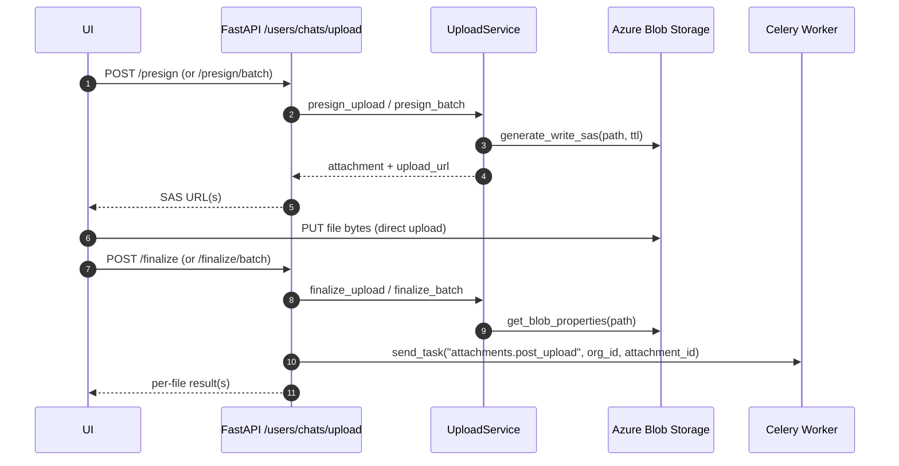

Chat Attachments Upload & Download (Technical)

Scope: src/service/chat, src/api/routers/chat_attachments, src/api/schemas/upload_models.py

Overview
- Direct-to-blob uploads via Azure SAS: client requests upload URL(s), uploads bytes directly, then finalizes.
- Background processing via Celery: checksum (optional), thumbnails for images/PDFs, status updates.
- Real-time status via SSE over Redis pub/sub.
- Short-lived read SAS URLs for secure downloads.

Mount Points
- Routers are mounted under both prefixes for UI compatibility:
  - `/chats/upload/*` and `/chats/attachment/*`
  - `/users/chats/upload/*`

API Surface
- POST `/presign` — single-file presign (returns `PresignResponse`).
- POST `/presign/batch` — batch presign (per-file results; partial success allowed).
- POST `/finalize` — finalize one upload (verifies blob; enqueues worker).
- POST `/finalize/batch` — finalize many uploads (enqueues worker per item).
- GET `/attachment/{attachment_id}` — current status for one attachment.
- GET `/attachments/stream` — SSE stream for specified IDs or all non-terminal IDs.
- GET `/attachment/{attachment_id}/download` — short-lived read SAS URL for original blob.

Response Envelope
- All endpoints respond with `GenericResponse[T]` (see `src/api/schemas/base_models.py`):
  - `status`: "SUCCESS" | "ERROR"
  - `message`: human-readable
  - `data`: payload (model below) or `null` on error

Pydantic Schemas (Requests/Responses)
- Source of truth: `src/api/schemas/upload_models.py`
- Optional fields are declared as `Optional[...]` or have defaults; all others are required.

```python
from typing import Optional
from uuid import UUID
from pydantic import BaseModel, Field, HttpUrl

class PresignRequest(BaseModel):
    filename: str = Field(..., min_length=1, max_length=255)
    mimetype: str
    size_bytes: int = Field(..., gt=0)

class PresignResponse(BaseModel):
    attachment_id: UUID
    filename: str
    mimetype: str
    upload_url: HttpUrl
    size_bytes: int
    expires_in_seconds: int
    status: str  # AttachmentStatus: pending_upload|uploaded|processing|completed|failed
    success: bool = True
    error_message: Optional[str] = None

class FinalizeRequest(BaseModel):
    attachment_id: UUID
    checksum: Optional[str] = None

class UploadedAttachmentResponse(BaseModel):
    attachment_id: UUID
    uploaded_at: str  # ISO8601
    status: str

class AttachmentDownloadResponse(BaseModel):
    attachment_id: UUID
    download_url: HttpUrl
    expires_in_seconds: int

class AttachmentPresignFileResponse(BaseModel):
    attachment_id: Optional[UUID] = None
    filename: str
    mimetype: Optional[str] = None
    upload_url: Optional[HttpUrl] = None
    size_bytes: Optional[int] = None
    success: bool = True
    error_message: Optional[str] = None
    expires_in_seconds: int = 0
    status: Optional[str] = None  # AttachmentStatus

class AttachmentBatchPresignRequest(BaseModel):
    files: list[PresignRequest]

class AttachmentBatchPresignResponse(BaseModel):
    files: list[AttachmentPresignFileResponse]
    errors: list[dict] = []

class AttachmentBatchFinalizeRequest(BaseModel):
    files: list[FinalizeRequest]

class AttachmentBatchFinalizeResult(BaseModel):
    attachment_id: UUID
    status: Optional[str] = None
    error: Optional[str] = None
    updated_at: Optional[str] = None  # ISO8601

class AttachmentBatchFinalizeResponse(BaseModel):
    results: list[AttachmentBatchFinalizeResult]
    errors: list[dict] = []

class AttachmentEventUpdate(BaseModel):
    attachment_id: str
    status: str
    updated_at: Optional[str] = None
    error_message: Optional[str] = None
    thumbnail_small_url: Optional[str] = None
```

Examples
- Presign request
```json
{ "filename": "report.pdf", "mimetype": "application/pdf", "size_bytes": 123456 }
```
- Presign response
```json
{
  "attachment_id": "2b5a4d8e-...",
  "filename": "report.pdf",
  "mimetype": "application/pdf",
  "upload_url": "https://...sas...",
  "size_bytes": 123456,
  "expires_in_seconds": 900,
  "status": "pending_upload",
  "success": true,
  "error_message": null
}
```
- SSE status frame data (array)
```json
[
  {
    "attachment_id": "...",
    "status": "processing",
    "updated_at": "2025-10-06T08:12:15Z",
    "error_message": null,
    "thumbnail_small_url": null
  }
]
```

Services and Infra
- Upload service: `src/service/chat/chat_attachments_service.py`
  - Validates ownership and org scoping; generates Azure SAS; enqueues Celery tasks.
- SSE service: `src/service/chat/chat_attachments_sse_service.py`
  - Publishes `status`, `ping`, `complete`, `timeout` events from Redis pub/sub.
- Azure storage: `AzureOrganisationBlobStorage` (SAS generation, container per org).
- Redis: `AsyncRedisPubSub` channels `att:{org_id}:attachments`.
- Celery worker: `src/workers/chat_worker/celery_app.py`, task `attachments.post_upload`.

Upload Flow


SSE Flow
```mermaid
sequenceDiagram
  participant UI
  participant API as /attachments/stream (SSE)
  participant SSE as AttachmentSSEService
  participant Redis as Redis Pub/Sub
  participant DB as Org DB

  UI->>API: GET /attachments/stream?attachment_ids=...
  API->>SSE: stream_events(explicit_ids)
  SSE->>DB: select non-terminal attachments (org+user scoped)
  SSE-->>UI: "status" event (initial list)
  Redis-->>SSE: messages {attachment_id, status, ...}
  SSE-->>UI: "status" events; emits "complete" when all terminal
```

Download Flow
```mermaid
flowchart LR
  A[Click download] --> B[API validates ownership/status]
  B --> C[Generate read SAS (expiring URL)]
  C --> D[Browser downloads original]
```

Tenancy and Security
- DB session is org-scoped via `get_org_session`; queries constrain by `organisation_id` and `user_id`.
- SAS links are short-lived and scoped: write for upload, read for download with optional filename.
- SSE limits updates to the current user's attachments; explicit ID filtering when supplied.

Error Handling
- Domain errors raised with HTTP-aware exceptions; batch responses accumulate per-file errors.
- Envelope always returned; `status` and `message` reflect outcome.

Configuration
- Upload limits from `chat_file_upload_config`:
  - `MAX_UPLOAD_FILE_SIZE_BYTES` (~50MB default)
  - `ALLOWED_MIMETYPES` (PDFs, images, office docs)
- Azure: `ORGANISATION_STORAGE_NAME`; credentials via Default/Workload/Managed Identity.
- Redis: `Config().get_redis_client_details` (async pub/sub, redis>=5).
- Celery: chat worker `chat_worker`; task `attachments.post_upload`.

Data Model Highlights
- `Attachment`: `status`, `storage_path`, `thumbnail_small_path`, `thumbnail_medium_path`, `checksum`, `virus_scan_status`, timestamps.
- Terminal statuses: `completed`, `failed`.

Operational Notes
- Loggers: `upload_handler`, `attachment_download_handler`, `attachments_post_upload_task`, `attachment_sse_service`, `azure_org_blob_storage`, `redis_pubsub`.
- SSE timeouts emit `timeout`; client should reconnect with backoff when needed.
- Ensure async clients are closed in routers to avoid resource warnings.

