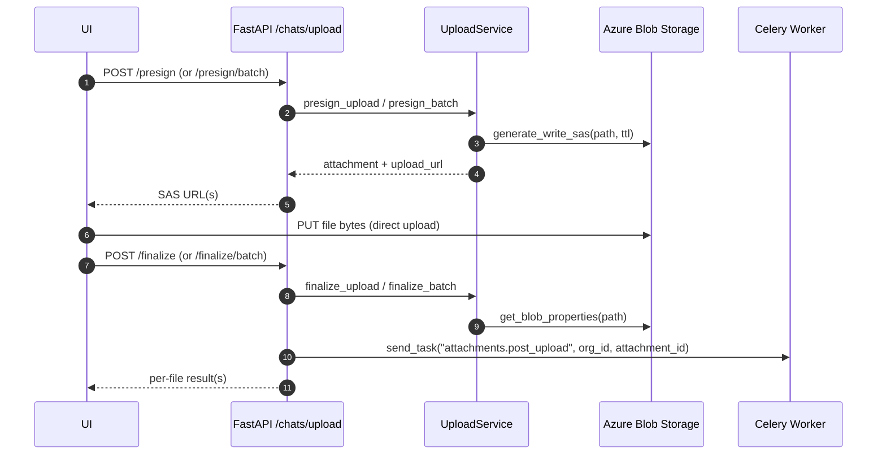

Chat Attachments Upload & Download (Technical)

Scope: src/api/routers/chat_attachments and related services

Overview
- Direct‑to‑blob upload using Azure SAS: client requests upload URL(s), uploads bytes, then finalizes.
- Background processing via Celery: checksum (optional), thumbnails for images/PDFs, status updates.
- Real‑time status via SSE over Redis pub/sub.
- Short‑lived read SAS for secure downloads.

Mount points
- Routers are mounted in two places for UI compatibility:
  - `/chats/upload/*` and `/chats/attachment/*`
  - `/users/chats/upload/*`
  The underlying paths below are relative to these prefixes.

API surface
- POST `/presign` → minimal single‑file presign (returns `PresignResponse`).
- POST `/presign/batch` → batch presign (returns per‑file results; partial success allowed).
- POST `/finalize` → finalize one upload (verifies blob, moves to PROCESSING; enqueues worker).
- POST `/finalize/batch` → finalize many uploads (enqueues workers per item).
- GET `/attachment/{attachment_id}` → current status for one attachment.
- GET `/attachments/stream` → SSE stream of status updates for specified IDs or all non‑terminal IDs.
- GET `/attachment/{attachment_id}/download` → short‑lived read SAS URL for original blob.

Schemas and models
- Pydantic requests/responses: `PresignRequest`, `FinalizeRequest`, `PresignResponse`, `AttachmentDownloadResponse`,
  batch models (`AttachmentBatchPresignRequest`, `AttachmentBatchPresignResponse`, `AttachmentBatchFinalizeRequest`, `AttachmentBatchFinalizeResponse`, `AttachmentBatchFinalizeResult`),
  SSE: `AttachmentEventUpdate`.
- DB models: `Attachment` + `AttachmentStatus` enum (pending_upload → uploaded → processing → completed | failed).
- Response envelope: `GenericResponse[T]` via `src/api/utils/http_response.Response`.

Services and infra
- `UploadService` (src/service/chat/chat_attachments_service.py)
  - Sets tenant search_path (`SET search_path TO <org_schema>`) per request method.
  - Presign: creates `Attachment` row, returns Azure write SAS for blob path `chat_uploads/{user_id}/{attachment_id}/{filename}`.
  - Finalize: verifies blob properties; sets status PROCESSING; commit; router enqueues Celery job `attachments.post_upload`.
  - Download: validates ownership; requires COMPLETED; returns read SAS with optional Content‑Disposition.
  - Batch helpers wrap single‑file operations and accumulate errors.
- `AttachmentSSEService` (src/service/chat/chat_attachments_sse_service.py)
  - Initial snapshot: non‑terminal attachments for current user or explicit IDs.
  - Subscribes to Redis channel `att:{org_id}:attachments`.
  - Emits `status`, `ping`, `timeout`, and `complete` events; returns when all watched IDs are terminal.
- Azure storage: `AzureOrganisationBlobStorage` handles SAS generation and container lifecycle per org.
- Redis pub/sub: `AsyncRedisPubSub` (redis>=5), with channel helpers in `src/infra/messaging`.
- Celery worker: `src/workers/chat_worker/celery_app.py`, task `attachments.post_upload` (see `tasks/post_upload.py`).

Upload flow


SSE flow
```mermaid
sequenceDiagram
  participant UI
  participant API as /attachments/stream (SSE)
  participant SSE as AttachmentSSEService
  participant Redis as Redis Pub/Sub
  participant DB as Org DB

  UI->>API: GET /attachments/stream?attachment_ids=...
  API->>SSE: stream_events(explicit_ids)
  SSE->>DB: select non‑terminal attachments (org+user scoped)
  SSE-->>UI: "status" event with initial list
  Redis-->>SSE: messages {attachment_id, status, ...}
  SSE-->>UI: "status" events; emits "complete" when all are terminal
```

Download flow
```mermaid
flowchart LR
  A[Click download] --> B[API validates ownership/status]
  B --> C[Generate read SAS (expiring URL)]
  C --> D[Browser downloads original]
```

Tenancy and security
- DB Session originates from `get_org_session`; service additionally sets `search_path` explicitly per call.
- Access control: every read/write checks `organisation_id` and `user_id` on the `Attachment` row.
- SAS links are short‑lived and scoped: write for upload, read for download with optional filename.
- SSE limits updates to the current user’s attachments; filters explicit IDs when provided.

Error handling
- Domain exceptions: `UploadServiceError` carries `status_code` for router translation.
- Batch operations aggregate errors per file; success continues despite failures.
- API always returns the standard `GenericResponse` envelope.

Configuration
- Upload limits from `chat_file_upload_config`:
  - `MAX_UPLOAD_FILE_SIZE_BYTES` (default ~50MB)
  - `ALLOWED_MIMETYPES` (defaults include PDFs, images, office docs)
- Azure: `ORGANISATION_STORAGE_NAME`; credentials via Default/Workload/Managed Identity depending on env.
- Redis: provided by `Config().get_redis_client_details`; async pub/sub requires redis>=5.
- Celery: chat worker app name `chat_worker`; task `attachments.post_upload`.

Data model highlights
- `Attachment` fields: `status`, `storage_path`, `thumbnail_small_path`, `thumbnail_medium_path`, `checksum`, `virus_scan_status`, timestamps.
- Terminal statuses: `completed`, `failed`.

Operational notes
- Logs: `upload_handler`, `attachment_download_handler`, `attachments_post_upload_task`, `attachment_sse_service`, `azure_org_blob_storage`, `redis_pubsub`.
- SSE timeouts produce `timeout` events; client should reconnect when needed.
- Ensure async clients are closed (`service.close()` in routers) to avoid resource warnings.

