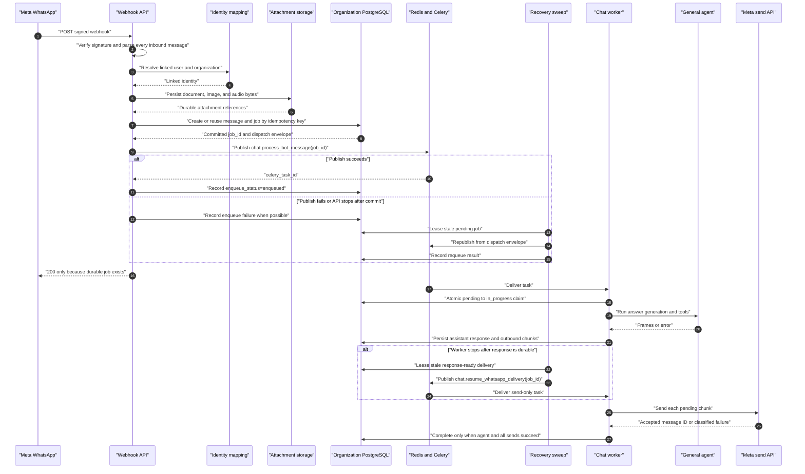
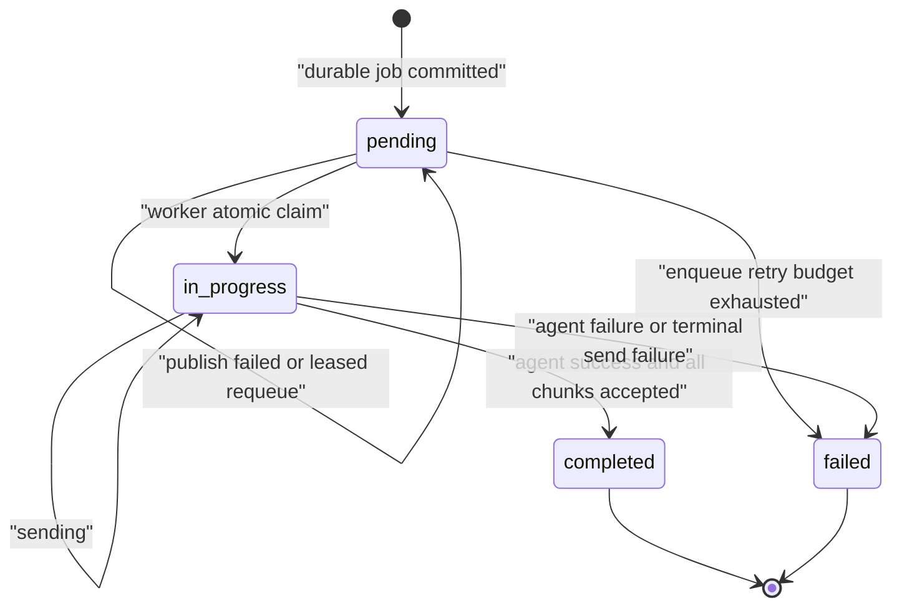
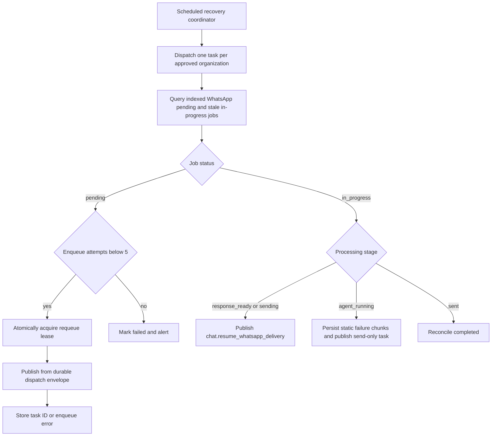

# WhatsApp Durable Delivery Solution Architecture And Implementation Plan

> **For agentic workers:** REQUIRED SUB-SKILL: Use `superpowers:executing-plans`
> to implement this document task-by-task. Steps use checkbox (`- [ ]`) syntax
> for tracking. Do not deploy, commit, push, or open a PR without explicit user
> authorization.

**Goal:** Make every accepted linked WhatsApp inbound message durable,
recoverable, and traceable so a pod restart, Redis interruption, or worker loss
causes delay or a visible terminal failure instead of a silent missing reply.

**Architecture:** Reuse `chat_messages` and `chat_message_jobs` as the durable
inbound ledger and work record. Persist the inbound message, complete worker
dispatch envelope, and idempotent job in PostgreSQL before acknowledging Meta;
then treat Redis/Celery as an at-least-once transport repaired by a scheduled,
leased recovery sweep. Final job success requires both agent success and Meta
accepting every outbound reply chunk.

**Tech Stack:** FastAPI, SQLModel/SQLAlchemy, PostgreSQL JSONB and partial
indexes, Alembic organization migrations, Redis, Celery, OpenTelemetry, pytest,
and Ruff.

---

## 1. Executive Decision

Use the existing `chat_message_jobs` row as the durable WhatsApp work record.
Do not add another inbound-event table in this iteration.

The required invariant is:

```text
No 2xx webhook acknowledgement for a linked inbound message
until one committed ChatMessageJob can reconstruct that message's worker task.
```

The resulting order is:

```text
verify webhook
  -> resolve linked user and organization
  -> durably ingest provider media
  -> atomically create/reuse ChatMessage + ChatMessageJob
  -> commit
  -> publish Celery task by job_id
  -> record enqueue outcome
  -> return 200
```

If PostgreSQL persistence fails, return `503` so Meta can retry. If queue publish
fails after the database commit, return `200`: the job is already durable and
the recovery sweep owns eventual enqueue.

PostgreSQL is the source of truth. Redis is transport, not proof that a message
was accepted.

## 2. Current State Confirmed In This Repository

The architecture is based on the current checkout, not an assumed flow:

| Boundary | Current behavior | Reliability consequence |
|---|---|---|
| Web chat intake | `ChatMessageService.create_user_message()` adds the message and job to one session; the API commits before enqueue | Worker can load the committed job by `job_id` |
| WhatsApp job creation | `_create_bot_job()` uses separate session/message/job commits | A crash can leave only part of the durable state |
| WhatsApp job failure | `_route_message()` catches job creation failure and continues with `job_id=None` | Work can run with no recovery record |
| Webhook acknowledgement | handler catches all processing exceptions and still returns `200` | Meta can stop retrying before durable work exists |
| Identity lookup | `_get_linked_user()` catches lookup exceptions and returns the same `None` result as an unlinked identity | A master-database failure can be acknowledged as if the user simply needs login |
| Idempotency | provider `wamid` exists only in transient `bot_context` | Duplicate webhook cannot reliably find the original job |
| Queue result | WhatsApp does not persist task ID, enqueue status, attempts, or error | A committed but unpublished job looks like any other pending job |
| Worker-loss handling | Celery uses `acks_late` and `task_reject_on_worker_lost=True` | Broker can redeliver a killed task |
| Worker claim | `_mark_job_in_progress()` accepts only `pending` | A redelivered killed task is skipped because its job is already `in_progress` |
| Recovery scheduling | stale cleanup tasks and routes exist, but `ChatWorkerConfig.beat_schedule` does not schedule them | Pending/in-progress WhatsApp jobs have no automatic database recovery loop |
| Stale cleanup | old pending/in-progress jobs are marked failed | Recoverable pending work is discarded instead of re-enqueued |
| Outbound completion | worker stores `completed` from agent success and ignores the send boolean | Job can look complete when Meta rejected the reply |
| Voice input | audio media IDs are passed transiently to the worker | A long queue outage can outlive provider media availability |

Relevant implementation surfaces:

- `src/api/routers/bots/whatsapp_webhook_handler.py`
- `src/service/bots/whatsapp_bot_service.py`
- `src/service/chat/external_chat_attachment_ingest_service.py`
- `src/domain/models/organisation_tables/job_models.py`
- `src/workers/chat_worker/tasks/bot_message_processing.py`
- `src/workers/chat_worker/services/bot_message_processing_service.py`
- `src/workers/chat_worker/services/stale_job_cleanup_service.py`
- `src/workers/chat_worker/tasks/stale_job_cleanup_tasks.py`
- `src/workers/chat_worker/config.py`
- `src/infra/observability/metrics.py`

## 3. Reliability Contract

### 3.1 Guaranteed After Implementation

For a valid inbound message from a linked WhatsApp identity:

1. A `200` means a durable job exists in the correct organization database.
2. One Meta `wamid` converges to one `ChatMessageJob`.
3. The job contains enough data to reconstruct the same Celery task without the
   original webhook request.
4. Queue publish success and failure are visible on the job.
5. A job committed immediately before an API restart is eventually enqueued by
   the recovery sweep.
6. Duplicate webhook or Celery delivery cannot run the same active job twice.
7. A WhatsApp job is `completed` only after all reply chunks are accepted by
   Meta.
8. Every non-completed job has a durable failure stage and error reason.
9. Operators can trace a message using `wamid`, `job_id`, Celery task ID, or
   outbound Meta message ID.

### 3.2 Explicit Non-Guarantees

No architecture can guarantee that PostgreSQL, Redis, workers, the LLM, tools,
network, and Meta are always available. This design guarantees durable
acceptance and visible recovery, not universal availability.

It also cannot provide true exactly-once delivery across a network timeout to
Meta unless Meta provides an idempotency contract for outbound sends. A timeout
can occur after Meta accepted the request but before this service received the
response.

The product policy in this plan is **delivery over rare duplication**:

- retry known transient Meta failures and ambiguous network failures with a
  bounded budget;
- record every attempt and accepted provider message ID;
- accept that an ambiguous retry can rarely duplicate one reply chunk;
- never describe that boundary as exactly-once.

If duplicate outbound delivery is less acceptable than a missing answer, change
this policy to stop at `send_status=unknown` and require operator review.

This plan does not change the current delivery-window policy: free-form service
messages remain the in-window behavior and approved templates remain the
out-of-window behavior.

## 4. Architecture Decisions

### AD-1: Reuse `chat_message_jobs`

`chat_message_jobs` already stores status, JSONB metadata, errors, timestamps,
user identity, token usage, cost, and latency. Web chat already uses it as the
durable work boundary. Adding a second WhatsApp inbox table would create another
state machine and reconciliation path without solving outbound Meta ambiguity.

Required database additions are one normalized column and three indexes, not a
new table:

1. A nullable `idempotency_key` column on `chat_message_jobs`, with a partial
   unique index on `(chat_type, idempotency_key)` for every chat channel.
2. A partial recovery index on `(status, updated_at)` for `WHATSAPP_CHAT` jobs.
3. A partial unique index on WhatsApp attachment `source_external_id`, allowing
   webhook retries to reuse media already copied to durable storage.

### AD-2: Database Idempotency Is Authoritative

Use this deterministic key:

```text
whatsapp:{phone_number_id}:{recipient_wa_id}:{wamid}
```

Redis may later cache `idempotency_key -> job_id`, but a cache hit is never
allowed to suppress processing unless the corresponding durable job is found.

### AD-3: The Job Stores A Complete Dispatch Envelope

Recovery must not rebuild a task from guesses. The exact arguments currently
sent to `chat.process_bot_message` are stored in
`job_metadata.dispatch_envelope` before commit, including text, reply context,
bot context, identity, and durable attachment references.

Voice/audio must enter the existing attachment/blob pipeline before the durable
job is acknowledged. Provider media IDs may remain as diagnostic metadata, but
they are not the only copy needed to process a delayed job.

### AD-4: Queue Publish Is Recoverable, Not Transactional

There is no atomic transaction spanning PostgreSQL and Redis. The design closes
that gap with this order:

1. Commit the job.
2. Try to publish.
3. Store the publish result.
4. Periodically lease and republish stale pending jobs.

A crash between any two steps leaves a database row that the sweep can inspect.

### AD-5: Worker Claim And Recovery Have Separate Leases

The existing atomic `pending -> in_progress` update remains the duplicate worker
guard. Recovery adds a short enqueue lease before publishing a stale pending job
so two sweepers do not republish it together.

An `in_progress` job is not blindly rerun after a worker crash. The recovery
decision uses `processing_stage`:

- `agent_running`: mark failed and send the durable static failure response;
  rerunning arbitrary agent tools could duplicate external side effects.
- `response_ready`: retry only outbound delivery from persisted reply chunks.
- `sending`: retry unsent/unknown chunks according to the bounded delivery-first
  policy.
- `sent`: reconcile to `completed` without invoking the agent again.

Send-only recovery uses a dedicated Celery task,
`chat.resume_whatsapp_delivery(organisation_id, job_id)`. That task loads the
persisted reply context and chunks, acquires a send lease, and calls Meta without
invoking the agent or its tools. The normal `chat.process_bot_message` task
remains the only agent-execution entrypoint.

### AD-6: Completion Means User Delivery Was Accepted

`agent_success` and `send_success` are separate facts. For WhatsApp:

```text
final_success = agent_success AND all_outbound_chunks_accepted
```

An agent answer persisted to chat history is not proof that the user received
it.

## 5. Target End-To-End Flow



### 5.1 Batch Webhook Rule

Meta payloads may contain more than one inbound message. Process and deduplicate
each message independently.

If message 1 commits and message 2 fails before commit, return `503` for the
payload. Meta can replay the batch; message 1 resolves to its existing job and
message 2 gets another persistence attempt.

Do not deduplicate the entire webhook using only the first `wamid`.

## 6. HTTP Acknowledgement Matrix

| Situation | Response | Reason |
|---|---:|---|
| Integration disabled | `503` | Provider should retry after configuration is restored |
| Invalid signature | `401` | Do not process an unauthenticated request |
| Malformed JSON | `400` | Retrying the same body cannot repair it |
| Status-only callback | `200` | No inbound user work is present |
| Unsupported but recognized message | `200` after the safe response attempt | No agent job is required |
| Identity lookup infrastructure failure | `503` | Do not confuse a database/configuration failure with an unlinked user |
| Confirmed unlinked identity | `200` after the login response attempt | Authentication flow is outside the linked-message durability contract |
| Linked message cannot be persisted | `503` | No durable recovery record exists |
| Linked job committed, queue publish succeeds | `200` | Work is durable and queued |
| Linked job committed, queue publish fails | `200` | Work is durable and scheduled recovery owns it |
| Duplicate with durable pending job | `200` after state-aware enqueue decision | Same work converges to one job |
| Duplicate with in-progress/completed job | `200` without another agent run | Existing job owns the message |

The handler must not catch a pre-durable exception and return `200`.

Required handler shape:

```python
service = WhatsAppBotService()
try:
    await service.process_webhook(payload)
except WhatsAppInboundDurabilityError:
    logger.error("WhatsApp inbound durability failed", exc_info=True)
    return Response(status_code=status.HTTP_503_SERVICE_UNAVAILABLE)
return Response(status_code=status.HTTP_200_OK)
```

Post-durable enqueue failure is handled and recorded inside the service, so it
does not escape as `WhatsAppInboundDurabilityError`.

## 7. Durable Data Contract

The existing `ChatMessageJob.status` remains one of `pending`, `in_progress`,
`completed`, or `failed`. WhatsApp-specific phases live in `job_metadata`.

Example committed metadata:

```json
{
  "source": "bot",
  "provider": "whatsapp",
  "conversation_type": "personal",
  "session_id": "<uuid>",
  "whatsapp_message_id": "wamid.ABC",
  "idempotency_key": "whatsapp:phone-1:15551234567:wamid.ABC",
  "phone_number_id": "phone-1",
  "recipient_wa_id": "15551234567",
  "dispatch_envelope": {
    "organisation_id": "<uuid>",
    "user_id": "<uuid>",
    "message_text": "Where is the proposal?",
    "provider": "whatsapp",
    "reply_context": {
      "phone_number_id": "phone-1",
      "recipient_wa_id": "15551234567",
      "incoming_message_id": "wamid.ABC"
    },
    "bot_context": {
      "conversation_type": "personal",
      "external_user_id": "15551234567",
      "external_tenant_id": "phone-1",
      "current_datetime": "2026-07-10T10:00:00+00:00",
      "whatsapp_message_id": "wamid.ABC",
      "current_attachments": []
    },
    "user_email": "linked-user@example.com"
  },
  "enqueue_status": "pending",
  "enqueue_attempts": 0,
  "celery_task_id": null,
  "last_enqueue_error": null,
  "processing_stage": "pending",
  "processing_attempts": 0,
  "send_status": "not_started",
  "send_attempts": 0,
  "next_send_attempt_at": null,
  "outbound_chunks": []
}
```

Rules:

- Never store Meta access tokens or raw file bytes in `job_metadata`.
- Persist attachment IDs and blob-backed references, not temporary download URLs.
- `dispatch_envelope` is immutable after commit except for adding durable
  attachment/transcription references before worker claim.
- Enqueue, processing, and send fields are mutable state.
- Every mutation reassigns a new metadata dictionary before committing so
  SQLAlchemy reliably detects the JSONB change.
- Truncate provider error bodies to a bounded length before persistence.

## 8. Database Indexes

Create org migration:

`migrations/org_migrations/versions/3c7f79637723_076_whatsapp_durable_delivery_indexes.py`

with:

```python
"""add normalized chat job idempotency and WhatsApp delivery indexes

Revision ID: 3c7f79637723
Revises: 3c7f79637724
Create Date: 2026-07-10
"""

from collections.abc import Sequence

import sqlalchemy as sa
from alembic import op

revision: str = "3c7f79637723"
down_revision: str | None = "3c7f79637724"
branch_labels: str | Sequence[str] | None = None
depends_on: str | Sequence[str] | None = None


def upgrade() -> None:
    op.add_column(
        "chat_message_jobs",
        sa.Column("idempotency_key", sa.Text(), nullable=True),
    )
    op.execute(
        """
        create unique index uq_chat_message_jobs_channel_idempotency
        on chat_message_jobs (chat_type, idempotency_key)
        where idempotency_key is not null
        """
    )
    op.execute(
        """
        create index ix_chat_message_jobs_whatsapp_recovery
        on chat_message_jobs (status, updated_at)
        where chat_type = 'WHATSAPP_CHAT'
        """
    )
    op.execute(
        """
        create unique index uq_attachments_whatsapp_source_external_id
        on attachments (source_external_id)
        where source_provider = 'whatsapp'
          and source_external_id is not null
        """
    )


def downgrade() -> None:
    op.execute("drop index if exists uq_attachments_whatsapp_source_external_id")
    op.execute("drop index if exists ix_chat_message_jobs_whatsapp_recovery")
    op.execute("drop index if exists uq_chat_message_jobs_channel_idempotency")
    op.drop_column("chat_message_jobs", "idempotency_key")
```

Before creating the media index, check existing WhatsApp attachment duplicates.
Do not delete duplicates automatically:

```sql
select
  source_external_id,
  count(*) as attachment_count,
  array_agg(attachment_id order by created_at) as attachment_ids
from attachments
where source_provider = 'whatsapp'
  and source_external_id is not null
group by source_external_id
having count(*) > 1;
```

If this query returns rows, reconcile links and blobs deliberately before the
migration. Do not choose a winning attachment by timestamp inside the migration.

## 9. Transaction Boundary

Refactor WhatsApp persistence so one organization session commits the inbound
`ChatMessage`, its attachment links, and `ChatMessageJob` together.

The durable method contract is:

```python
async def _create_or_get_durable_job(
    self,
    *,
    user: User,
    message: WhatsAppInboundMessage,
    attachment_refs: list[dict[str, Any]],
    dispatch_envelope: dict[str, Any],
) -> ChatMessageJob:
    """Return the one committed job for this provider message."""
```

Required behavior:

1. Build the deterministic idempotency key.
2. Open one organization session.
3. Query for an existing job with that key.
4. Return the existing job when found.
5. Find or create the active WhatsApp `ChatSession` without committing yet.
6. Add and flush the inbound `ChatMessage`.
7. Add attachment links.
8. Add the pending `ChatMessageJob` with its dispatch envelope.
9. Commit once.
10. If the unique index raises `IntegrityError`, roll back the whole transaction
    and load the winning job in a fresh session.
11. Propagate any other persistence failure as
    `WhatsAppInboundDurabilityError`.

Do not retain this behavior:

```python
logger.exception("Failed to create WhatsApp bot chat job, dispatching without job_id")
```

There is no valid linked WhatsApp agent dispatch without a durable `job_id`.

### 9.1 Media And Voice Durability

Documents and images already enter
`ExternalChatAttachmentIngestService.ingest_whatsapp_media_files()`. Normalize
audio/voice descriptors into the same durable attachment path before creating
the job.

Make WhatsApp ingestion strict and idempotent:

1. Look up an existing WhatsApp attachment by `source_external_id` before
   downloading.
2. Reuse it when present.
3. Let the partial unique index settle concurrent duplicate downloads; the
   losing transaction rolls back, removes its just-uploaded orphan blob, and
   reloads the winner.
4. Require one durable attachment reference for every supported inbound media
   descriptor.
5. Raise `WhatsAppInboundDurabilityError` instead of silently returning a
   partial/empty list when download, storage, or attachment persistence fails.

The worker must transcribe from the blob-backed attachment reference. It must not
depend exclusively on downloading the original Meta media ID after an arbitrary
queue delay.

If media persistence fails, no durable reconstructable job exists, so return
`503`. The attachment source ID index and job idempotency key make replay safe.

## 10. Duplicate Decision Table

When a webhook resolves to an existing job:

| Job state | Enqueue/send state | Action |
|---|---|---|
| `pending` | never enqueued or last enqueue failed | Acquire enqueue lease and publish |
| `pending` | enqueued recently | Return existing job; do not republish immediately |
| `pending` | enqueue lease expired | Reclaim lease and publish |
| `in_progress` | active | Return existing job; active worker owns it |
| `in_progress` | stale and `response_ready` | Recovery publishes `chat.resume_whatsapp_delivery` |
| `in_progress` | stale and `agent_running` | Fail visibly and send static failure; do not rerun unknown tool side effects |
| `completed` | `send_status=sent` | Acknowledge duplicate without work |
| `failed` | enqueue-only failure and budget remains | Move to pending and publish |
| `failed` | terminal agent/provider failure | Acknowledge duplicate and preserve failure evidence |

Three distinct user messages with the same text remain three jobs because their
Meta `wamid` values differ. Idempotency never combines separate user intent.

## 11. Queue Publish And Lease Protocol

Use one shared task serializer for both initial enqueue and recovery:

```python
async def enqueue_whatsapp_job(
    *,
    job_id: UUID,
    envelope: dict[str, Any],
) -> str:
    return await send_chat_task_async(
        "chat.process_bot_message",
        args=[
            envelope["organisation_id"],
            envelope["user_id"],
            envelope["message_text"],
            "whatsapp",
            envelope["reply_context"],
        ],
        kwargs={
            "user_email": envelope.get("user_email"),
            "bot_context": envelope["bot_context"],
            "job_id": str(job_id),
        },
        queue="chat_messages",
        routing_key="chat_messages",
    )
```

Do not duplicate this argument construction in the webhook and recovery paths.

### 11.1 Initial Enqueue

After durable commit:

1. Increment `enqueue_attempts` and set `enqueue_status=enqueuing`.
2. Publish from the committed dispatch envelope.
3. On success, store `enqueue_status=enqueued` and `celery_task_id`.
4. On exception, store `enqueue_status=failed` and
   `last_enqueue_error`; leave the job `pending`.
5. Return normally because recovery can reconstruct the task.

If the metadata update itself fails after publish, the worker can still claim the
job. If publish did not happen, the stale pending sweep republishes it. This is
why job status and age remain authoritative when task ID metadata is absent.

### 11.2 Recovery Lease

The sweep runs every 60 seconds and considers WhatsApp pending jobs older than
two minutes. It processes bounded batches of 500 jobs per organization.

For each candidate, atomically change:

```text
enqueue_status: pending|failed|enqueued -> requeueing
enqueue_attempts: N -> N + 1
updated_at: old -> now
```

only when the row is still `pending` and older than the cutoff. A rowcount of one
owns the lease. Publish after committing the lease; then store success or
failure.

If the sweeper dies after leasing but before publish, `updated_at` becomes stale
again and a later sweep reclaims it. Maximum enqueue attempts: `5`.

Use `FOR UPDATE SKIP LOCKED` for batch selection or an equivalent conditional
`UPDATE ... RETURNING` claim. Do not select rows and publish without an atomic
claim.

### 11.3 Send-Only Recovery Task

Add this task to
`src/workers/chat_worker/tasks/bot_message_processing.py`:

```python
@app.task(
    name="chat.resume_whatsapp_delivery",
    acks_late=True,
    bind=True,
    autoretry_for=(Exception,),
    retry_backoff=True,
    retry_jitter=True,
    max_retries=3,
)
def resume_whatsapp_delivery(
    self,
    organisation_id: str,
    job_id: str,
) -> bool:
    service = BotMessageProcessingService(UUID(organisation_id))
    return service.resume_whatsapp_delivery(UUID(job_id))
```

Add the task route to `ChatWorkerConfig.task_routes` on `chat_messages`.

`BotMessageProcessingService.resume_whatsapp_delivery()` must:

1. Load only a WhatsApp job in `response_ready` or `sending` stage, or a failed
   job carrying a static failure payload that still needs delivery.
2. Atomically lease delivery by changing `send_status` to `sending`, incrementing
   `send_attempts`, and refreshing `updated_at`.
3. Return without sending when another unexpired send lease owns the job.
4. Send only chunks without an accepted provider message ID.
5. Keep an agent-success job `in_progress` until all chunks are accepted, then
   mark it `completed`.
6. Keep an agent-failure job `failed` even when its static failure message is
   delivered successfully.
7. Persist retryable, ambiguous, and terminal send outcomes.
8. Persist `next_send_attempt_at` for retryable/ambiguous failures so database
   recovery and Celery autoretry use the same backoff decision.

## 12. Worker Lifecycle

The worker keeps the existing atomic claim, but records stages and terminal
errors explicitly:



Required worker rules:

1. Increment `processing_attempts` during the atomic claim.
2. Set `processing_stage=agent_running` before invoking the agent.
3. On an exception before an agent result, set job `failed`, persist
   `failure_stage=agent_running`, persist the static WhatsApp failure chunks,
   and publish `chat.resume_whatsapp_delivery`.
4. After a successful agent result, persist the assistant message and rendered
   outbound chunks before calling Meta.
5. Set `processing_stage=response_ready` after that commit.
6. Send only chunks not already recorded as accepted.
7. Set `processing_stage=sending` during outbound delivery.
8. Finalize `completed` only when every chunk has a provider message ID.
9. Finalize `failed` for a terminal agent or send failure and store the exact
   stage.
10. Never return `True` merely because a duplicate task found an `in_progress`
    job; log the lease/stage decision so recovery remains observable.

Use concrete recovery constants in
`src/workers/chat_worker/services/stale_job_cleanup_service.py`:

```python
WHATSAPP_PENDING_REQUEUE_AFTER_MINUTES = 2
WHATSAPP_IN_PROGRESS_STALE_AFTER_MINUTES = 12
WHATSAPP_ENQUEUE_LEASE_MINUTES = 2
WHATSAPP_SEND_LEASE_MINUTES = 2
WHATSAPP_MAX_ENQUEUE_ATTEMPTS = 5
WHATSAPP_MAX_SEND_ATTEMPTS = 3
WHATSAPP_RECOVERY_BATCH_SIZE = 500
```

The 12-minute in-progress threshold is deliberately above the chat worker's
10-minute hard task limit. An immediately redelivered killed task can still find
an active `in_progress` row and exit, but the scheduled database sweep repairs
that state after the stale threshold.

The Celery task currently declares `max_retries=3` but does not call
`self.retry()`. Do not rely on that declaration as a recovery mechanism.

## 13. Outbound Send Contract

The current `bool`/`None` send result loses the HTTP status and provider error.
Add a result type in `whatsapp_bot_service.py`:

```python
@dataclass(frozen=True, slots=True)
class WhatsAppSendResult:
    accepted: bool
    provider_message_id: str | None = None
    status_code: int | None = None
    error: str | None = None
    ambiguous: bool = False

    @property
    def retryable(self) -> bool:
        return self.ambiguous or self.status_code == 429 or (
            self.status_code is not None and self.status_code >= 500
        )
```

Add `send_text_message_result()` for the worker. Keep
`send_text_message()` and `send_text_message_with_id()` as compatibility wrappers
for existing callers.

Classify outcomes:

| Outcome | Result | Retry policy |
|---|---|---|
| Meta `2xx` with message ID | accepted | store ID; do not resend chunk |
| Meta `2xx` without message ID or invalid JSON | ambiguous | bounded retry and record malformed response |
| Meta `429` | retryable failure | exponential backoff with jitter |
| Meta `5xx` | retryable failure | exponential backoff with jitter |
| Network timeout/reset | ambiguous | bounded retry; possible duplicate recorded |
| Meta `401/403` | terminal auth failure | fail and alert; do not hammer Meta |
| Other Meta `4xx` | terminal request/policy failure | fail with response body |
| Missing access token | terminal configuration failure | fail and alert |

Before sending, persist:

```json
"outbound_chunks": [
  {
    "index": 0,
    "text": "first chunk",
    "status": "pending",
    "attempts": 0,
    "provider_message_id": null,
    "last_error": null
  }
]
```

Update and commit each accepted chunk before moving to the next chunk. A retry
starts from the first non-accepted chunk rather than resending all earlier
chunks.

## 14. Recovery Flow



Schedule the existing coordinator route in `ChatWorkerConfig.beat_schedule`:

```python
"cleanup-stale-chat-jobs": {
    "task": "chat.cleanup_stale_jobs_all_orgs",
    "schedule": 60.0,
    "options": {
        "queue": "chat_processing",
        "routing_key": "chat_processing",
    },
},
```

Update the existing config test from "not scheduled" to asserting the 60-second
schedule.

`chat-beat` becomes an explicit recovery dependency. Run one scheduler instance,
monitor its heartbeat/sweep metric, and alert when no successful sweep occurs for
three minutes. The database lease still protects against duplicate recovery if a
deployment briefly runs two schedulers.

The WhatsApp recovery pass must run before generic stale-job failure so the
generic code cannot mark a recoverable pending job failed first.

## 15. Observability

Extend the existing lazy OpenTelemetry instruments in
`src/infra/observability/metrics.py`. Use bounded attributes only; never label a
metric with user ID, `wamid`, phone number, or job ID.

Required metrics:

| Metric | Type | Bounded attributes |
|---|---|---|
| `copilotgtm.whatsapp.inbound.count` | counter | `outcome=new|duplicate|invalid|unlinked` |
| `copilotgtm.whatsapp.durable_job.count` | counter | `outcome=created|reused|failed` |
| `copilotgtm.whatsapp.enqueue.count` | counter | `outcome=enqueued|failed|requeued|exhausted` |
| `copilotgtm.whatsapp.recovery.sweep.count` | counter | `outcome=completed|failed` |
| `copilotgtm.whatsapp.job.age` | histogram | `status=pending|in_progress` |
| `copilotgtm.whatsapp.processing.count` | counter | `outcome=completed|agent_failed|worker_failed` |
| `copilotgtm.whatsapp.send.count` | counter | `outcome=sent|retryable|terminal|ambiguous` |
| `copilotgtm.whatsapp.send.attempts` | histogram | `outcome=sent|failed` |

Every structured log in this path includes available correlation fields:

```text
organisation_id
whatsapp_message_id
job_id
celery_task_id
processing_stage
provider_message_id
```

Alert conditions:

- any linked-message durable persistence failure sustained for five minutes;
- no successful recovery sweep for three minutes while chat-beat is enabled;
- pending WhatsApp job oldest age above five minutes;
- enqueue failure rate above one percent for five minutes;
- enqueue retry exhaustion above zero;
- in-progress age above the worker hard timeout plus two minutes;
- Meta auth failures above zero after a deployment/configuration change;
- send failure rate above five percent for ten minutes.

## 16. Operator Query

Given a Meta `wamid`:

```sql
select
  job_id,
  message_id,
  status,
  job_metadata->>'whatsapp_message_id' as whatsapp_message_id,
  idempotency_key,
  job_metadata->>'enqueue_status' as enqueue_status,
  job_metadata->>'enqueue_attempts' as enqueue_attempts,
  job_metadata->>'celery_task_id' as celery_task_id,
  job_metadata->>'processing_stage' as processing_stage,
  job_metadata->>'processing_attempts' as processing_attempts,
  job_metadata->>'send_status' as send_status,
  job_metadata->>'send_attempts' as send_attempts,
  job_metadata->>'next_send_attempt_at' as next_send_attempt_at,
  job_metadata->'outbound_chunks' as outbound_chunks,
  error_message,
  created_at,
  updated_at
from chat_message_jobs
where chat_type = 'WHATSAPP_CHAT'
  and job_metadata->>'whatsapp_message_id' = '<wamid>'
order by created_at desc;
```

Expected interpretation:

- zero rows: webhook was not durably accepted or identity resolution never
  reached the organization database;
- one pending row: waiting for initial queue delivery or recovery;
- one in-progress row: worker owns it; inspect stage and age;
- one completed row with all chunk IDs: Meta accepted the answer;
- one failed row: `error_message`, stage, enqueue, and send fields identify the
  exact boundary;
- more than one row: idempotency invariant is broken.

## 17. Capacity And Scaling

Durability and throughput are separate concerns.

At 10,000 inbound messages, this design allows queue age to rise without losing
the accepted work. Actual drain time depends on agent duration, worker replicas,
worker concurrency, memory, database pools, Redis capacity, and LLM/Meta rate
limits.

Current dev and prod chat-worker values use concurrency `1`, at most two
replicas, child recycling after 25 tasks, and a child memory ceiling. Those
settings are not evidence that 10,000 messages can drain within a target time.

Use this capacity relationship:

```text
required_concurrency = arrival_rate_per_second * average_processing_seconds
```

Scaling rules:

1. Keep worker prefetch at `1` for fair long-running task distribution.
2. Autoscale primarily from queue depth and oldest-message age.
3. Keep per-tenant limits so one customer cannot consume every worker slot.
4. Size database pools for API plus worker concurrency before increasing
   replicas.
5. Apply backpressure when LLM or Meta rate limits are saturated.
6. Keep API intake limited to authentication, durable storage, and queue publish;
   never run the agent in the webhook process.

## 18. 10,000-Message Acceptance Gate

Create:

`scripts/load_testing/whatsapp_durable_delivery.py`

The script uses stubbed identity, agent, Redis/Celery, and Meta send boundaries.
It must support:

```text
--messages 10000
--duplicate-replay
--fail-after-db-commit <count>
--fail-enqueue <count>
--kill-workers <count>
--fail-meta-transient <count>
--apply
```

Default mode is dry-run/config validation. `--apply` is required to generate
jobs in the selected non-production test organization.

Pass criteria:

1. 10,000 unique `wamid` values produce exactly 10,000 jobs.
2. Replaying all 10,000 webhooks still leaves exactly 10,000 jobs.
3. Every job contains a complete dispatch envelope.
4. Injected post-commit/pre-publish failures are recovered without another
   webhook.
5. Injected enqueue failures are retried and drain after Redis recovery.
6. Duplicate Celery deliveries produce one active claim per job.
7. Text, document, image, and audio cases remain reconstructable after intake.
8. Completed jobs contain accepted provider IDs for all outbound chunks.
9. No pending job remains older than the recovery SLO after the queue drains.
10. Every terminal failure contains stage and error evidence.
11. Increasing worker capacity reduces oldest queue age.
12. API memory and worker memory stay below configured limits during the test.

This gate proves delivery correctness with controlled dependencies. A separate
environment test is still required to establish production throughput against
real database, Redis, LLM, and Meta quotas.

## 19. File Map

### Production Changes

- Modify `src/api/routers/bots/whatsapp_webhook_handler.py`
  - Return `503` on pre-durable persistence failure.
  - Keep signature validation and malformed-body handling.
  - Keep pre-durable Redis dedupe removed.
- Modify `src/service/bots/whatsapp_bot_service.py`
  - Add persistence error and send-result types.
  - Add deterministic idempotency key.
  - Persist message and job atomically.
  - Persist complete dispatch envelope.
  - Make durable job creation mandatory.
  - Centralize task serialization.
  - Persist enqueue and send outcomes.
- Modify `src/service/chat/external_chat_attachment_ingest_service.py`
  - Ingest WhatsApp audio/voice into durable storage using the existing media
    path.
- Modify `src/workers/chat_worker/services/bot_message_processing_service.py`
  - Persist processing stages and outbound chunks.
  - Finalize from agent and send success.
  - Resume send-only work without rerunning the agent.
- Modify `src/workers/chat_worker/tasks/bot_message_processing.py`
  - Add the dedicated `chat.resume_whatsapp_delivery` task.
- Modify `src/workers/chat_worker/services/stale_job_cleanup_service.py`
  - Lease/requeue WhatsApp pending jobs before generic stale failure.
  - Recover stale response-ready sends.
  - Fail stale agent-running work visibly.
- Modify `src/workers/chat_worker/config.py`
  - Route the send-only task and schedule the existing cleanup/recovery
    coordinator every 60 seconds.
- Modify `src/infra/observability/metrics.py`
  - Add bounded WhatsApp delivery instruments and recording helpers.
- Create
  `migrations/org_migrations/versions/3c7f79637723_076_whatsapp_durable_delivery_indexes.py`
- Create `scripts/load_testing/whatsapp_durable_delivery.py`

### Tests

- Modify `tests/api/routers/bots/test_whatsapp_webhook_handler.py`
- Modify `tests/service/bots/test_whatsapp_bot_service.py`
- Modify `tests/workers/chat_worker/services/test_bot_job_tracking.py`
- Create
  `tests/workers/chat_worker/services/test_whatsapp_job_recovery_service.py`
- Modify `tests/workers/chat_worker/test_chat_worker_config.py`
- Modify
  `tests/workers/chat_worker/tasks/test_chat_worker_task_registration.py`

No frontend change is required.

## 20. Implementation Tasks

### Task 1: Lock The Webhook ACK Contract

**Files:**

- Modify `tests/api/routers/bots/test_whatsapp_webhook_handler.py`
- Modify `src/api/routers/bots/whatsapp_webhook_handler.py`

- [ ] Add a failing test asserting persistence failure returns `503`.
- [ ] Add a test asserting status-only callbacks return `200`.
- [ ] Preserve the test proving no Redis dedupe runs before durable processing.
- [ ] Add `WhatsAppInboundDurabilityError` to the service boundary.
- [ ] Change `_get_linked_user()` so a successful no-match returns `None`, while
  a lookup exception raises `WhatsAppInboundDurabilityError`.
- [ ] Return `503` only for pre-durable failure and `200` after durable service
  completion.
- [ ] Run:

```bash
uv run pytest tests/api/routers/bots/test_whatsapp_webhook_handler.py -q --tb=short
uv run ruff check src/api/routers/bots/whatsapp_webhook_handler.py tests/api/routers/bots/test_whatsapp_webhook_handler.py
```

Expected: focused tests and Ruff pass; production handler contains no
`get_redis_client`, `_extract_message_ids`, or `webhook:whatsapp` usage.

### Task 2: Add Database Idempotency And Recovery Indexes

**Files:**

- Create
  `migrations/org_migrations/versions/3c7f79637723_076_whatsapp_durable_delivery_indexes.py`

- [ ] Add the exact migration from Section 8.
- [ ] Run the duplicate preflight query against a disposable organization
  database after fixture setup.
- [ ] Run:

```bash
uv run alembic -c migrations/org_migrations/alembic.ini heads
```

Expected: one organization migration head, `3c7f79637723`.

### Task 3: Persist One Reconstructable Job Per `wamid`

**Files:**

- Modify `tests/service/bots/test_whatsapp_bot_service.py`
- Modify `src/service/bots/whatsapp_bot_service.py`
- Modify `src/service/chat/external_chat_attachment_ingest_service.py`

- [ ] Add a unit test for the deterministic idempotency key.
- [ ] Add a test proving two calls for the same `wamid` return one job.
- [ ] Add a race-path test proving `IntegrityError` reloads the winning job.
- [ ] Add a transaction test proving message and job commit together.
- [ ] Add a test proving job creation failure does not call
  `send_chat_task_async`.
- [ ] Add text, document, image, and audio dispatch-envelope tests.
- [ ] Add a test proving duplicate WhatsApp media IDs reuse one attachment.
- [ ] Add a test proving partial media ingestion raises the durability error.
- [ ] Normalize audio into durable attachment references.
- [ ] Replace `_create_bot_job()` multi-commit behavior with
  `_create_or_get_durable_job()`.
- [ ] Remove dispatch without `job_id`.
- [ ] Run:

```bash
uv run pytest tests/service/bots/test_whatsapp_bot_service.py -q --tb=short
uv run ruff check src/service/bots/whatsapp_bot_service.py src/service/chat/external_chat_attachment_ingest_service.py tests/service/bots/test_whatsapp_bot_service.py
```

Expected: one durable job per provider message and no worker dispatch without a
job ID.

### Task 4: Persist Enqueue State And Reuse One Serializer

**Files:**

- Modify `tests/service/bots/test_whatsapp_bot_service.py`
- Modify `src/service/bots/whatsapp_bot_service.py`

- [ ] Add a test that enqueue success stores task ID and attempt count.
- [ ] Add a test that enqueue failure leaves a recoverable pending job.
- [ ] Add duplicate-state table tests for pending, in-progress, completed, and
  failed jobs.
- [ ] Implement the shared `enqueue_whatsapp_job()` serializer from Section 11.
- [ ] Persist enqueue transitions using fresh organization sessions.
- [ ] Run the focused service tests and Ruff command from Task 3.

Expected: every committed WhatsApp job shows whether initial publish succeeded,
failed, or needs recovery.

### Task 5: Schedule Atomic Pending-Job Recovery

**Files:**

- Create
  `tests/workers/chat_worker/services/test_whatsapp_job_recovery_service.py`
- Modify `src/workers/chat_worker/services/stale_job_cleanup_service.py`
- Modify `src/workers/chat_worker/config.py`
- Modify `tests/workers/chat_worker/test_chat_worker_config.py`

- [ ] Add a failing config test requiring the 60-second cleanup schedule.
- [ ] Add a test proving two sweepers cannot lease the same pending job.
- [ ] Add a test proving an expired lease can be reclaimed.
- [ ] Add a test proving the exact stored dispatch envelope is republished.
- [ ] Add a retry-exhaustion test at five enqueue attempts.
- [ ] Implement the WhatsApp recovery pass before generic stale failure.
- [ ] Add the Beat schedule from Section 14.
- [ ] Run:

```bash
uv run pytest tests/workers/chat_worker/services/test_whatsapp_job_recovery_service.py tests/workers/chat_worker/test_chat_worker_config.py -q --tb=short
uv run ruff check src/workers/chat_worker/services/stale_job_cleanup_service.py src/workers/chat_worker/config.py tests/workers/chat_worker/services/test_whatsapp_job_recovery_service.py tests/workers/chat_worker/test_chat_worker_config.py
```

Expected: stale pending jobs are leased and republished automatically; exhausted
jobs become visibly failed.

### Task 6: Make Worker Completion Truthful

**Files:**

- Modify `tests/workers/chat_worker/services/test_bot_job_tracking.py`
- Modify `src/workers/chat_worker/services/bot_message_processing_service.py`
- Modify `src/workers/chat_worker/tasks/bot_message_processing.py`
- Modify `src/workers/chat_worker/config.py`
- Modify
  `tests/workers/chat_worker/tasks/test_chat_worker_task_registration.py`
- Modify `src/service/bots/whatsapp_bot_service.py`

- [ ] Add a regression test proving agent success plus send failure marks the job
  failed.
- [ ] Add a test proving an exception before an agent result finalizes the job.
- [ ] Add a test proving response chunks are persisted before send.
- [ ] Add a test proving accepted chunks are not resent during recovery.
- [ ] Add a task registration test for `chat.resume_whatsapp_delivery`.
- [ ] Add a test proving send-only recovery never invokes the agent.
- [ ] Add tests for Meta `2xx`, `429`, `5xx`, auth `4xx`, and ambiguous network
  failure classification.
- [ ] Implement `WhatsAppSendResult` and compatibility wrappers.
- [ ] Persist processing stages and outbound chunks.
- [ ] Implement and route `chat.resume_whatsapp_delivery`.
- [ ] Finalize with `agent_success and all_chunks_accepted`.
- [ ] Run:

```bash
uv run pytest tests/workers/chat_worker/services/test_bot_job_tracking.py tests/workers/chat_worker/tasks/test_chat_worker_task_registration.py tests/service/bots/test_whatsapp_bot_service.py -q --tb=short
uv run ruff check src/workers/chat_worker/services/bot_message_processing_service.py src/workers/chat_worker/tasks/bot_message_processing.py src/workers/chat_worker/config.py src/service/bots/whatsapp_bot_service.py tests/workers/chat_worker/services/test_bot_job_tracking.py tests/workers/chat_worker/tasks/test_chat_worker_task_registration.py tests/service/bots/test_whatsapp_bot_service.py
```

Expected: database completion means Meta accepted the entire answer.

### Task 7: Add Operational Evidence

**Files:**

- Modify `src/infra/observability/metrics.py`
- Modify the focused WhatsApp service/recovery tests

- [ ] Add lazy instruments and recording helpers for Section 15 metrics.
- [ ] Add tests proving metric attributes are bounded and contain no IDs or phone
  numbers.
- [ ] Add structured logs at durable creation, enqueue, claim, recovery, and send
  boundaries.
- [ ] Verify the Section 16 operator query against a test organization.
- [ ] Run:

```bash
uv run ruff check src/infra/observability/metrics.py
```

Expected: a no-answer incident can be located at one exact boundary without
correlating broad pod logs by time alone.

### Task 8: Prove The 10,000-Message Contract

**Files:**

- Create `scripts/load_testing/whatsapp_durable_delivery.py`

- [ ] Implement dry-run validation and explicit `--apply` protection.
- [ ] Implement unique and duplicate webhook generation.
- [ ] Implement DB-commit, queue, worker-loss, and Meta-send fault injection.
- [ ] Emit the counters from Section 18 as JSON.
- [ ] Run the script against a disposable non-production organization with
  provider and agent stubs.
- [ ] Save the command and JSON result in the rollout evidence; do not commit a
  generated 10,000-row payload.

Expected: all Section 18 pass criteria hold. Production throughput is not claimed
from this stubbed test alone.

### Task 9: Final Verification

- [ ] Run all focused reliability tests:

```bash
uv run pytest tests/api/routers/bots/test_whatsapp_webhook_handler.py tests/service/bots/test_whatsapp_bot_service.py tests/workers/chat_worker/services/test_bot_job_tracking.py tests/workers/chat_worker/services/test_whatsapp_job_recovery_service.py tests/workers/chat_worker/tasks/test_chat_worker_task_registration.py tests/workers/chat_worker/test_chat_worker_config.py -q --tb=short
```

- [ ] Run Ruff across the complete changed Python surface:

```bash
uv run ruff check src/api/routers/bots/whatsapp_webhook_handler.py src/service/bots/whatsapp_bot_service.py src/service/chat/external_chat_attachment_ingest_service.py src/workers/chat_worker/services/bot_message_processing_service.py src/workers/chat_worker/services/stale_job_cleanup_service.py src/workers/chat_worker/tasks/bot_message_processing.py src/workers/chat_worker/config.py src/infra/observability/metrics.py tests/api/routers/bots/test_whatsapp_webhook_handler.py tests/service/bots/test_whatsapp_bot_service.py tests/workers/chat_worker/services/test_bot_job_tracking.py tests/workers/chat_worker/services/test_whatsapp_job_recovery_service.py tests/workers/chat_worker/tasks/test_chat_worker_task_registration.py tests/workers/chat_worker/test_chat_worker_config.py scripts/load_testing/whatsapp_durable_delivery.py
```

- [ ] Verify one Alembic head:

```bash
uv run alembic -c migrations/org_migrations/alembic.ini heads
```

- [ ] Run the 10,000-message stubbed gate.
- [ ] Inspect the worktree diff and confirm unrelated `pytest.ini` and `e2e/`
  changes were not included.

Expected: all focused tests and Ruff pass, the migration is the sole org head,
and load evidence satisfies every acceptance counter.

## 21. Rollout Plan

1. Run duplicate preflight across organization schemas.
2. Apply migration `076` before code that writes idempotency metadata.
3. Deploy API and chat-worker code together; the metadata shape is one contract.
4. Deploy chat-beat with the 60-second schedule.
5. Send one linked text, document, image, and voice message in dev.
6. Confirm each has exactly one job, an enqueue result, a processing stage, and
   accepted outbound provider IDs.
7. Kill one chat-worker child after job claim and verify the job reaches a
   visible recovery/terminal outcome.
8. Make Redis unavailable after DB commit and verify the scheduled sweep
   republishes after Redis returns.
9. Force a Meta `401` and verify the job fails visibly instead of completing.
10. Watch pending age, requeue count, send failures, API latency, worker memory,
    and queue depth through one normal traffic cycle.
11. Increase worker capacity only after queue-age evidence requires it.

Rollback order:

1. Disable the Beat recovery schedule if it creates unexpected database load.
2. Roll back API/worker code while leaving indexes in place; they are inert for
   rows without idempotency metadata.
3. Drop indexes only after old code is stable and no new rows depend on the
   uniqueness contract.

## 22. Release Gate

Do not call the solution complete until all of these are true in the same
release:

- [ ] Handler returns non-2xx when no durable linked-message job exists.
- [ ] Identity infrastructure failure cannot be treated as an unlinked user.
- [ ] Message and job are one transaction.
- [ ] Job creation failure cannot dispatch without `job_id`.
- [ ] Unique DB idempotency is active.
- [ ] Complete text/media/audio dispatch envelope is durable.
- [ ] WhatsApp media retries reuse one durable attachment per provider media ID.
- [ ] Enqueue outcome and task ID are durable.
- [ ] Pending-job recovery is atomically leased and actually scheduled.
- [ ] Worker exception paths become terminal or recoverable in DB.
- [ ] Outbound chunks and Meta message IDs are durable.
- [ ] Send-only recovery cannot rerun the agent or its tools.
- [ ] Completed means agent success and send success.
- [ ] Operator query identifies every tested failure boundary.
- [ ] Focused tests and Ruff pass.
- [ ] Alembic has one head.
- [ ] The 10,000-message fault-injection gate passes.
- [ ] Dev restart, Redis-loss, and Meta-rejection drills pass.

The correct production claim is:

> Accepted linked WhatsApp messages do not fail silently. They are processed,
> recovered where safe, or left in a visible terminal state with the exact
> failure boundary.

Do not claim that memory scaling alone prevents message loss, and do not claim
absolute or exactly-once delivery across an external provider.
