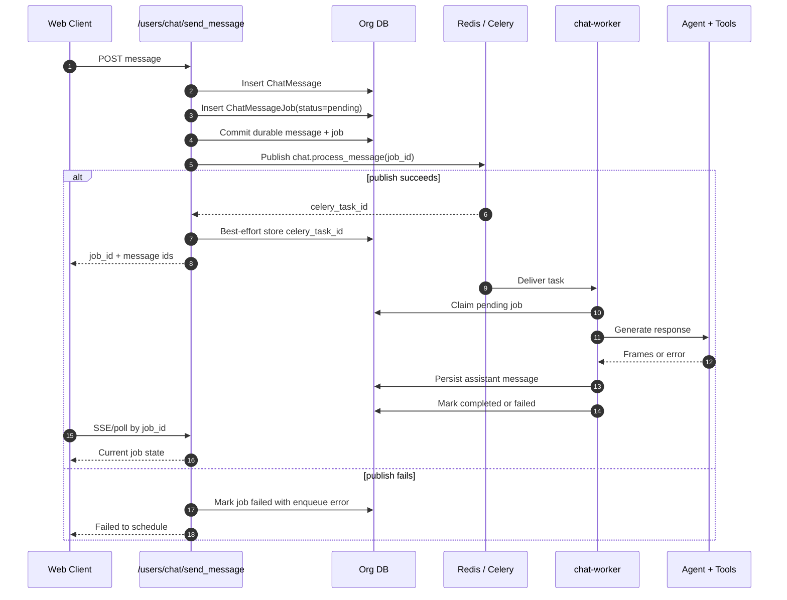
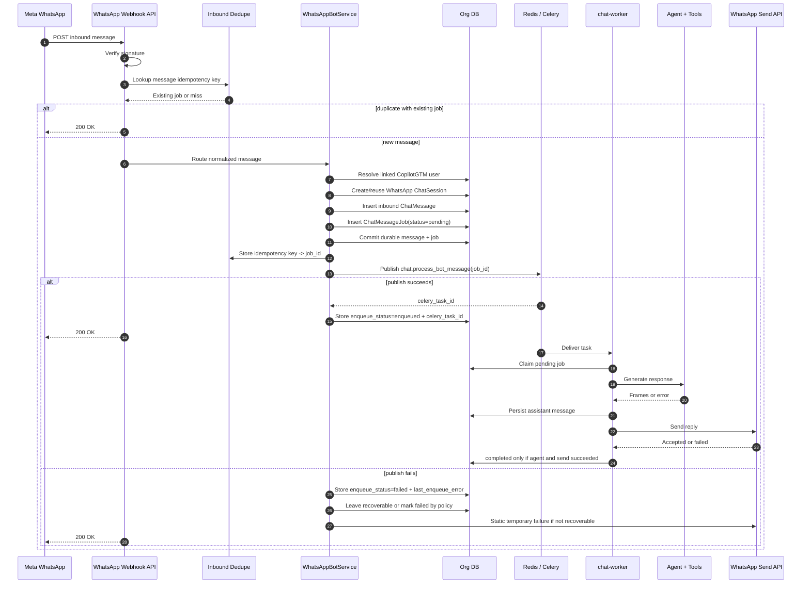
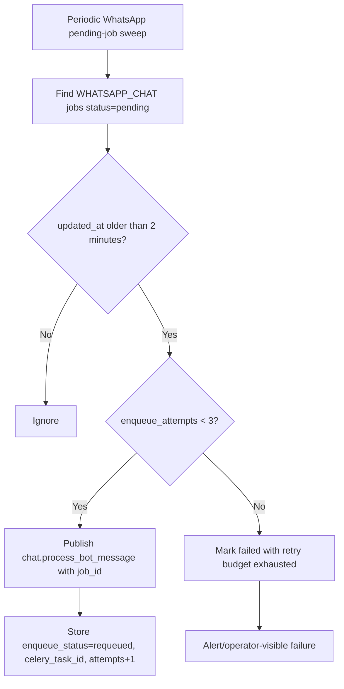
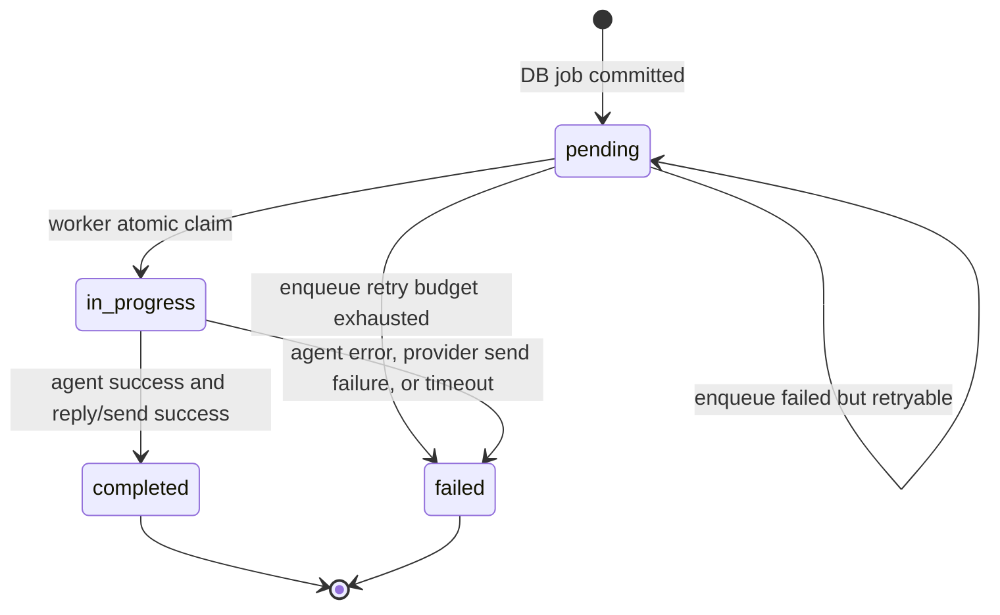

# Web Chat And WhatsApp Production Delivery Flow

## Decision

Use `chat_message_jobs` as the durable outbox for both web chat and WhatsApp.
The API/webhook path must persist the user message and job first, commit the DB
transaction, then publish a Celery task with the committed `job_id`.

At 50,000 inbound messages/hour, the system should scale by increasing
`chat-worker` replicas and Celery concurrency, not by changing the message
contract.

Rating: **8.5/10 for the reviewed final design**.

This is high enough to implement, but not 10/10 because Redis/Celery is still an
at-least-once queue, not a transactional outbox broker. The requeue sweeper and
idempotent worker claim make that acceptable without adding a new table or
broker in this iteration.

Current code warning: the existing WhatsApp webhook handler performs a
best-effort Redis dedupe before `process_webhook()`. That is not production-safe
because a process failure after setting Redis but before committing a durable job
can cause a Meta retry to be ignored. The production design below moves the
dedupe success marker after the durable DB boundary and stores `job_id` as the
dedupe value.

## Requirements

1. No inbound user message can disappear between API/webhook acceptance and
   worker processing.
2. Web chat and WhatsApp must use the same durable shape: message, job, commit,
   enqueue with `job_id`.
3. A queued message can fail, but it must fail visibly in DB and logs.
4. Duplicate webhook deliveries or duplicate Celery deliveries must not create
   duplicate assistant replies.
5. Scaling to 50,000 messages/hour should require more worker capacity, not a
   new flow.
6. Operators must be able to answer where a message stopped from `job_id`,
   `celery_task_id`, or WhatsApp `message_id`.

## Capacity Model

50,000 messages/hour is about **14 messages/second**. The intake path only does
DB writes and queue publish, so the API/webhook layer should handle that volume
comfortably if it avoids LLM/provider work.

Worker capacity depends on average processing time:

| Average worker time | Needed concurrent slots for 50k/hour | Practical target with headroom |
|---------------------|--------------------------------------|--------------------------------|
| 10 seconds | 139 | 200 |
| 20 seconds | 278 | 400 |
| 30 seconds | 417 | 600 |
| 60 seconds | 834 | 1,200 |

Formula:

```text
required_concurrency = messages_per_second * average_processing_seconds
```

The design is valid only if:

- webhook/API p95 stays below provider timeout thresholds
- Redis queue depth drains when worker replicas are increased
- database connection pools are sized for API plus worker concurrency
- LLM/tool provider rate limits are either high enough or backpressure is
  explicit
- per-tenant hot spots are handled; one large customer cannot starve all worker
  slots or exhaust the shared database pool

## Web Chat Flow



## WhatsApp Flow



## Requeue Flow

The worker claim handles duplicate task delivery. The remaining production gap
is the opposite case: DB job committed, but the task was not published, was lost
before execution, or the worker crashed before claim.



This is the piece that makes scaling safe. Redis/Celery is allowed to be
at-least-once because the database remains the source of truth, and the sweeper
repairs missed queue execution.

The sweeper must claim requeue candidates before publishing, using either a
short `requeueing` metadata marker with `updated_at` update or a row lock/atomic
update. Without that, two sweeper tasks can publish the same pending job at the
same time. Duplicate worker delivery is safe, but unbounded duplicate publish
adds avoidable queue pressure at scale.

## State Machine



Rules:

- Only API/webhook/requeue creates or republishes `pending` jobs.
- Only worker can move `pending` to `in_progress`.
- Only worker can mark a generated answer `completed`.
- WhatsApp completion requires provider send success, not just agent success.
- A duplicate worker task exits if the job is not `pending`.

## Idempotency

### Web Chat

Web clients receive `job_id` synchronously. Duplicate browser retries should be
handled by a client request id if duplicate web-send becomes a real issue. It is
not required for the WhatsApp incident.

### WhatsApp

WhatsApp must use a deterministic inbound key:

```text
whatsapp:{phone_number_id}:{recipient_wa_id}:{message_id}
```

The dedupe value should be `job_id`, not just `"1"`. It must be written only
after the job is durably committed, or as part of a DB-backed idempotency record
inside the same transaction. Redis-only dedupe before job creation is unsafe.

Preferred implementation:

1. Add a unique DB idempotency key for WhatsApp inbound messages, either as a
   narrow table or a generated/indexed field tied to `chat_message_jobs`.
2. In one DB transaction, create/reuse the session, inbound message, job, and
   idempotency mapping.
3. After commit, optionally mirror `idempotency_key -> job_id` to Redis for fast
   duplicate rejection.
4. If Redis is down, fall back to DB lookup; do not drop idempotency.

On duplicate webhook:

| Existing job state | Action |
|--------------------|--------|
| `pending` | return 200, do not create or enqueue another job |
| `in_progress` | return 200 |
| `completed` | return 200 |
| `failed` with retryable enqueue error | optional requeue within retry budget |
| `failed` with permanent error | return 200, do not duplicate |

If the webhook contains multiple messages, dedupe and create jobs per message.
One duplicate message in the batch must not cause the whole webhook batch to be
ignored.

## Required Metadata

Store this in `chat_message_jobs.job_metadata`.

| Field | Required for | Purpose |
|-------|--------------|---------|
| `provider` | WhatsApp | `whatsapp` |
| `source` | WhatsApp | `bot` |
| `conversation_type` | WhatsApp | `personal` |
| `session_id` | Web + WhatsApp | load persisted chat history |
| `user_message_id` | Web + WhatsApp | trace inbound message |
| `assistant_message_id` | Web | preallocated assistant message |
| `whatsapp_message_id` | WhatsApp | Meta trace/idempotency |
| `phone_number_id` | WhatsApp | business phone routing |
| `recipient_wa_id` | WhatsApp | user routing |
| `idempotency_key` | WhatsApp | duplicate webhook convergence |
| `enqueue_status` | Web + WhatsApp | `enqueued`, `failed`, `requeued` |
| `celery_task_id` | Web + WhatsApp | queue trace |
| `enqueue_attempts` | WhatsApp | bounded requeue |
| `last_enqueue_error` | Web + WhatsApp | operator debugging |
| `send_status` | WhatsApp | `sent` or `failed` |
| `send_error` | WhatsApp | provider error body/status |
| `lease_owner` | WhatsApp requeue | optional sweeper/task owner while republishing |
| `lease_expires_at` | WhatsApp requeue | prevents permanent stuck requeue claims |

## Failure Policy

| Failure point | User result | DB result | Recovery |
|---------------|-------------|-----------|----------|
| Signature invalid | no processing | no job | Meta retry/ignore |
| User not linked | login reply | no chat job | user signs in |
| DB job creation fails | temporary failure reply | no job or rollback | alert API error |
| Celery publish fails | fallback or delayed recovery | failed or pending with `enqueue_status=failed` | sweeper if recoverable |
| Worker duplicate task | no user-visible duplicate | existing terminal/non-pending state | safe no-op |
| Worker crash before claim | no immediate reply | job remains pending | sweeper requeues |
| Worker crash after claim | no immediate reply | job stuck in_progress | stale cleanup marks failed or retries by policy |
| Agent/tool failure | static error reply | failed | user can retry |
| WhatsApp send failure | maybe no reply delivered | failed with `send_status=failed` | operator-visible retry/manual handling |
| Redis dedupe unavailable | normal processing continues | DB idempotency decides duplicate handling | alert if sustained |
| LLM/provider rate limited | delayed or failed reply | pending/in_progress age rises | backpressure and provider-specific retry |
| Tenant DB pool exhausted | delayed reply or temporary failure | enqueue/processing errors visible | per-tenant concurrency cap |

## Loophole Review

These are the ways this design could still fail if implemented carelessly, and
the required guard for each.

| Loophole | Risk | Required guard |
|----------|------|----------------|
| Dedupe key written before durable job commit | Meta retry gets ignored and no job exists | write dedupe after commit or in DB transaction |
| Redis-only dedupe | Redis restart loses duplicate protection | DB unique idempotency key is source of truth |
| Batch webhook deduped as one unit | duplicate first message drops later new messages | dedupe per inbound message |
| Job metadata update after publish succeeds fails | task runs, but no `celery_task_id` is visible | log warning and let sweeper rely on job status/age |
| Two sweepers requeue same pending job | duplicate queue pressure | atomic requeue claim/lease before publish |
| Generic stale cleanup fails WhatsApp pending job before requeue | recoverable message becomes failed | run WhatsApp requeue before generic stale-fail pass |
| Worker marks completed when WhatsApp send failed | user never receives answer but job looks done | finalize with `agent_success and send_success` |
| Assistant message persisted before send failure | chat history shows a reply user never got | mark job failed and store `send_status=failed`; decide whether to display internally |
| Worker prefetch too high | few workers reserve many long-running tasks | low prefetch and autoscale by queue age |
| LLM/provider limits lower than worker capacity | adding workers makes failures faster | provider backpressure, rate-limit metrics, and retry budget |
| Tenant hot spot | one org consumes all worker slots/DB connections | per-tenant queue fairness or concurrency cap |
| Missing index on idempotency/status metadata | sweep and duplicate lookup become slow at scale | DB index or dedicated idempotency table |
| No load-test with stubbed providers | design passes on paper only | 50k/hour intake and worker-drain test before production claim |

## Scaling Plan

The flow is intentionally queue-backed. To scale:

1. Increase API/webhook pods only if request latency or CPU requires it.
2. Increase `chat-worker` replicas/concurrency until `chat_messages` queue age
   drains under the SLO.
3. Keep `chat_messages` separate from low-priority cleanup/attachment queues so
   user replies are not starved.
4. Set worker prefetch low enough that one worker does not reserve a large chunk
   of long-running LLM tasks.
5. Size DB pools for total worker concurrency, or cap worker concurrency before
   the DB becomes the bottleneck.
6. Rate-limit or shed load before LLM/provider limits cause unbounded queue age.
7. Add per-provider and per-tenant concurrency controls before raising worker
   count aggressively.

Operational SLOs:

| Signal | Target |
|--------|--------|
| webhook/API p95 latency | under 2 seconds |
| queue publish failure rate | below 0.1% |
| `chat_messages` oldest task age | under 2 minutes sustained |
| WhatsApp `pending` jobs older than 5 minutes | zero |
| WhatsApp send failure rate | alert above 5% for 10 minutes |
| duplicate assistant replies per inbound WhatsApp id | zero |

## Operator Query

Use this query when a user reports a WhatsApp no-answer incident and provides an
approximate message time or Meta `wamid`.

```sql
select
  job_id,
  status,
  job_metadata->>'enqueue_status' as enqueue_status,
  job_metadata->>'celery_task_id' as celery_task_id,
  job_metadata->>'send_status' as send_status,
  error_message,
  created_at,
  updated_at
from chat_message_jobs
where chat_type = 'WHATSAPP_CHAT'
  and job_metadata->>'whatsapp_message_id' = '<wamid>'
order by created_at desc;
```

## Implementation Order

1. Keep the current WhatsApp enqueue metadata fix.
2. Move WhatsApp dedupe to the durable boundary: DB idempotency first, Redis
   cache second.
3. Add WhatsApp idempotency key and duplicate-to-existing-job behavior.
4. Add WhatsApp pending-job requeue before generic stale cleanup fails it.
5. Add atomic requeue claim/lease so multiple sweepers cannot stampede.
6. Finalize bot jobs with `agent_success and send_success`.
7. Store `send_status` and `send_error` for WhatsApp.
8. Add metrics and alerts for queue age, pending age, enqueue failures, requeues,
   and send failures.
9. Add per-tenant/provider concurrency controls if load tests show unfairness or
   provider throttling.
10. Load test with a stubbed agent/provider path before claiming 50k/hour.

## Review Passes

### Review 1: Silent Failure

Pass. Every accepted message has one of:

- committed job and queued task
- committed job with enqueue failure metadata
- explicit user-safe failure before queueing

### Review 2: Duplicate Delivery

Pass with required idempotency work. Celery duplicates are already handled by the
worker pending-job claim. WhatsApp webhook duplicates require DB-backed
idempotency, not the current pre-processing Redis-only key.

### Review 3: Queue Loss Or Worker Crash

Pass only with the requeue sweeper. Without it, a `pending` WhatsApp job can
still wait until generic stale cleanup marks it failed. That is visible, but not
good enough for production reliability.

### Review 4: Provider Send Failure

Pass only after job finalization includes WhatsApp send success. Current worker
logic can treat agent success as job success even if the outbound send fails.

### Review 5: 50,000 Messages/Hour

Pass as a flow design. Intake is fast and durable; processing capacity scales
with workers. Actual production readiness still requires a load test because DB
pool limits, LLM/provider rate limits, and Celery prefetch settings determine
the real worker count.

The load-test gate is documented in `scripts/load_testing/whatsapp_reliable_delivery.md`.

### Review 6: Dedupe Ordering

Current code does not pass this review. The plan passes only if dedupe is moved
after durable job creation or backed by a DB unique key created in the same
transaction as the job.

### Review 7: Operational Robustness

Pass as a plan. The required metrics, alerts, requeue lease, and load-test gate
are documented. It is not production-proven until those gates are implemented
and exercised.

## Honest Rating

| Version | Rating | Reason |
|---------|--------|--------|
| Current one-file enqueue fix | 8/10 for the observed incident | It closes the durable-job-to-enqueue visibility gap. |
| Current deployed system as full 50k/hour guarantee | 5.5/10 | Missing idempotency, requeue, send-status finalization, and scale proof. |
| This reviewed production design | 8.5/10 | Adds durable idempotency, requeue lease, dedupe ordering, fairness, and validation gates while still reusing existing primitives. |
| 10/10 version | 10/10 | Would use a transactional outbox or broker with stronger publish guarantees, full metrics, and proven load-test evidence. |

Final recommendation: implement the complete production design in the order
above. Do not claim “never fail”; claim “never fail silently, and recover
automatically where recovery is safe.”

Implementation plan: `docs/superpowers/plans/2026-07-09-whatsapp-reliable-delivery-implementation.md`.
