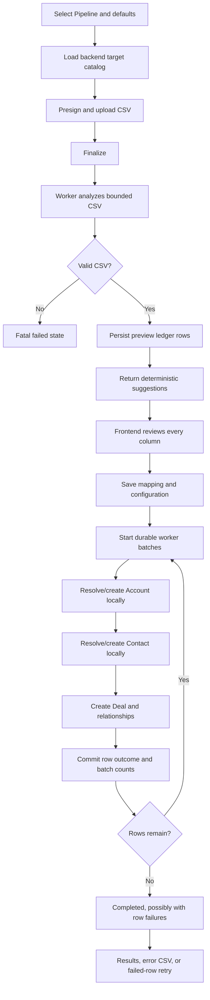

# Audited CRM CSV Deal Import Flow

This document describes the implemented backend flow. The frontend wire contract and examples are in [`crm-imports-api.md`](../API%20Documentation/deals/crm-imports-api.md).

## Runtime Flow

## Persistence

The feature introduces no database migration or new table.

- Existing `deal_jobs` rows store configuration, analysis, mapping, state, and aggregate counts.
- Existing `crm_import_rows` rows store raw/normalized values, status, record IDs, and row errors.
- Supplementary owner, stage, outcome, attempt, and error-field audit details live under the existing `normalized_values._audit` JSONB key.
- API presentation removes `_audit` from `normalized_values` and projects approved audit fields into typed response properties.

## Processing Guarantees

- A transaction-scoped import lock serializes duplicate worker deliveries.
- Each task processes at most 250 ready rows.
- Each row uses a nested savepoint, so one validation failure does not roll back sibling rows.
- A batch commits before its continuation task is published.
- Celery redelivery resumes only rows still in preview/ready state.
- Account and Contact identity locks prevent simultaneous imports from creating the same local identity.
- Failed-row retry resets only failed ledger rows; successful Deal IDs remain immutable.

## Dependency Boundaries

- Account and Contact imports use opt-in local resolution methods and never invoke external enrichment.
- Matched Account/Contact records are returned untouched.
- Deal and Deal custom-field writes still pass through canonical validation services.
- CSV-specific parsing occurs inside the import service, so Lead forms and ordinary Deal custom-field callers retain their existing coercion behavior.
- The only shared Deal behavior change is correct lifecycle initialization when any caller creates directly in a won/lost stage.

## State and Failure Semantics

- `uploading`: waiting for direct blob upload/finalize.
- `analyzing`: worker parsing and generating mapping suggestions.
- `ready_for_mapping`: analysis succeeded; mapping may be reviewed or retried.
- `importing`: durable row batches are running.
- `completed`: all eligible rows were attempted; row failures may exist.
- `failed`: fatal upload, analysis, configuration, or exhausted worker failure.

Expected row errors are persisted with safe messages and do not fail the parent job. Unexpected worker failures retry and only mark the job failed if retries are exhausted while the job is still in the expected state.

## Frontend Reads

- `GET /users/crm/imports/csv/{import_id}` is the source of truth for state, configuration, aggregate counts, progress, and recent errors.
- `GET /users/crm/imports/csv/{import_id}/rows` is the source of truth for the Results table.
- `GET /users/crm/imports/csv/{import_id}/errors.csv` provides spreadsheet-safe failed/skipped rows.

The default Results view must fetch all row statuses. A failed-only query is appropriate only after the user selects a Failed tab.
