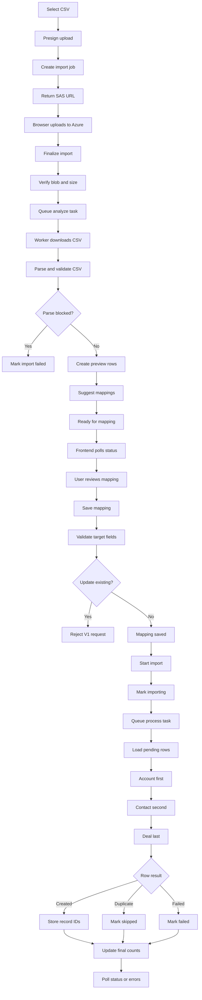

# CRM CSV Import Flow

This document shows the implemented CRM CSV import path for accounts, contacts, deals, and combined rows. Deal import uses the generic CRM import route; the old deal-scoped import endpoints have been removed.

## Runtime Flow

## What Gets Stored

- `deal_jobs` is the import header and public `import_id`.
- `deal_jobs.job_metadata` stores filename, storage path, mode, analysis, mapping suggestions, and saved mapping.
- `crm_import_rows` stores row-level raw values, normalized values, status, `target_type`, `account_id`, `contact_id`, `deal_id`, and row errors.
- `deal_jobs.result_data` stores final counts, including `created_accounts`, `created_contacts`, `created_deals`, `skipped_duplicates`, and `failed_rows`.

## Frontend Completion View

The completion UI should use two backend reads:

1. `GET /users/crm/imports/csv/{import_id}` for aggregate counts:
   - `total_rows`
   - `processed_rows`
   - `created_accounts`
   - `created_contacts`
   - `created_deals`
   - `skipped_duplicates`
   - `failed_rows`
2. `GET /users/crm/imports/csv/{import_id}/rows?limit=100` for row-level outcomes:
   - row number
   - row status
   - `target_type`
   - created/resolved `account_id`, `contact_id`, `deal_id`
   - row error or duplicate reason

The frontend should not fetch only `/rows?status=failed` after completion. That hides successful rows and duplicate/skipped rows, which makes an import with `0` created records look like a successful but unexplained no-op. If `processed_rows > 0` and `created_accounts`, `created_contacts`, and `created_deals` are all `0`, the UI should explicitly show that no CRM records were created and direct the user to the result table.

## Row Processing Order

1. Account fields are handled first through `AccountWriteService`.
2. Contact fields are handled second through `ContactWriteService`; explicit account linkage is passed as `company_id`.
3. Deal fields are handled last through `DealWriteService.create_deal(...)`, with account/contact relationship payloads when available.

This order is intentional: deal creation can safely attach the account and contact records created or resolved earlier in the same row.

## Failure Paths

- Missing upload blob: finalize returns an error before worker processing starts.
- CSV parse limit or encoding failure: analyze marks the import failed and stores parse details.
- Unsupported mapping target: mapping save returns an error before import start.
- `update_existing=true`: rejected in V1.
- Row duplicate: row becomes `skipped_duplicate`.
- Row validation error: row becomes `failed` and appears in `/errors.csv`.
- Unexpected row exception: row becomes `failed` without logging raw PII values.

## API Touchpoints

- `POST /users/crm/imports/csv/presign`
- `POST /users/crm/imports/csv/{import_id}/finalize`
- `GET /users/crm/imports/csv/{import_id}`
- `PATCH /users/crm/imports/csv/{import_id}/mapping`
- `POST /users/crm/imports/csv/{import_id}/start`
- `GET /users/crm/imports/csv/{import_id}/rows`
- `GET /users/crm/imports/csv/{import_id}/errors.csv`
