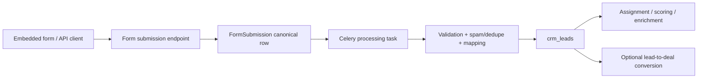

# Lead Management Backend Design

**Date:** April 30, 2026
**Status:** Implemented design notes
**Scope:** Organisation-schema backend tables, services, APIs, form-ingestion links, and lead-to-deal conversion.

## Decision

Create a first-class `crm_leads` table. Do not store leads in `crm_deals`.

`crm_deals` is an opportunity table: it is tied to pipelines/stages, stage history, deal participants, deal summaries, forecast amount, close dates, and opportunity analytics. A lead is a pre-opportunity record: it can arrive from a product-owned form, manual entry, import, or CRM provider; it may have no deal amount, no pipeline stage, no meeting context, and no confirmed buying process. Reusing `crm_deals` would make list filters, custom columns, conversion, and analytics ambiguous.

Leads should still share the CRM foundations already present in this repo:

- org-schema isolation with `organisation_id`
- nullable `integration_id` for internal/form-created records and provider-backed records
- provider identity through `crm_source_object_mappings` where present
- `properties` JSONB for custom field values
- `crm_custom_field_definitions` extended from deal-only to lead + deal
- conversion into existing `crm_deals`, `crm_contacts`, and `crm_companies`

## Current Repo Fit

Observed current state:

- `CRMDeal` lives in `src/domain/models/organisation_tables/sync/crm/deals.py`.
- Internal deals already exist, but they still behave as opportunities and create stage history.
- Deal custom fields are stored in `crm_deals.properties`.
- `CRMCustomFieldEntity` currently supports only `DEAL = "deal"`.
- The custom field registry already has source-aware metadata, validation, formula support, and provider/internal distinction.
- Prior forms architecture should treat product-owned form submissions as the intake record; lead creation is a downstream action after validated submission intake.

That means the right extension is not a parallel custom-field system. It is a new lead entity that reuses the existing custom-field definition/value pattern.

## Lead Entity Model

### `crm_leads`

Purpose: one candidate buyer/person/company record before it becomes a deal. It can represent a person-led lead, a company-led lead, or a partially anonymous inbound submission.

Suggested SQLModel location:

`src/domain/models/organisation_tables/sync/crm/leads.py`

Use `FlexibleSyncedRecordMixin`:

- `organisation_id` is required.
- `integration_id` is nullable.
- `is_deleted` is the soft-delete flag.

`integration_id` should be null for product-owned forms/manual/API-created leads unless we intentionally route all internal CRM objects through the existing internal CRM integration. Null is cleaner for form-originated leads because forms are owned by our product, not by an external CRM provider.

Columns:

| Column | Type | Notes |
| --- | --- | --- |
| `lead_id` | UUID PK | Internal lead ID |
| `source_type` | enum/string | `form`, `manual`, `import`, `api`, `provider_sync`, `chat`, `workflow` |
| `source_channel` | string nullable | `website`, `linkedin`, `event`, `partner`, `outbound`, etc. |
| `source_name` | string nullable | Campaign/form/import/provider display name |
| `source_ref` | string nullable | External campaign ID, form slug, import ID, or provider object reference |
| `status` | enum/string | `new`, `working`, `qualified`, `unqualified`, `converted`, `archived` |
| `priority` | string nullable | `low`, `medium`, `high`, `urgent` or org-defined |
| `score` | numeric nullable | Lead score, product or provider supplied |
| `first_name` | string nullable | Person profile |
| `last_name` | string nullable | Person profile |
| `full_name` | string nullable | Store exactly what form/import supplied |
| `email` | string nullable | Lowercase-normalized for search/dedupe |
| `phone` | string nullable | E.164 if possible; raw can remain in `properties` |
| `job_title` | string nullable | Person profile |
| `linkedin_url` | string nullable | Person enrichment/profile |
| `company_name` | string nullable | Company profile |
| `company_domain` | string nullable | Lowercase-normalized domain for dedupe |
| `company_website` | string nullable | Raw website URL |
| `industry` | string nullable | Company profile |
| `country` | string nullable | Location |
| `region` | string nullable | Location |
| `city` | string nullable | Location |
| `message` | text nullable | Original inquiry/message from form |
| `interest` | string nullable | Product/service interest |
| `budget_amount` | numeric nullable | Optional qualification signal, not deal amount |
| `budget_currency` | string nullable | ISO currency for budget |
| `owner_id` | UUID nullable FK `crm_users.user_id` | Resolved internal CRM owner |
| `owner_name` | string nullable | Display snapshot |
| `owner_email` | string nullable | Display snapshot |
| `assigned_at` | timestamptz nullable | Assignment timestamp |
| `contact_id` | UUID nullable FK `crm_contacts.contact_id` | Resolved/matched contact if created or linked |
| `company_id` | UUID nullable FK `crm_companies.company_id` | Resolved/matched company if created or linked |
| `converted_deal_id` | UUID nullable FK `crm_deals.deal_id` | Set once converted |
| `disqualified_reason` | string nullable | Reason when status becomes `unqualified` |
| `archive_reason` | string nullable | Reason when archived without qualification |
| `form_id` | UUID nullable | Product-owned form ID when source is form |
| `form_version_id` | UUID nullable | Immutable form version that produced the lead |
| `form_submission_id` | UUID nullable | Canonical form submission row |
| `utm_source` | string nullable | Common attribution |
| `utm_medium` | string nullable | Common attribution |
| `utm_campaign` | string nullable | Common attribution |
| `utm_term` | string nullable | Common attribution |
| `utm_content` | string nullable | Common attribution |
| `attribution` | JSONB not null default `{}` | Referrer, landing page, IP-derived metadata, campaign details |
| `consent` | JSONB not null default `{}` | Marketing consent, privacy acceptance, capture timestamp, policy version |
| `properties` | JSONB not null default `{}` | Custom column values keyed by `crm_custom_field_definitions.key` |
| `metrics` | JSONB not null default `{}` | Lead scoring inputs, enrichment scores, engagement counters |
| `crm_url` | string nullable | Provider UI URL if synced from external CRM |
| `source_created_at` | timestamptz nullable | Creation time from source/provider |
| `captured_at` | timestamptz not null | When our system captured the lead |
| `last_activity_at` | timestamptz nullable | Most recent activity linked to lead |
| `last_contacted_at` | timestamptz nullable | Sales outreach timestamp |
| `qualified_at` | timestamptz nullable | Status transition timestamp |
| `converted_at` | timestamptz nullable | Lead-to-deal conversion timestamp |
| `disqualified_at` | timestamptz nullable | Status transition timestamp |
| `synced_at` | timestamptz nullable | Last provider sync time |
| `source_modified_at` | timestamptz nullable | Provider modified time |
| `last_seen_at` | timestamptz nullable | Provider snapshot presence |
| `created_by_user_id` | UUID nullable FK `crm_users.user_id` | Internal actor where applicable |
| `updated_by_user_id` | UUID nullable FK `crm_users.user_id` | Internal actor where applicable |

Provider identity:

- Provider/migration lead IDs are stored in `crm_source_object_mappings` with
  `external_object_type = 'lead'` and `local_object_type = 'lead'`.
- Raw provider payloads for synced leads are stored on the mapping row, not on
  `crm_leads`.
- Product-owned direct-ingestion metadata is stored in `crm_leads.properties`
  under reserved `_copilotgtm_*` keys. Form submissions keep their raw payload in
  `lead_form_submissions`.

Recommended constraints:

- Conversion invariant:
  - if `status = 'converted'`, `converted_deal_id is not null and converted_at is not null`
- Email/domain normalization should happen in service code; do not enforce email required because forms can be partially configured.
- Budget constraint:
  - `budget_amount is null or budget_amount >= 0`
- Score constraint:
  - `score is null or score >= 0`

Recommended indexes:

- `(organisation_id, status, captured_at desc)`
- `(organisation_id, owner_id, status)`
- `(organisation_id, email)` where `email is not null and is_deleted = false`
- `(organisation_id, company_domain)` where `company_domain is not null and is_deleted = false`
- `(organisation_id, form_id, captured_at desc)` where `form_id is not null`
- `(organisation_id, converted_deal_id)` where `converted_deal_id is not null`
- GIN index on `properties` only if lead custom-field filtering becomes a real list-view requirement. Add it when needed, because JSONB GIN indexes are not free.

### `crm_lead_participants`

Purpose: contact, company, owner, or custom participant linked to a lead before
conversion.

Provider identity does not live on `crm_lead_participants`. Provider participant
or association IDs are stored in `crm_source_object_mappings` with
`external_object_type = 'lead_participant'` and
`local_object_type = 'lead_participant'`.

Columns:

| Column | Type | Notes |
| --- | --- | --- |
| `participant_id` | UUID PK | Internal participant relationship ID |
| `lead_id` | UUID FK `crm_leads.lead_id` | Owning lead |
| `participant_type` | enum/string | `contact`, `company`, `user`, or `custom` |
| `relationship_role` | string | Role such as `primary_contact`, `participant`, `primary_company`, or `owner` |
| `is_primary` | boolean | Primary relationship marker for its role/type |
| `related_local_id` | UUID nullable | Local contact/company/user UUID when resolved |
| `name` / `email` / `phone` | strings nullable | Display or matching identity when no local row exists |
| `job_title` / `company_name` / `company_domain` | strings nullable | Denormalized participant context |
| `source` | string nullable | `form`, `manual`, `import`, `provider_sync`, etc. |
| `source_reference_id` | UUID nullable | Product source row that created this participant link |
| `properties` | JSONB not null default `{}` | Additional participant metadata |

Recommended constraints:

- A participant must have `related_local_id` or `email`.
- Active locally-resolved participants are unique by
  `(lead_id, participant_type, related_local_id, relationship_role)`.
- Active primary roles are unique by
  `(lead_id, participant_type, relationship_role)` where `is_primary = true`.

### `crm_lead_status_history`

Purpose: audit lead lifecycle transitions and power funnel analytics.

Columns:

| Column | Type | Notes |
| --- | --- | --- |
| `history_id` | UUID PK | Internal history row |
| `organisation_id` | UUID | Tenant isolation |
| `lead_id` | UUID FK `crm_leads.lead_id` | Lead |
| `from_status` | string nullable | Previous status |
| `to_status` | string not null | New status |
| `reason` | string nullable | Disqualification/archive reason or conversion note |
| `actor_user_id` | UUID nullable | Internal user when user-triggered |
| `source` | string nullable | `api`, `form_processor`, `provider_sync`, `workflow`, `import` |
| `changed_at` | timestamptz not null | Transition time |
| `metadata` | JSONB not null default `{}` | Context snapshot |

Indexes:

- `(organisation_id, lead_id, changed_at desc)`
- `(organisation_id, to_status, changed_at desc)`

### `crm_lead_activities`

Do not create a separate table if `CRMActivity` can support lead associations cleanly. Extend `CRMActivityObjectType` with `LEAD = "lead"` and add nullable `lead_id` only if activity-to-lead becomes first-class. Provider lead activity identity should still resolve through `crm_source_object_mappings`.

## Custom Columns

Extend the existing field registry:

```python
class CRMCustomFieldEntity(str, Enum):
    DEAL = "deal"
    LEAD = "lead"
```

Lead values should be stored in `crm_leads.properties`, exactly like deal values are stored in `crm_deals.properties`.

Required service changes:

- `CustomFieldWriteService` should accept `CRMCustomFieldEntity.LEAD`.
- `delete_field()` must check `crm_leads.properties ? key` for lead fields and `crm_deals.properties ? key` for deal fields.
- `DealWriteService._validate_custom_properties()` should remain deal-specific.
- Add `LeadWriteService._validate_custom_properties()` using the same coercion/data-type behavior but filtering definitions by `entity_type = 'lead'`.
- Formula validation must be entity-scoped so lead formulas cannot silently depend on deal-only fields.

This avoids new value tables and keeps reads simple. If later we need strict per-value auditing or high-cardinality custom-field filtering, introduce a derived/search table then. Do not start there.

## Form Ingestion Relationship

Product-owned forms should not synchronously create deals. The production flow should be:



Lead creation from a form should store:

- `source_type = 'form'`
- `form_id`
- `form_version_id`
- `form_submission_id`
- common fields mapped to typed lead columns
- unmapped lead custom fields in `properties`
- raw submission in `LeadFormSubmission.raw_payload` / `context`
- attribution and consent metadata separately from arbitrary `properties`

The form builder should allow fields to map to:

- lead standard columns
- lead custom fields
- submission-only metadata

## Lead-to-Deal Conversion

Conversion should be a service operation, not a direct row mutation from the API handler.

Service:

`LeadConversionService.convert_to_deal(lead_id, payload, actor_user_id)`

Responsibilities:

1. Load lead by `organisation_id` and `lead_id`, excluding deleted rows.
2. Prevent converting `converted` or `archived` leads unless explicitly forced by a controlled admin path.
3. Resolve or create contact/company when requested.
4. Create a `CRMDeal` through `DealWriteService`, mapping only opportunity-safe fields:
   - `name`: supplied in conversion payload or derived from company/person
   - `lead_source`: lead `source_channel` / `source_name`
   - `primary_contact_*`
   - `company_*`
   - `description`: lead message/context
   - deal custom properties only from explicit mapping, not blindly copied from lead custom fields
5. Set `crm_leads.status = 'converted'`.
6. Set `converted_deal_id` and `converted_at`.
7. Insert `crm_lead_status_history`.
8. Commit once, so deal creation and lead conversion state stay consistent.

Important rule: lead custom fields and deal custom fields are separate schemas. Copy values only through an explicit conversion mapping, because a lead field like `campaign_interest` is not necessarily a deal field.

## Service Boundaries

Add:

- `src/service/crm/internal/lead_write_service.py`
  - create/update/archive/assign/status transitions/custom-property validation
- `src/service/crm/access/leads_access_service.py`
  - list/detail/search, field filtering, custom-column response assembly
- `src/service/crm/internal/lead_conversion_service.py`
  - conversion transaction and mapping to existing deal/contact/company services
- `src/api/routers/crm/leads/leads_handler.py`
  - authenticated lead APIs

Keep form processing separate:

- form submission service owns submission validation and persistence
- lead service owns lead creation/update
- conversion service owns opportunity creation

This prevents form-specific assumptions leaking into CRM lead management.

## API Contract

Suggested endpoints under the existing CRM router prefix:

| Method | Path | Purpose |
| --- | --- | --- |
| `GET` | `/crm/leads` | List leads with pagination/filtering |
| `POST` | `/crm/leads` | Create manual/API lead |
| `GET` | `/crm/leads/{lead_id}` | Lead detail with custom columns |
| `PATCH` | `/crm/leads/{lead_id}` | Update lead standard/custom fields |
| `POST` | `/crm/leads/{lead_id}/assign` | Assign owner |
| `POST` | `/crm/leads/{lead_id}/status` | Controlled status transition |
| `POST` | `/crm/leads/{lead_id}/convert` | Convert lead to deal |
| `DELETE` | `/crm/leads/{lead_id}` | Soft-delete/archive lead |

List filters:

- `status`
- `owner_id`
- `source_type`
- `source_channel`
- `form_id`
- `created_from` / `created_to`
- `q` for email/name/company/domain
- later: custom-field filters

Response shape should mirror deal detail conventions:

```json
{
  "lead_id": "...",
  "status": "new",
  "full_name": "Jane Buyer",
  "email": "jane@example.com",
  "company_name": "Example Inc",
  "source_type": "form",
  "form_submission_id": "...",
  "custom_columns": {
    "product_interest": "analytics",
    "team_size": 42
  },
  "custom_column_definitions": [
    {
      "key": "product_interest",
      "label": "Product Interest",
      "data_type": "select"
    }
  ]
}
```

## Security and Isolation

All lead queries must include `organisation_id`.

Never load by `lead_id` alone in services that can be called from API, agents, workers, or form processors. Use `(organisation_id, lead_id)` and validate linked `form_id`, `contact_id`, `company_id`, `converted_deal_id`, and `owner_id` belong to the same organisation context.

Public form submissions must not accept arbitrary `organisation_id` from the browser. The public form token/slug must resolve to an organisation and form version server-side.

## Observability

Log structured events for:

- lead created
- lead deduped
- lead assigned
- status changed
- conversion attempted
- conversion succeeded/failed
- form submission mapped to lead

Metrics:

- lead creation count by `source_type`
- form submission to lead success/failure count
- dedupe hit rate
- conversion rate by source/form
- lead conversion latency from `captured_at` to `converted_at`

## Rollout Plan

1. Add `crm_leads` and `crm_lead_status_history` org migration.
2. Extend `CRMCustomFieldEntity` with `LEAD`.
3. Update custom-field services to be entity-aware for delete/value checks.
4. Add lead model exports.
5. Add lead write/access/conversion services.
6. Add authenticated lead APIs.
7. Connect product-owned form processing to create leads asynchronously.
8. Add list/detail API documentation under `docs/API Documentation/`.
9. Add tests for org isolation, custom-field validation, form-created lead, duplicate handling, and conversion transaction.

## Open Product Decisions

These should be decided before implementation starts:

- Are anonymous leads allowed, or must every lead have at least email or phone?
- Should duplicate submissions update an existing open lead or create a new lead marked as duplicate?
- What are the default lead statuses for the first release?
- Do lead custom fields need list-view filtering on day one?
- Should internal form leads use `integration_id = null` or the existing internal CRM integration? My recommendation is `null` for product-owned forms, unless we want all CRM-owned objects to be integration-backed for consistency with current internal deals.

## Recommendation Summary

Build `crm_leads` as a first-class pre-opportunity table with its own lifecycle, custom fields, form links, and conversion path. Reuse the existing custom-field registry and JSONB value pattern. Convert leads into `crm_deals` only when the user or workflow qualifies the lead into a real opportunity.
