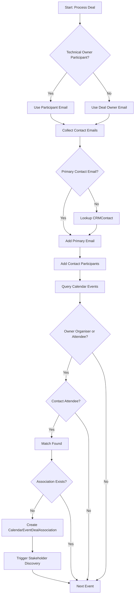

# Deal-Meeting Matching Logic Flow

## 1. Objective

The goal of the Deal-Meeting Matching logic is to automatically identify calendar events that are relevant to a specific CRM Deal. This enables the system to build a timeline of interactions and discover stakeholders.

## 2. Logic Overview

The matching process is executed per Deal and follows these steps:

### Step 1: Identify Deal Owner

We determine which internal user must be present in a meeting for it to count toward the deal.

- **Primary source:** `CRMDealParticipant` records with `participant_type=USER` and `relationship_role=technical_owner`.
- **Fallback:** use the `owner_email` stored on the CRM Deal when no technical owner participant is linked.
- **Validation:** skip the deal if no normalized email is available after these checks.

### Step 2: Collect Deal Contact Emails

Instead of coarse domain filtering, we now require explicit contact attendees. The matcher builds a set of lower-cased contact emails by:

1. **Primary Contact:** taking `primary_contact_email` directly from the deal when present.
2. **Primary Contact Lookup:** if the primary email is missing, loading the referenced `CRMContact` via `primary_contact_external_id` and merging the contact's primary plus `additional_emails` field.
3. **Deal Participants:** iterating `CRMDealParticipant` rows where `participant_type=CONTACT`, adding explicit `related_email` values, or resolving the contact by `related_local_id`/`related_external_id` to merge all known emails.
4. **Owner Deduplication:** removing the owner email from the contact set to avoid self-matching.

### Step 3: Find Matching Meetings

We query `CalendarEvent` rows that satisfy **both** attendee constraints:

1. **Owner Presence:** the owner email is either the meeting organiser or appears as a calendar attendee.
2. **Contact Presence:** at least one attendee's email matches the collected contact set (primary or secondary addresses).

### Step 4: Link & Enrich

For every matching meeting found:

1. **Create Association:** A `CalendarEventDealAssociation` record is created with status `SUGGESTED`.
2. **Trigger Discovery:** The `StakeholderService` is triggered to extract new stakeholders from the meeting attendees.

## 3. Process Flow Chart

## 4. Implementation Details

- **Service:** `src/workers/deal_worker/services/deal_meeting_matcher.py`
- **Task:** `deal.process_deal_meetings_task`
- **Table:** `calendar_event_deal_associations`

This logic ensures that we only link meetings where the accountable owner meets directly with at least one verified deal contact, dramatically reducing noise from internal-only meetings or unrelated calls.
