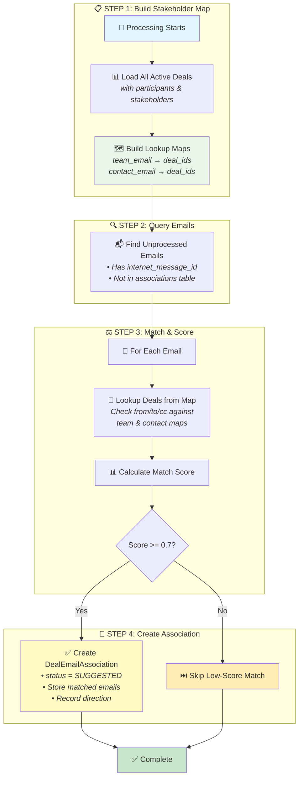

# Deal Email Matching Automation Guide

## Overview

This document describes the automated process of linking email messages to CRM deals based on stakeholder participation. Similar to how calendar meetings are matched to deals, emails are matched when they involve both internal team members and external customer contacts associated with a deal.

## Scope & Responsibilities

- Link emails to the most relevant CRM deals based on stakeholder participation
- Use `internet_message_id` for cross-user deduplication (same email in multiple mailboxes = one association)
- **Run hourly** using incremental processing (only new emails since last run)
- Provide engagement metrics by tracking email communication with deal stakeholders

## Processing Strategy: Email-First Batch Approach

For efficient hourly processing, we use an **Email-First** approach with batched deal loading:

```text
1. Load all active deals with stakeholders → Build map: {stakeholder_email: [deal_ids]}
2. Fetch unprocessed emails (not yet in any association)
3. For each email:
   - Extract from/to/cc emails
   - Lookup matching deals from in-memory stakeholder map
   - Score and create associations
```

**Why Email-First?**

| Aspect | Deal-First (iterate deals) | Email-First (iterate emails) |
| --- | --------------------------- | ------------------------------ |
| **DB Queries** | N deals × M emails | 2 queries (deals + emails) |
| **Hourly Fit** | ❌ Re-scans ALL emails every hour | ✅ Only new emails processed |
| **Scaling** | O(deals × emails) | O(new_emails) with in-memory lookup |

## Core Components

| Layer | Location | Responsibility |
| --- | --- | --- |
| **Model** | `DealEmailAssociation` (`src/domain/models/organisation_tables/sync/email_models.py`) | Store deal-email associations using `internet_message_id` |
| **Service** | `DealEmailMatcher` (`src/workers/deal_worker/services/deal_email_matcher.py`) | Stakeholder lookup, email matching logic |
| **Celery Tasks** | `deal.process_deal_emails_task`, `deal.trigger_deal_email_processing_all_orgs` | Invoke matcher for org-wide and scheduled runs |

## Data Model

### DealEmailAssociation Table

Follows the same pattern as `CalendarEventDealAssociation` - links emails to deals with matching metadata.

```python
from src.domain.models.organisation_tables.sync.calendar import AssociationStatus  # Reuse existing enum


class EmailDirection(str, Enum):
    """Direction of email relative to the deal team."""
    INBOUND = "INBOUND"    # From external contact to team
    OUTBOUND = "OUTBOUND"  # From team to external contact
    INTERNAL = "INTERNAL"  # Between team members (CC'd contacts)


class DealEmailAssociation(SQLModel, table=True):
    """
    Links emails to deals using internet_message_id for cross-user deduplication.
    Follows the same pattern as CalendarEventDealAssociation.
    """
    
    __tablename__ = "deal_email_associations"
    __table_args__ = (
        UniqueConstraint("deal_id", "internet_message_id", name="uq_deal_email"),
        Index("ix_deal_email_org_status", "organisation_id", "status"),
        Index("ix_deal_email_deal", "deal_id"),
        Index("ix_deal_email_internet_msg", "internet_message_id"),
    )

    association_id: UUID = Field(default_factory=uuid4, primary_key=True)
    organisation_id: UUID = Field(index=True)
    deal_id: UUID = Field(foreign_key="crm_deals.deal_id")
    internet_message_id: str = Field(
        sa_column=Column(String(512), nullable=False),
        description="RFC 822 Message-ID - same across all recipients of the email",
    )
    
    # Matching metadata (same pattern as CalendarEventDealAssociation)
    status: AssociationStatus = Field(default=AssociationStatus.SUGGESTED)
    match_score: float = Field(default=0.0, description="Confidence score 0.0-1.0")
    
    # Email-specific metadata
    direction: EmailDirection = Field(
        default=EmailDirection.INBOUND,
        description="Direction relative to deal team",
    )
    matched_stakeholder_emails: list[str] | None = Field(
        default=None, 
        sa_column=Column(JSONB, nullable=True),
        description="Which stakeholder emails matched this email",
    )
    
    # Email context (denormalized for quick access without joining)
    email_subject: str | None = Field(default=None, sa_column=Column(String(500), nullable=True))
    email_date: datetime | None = Field(
        default=None,
        sa_column=Column(DateTime(timezone=True), nullable=True),
        description="When the email was sent/received",
    )
    
    # Timestamps
    created_at: datetime = Field(
        default_factory=utcnow,
        sa_column=Column(DateTime(timezone=True), nullable=False),
    )
    updated_at: datetime = Field(
        default_factory=utcnow,
        sa_column=Column(DateTime(timezone=True), nullable=False),
    )
```

### Comparison with Related Tables

| Aspect | `CalendarEventDealAssociation` | `DealEmailAssociation` | `DealStakeholder` |
| --- | ------------------------------- | ------------------------ | ------------------- |
| **Links to** | `event_id` → CalendarEvent | `internet_message_id` → Email (logical) | `deal_id` → CRMDeal |
| **Status** | `AssociationStatus` enum | `AssociationStatus` enum (reused) | N/A |
| **Score** | `match_score` | `match_score` | `engagement_score` |
| **Direction** | N/A (meetings are bidirectional) | `EmailDirection` enum | N/A |
| **Generation** | meeting_prep, summary, followup | N/A (not needed for emails) | N/A |
| **Source** | N/A (always from calendar) | N/A (always automated matching) | `StakeholderSource` enum |

### Why `internet_message_id` instead of `email_id`?

| Approach | Problem |
| --- | --- |
| Use `email_id` | If User A's copy is mapped, User B's copy is not. Need N associations for N users. |
| Use `internet_message_id` | **One association covers ALL copies.** Query returns all users' email records. |

## Matching Algorithm

### Step 1: Build Stakeholder-to-Deal Map

Load all active deals and build an in-memory lookup map for efficient matching:

**Internal Team (Organisation Users):**

1. **Deal Owner Email** - Primary owner (`CRMDeal.owner_email`)
2. **USER Participants** - From `CRMDealParticipant` where `participant_type = USER`:
   - `owner` - Primary deal owner (may duplicate owner_email)
   - `collaborator` - Deal collaborators
   - `split_owner` - Revenue split owners (Enterprise)
   - Any other USER-type participants

**External Contacts (Customer Side):**

1. **Deal Stakeholders** - From `DealStakeholder` table (contacts discovered from meetings/calendar events)

Build two lookup structures:

- `team_email_to_deals: dict[str, set[UUID]]` - Maps team email → deal IDs
- `contact_email_to_deals: dict[str, set[UUID]]` - Maps contact email → deal IDs

### Step 2: Query Unprocessed Emails

Find emails that have not been processed yet:

1. Have a valid `internet_message_id`
2. Are not already in `deal_email_associations` table (for ANY deal)
3. Have at least one participant (from/to/cc) in our stakeholder map

```sql
-- Get distinct internet_message_ids that are NOT yet processed
SELECT DISTINCT e.internet_message_id, e.from_email, e.to_emails, e.cc_emails, 
       e.subject, e.received_at, e.direction
FROM emails e
WHERE e.organisation_id = :org_id
  AND e.internet_message_id IS NOT NULL
  AND NOT EXISTS (
      SELECT 1 FROM deal_email_associations dea 
      WHERE dea.internet_message_id = e.internet_message_id
        AND dea.organisation_id = :org_id
  )
```

### Step 3: Match Emails to Deals

For each unprocessed email:

1. Extract all participants: `from_email`, `to_emails`, `cc_emails`
2. Lookup which deals have matching stakeholders using in-memory maps
3. For each matching deal, calculate match score

**Scoring Logic:**

| Condition | Score | Reason |
| --- | --- | --- |
| Team member is **sender** AND contact is recipient | **1.0** | Outbound to customer - high relevance |
| Contact is **sender** AND team member is recipient | **1.0** | Inbound from customer - high relevance |
| Team member in CC, contact is sender/recipient | **0.7** | Team is looped in on customer communication |
| Multiple stakeholders involved | **+0.1** | More participants = higher confidence |

### Step 4: Create Associations

For emails with score >= threshold (default: 0.7):

1. Create `DealEmailAssociation` with `status = AssociationStatus.SUGGESTED`
2. Set `direction` based on sender:
   - `EmailDirection.OUTBOUND` if sender is team member
   - `EmailDirection.INBOUND` if sender is external contact
   - `EmailDirection.INTERNAL` if both sender and primary recipient are team members
3. Store `matched_stakeholder_emails` for audit trail
4. Denormalize `email_subject` and `email_date` for quick access
5. Skip if association already exists (idempotent via unique constraint)

## Visual Flow



## Task Configuration

### Celery Tasks

```python
# Process all deals for an organisation
@app.task(name="deal.process_deal_emails_task")
def process_deal_emails_task(organisation_id: str) -> dict[str, int]:
    """Process email matching for all active deals in an organisation."""

# Periodic task for all organisations (daily)
@app.task(name="deal.trigger_deal_email_processing_all_orgs")
def trigger_deal_email_processing_all_orgs():
    """Trigger email matching for all active organisations."""

# Process emails for a single deal
@app.task(name="deal.process_single_deal_emails_task")
def process_single_deal_emails_task(organisation_id: str, deal_id: str) -> dict[str, int]:
    """Process email matching for a specific deal."""
```

### Schedule

| Task | Schedule | Description |
| --- | --- | --- |
| `trigger_deal_email_processing_all_orgs` | **Hourly** | Process all orgs (incremental) |
| `process_deal_emails_task` | On-demand | Single org processing |
| `process_single_deal_emails_task` | On-demand | Single deal processing |

## Configuration Parameters

| Parameter | Default | Description |
| --- | --- | --- |
| `MIN_MATCH_SCORE` | 0.7 | Minimum score to create association |
| `BATCH_SIZE` | 500 | Emails to process per batch |

## Query Examples

### Get all emails for a deal (across all users)

```python
emails = await session.execute(
    select(Email)
    .join(DealEmailAssociation, 
          Email.internet_message_id == DealEmailAssociation.internet_message_id)
    .where(
        DealEmailAssociation.deal_id == deal_id,
        DealEmailAssociation.status != AssociationStatus.REJECTED,
    )
)
```

### Get email count per deal

```python
email_counts = await session.execute(
    select(
        DealEmailAssociation.deal_id,
        func.count(DealEmailAssociation.association_id).label("email_count")
    )
    .where(DealEmailAssociation.organisation_id == org_id)
    .group_by(DealEmailAssociation.deal_id)
)
```

## Error Handling

| Error | Action |
| --- | --- |
| Missing `internet_message_id` | Skip email (log warning) |
| Database constraint violation | Skip (already associated) |
| Stakeholder query fails | Retry task with exponential backoff |

## Metrics & Monitoring

Track the following metrics:

- `deal_emails_processed` - Total emails evaluated
- `deal_emails_matched` - Emails that met threshold
- `deal_emails_skipped` - Emails below threshold
- `deals_with_emails` - Deals that have email associations

## Future Enhancements

1. **Thread Grouping** - Group emails by `thread_id` for conversation view
2. **Sentiment Analysis** - Analyze email content for deal health signals
3. **Auto-Confirmation** - Auto-confirm high-score associations (score >= 0.95)
4. **Stakeholder Discovery** - Add new stakeholders from email participants (like calendar does)
