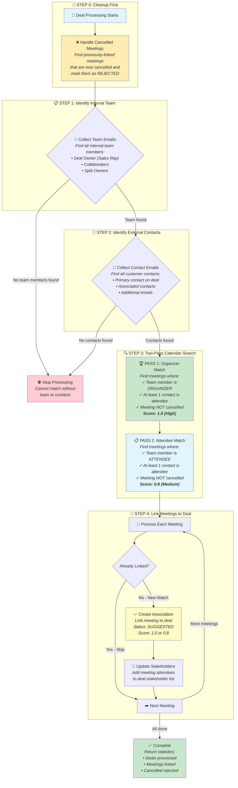

# Deal Meeting Automation Guide

## Scope & Responsibilities

- Link external-facing calendar events to the most relevant CRM deals so downstream surfaces (Briefing Room, Stakeholder tab, engagement metrics) stay current.
- Run safely across three execution surfaces: single deal refreshes, single-organisation backfills, and scheduled all-org sweeps.
- Keep the stakeholder graph hydrated by syncing CRM contacts before matching and re-processing attendee lists after new meetings are linked.
- Handle cancelled meetings by rejecting previously-mapped associations BEFORE matching new ones, and filtering cancelled events during matching.

## Core Components

| Layer | Location | Responsibility |
| :--- | :--- | :--- |
| Service | `src/workers/deal_worker/services/deal_meeting_matcher.py` | Team/contact discovery, two-pass meeting matching, cancelled event handling, stakeholder kicks |
| Celery Tasks | `deal.process_deal_meetings_task`, `deal.process_single_deal_task`, `deal.trigger_deal_meeting_processing_all_orgs` | Invoke the matcher for org-wide, per-deal, and scheduled runs |
| Models | `CalendarEvent`, `CalendarAttendee`, `CalendarEventDealAssociation` (`src/domain/models/organisation_tables/sync/calendar.py`) | Persist events, attendees, and association metadata |
| Stakeholder Bridge | `StakeholderService` | Sync CRM contacts (`sync_stakeholders_from_deal`) and derive new stakeholders from meetings (`sync_stakeholders_from_event`) |

## Matching Algorithm

### Step 0: Handle Cancelled Meetings FIRST

Before matching any new meetings, the system:
1. Finds all previously-linked meetings that are now cancelled
2. Updates their association status to `REJECTED`
3. This ensures cancelled meetings are cleaned up before new matching begins

### Step 1: Collect Team Emails (`_collect_team_emails`)

- Collect all USER-type participants from `CRMDealParticipant` (owner, collaborator, split_owner)
- Any team member's participation in a meeting qualifies it for matching
- Fallback to `CRMDeal.owner_email` when no USER participants have emails

### Step 2: Collect Contact Emails (`_collect_contact_emails`)

- Start with the normalized `CRMDeal.primary_contact_email`
- Merge every `CRMDealParticipant` with `participant_type=CONTACT`
- **Only ONE contact needs to be present** in the meeting (not all contacts)
- Remove team emails from the contact set to avoid self-matching

### Step 3: Two-Pass Event Matching

The system uses a **two-pass approach** with different confidence scores:

#### Pass 1: Team Member is ORGANIZER (Score: 1.0)

| Criteria | Description |
|----------|-------------|
| Team Role | Team member is the **meeting organizer** |
| Contact | At least ONE customer contact is an attendee |
| Status | Meeting is NOT cancelled |
| Confidence | **High (1.0)** - Team organized this customer meeting |

#### Pass 2: Team Member is ATTENDEE (Score: 0.8)

| Criteria | Description |
|----------|-------------|
| Team Role | Team member is an **attendee** (someone else organized) |
| Contact | At least ONE customer contact is an attendee |
| Status | Meeting is NOT cancelled |
| Confidence | **Medium (0.8)** - Team is participating but didn't organize |

### Step 4: Association Creation

- Skip events already linked to this deal
- Create new associations with appropriate `match_score`
- Trigger stakeholder discovery for each new match

## Visual Flow

The following diagram illustrates how the deal-meeting matching process works from start to finish:



### Flow Summary for Business Users

| Step | What Happens | Why It Matters |
|------|-------------|----------------|
| **0. Cleanup** | Mark cancelled meetings as rejected | Ensures stale data is cleaned before new matching |
| **1. Identify Team** | Find all internal users on the deal | Meetings with ANY team member are captured |
| **2. Identify Contacts** | Find all customer contacts on the deal | Only ONE contact needs to be in the meeting |
| **3. Search Calendar** | Two-pass search with different confidence scores | Organizer meetings get higher priority (1.0 vs 0.8) |
| **4. Link Meetings** | Create associations with appropriate scores | Populates Briefing Room with relevant meetings |

### Match Score Explanation

| Score | Meaning | When Applied |
|-------|---------|--------------|
| **1.0** | High Confidence | Team member **organized** the meeting with customer |
| **0.8** | Medium Confidence | Team member **attended** meeting with customer (someone else organized) |

### Key Business Rules

1. **Cleanup First**: Cancelled meetings are handled BEFORE matching new ones
2. **Two-Pass Matching**: Organizer matches get higher scores than attendee-only matches
3. **One Contact Required**: Only ONE customer contact needs to be in the meeting (not all)
4. **Cancelled Events Excluded**: Cancelled meetings are never matched
5. **No Duplicates**: Each meeting can only be linked once per deal
6. **Stakeholder Discovery**: New contacts found in meetings are automatically added to the deal

## Execution Modes

- **Per-Organisation Sweep** (`DealMeetingMatcher.process_organisation`)
  1. **First**: Handle cancelled associations across all deals (cleanup)
  2. **Then**: Fetch every open deal and match meetings using two-pass approach
  - Returns stats: `{"deals_processed": n, "meetings_linked": m, "cancelled_rejected": c}`
  - Wired to Celery task `deal.process_deal_meetings_task`

- **Single Deal Refresh** (`DealMeetingMatcher.process_deal`)
  1. **First**: Handle cancelled associations for this specific deal
  2. **Then**: Match meetings using two-pass approach
  - Used for user-triggered refreshes or CRM webhook updates
  - Hosted by Celery task `deal.process_single_deal_task`

- **Legacy Wrapper** (`process_deal_meetings` function)
  - Retained for backward compatibility; calls `process_organisation`

## Cancelled Event Handling

### When Cancellations are Processed

Cancelled events are handled **BEFORE** matching new ones:

```
1. Handle Cancelled → 2. Collect Team → 3. Collect Contacts → 4. Match Meetings
```

This ensures:
- Stale associations are cleaned up first
- New matching works with accurate data
- Previously-matched cancelled meetings are properly rejected

### How Cancellations are Detected

| Provider | Field | Cancelled Value |
|----------|-------|-----------------|
| Google Calendar | `status` | `"cancelled"` |
| Microsoft/Outlook | `isCancelled` | `true` → translated to `status="cancelled"` |

### What Happens to Cancelled Meetings

1. **During Cleanup (Step 0)**: Existing associations linked to cancelled events → status updated to `REJECTED`
2. **During Matching (Steps 3-4)**: Cancelled events are filtered out and never matched

## Operational Notes

- Cleanup runs FIRST to ensure accurate matching
- Two-pass matching gives organizer meetings higher priority (score 1.0 vs 0.8)
- Only ONE contact needs to be present in a meeting for it to match
- Association creation is idempotent (uniqueness constraint + existence check)
- Stakeholder hydration runs synchronously after each new match
- All logging uses shared worker logger for consistent observability
