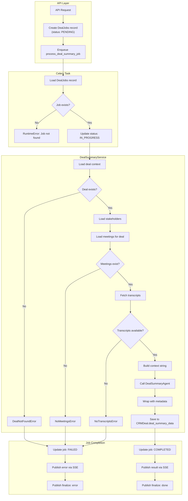

# Deal Summary Tasks Guide

## Purpose

- Generate comprehensive deal summaries by analyzing ALL meeting transcripts associated with a deal.
- Provide AI-powered insights into deal progression, key themes, and action items.
- Support real-time progress updates via SSE for UI feedback.
- Handle job queue processing with proper error handling and retries.

## Building Blocks

| Layer | Location | Responsibility |
| :--- | :--- | :--- |
| Celery Task | `src/workers/deal_worker/tasks/deal_summary_tasks.py` | Job processing, status updates, error handling |
| Service | `src/workers/deal_worker/services/deal_summary_service.py` | Context building, transcript fetching, agent invocation |
| Agent | `src/agents/workflows/deal_summary.py` | AI-powered summary generation |
| Publisher | `src/service/crm/jobs/deal_job_event_publisher.py` | SSE progress updates via Redis |

## Available Tasks

| Task Name | Function | Trigger |
| :--- | :--- | :--- |
| `deal_summary_task.process` | Generate summary for a deal via job queue | Job queue (DealJobs) |

---

## Task Details

### `process_deal_summary_job`

Processes a deal summary job by loading context and invoking the AI agent.

```python
from src.workers.deal_worker.tasks.deal_summary_tasks import process_deal_summary_job

process_deal_summary_job.delay(organisation_id="<uuid>", job_id="<uuid>")
```

**Parameters:**

| Parameter | Type | Description |
| :--- | :--- | :--- |
| `organisation_id` | str | UUID of the organisation |
| `job_id` | str | UUID of the DealJobs record |

**Returns (Success):**

```python
{
    "status": "completed",
    "job_id": "<uuid>",
    "job_type": "deal_summary"
}
```

**Returns (Failure - Non-Retryable):**

```python
{
    "status": "failed",
    "job_id": "<uuid>",
    "error": "No meetings found for deal ...",
    "error_code": "no_meetings",
    "retryable": False
}
```

**Retry Policy:** 3 retries with exponential backoff (60s, 120s, 240s)

---

## Processing Flow



---

## Error Handling

### Error Types

| Error Type | Code | Retryable | Description |
| :--- | :--- | :--- | :--- |
| `DealNotFoundError` | `deal_not_found` | ❌ | Deal does not exist in database |
| `NoMeetingsError` | `no_meetings` | ❌ | No meetings associated with the deal |
| `NoTranscriptsError` | `no_transcripts` | ❌ | Meetings exist but no transcripts available |
| `DealSummaryError` | `summary_error` | ✅ | Generic error (will retry) |
| Other exceptions | - | ✅ | Unexpected errors (will retry) |

### Error Flow

```python
try:
    result = await service.generate_summary(deal_id)
    job.status = JobStatus.COMPLETED
    job.result_data = result
except DealSummaryError as e:
    if not e.retryable:
        job.status = JobStatus.FAILED
        job.error_message = e.message
        publisher.publish_error(e.message, e.error_code)
        return  # Don't retry
    raise  # Retry
except Exception as e:
    job.status = JobStatus.FAILED
    job.error_message = str(e)[:500]
    job.retry_count += 1
    raise  # Retry
```

---

## SSE Progress Updates

The task publishes real-time progress updates via Redis for UI feedback:

| Step | Progress | Message |
| :--- | :--- | :--- |
| `context` | 10% | Loading deal context... |
| `stakeholders` | 15% | Loading stakeholders... |
| `meetings` | 20% | Loading meeting history... |
| `transcript_fetch` | 25-60% | Fetching transcript 1/5... |
| `analysis` | 60% | Analyzing 5 meeting transcripts... |
| `generation` | 70% | Generating deal summary... |
| `saving` | 90% | Saving results... |

### Publisher Methods

```python
publisher = DealJobRedisPublisher(org_uuid, job_uuid, "deal_summary")

# Progress updates
publisher.publish_progress("Loading deal context...", "context", 0.1)

# Final result
publisher.publish_result(result_dict)

# Error notification
publisher.publish_error("No meetings found", "no_meetings")

# Stream finalization
publisher.publish_finalize("done")  # or "error"
```

---

## Result Schema

The generated summary is wrapped with metadata before saving:

```python
{
    "schema_version": "1.0",
    "generated_at": "2025-12-03T10:30:00Z",
    "data": {
        # DealSummaryAgent output
        "executive_summary": "...",
        "key_themes": [...],
        "stakeholder_dynamics": "...",
        "next_steps": [...],
        "risks": [...],
        "timeline": [...]
    }
}
```

**Storage:** Saved to `CRMDeal.deal_summary_data` (JSON field)

---

## Service Workflow

### DealSummaryService.generate_summary()

1. **Load Deal** - Fetch CRMDeal by ID
2. **Load Stakeholders** - Get all DealStakeholder records
3. **Load Meetings** - Get CalendarEvents linked to deal
4. **Fetch Transcripts** - Use TranscriptService.ensure_transcript() for each meeting
5. **Build Context** - Format deal + stakeholders + transcripts into context string
6. **Call Agent** - Invoke DealSummaryAgent.generate()
7. **Wrap Result** - Add schema_version and generated_at
8. **Save to Deal** - Update CRMDeal.deal_summary_data

### Transcript Fetching

Transcripts are fetched on-demand via `TranscriptService.ensure_transcript()`:

- Checks if transcript exists in database
- If not, fetches from provider (Teams, Zoom, etc.)
- Returns Meeting record with `full_transcript` field

---

## Retry Configuration

| Parameter | Value | Description |
| :--- | :--- | :--- |
| `bind=True` | - | Access to `self` for retry control |
| `acks_late=True` | - | Acknowledge after completion (reliability) |
| `max_retries=3` | - | Maximum retry attempts |
| Backoff Formula | `60 * (2^retries)` | 60s → 120s → 240s |

---

## Job Queue Integration

### Creating a Job

Jobs are typically created by the API layer:

```python
job = DealJobs(
    organisation_id=org_id,
    deal_id=deal_id,
    job_type=JobType.DEAL_SUMMARY,
    status=JobStatus.PENDING,
)
session.add(job)
await session.commit()

# Enqueue task
process_deal_summary_job.delay(str(org_id), str(job.job_id))
```

### Job States

| Status | Description |
| :--- | :--- |
| `PENDING` | Job created, waiting for worker |
| `IN_PROGRESS` | Worker picked up job, processing |
| `COMPLETED` | Successfully generated summary |
| `FAILED` | Error occurred (check error_message) |

---

## Related Documentation

- [Deal Activities](./deal-activities.md) - Canonical CRM activities (tasks/calls/meetings/etc.)
- [Stakeholder Analysis Tasks](./stakeholder-analysis-tasks.md) - AI stakeholder analysis
- [Celery Worker Creation Guide](../celery-worker-creation-guide.md) - How to create new workers
