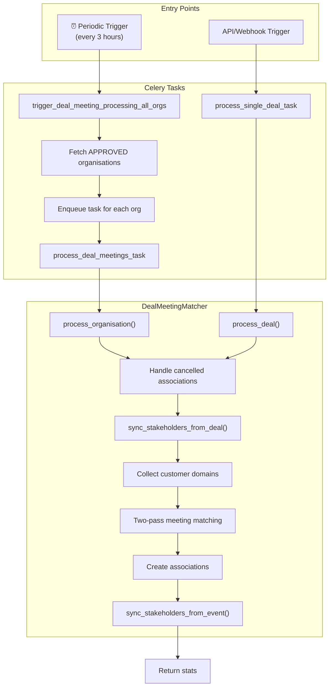

# Deal Tasks Guide

## Purpose

- Orchestrate deal-meeting matching by linking calendar events to CRM deals.
- Trigger stakeholder discovery from meeting attendees.
- Provide both scheduled and on-demand processing capabilities.
- Handle cancelled meeting associations.

## Building Blocks

| Layer | Location | Responsibility |
| :--- | :--- | :--- |
| Celery Tasks | `src/workers/deal_worker/tasks/deal_tasks.py` | Async entry points for deal processing |
| Service | `src/workers/deal_worker/services/deal_meeting_matcher.py` | Two-pass matching algorithm, cancelled event handling |
| Stakeholder Bridge | `src/workers/deal_worker/services/stakeholder_service.py` | Sync CRM contacts and discover attendees |

## Available Tasks

| Task Name | Function | Trigger |
| :--- | :--- | :--- |
| `deal.process_deal_meetings_task` | Process meetings for a single organisation | Manual/API trigger |
| `deal.process_single_deal_task` | Process meetings for a single deal | Manual/API trigger |
| `deal.trigger_deal_meeting_processing_all_orgs` | Trigger processing for all active organisations | Periodic (every 3 hours) |

---

## Task Details

### `process_deal_meetings_task`

Processes all open deals for an organisation to match calendar events.

```python
from src.workers.deal_worker.tasks.deal_tasks import process_deal_meetings_task

process_deal_meetings_task.delay(organisation_id="<uuid>")
```

**Parameters:**

| Parameter | Type | Description |
| :--- | :--- | :--- |
| `organisation_id` | str | UUID of the organisation (string for JSON serialization) |

**Returns:**

```python
{
    "deals_processed": 10,
    "meetings_linked": 25,
    "cancelled_rejected": 2
}
```

**Retry Policy:** 3 retries with exponential backoff (60s, 120s, 240s)

---

### `process_single_deal_task`

Processes a specific deal to match meetings and discover stakeholders.

```python
from src.workers.deal_worker.tasks.deal_tasks import process_single_deal_task

process_single_deal_task.delay(organisation_id="<uuid>", deal_id="<uuid>")
```

**Parameters:**

| Parameter | Type | Description |
| :--- | :--- | :--- |
| `organisation_id` | str | UUID of the organisation |
| `deal_id` | str | UUID of the deal to process |

**Returns:**

```python
{
    "deals_processed": 1,
    "meetings_linked": 3,
    "cancelled_rejected": 0
}
```

**Retry Policy:** 3 retries with exponential backoff

**Use Cases:**

- User manually refreshes a deal in the UI
- CRM webhook notifies of deal update
- New calendar sync completes

---

### `trigger_deal_meeting_processing_all_orgs`

Periodic task that enqueues `process_deal_meetings_task` for every active organisation.

**Schedule:** Every 3 hours (configured in Celery beat)

**Selection Criteria:** Only organisations with `status == OrganisationStatus.APPROVED`

**Behavior:**

1. Queries all approved organisations from master database
2. Enqueues `process_deal_meetings_task` for each organisation
3. Tasks run asynchronously in parallel

---

## Processing Flow



## What the Tasks Do

### Step-by-Step Processing

1. **Handle Cancelled Meetings First**
   - Find previously-linked meetings that are now cancelled
   - Update their association status to `REJECTED`

2. **Sync CRM Stakeholders**
   - Add CRM CONTACT participants as stakeholders
   - Collect customer email domains for filtering

3. **Collect Team & Contact Emails**
   - Team: All USER participants (owner, collaborators, split owners)
   - Contacts: Primary contact + all CONTACT participants

4. **Two-Pass Meeting Matching**
   - **Pass 1 (Score 1.0):** Team member is ORGANIZER + contact is attendee
   - **Pass 2 (Score 0.8):** Team member is ATTENDEE + contact is attendee

5. **Create Associations**
   - Link meetings to deals with appropriate confidence scores
   - Skip already-linked meetings

6. **Discover Stakeholders from Events**
   - Add meeting attendees with customer domains as stakeholders
   - Update engagement metrics

## Retry Configuration

| Parameter | Value | Description |
| :--- | :--- | :--- |
| `bind=True` | - | Access to `self` for retry control |
| `acks_late=True` | - | Acknowledge after completion (reliability) |
| `max_retries=3` | - | Maximum retry attempts |
| Backoff Formula | `60 * (2^retries)` | 60s → 120s → 240s |

## Async Execution Pattern

Tasks use the `run_async` helper to bridge Celery's synchronous execution with async database operations:

```python
async def _run():
    org_uuid = UUID(organisation_id)
    async for session in acquire_org_async_session(org_uuid):
        return await process_deal_meetings(session, org_uuid)

result = run_async(_run())
```

## Related Documentation

- [Deal Meeting Automation](./deal-meeting-automation.md) - Detailed matching algorithm
- [Stakeholder Operations](./stakeholder-operations.md) - Stakeholder discovery logic
- [Celery Worker Creation Guide](../celery-worker-creation-guide.md) - How to create new workers
