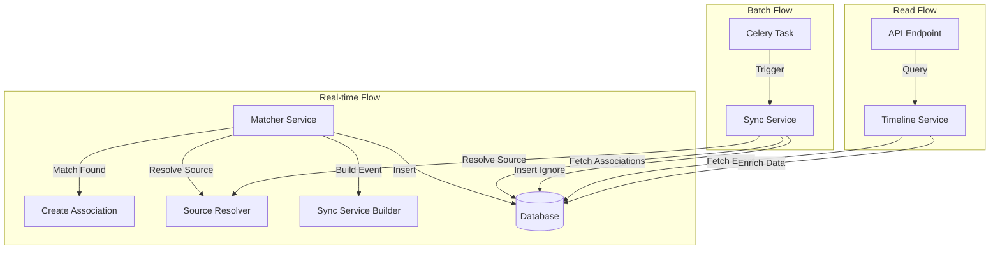
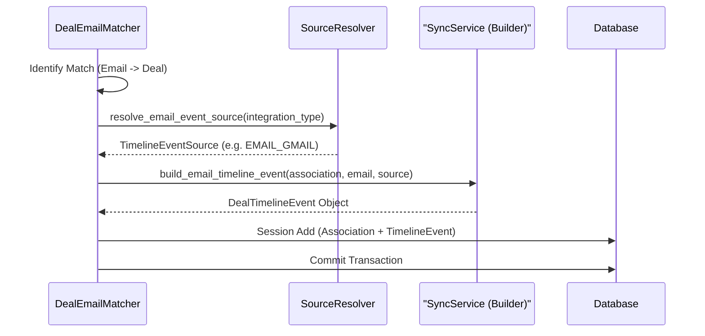
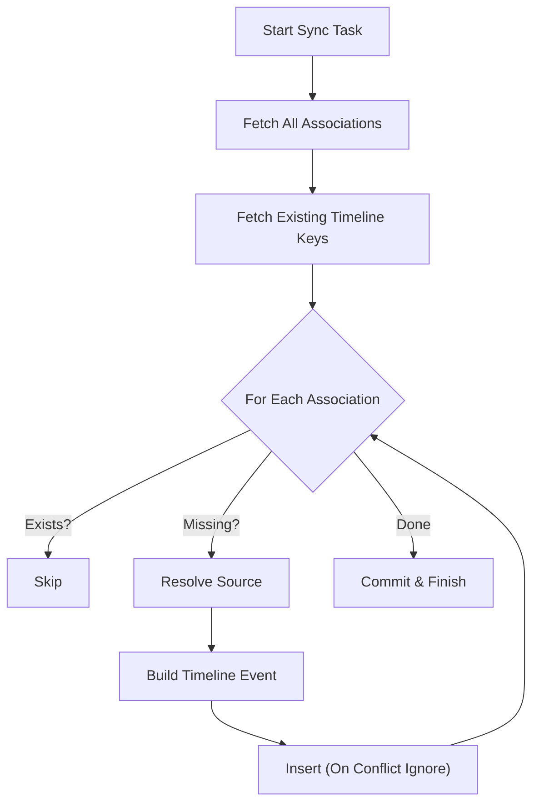

# Deal Timeline Creation

This document details the architecture, logic, and workflows for creating and managing Deal Timeline events in the Copilot backend.

## Overview

The Deal Timeline feature provides a unified, chronological view of all interactions (emails, meetings) associated with a deal. It aggregates data from various sources (Gmail, Outlook, Google Calendar, Outlook Calendar) into a normalized `DealTimelineEvent` model.

Timeline events are created in two primary ways:

1. **Real-time (Inline)**: Created immediately when an email or meeting is matched to a deal.
2. **Batch (Backfill)**: Created via background tasks to sync existing associations or repair data.

## Architecture

The timeline architecture consists of the following key components:

* **`DealTimelineService`**: Core service for querying and managing timeline events. Handles data enrichment for API responses.
* **`DealTimelineSyncService`**: Service for batch synchronization and providing builder functions for inline creation.
* **`TimelineEventSourceResolver`**: Logic for determining the source system (e.g., Gmail vs. Outlook) based on integration metadata.
* **Matchers (`DealEmailMatcher`, `DealMeetingMatcher`)**: Services that identify matches and trigger inline timeline creation.
* **Celery Tasks**: Background tasks for org-wide or deal-specific timeline syncing.

## Data Model

The `DealTimelineEvent` table is a denormalized view designed for efficient querying.

| Field | Description |
| :--- | :--- |
| `timeline_event_id` | Primary Key (UUID) |
| `deal_id` | Foreign Key to CRM Deal |
| `event_type` | `EMAIL` or `MEETING` |
| `event_source` | `EMAIL_GMAIL`, `EMAIL_OUTLOOK`, `CALENDAR_GOOGLE`, `CALENDAR_OUTLOOK` |
| `event_timestamp` | Date/Time of the interaction |
| `source_record_id` | ID of the underlying association record |
| `title` | Subject or Meeting Title |
| `subtitle` | Sender info or Duration |
| `event_metadata` | JSONB blob for extra details (attachments, location, etc.) |

## Creation Workflows

### 1. Real-time Creation (Inline)

This is the standard flow for new data. When the `DealEmailMatcher` or `DealMeetingMatcher` identifies a link between an activity and a deal, it creates the timeline event within the same database transaction.

**Logic Flow:**

1. **Match**: Matcher identifies that Email E belongs to Deal D.
2. **Association**: Matcher prepares `DealEmailAssociation` record.
3. **Resolution**: Matcher calls `resolve_email_event_source` (or meeting equivalent) to determine the provider (e.g., Gmail) based on the integration type.
4. **Build**: Matcher calls `build_email_timeline_event` (from `DealTimelineSyncService`) to construct the `DealTimelineEvent` object in memory.
5. **Persist**: Both the Association and Timeline Event are added to the session and committed atomically.

### 2. Batch Synchronization (Backfill)

This flow is used for:

* Backfilling timeline events for deals created before the feature existed.
* Repairing data if timeline events are missing.
* Manual sync triggers from the admin panel.

**Logic Flow:**

1. **Trigger**: `deal.sync_deal_timeline` task is called for a Deal ID.
2. **Fetch**: `DealTimelineSyncService` fetches all associations (Emails/Meetings) for the deal.
3. **Dedup**: Service fetches existing `(event_type, source_record_id)` pairs to avoid duplicates.
4. **Process**: For each missing event:
    * Resolve source using `TimelineEventSourceResolver`.
    * Build event using `build_*_timeline_event`.
    * Insert into DB using `ON CONFLICT DO NOTHING` for safety.

## Logic Details

### Source Resolution

The `TimelineEventSourceResolver` determines the `event_source` field. It prioritizes the **Integration Type** of the connected account.

* **Emails**:
  * `IntegrationType.GMAIL` -> `EMAIL_GMAIL`
  * `IntegrationType.OUTLOOK_EMAIL` -> `EMAIL_OUTLOOK`
* **Meetings**:
  * `IntegrationType.GOOGLE_CALENDAR` -> `CALENDAR_GOOGLE`
  * `IntegrationType.OUTLOOK_CALENDAR` -> `CALENDAR_OUTLOOK`
  * *Note*: Conference providers (Teams, Zoom) are stored in `event_metadata`, not as the primary source.

### Deduplication

Timeline events are unique per `(event_type, source_record_id)`.

* **Inline**: Relies on the fact that associations are created once.
* **Batch**: Uses `ON CONFLICT DO NOTHING` on the unique constraint `uq_timeline_event_source`.

### Data Enrichment

The `DealTimelineEvent` table stores "Preview" data (Title, Subtitle, Participant names) for fast list rendering.
For the **Detail View**, `DealTimelineService.get_timeline_event_detail` performs a live fetch:

1. Loads the `DealTimelineEvent`.
2. Uses `source_record_id` to find the original Association.
3. Joins with `Email` or `CalendarEvent` tables to fetch full body, attendees, and attachments.
