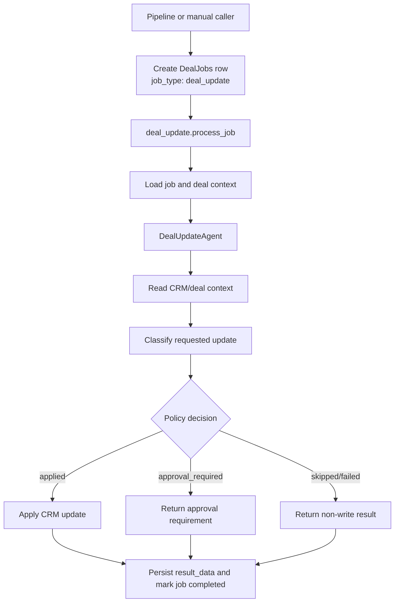

# Deal Update Agent Guide

## Purpose

- Apply safe, structured CRM deal updates from an agent workflow.
- Support direct updates for low-risk deal fields, lifecycle fields, and account/company fields.
- Keep approval boundaries deterministic before any CRM mutation happens.
- Run as a deal-scoped worker job, with optional automatic wiring after the existing deal insight pipeline.
- Defer primary-contact writes until the contact-write policy is designed.

## Safety Boundaries

| Boundary | Rule |
| :--- | :--- |
| Organisation scope | Every agent and tool receives `organisation_id` through `AgentContext`; tools must not use unscoped external IDs. |
| Deal scope | `DealUpdateAgent` is initialized with a deal id, and write tools operate against that deal context. |
| Fresh sessions | The agent does not hold a database session during LLM execution; tools acquire sessions only when needed. |
| Read-before-write | The prompt requires the agent to inspect current CRM state before choosing an update. |
| Policy-before-mutation | Write tools call the deal update policy before applying any change. |
| Contact updates | Primary-contact updates are intentionally skipped in this slice. |

## Tool List

| Tool | Purpose | Current behavior |
| :--- | :--- | :--- |
| `update_deal_fields` | Updates safe deal fields such as amount and other supported low-risk fields. | Can apply directly when policy returns `applied`; otherwise returns approval/skipped/failed status. |
| `update_deal_lifecycle` | Updates lifecycle fields such as deal stage and closed-lost reason/description. | Uses policy classification before writing. |
| `update_deal_account` | Updates account/company fields related to the deal. | Uses policy classification before writing. |

Read tools are supplied through the `DealUpdateAgent` registry entry so the agent can inspect the deal before using write tools. Keep the tool set intentionally small; adding broad CRM tools here lowers tool-call reliability and expands the write surface.

## Approval Behavior

The approval boundary lives in `src/service/crm/internal/deal_update_policy.py`.

Policy decisions use a small status vocabulary:

| Status | Meaning |
| :--- | :--- |
| `applied` | Tool may write immediately. |
| `approval_required` | Tool must not write; caller should surface approval requirement. |
| `skipped` | Tool did not write because the request is unsupported or deferred. |
| `failed` | Tool could not complete the requested update. |

Low-risk, directly requested field updates can be applied without approval. Higher-risk lifecycle or unsupported changes should be routed through approval behavior or skipped until the policy explicitly supports them.

## Job Flow



The Celery route is `deal_update.process_job` on the `deal_jobs` queue. The worker task owns loading the `DealJobs` row, validating that the type is `deal_update`, invoking `DealUpdateAgent`, and saving result metadata back to the job.

## Job Creation Pattern

Do not add a dedicated worker-side trigger service for this flow.

The repository pattern is:

| Trigger source | Pattern |
| :--- | :--- |
| Automatic deal insight pipeline | Create the follow-up `DealJobs` row inside `src/workers/deal_worker/utils/pipeline_dispatch.py`. |
| Future manual/API trigger | Reuse `src/service/crm/jobs/deal_job_service.py`, or add a narrow method there if a shared contract is needed. |
| Deal memory/risk/stakeholder jobs | Follow existing inline pipeline/helper creation patterns, not a new trigger service. |

## Automatic Pipeline Flag

Automatic post-insight deal-update execution is feature-flagged:

```bash
ENABLE_DEAL_UPDATE_AGENT_PIPELINE=true
```

When the flag is false, the existing deal insight pipeline should continue through deal task sync without appending a deal-update job. When the flag is true, pipeline dispatch creates a `deal_update` job and appends `deal_update.process_job` after the insight group and deal task sync.

## Agent Configuration

The agent is configured through `src/infra/config/agent_config.py` with the `deal_update_agent` key and these environment variables:

```bash
AGENT_DEAL_UPDATE_MODEL=<model>
AGENT_DEAL_UPDATE_DEBUG=false
AGENT_DEAL_UPDATE_TIMEOUT=180
```

## Focused Test Command

```bash
uv run pytest tests/service/crm/internal/test_deal_update_policy.py tests/agents/tools/crm/test_deal_update_tools.py tests/agents/tools/test_registry_deal_update_agent.py tests/agents/workflows/deal_update/test_deal_update_agent.py tests/workers/deal_worker/test_deal_update_task.py tests/workers/deal_worker/test_pipeline_dispatch_deal_update.py -v
```

## Focused Ruff Command

```bash
uv run ruff check src/service/crm/internal/deal_update_policy.py src/agents/tools/crm src/agents/workflows/deal_update src/workers/deal_worker/tasks/deal_insight_tasks/deal_update_task.py src/workers/deal_worker/utils/pipeline_dispatch.py tests/service/crm/internal/test_deal_update_policy.py tests/agents/tools/crm/test_deal_update_tools.py tests/agents/tools/test_registry_deal_update_agent.py tests/agents/workflows/deal_update/test_deal_update_agent.py tests/workers/deal_worker/test_deal_update_task.py tests/workers/deal_worker/test_pipeline_dispatch_deal_update.py
```
