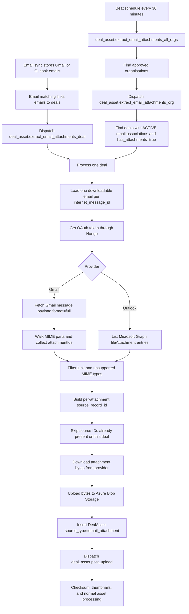

# Email Attachment Deal Assets

This document explains how email attachments become deal assets in CopilotGTM.
The flow runs in the deal worker after email-to-deal matching and also on a
periodic catch-up schedule.

## Purpose

When a Gmail or Outlook email is associated with a deal, useful file attachments
from that email should appear in the deal's Assets section. The backend does this
by downloading the attachment from the email provider, storing it in Azure Blob
Storage, creating a `DealAsset` row, and then dispatching the normal deal asset
post-upload processing task.

The feature is implemented as backend automation. It does not require a user to
manually upload the attachment.

## Scope

This document covers email attachments from Gmail and Outlook email sync. Teams
chat or channel file attachments follow the chat attachment ingestion path and
are documented separately under the chat and Teams bot documentation.

## Entry Points

| Entry point | File | When it runs |
|---|---|---|
| Email matching trigger | `src/workers/deal_worker/tasks/deal_mappers/email_matching_tasks.py` | After email matching finds deals with newly associated emails |
| Scheduled catch-up | `src/workers/deal_worker/config.py` | Every 30 minutes via `email-attachment-extraction` beat schedule |
| All-org coordinator | `src/workers/deal_worker/tasks/deal_asset_email_attachment_tasks.py` | Dispatches org-level extraction for all approved organisations |
| Org-level task | `src/workers/deal_worker/tasks/deal_asset_email_attachment_tasks.py` | Finds deals in one organisation that have emails with attachments |
| Deal-level task | `src/workers/deal_worker/tasks/deal_asset_email_attachment_tasks.py` | Processes attachments for one specific deal |

## High-Level Flow



## Celery Task Model

The implementation follows the existing three-tier worker pattern:

1. `deal_asset.extract_email_attachments_all_orgs`
   - Reads approved organisations from the master schema.
   - Dispatches one org task per approved organisation.

2. `deal_asset.extract_email_attachments_org`
   - Uses a Redis task lock per organisation to prevent overlapping org runs.
   - Calls `DealAssetEmailAttachmentService.process_organisation()`.
   - Finds candidate deals in that organisation.

3. `deal_asset.extract_email_attachments_deal`
   - Runs when email matching has just associated emails to a deal.
   - Calls `DealAssetEmailAttachmentService.process_deal(deal_id)`.

The scheduled task is a catch-up path. The per-deal task is the low-latency path
that runs soon after email matching.

## Service Flow

Core logic lives in
`src/workers/deal_worker/services/deal_asset_email_attachment_service.py`.

For each deal:

1. Query active `DealEmailAssociation` rows for the current organisation and
   deal where the matching `Email` has `has_attachments == true`.
2. Join to `KnowledgeIntegration` and keep only active integrations with a
   `connection_id`.
3. Pick one email record per `internet_message_id`. This prevents duplicate
   downloads when the same email is synced through multiple users or providers.
4. Get the provider access token through Nango.
5. List attachment metadata from the provider.
6. Filter non-useful or unsupported attachments.
7. Build stable per-attachment source IDs.
8. Skip source IDs that already exist as `DealAsset` rows for the same deal.
9. Download provider attachment bytes.
10. Upload bytes to Azure Blob Storage.
11. Insert a `DealAsset` row with `source_type = email_attachment`.
12. Dispatch `deal_asset.post_upload` for checksum and thumbnail processing.

The service uses fresh database sessions. It does not hold a database session
while calling Gmail, Microsoft Graph, Nango, or Azure Blob Storage.

## Provider Behavior

### Gmail

Gmail attachment extraction uses:

- `users.messages.get` with `format=full` to fetch the MIME part tree.
- Recursive MIME traversal to find parts with `body.attachmentId`.
- `users.messages.attachments.get` to download the attachment bytes.

Gmail returns attachment content as URL-safe base64. The downloader restores
missing padding and decodes the bytes before upload.

Required permission: Gmail read access, currently satisfied by `gmail.readonly`.

### Outlook Email

Outlook attachment extraction uses Microsoft Graph:

- `GET /me/messages/{message_id}/attachments` to list attachments.
- Only `#microsoft.graph.fileAttachment` entries are processed.
- `itemAttachment` entries, such as forwarded embedded emails, are skipped.
- `GET /me/messages/{message_id}/attachments/{attachment_id}` downloads the
  file attachment payload.

Microsoft Graph returns attachment content in `contentBytes` as standard base64.

Required permission: delegated mail read access for Outlook email sync.

## Filtering Rules

Filtering happens in two layers.

### Junk Filtering

`filter_junk_attachments()` removes attachments that are unlikely to be useful
deal assets:

| Rule | Reason |
|---|---|
| File size > 25 MB | Bound runtime and storage cost |
| File size < 1 KB | Usually tracking pixels or stubs |
| `.ics` or `text/calendar` | Calendar integration already handles meeting context |
| `.eml` or `message/rfc822` | Embedded emails are not file assets in the current UI |
| `image001.png` style names | Common signature image pattern |
| Small images under 100 KB | Usually logos, icons, or inline signatures |

### Supported MIME Policy

After junk filtering, the service checks the normalized MIME type against
`chat_file_upload_config.ALLOWED_MIMETYPES`. Unsupported active content such as
HTML is skipped before download and blob creation.

The MIME type is normalized before:

- Comparing against the allowlist.
- Uploading to Blob Storage.
- Persisting in `DealAsset.mimetype`.

## Deduplication

Deduplication is per deal and per provider attachment, not just per email.

The service builds:

```text
email:{sha256(internet_message_id)[:16]}:attachment:{sha256(attachment_id)[:16]}
```

This value is stored in `DealAsset.source_record_id`. The service checks
existing `DealAsset` rows for the same organisation, deal, source type, and
source record ID before downloading.

This matters because one email can contain multiple attachments. A previous
email-level dedupe strategy could skip the remaining attachments if one
attachment had already been processed. The current implementation dedupes at
attachment level.

## Storage Path

Email attachment blobs are stored under:

```text
deal_assets/{deal_id}/email_attachments/{message_hash}/{attachment_hash}/{sanitized_filename}
```

Where:

- `message_hash` is the first 12 characters of the SHA-256 hash of
  `internet_message_id`.
- `attachment_hash` is the first 12 characters of the SHA-256 hash of provider
  `attachment_id`.
- `sanitized_filename` removes unsafe characters and falls back to `attachment`
  when the provider filename is empty.

## DealAsset Record

Created rows use:

| Field | Value |
|---|---|
| `organisation_id` | Current organisation security boundary |
| `deal_id` | Current deal |
| `added_by_user_id` | `AUTOMATED_PIPELINE_USER_ID` |
| `name` / `filename` | Provider filename |
| `mimetype` | Normalized MIME type |
| `storage_path` | Azure Blob path |
| `status` | `PROCESSING` |
| `direction` | Mapped from `DealEmailAssociation.direction` |
| `source_type` | `email_attachment` |
| `source_record_id` | Per-attachment source ID |
| `source_context` | Email subject context |
| `asset_metadata.email_id` | Internal email row ID |
| `asset_metadata.internet_message_id` | RFC message ID |
| `asset_metadata.provider_attachment_id` | Gmail or Outlook attachment ID |
| `asset_metadata.integration_type` | Gmail or Outlook integration type |

Direction mapping:

| Email direction | Asset direction |
|---|---|
| `INBOUND` | `received` |
| `OUTBOUND` | `shared` |
| `INTERNAL` | `internal` |
| Unknown | `internal` |

## Download URLs

Deal asset download URLs are generated through
`DealAssetsService.generate_download_url()`. For file assets, it passes a
download filename to Azure Blob SAS generation so the response uses attachment
disposition rather than browser inline rendering.

The blob storage layer sanitizes the filename before adding it to
`Content-Disposition`.

## Security and Isolation

The flow enforces these boundaries:

- Every org database query filters by `organisation_id`.
- Deal processing receives `organisation_id` at service construction and
  `deal_id` at task execution.
- The integration join requires `KnowledgeIntegration.organisation_id` to match
  the current organisation.
- Database sessions are short-lived and released before provider and blob calls.
- Unsupported MIME types are skipped before blob upload.
- User-facing download filenames are sanitized before they reach
  `Content-Disposition`.
- The org-level task uses a Redis lock to avoid overlapping extraction for the
  same organisation.

## Failure Behavior

Attachment processing is best-effort:

- A failed attachment increments the error count but does not stop the rest of
  the email.
- A failed email increments the error count but does not stop the rest of the
  deal.
- A dedupe conflict returns skipped rather than failing the task.
- If `deal_asset.post_upload` dispatch fails after insertion, the asset remains
  in `PROCESSING` and must be recovered by operational cleanup or manual
  re-dispatch.

Task retry behavior:

| Task | Retries | Lock |
|---|---:|---|
| Org extraction | 2 | Yes, per organisation |
| Deal extraction | 3 | No |
| All-org dispatch | 0 | No |

## Operational Verification

Run focused tests for this flow:

```bash
uv run pytest \
  tests/workers/integrations_worker/providers/email/test_attachment_downloader.py \
  tests/workers/deal_worker/services/test_deal_asset_email_attachment_service.py \
  tests/service/integrations/test_email_sync_service_gmail.py \
  tests/workers/deal_worker/tasks/test_email_attachment_task_registration.py \
  tests/service/crm/test_deal_assets_service.py \
  -q
```

Run focused lint:

```bash
uv run ruff check \
  src/workers/integrations_worker/providers/email/attachment_downloader.py \
  src/workers/deal_worker/services/deal_asset_email_attachment_service.py \
  src/workers/deal_worker/tasks/deal_asset_email_attachment_tasks.py \
  src/workers/deal_worker/tasks/__init__.py \
  src/service/integrations/email_sync_service.py \
  src/service/crm/deal_assets_service.py \
  src/infra/storage/azure_org_blob_storage.py
```

To verify task export wiring:

```bash
uv run pytest tests/workers/deal_worker/tasks/test_email_attachment_task_registration.py -q
```
