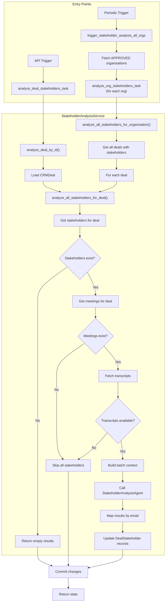

# Stakeholder Analysis Tasks Guide

## Purpose

- Analyze stakeholders using AI to extract insights from meeting transcripts.
- Identify stakeholder stance, decision power, and engagement temperature.
- Extract motivations, pain points, and champion potential.
- Support both per-deal and organisation-wide analysis.

## Building Blocks

| Layer | Location | Responsibility |
| :--- | :--- | :--- |
| Celery Tasks | `src/workers/deal_worker/tasks/stakeholder_analysis_tasks.py` | Async entry points for analysis |
| Service | `src/workers/deal_worker/services/stakeholder_analysis_service.py` | Context building, batch analysis, record updates |
| Agent | `src/agents/workflows/stakeholder_analysis.py` | AI-powered stakeholder analysis |
| Transcript Service | `src/service/integrations/transcript_service.py` | Fetch transcripts from providers |

## Available Tasks

| Task Name | Function | Trigger |
| :--- | :--- | :--- |
| `stakeholder.analyze_deal_stakeholders_task` | Analyze all stakeholders for a deal | Manual/API trigger |
| `stakeholder.analyze_org_stakeholders_task` | Analyze all stakeholders across an organisation | Manual/API trigger |
| `stakeholder.trigger_analysis_all_orgs` | Trigger analysis for all active organisations | Periodic |

---

## Task Details

### `analyze_deal_stakeholders_task`

Analyzes all stakeholders for a specific deal using meeting transcripts.

```python
from src.workers.deal_worker.tasks.stakeholder_analysis_tasks import analyze_deal_stakeholders_task

analyze_deal_stakeholders_task.delay(organisation_id="<uuid>", deal_id="<uuid>")
```

**Parameters:**

| Parameter | Type | Description |
| :--- | :--- | :--- |
| `organisation_id` | str | UUID of the organisation |
| `deal_id` | str | UUID of the deal to analyze |

**Returns:**

```python
{
    "stakeholders_processed": 5,
    "stakeholders_analyzed": 4,   # Had transcripts to analyze
    "stakeholders_skipped": 1     # No relevant transcripts
}
```

**Retry Policy:** 3 retries with exponential backoff (60s, 120s, 240s)

**Use Cases:**

- User requests stakeholder analysis from UI
- After new meeting transcripts become available
- Post deal-meeting matching refresh

---

### `analyze_org_stakeholders_task`

Analyzes all stakeholders across all deals for an organisation.

```python
from src.workers.deal_worker.tasks.stakeholder_analysis_tasks import analyze_org_stakeholders_task

analyze_org_stakeholders_task.delay(organisation_id="<uuid>")
```

**Parameters:**

| Parameter | Type | Description |
| :--- | :--- | :--- |
| `organisation_id` | str | UUID of the organisation |

**Returns:**

```python
{
    "deals_processed": 10,
    "stakeholders_processed": 45,
    "stakeholders_analyzed": 38,
    "stakeholders_skipped": 7
}
```

**Retry Policy:** 3 retries with exponential backoff

---

### `trigger_stakeholder_analysis_all_orgs`

Periodic task that enqueues `analyze_org_stakeholders_task` for every active organisation.

**Selection Criteria:** Only organisations with `status == OrganisationStatus.APPROVED`

**Behavior:**

1. Queries all approved organisations from master database
2. Enqueues `analyze_org_stakeholders_task` for each
3. Tasks run asynchronously in parallel

---

## Processing Flow



---

## Analysis Output Fields

The AI agent analyzes each stakeholder and updates these fields:

| Field | Type | Values | Description |
| :--- | :--- | :--- | :--- |
| `stance` | Enum | Champion, Supporter, Neutral, Blocker, Unknown | Stakeholder's position on the deal |
| `decision_power` | Enum | Final Decision, Influencer, Recommender, End User, Unknown | Level of decision authority |
| `temperature` | Enum | Hot, Warm, Cold | Current engagement level |
| `champion_potential` | Float | 0.0 - 1.0 | Likelihood of becoming a champion |
| `motivation` | Text | - | Key motivations identified from conversations |
| `pain_points` | List[str] | - | Pain points mentioned in meetings |
| `keywords` | List[str] | - | Key terms/topics associated with stakeholder |

### Example Updated Record

```python
stakeholder.stance = StakeholderStance.CHAMPION
stakeholder.decision_power = DecisionPower.INFLUENCER
stakeholder.temperature = StakeholderTemperature.HOT
stakeholder.champion_potential = 0.85
stakeholder.motivation = "Wants to modernize their sales process and reduce manual data entry"
stakeholder.pain_points = ["Current CRM is too complex", "Lack of mobile access"]
stakeholder.keywords = ["automation", "mobile", "integration", "ease of use"]
```

---

## Batch Analysis Strategy

The service analyzes **all stakeholders for a deal in a single LLM call** for efficiency:

### Why Batch?

1. **Cost Efficiency** - One API call instead of N calls per stakeholder
2. **Better Context** - Agent sees all stakeholders together for relationship insights
3. **Consistency** - Comparative analysis across stakeholders
4. **Speed** - Parallel processing within single call

### Context Structure

```python
"""
BATCH STAKEHOLDER ANALYSIS REQUEST

STAKEHOLDERS TO ANALYZE (5 total)
=================================
### Stakeholder 1:
- Email (ID): john@customer.com
- Name: John Smith
- Job Title: VP of Sales
- Current Stance: UNKNOWN
- Current Temperature: COLD
...

### Stakeholder 2:
...

DEAL CONTEXT
============
- Deal Name: Acme Corp Enterprise
- Company: Acme Corporation
- Stage: Negotiation
- Amount: $150,000

MEETING TRANSCRIPTS
===================
### Meeting 1: Discovery Call
Date: 2025-11-15 10:00
Attendees: John Smith (john@customer.com), Jane Doe (jane@customer.com)
Transcript: ...

### Meeting 2: Demo Session
...
"""
```

### Result Mapping

The agent returns analysis for each stakeholder identified by email:

```python
batch_result = await agent.generate(context)

# Map results by email
email_to_analysis = {a.stakeholder_email.lower(): a for a in batch_result.stakeholders}

# Update each stakeholder
for stakeholder in stakeholders:
    analysis = email_to_analysis.get(stakeholder.email.lower())
    if analysis:
        update_stakeholder_with_analysis(stakeholder, analysis)
```

---

## Transcript Handling

### Fetching Transcripts

Transcripts are fetched on-demand via `TranscriptService.ensure_transcript()`:

```python
async def get_meetings_with_transcripts(events: list[CalendarEvent]):
    results = []
    for event in events:
        meeting = await transcript_service.ensure_transcript(event.event_id)
        if meeting and meeting.full_transcript:
            results.append((event, meeting))
    return results
```

### Transcript Truncation

Very long transcripts are truncated to prevent context overflow:

```python
if len(transcript) > 15000:
    transcript = transcript[:15000] + "\n... [transcript truncated]"
```

---

## Skip Conditions

Stakeholders are skipped (not analyzed) when:

| Condition | Reason |
| :--- | :--- |
| No meetings for deal | No context to analyze |
| No transcripts available | Meetings exist but no recordings |
| Agent returns no result for email | Stakeholder not found in transcripts |
| Error during deal processing | Counted as skipped, continues to next deal |

---

## Retry Configuration

| Parameter | Value | Description |
| :--- | :--- | :--- |
| `bind=True` | - | Access to `self` for retry control |
| `acks_late=True` | - | Acknowledge after completion (reliability) |
| `max_retries=3` | - | Maximum retry attempts |
| Backoff Formula | `60 * (2^retries)` | 60s → 120s → 240s |

---

## Difference from Stakeholder Sync Tasks

| Aspect | Analysis Tasks (this file) | Sync Tasks (`stakeholder_tasks.py`) |
| :--- | :--- | :--- |
| **Purpose** | AI-powered insights extraction | Discovery and data synchronization |
| **Input** | Meeting transcripts | CRM data, calendar events |
| **Output** | Stance, decision power, motivations | New stakeholder records, engagement scores |
| **Trigger** | On-demand or periodic | After meeting matching |
| **Dependencies** | Requires transcripts | Requires CRM contacts |

---

## Related Documentation

- [Stakeholder Operations](./stakeholder-operations.md) - Stakeholder discovery and sync logic
- [Deal Summary Tasks](./deal-summary-tasks.md) - AI deal summary generation
- [Deal Tasks](./deal-tasks.md) - Deal-meeting matching tasks
- [Celery Worker Creation Guide](../celery-worker-creation-guide.md) - How to create new workers
