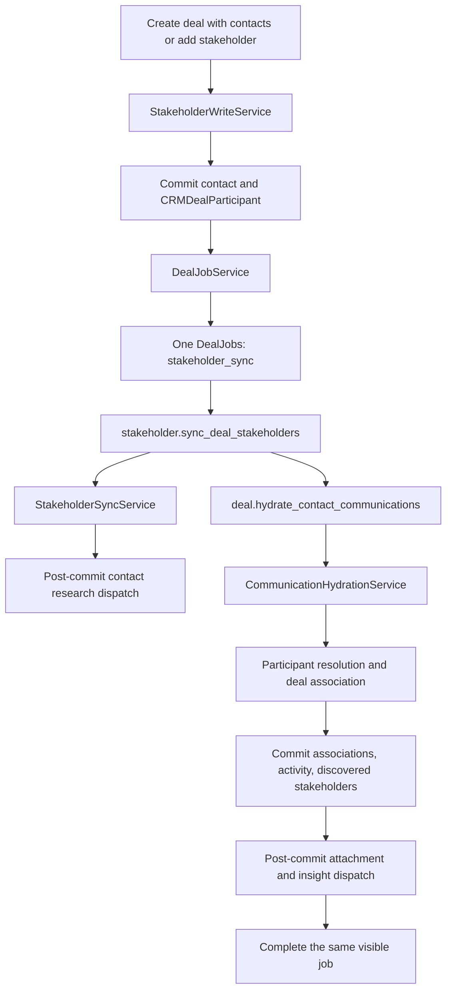

# Stakeholder processing job visibility

## Status

Implemented. Manual stakeholder creation and inline deal creation use one
reconnectable `stakeholder_sync` job for the complete deal action.

## Runtime flow



The worker processes every active contact participant on the deal. It does not
run a separate email job and calendar job for each stakeholder.

## Visible job contract

The single visible job has:

- `job_type = stakeholder_sync`;
- `deal_id` set;
- `event_id = null`;
- `status = pending` before publication;
- `job_metadata.enqueue_status` updated from `pending` to `enqueued`, or to
  `failed` if broker publication fails;
- `emit_events = true` in the worker payload.

For a standalone stakeholder add, `stakeholder_id` and
`job_metadata.participant_id` identify the affected participant.

For deal creation with multiple inline participants:

- `stakeholder_id = null`;
- `job_metadata.participant_ids` contains every affected participant ID;
- one job is created for the whole action.

An unchanged active duplicate stakeholder submission does not create a replay
job. Restoring a deleted participant does.

## API response

`POST /users/crm/deals/{deal_id}/stakeholders` returns the stakeholder and zero
or one processing job:

```json
{
  "status": "SUCCESS",
  "data": {
    "stakeholder": {
      "participant_id": "9d8156e3-0bd1-4d24-9b9c-0cddae9a56ac",
      "deal_id": "2fe3f805-5371-4cf2-a6e4-964cbfdd4644",
      "email": "buyer@example.com",
      "name": "Buyer Name"
    },
    "processing_jobs": [
      {
        "job_id": "d83c03bb-5ebe-4c78-9584-4e827819f1c8",
        "job_type": "stakeholder_sync",
        "status": "pending"
      }
    ],
    "research_job": null
  }
}
```

Contact research remains a separate job. The create route may return a
`contact_research` job when the stakeholder is linked to an eligible contact.
The stakeholder processing job itself also returns missing research contact IDs
to its worker, which dispatches them only after normalization commits.

## Progress and terminal ownership

The stakeholder task starts the visible job and publishes
`searching_related_stakeholders`. When replay is required it hands the same
`job_id`, `job_type`, and `emit_events` context to
`deal.hydrate_contact_communications`.

Hydration then publishes `hydrating_communications`, commits CRM contacts,
communication associations, activity projections, and discovered participants,
and completes the same job at `saving_communication_links`.

If hydration exhausts retries, it fails the same visible job. Silent integration
or recovery hydration does not publish SSE unless visible context was explicitly
supplied.

## Reconnect

Deal detail exposes active stakeholder processing jobs through
`active_deal_jobs.stakeholder_processing`. Clients reconnect through:

`GET /users/crm/deals/{deal_id}/jobs/{job_id}/stream`

The stream uses the existing `DealJobSSEService` and supports
`Last-Event-ID`. Stakeholder research remains visible on stakeholder detail,
not in the deal-level processing list. Because `contact_research` is owned by a
contact rather than a deal, clients reconnect it through:

`GET /users/crm/jobs/{job_id}/stream`

## Failure semantics

- The stakeholder/contact transaction commits before the visible job is
  created.
- The job row commits before broker publication.
- Publication failure records `enqueue_status = failed` while the durable job
  remains pending for reconnect recovery.
- Association/activity changes commit before attachment, research, and insight
  follow-ups are published.
- A follow-up research failure is logged without rolling back stakeholder
  normalization.
- Exhausted hydration failure is terminal on the same visible job.

## Implementation map

| Responsibility | Code |
| --- | --- |
| Participant writes and explicit outcomes | `src/service/crm/participants/stakeholder_write_service.py` |
| Participant normalization | `src/service/crm/participants/stakeholder_sync_service.py` |
| Visible job creation and recovery | `src/service/crm/jobs/deal_job_service.py` |
| Stakeholder task and research dispatch | `src/workers/deal_worker/tasks/deal_mappers/stakeholder_tasks.py` |
| Communication hydration task | `src/workers/deal_worker/tasks/deal_mappers/contact_communication_hydration_tasks.py` |
| Hydration business flow | `src/service/crm/communications/hydration_service.py` |
| Participant resolution | `src/service/crm/communications/participant_resolution_service.py` |
| Communication-to-deal association | `src/service/crm/communications/deal_association_service.py` |
| SSE tracking | `src/workers/deal_worker/tasks/deal_mappers/visible_job_tracking.py` |
