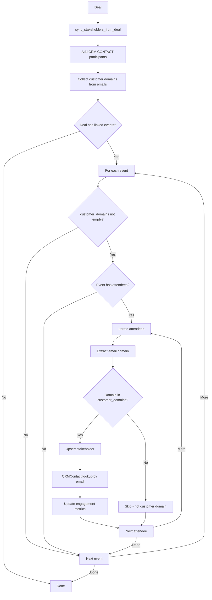

# Stakeholder Discovery & Sync Guide

## Purpose

- Maintain an accurate `DealStakeholder` graph that blends CRM-sourced contacts with newly discovered meeting attendees.
- Provide engagement context (last contact, score, temperature) for the Stakeholder tab, validation plans, and meeting prep views.
- Offer deterministic entry points so UI actions (manual meeting confirmations) and background jobs share the same enrichment logic.

## Selection Logic (Inclusion-Based)

Stakeholder discovery uses a simple **inclusion-based** approach:

| Source | Selection Rule |
| :--- | :--- |
| **CRM CONTACT Participants** | Directly added as stakeholders - these are known customer contacts |
| **Calendar Event Attendees** | Only attendees matching the **same domain** as CRM contacts are added |

### How It Works

1. **From CRM Participants**: All `CONTACT` type participants are added directly as stakeholders. Their email domains become the "customer domains".
2. **From Calendar Events**: Only attendees whose email domain matches one of the customer domains (derived from CRM contacts) are added.
3. **No Exclusion Needed**: We don't exclude seller/internal team - we simply **select** only customer domain attendees.

This is a clean inclusion model: "Add CRM contacts → Get their domains → Add meeting attendees with same domain"

## Building Blocks

| Layer | Location | Responsibility |
| :--- | :--- | :--- |
| Service | `src/workers/deal_worker/services/stakeholder_service.py` | Contains `sync_stakeholders_from_deal` and `sync_stakeholders_from_event` with domain-based selection |
| Celery Task | `stakeholder.sync_from_meeting_task` (`src/workers/deal_worker/tasks/stakeholder_tasks.py`) | Async entry point for API-triggered meeting confirmations |
| Deal Tasks | `src/workers/deal_worker/tasks/deal_tasks.py` | Triggers deal processing with stakeholder discovery |
| Models | `DealStakeholder`, `StakeholderSource`, `StakeholderTemperature`, `CRMContact`, `CalendarEvent` | Persist stakeholder state, allow contact lookups, and surface attendee metadata |

## Entry Points & Responsibilities

1. **`sync_stakeholders_from_deal(deal) -> (int, set[str])`**
   - Prime the stakeholder table from CRM data before any meeting matching occurs.
   - Creates/updates stakeholders for:
     - The deal's primary contact (`primary_contact_email` + `primary_contact_name`)
     - Each `CRMDealParticipant` where `participant_type == CONTACT` and `related_email` is present
   - Skips `USER` participants (owner, collaborators, split owners) as they are internal team.
   - **Returns**: `(processed_count, customer_domains)` - the set of email domains from CRM contacts
   - New rows default to `source=StakeholderSource.CRM`, `temperature=COLD`, and reuse the participant `relationship_role` as job title.

2. **`sync_stakeholders_from_event(deal, event, customer_domains)`**
   - Consumes `CalendarEvent.attendees` to detect new stakeholders from linked meetings.
   - **Requires `customer_domains`** - skips processing if empty (no CRM contacts to derive domain from).
   - **Only processes** attendees whose email domain is in `customer_domains`
   - For every qualifying attendee:
     - Upsert a `DealStakeholder` row keyed by `(deal_id, email)` with `source=CALENDAR_DISCOVERY` (upgraded to `CRM` if a matching contact exists).
     - Link to `CRMContact` via email match and backfill name/job title when missing.
     - Update `last_contact_at` when the meeting `start_at` is newer than the stored timestamp.
     - Increment `engagement_score` by `1.0` and recompute `temperature` (`>5 → HOT`, `>2 → WARM`, else `COLD`).
   - Returns the number of processed attendees so callers can emit telemetry.

3. **Celery Task Path** (`stakeholder.sync_from_meeting_task`)
   - Allows APIs to trigger stakeholder discovery on-demand (e.g., after a user confirms a suggested meeting in the UI).
   - Loads the deal and event with attendees inside the worker, instantiates `StakeholderService`, and delegates to `sync_stakeholders_from_event`.

## Collaboration with Deal Matching

- Before querying calendar events, the matcher calls `sync_stakeholders_from_deal` to:
  1. Guarantee that CRM contacts already appear in the stakeholder table
  2. Collect customer domains for event attendee filtering
- After every newly created `CalendarEventDealAssociation`, the matcher invokes `sync_stakeholders_from_event` with the collected customer domains so the UI immediately sees fresh attendees with updated engagement metrics.
- When a meeting association is confirmed through an API workflow, that flow should enqueue `stakeholder.sync_from_meeting_task` to reuse the exact same enrichment logic.

## Data Quality Notes

- Email normalization happens inside the service (lowercasing + trimming). Avoid pre-normalizing upstream to keep the logic centralized.
- **Domain filtering requires at least one CRM contact with a valid email** - if no contacts exist, calendar-based discovery is skipped.
- CRM participants are always processed (they're already vetted customer contacts).
- Engagement score and temperature model are intentionally simple right now—raise thresholds or switch to weighted scoring here once analytics requirements are clearer.
