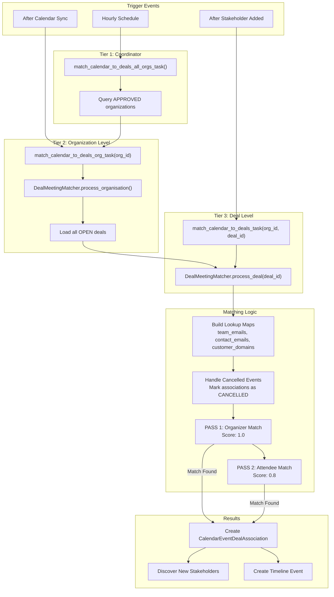

# Deal Calendar Mapping Guide

> **Purpose**: This document explains how calendar events are matched to CRM deals based on participant overlap. It covers the matching algorithm, scoring logic, association creation, and stakeholder discovery.

## Overview

Calendar events are automatically linked to deals when they involve both internal team members and external customer contacts. The system uses a two-pass matching algorithm to create high-confidence associations.

```
┌─────────────────────────────────────────────────────────────────────────────┐
│                       CALENDAR-TO-DEAL MAPPING OVERVIEW                      │
├─────────────────────────────────────────────────────────────────────────────┤
│                                                                              │
│   ┌────────────────┐              ┌────────────────┐                        │
│   │ Calendar Event │              │    CRM Deal    │                        │
│   │                │              │                │                        │
│   │ - Organizer    │◀────────────▶│ - Team Emails  │                        │
│   │ - Attendees    │   MATCHING   │ - Stakeholders │                        │
│   │ - Start/End    │              │ - Participants │                        │
│   └────────────────┘              └────────────────┘                        │
│           │                                │                                 │
│           │                                │                                 │
│           ▼                                ▼                                 │
│   ┌─────────────────────────────────────────────────────────────────┐       │
│   │              CalendarEventDealAssociation                        │       │
│   │                                                                  │       │
│   │  - event_id (FK to CalendarEvent)                               │       │
│   │  - deal_id (FK to CRMDeal)                                      │       │
│   │  - match_score (1.0 for organizer, 0.8 for attendee)            │       │
│   │  - status (ACTIVE, REMOVED, CANCELLED)                          │       │
│   └─────────────────────────────────────────────────────────────────┘       │
│                                                                              │
└─────────────────────────────────────────────────────────────────────────────┘
```

## Architecture

### Three-Tier Task Structure

```
┌─────────────────────────────────────────────────────────────────────────────┐
│                         TASK HIERARCHY                                       │
├─────────────────────────────────────────────────────────────────────────────┤
│                                                                              │
│   TIER 1: All Organizations (Coordinator)                                    │
│   ┌─────────────────────────────────────────────────────────────────────┐   │
│   │ match_calendar_to_deals_all_orgs_task()                             │   │
│   │                                                                     │   │
│   │ - Triggered: Hourly schedule, manual                                │   │
│   │ - Time Limit: 5 minutes                                             │   │
│   │ - Purpose: Query approved orgs, dispatch Tier 2                     │   │
│   └──────────────────────────────────┬──────────────────────────────────┘   │
│                                      │                                       │
│                                      │ For each org                          │
│                                      ▼                                       │
│   TIER 2: Organization Level                                                 │
│   ┌─────────────────────────────────────────────────────────────────────┐   │
│   │ match_calendar_to_deals_org_task(organisation_id)                   │   │
│   │                                                                     │   │
│   │ - Triggered: Tier 1, after calendar sync                            │   │
│   │ - Time Limit: 10 minutes                                            │   │
│   │ - Retries: 2 (60s exponential backoff)                              │   │
│   │ - Purpose: Process all OPEN deals in org                            │   │
│   └──────────────────────────────────┬──────────────────────────────────┘   │
│                                      │                                       │
│                                      │ For each deal                         │
│                                      ▼                                       │
│   TIER 3: Deal Level                                                         │
│   ┌─────────────────────────────────────────────────────────────────────┐   │
│   │ match_calendar_to_deals_task(organisation_id, deal_id)              │   │
│   │                                                                     │   │
│   │ - Triggered: After stakeholder sync (new stakeholder added)         │   │
│   │ - Time Limit: 2 minutes                                             │   │
│   │ - Retries: 3 (30s exponential backoff)                              │   │
│   │ - Purpose: Re-match events for specific deal                        │   │
│   └─────────────────────────────────────────────────────────────────────┘   │
│                                                                              │
└─────────────────────────────────────────────────────────────────────────────┘
```

---

## Matching Algorithm

### Two-Pass Strategy

The matching algorithm uses a **two-pass approach** to prioritize high-confidence matches:

```
┌─────────────────────────────────────────────────────────────────────────────┐
│                       TWO-PASS MATCHING ALGORITHM                            │
├─────────────────────────────────────────────────────────────────────────────┤
│                                                                              │
│   PASS 1: ORGANIZER MATCH (Score: 1.0 - Highest Confidence)                 │
│   ════════════════════════════════════════════════════════                  │
│                                                                              │
│   Condition:                                                                 │
│   ┌─────────────────────────────────────────────────────────────────────┐   │
│   │ event.organiser_email IN team_emails                                │   │
│   │ AND                                                                 │   │
│   │ ANY(attendee.email IN contact_emails)                               │   │
│   │ AND                                                                 │   │
│   │ event.status != 'cancelled'                                         │   │
│   └─────────────────────────────────────────────────────────────────────┘   │
│                                                                              │
│   Rationale:                                                                 │
│   - Team member ORGANIZED the meeting                                        │
│   - Customer contact is INVITED                                              │
│   - High confidence this is a deal-related meeting                           │
│                                                                              │
│   ─────────────────────────────────────────────────────────────────────────  │
│                                                                              │
│   PASS 2: ATTENDEE MATCH (Score: 0.8 - Lower Confidence)                    │
│   ═══════════════════════════════════════════════════════                   │
│                                                                              │
│   Condition:                                                                 │
│   ┌─────────────────────────────────────────────────────────────────────┐   │
│   │ ANY(attendee.email IN team_emails)                                  │   │
│   │ AND                                                                 │   │
│   │ attendee.email != event.organiser_email  (Team is NOT organizer)    │   │
│   │ AND                                                                 │   │
│   │ ANY(attendee.email IN contact_emails)                               │   │
│   │ AND                                                                 │   │
│   │ event.status != 'cancelled'                                         │   │
│   │ AND                                                                 │   │
│   │ event NOT already matched in Pass 1                                 │   │
│   └─────────────────────────────────────────────────────────────────────┘   │
│                                                                              │
│   Rationale:                                                                 │
│   - Team member is an ATTENDEE (invited by someone else)                     │
│   - Customer contact is also attending                                       │
│   - Lower confidence - team didn't organize this meeting                     │
│                                                                              │
└─────────────────────────────────────────────────────────────────────────────┘
```

### Data Collection Phase

Before matching, the system collects lookup data:

```python
# Location: src/workers/deal_worker/services/deal_meeting_matcher.py

def _build_lookup_maps(deal: CRMDeal) -> tuple[set[str], set[str], set[str]]:
    """
    Build lookup maps for efficient matching.

    Returns:
        team_emails: Internal team member emails
        contact_emails: Customer stakeholder emails
        customer_domains: Customer company domains
    """

    # 1. Team Emails (internal users)
    team_emails = set()

    # Deal owner
    if deal.owner_email:
        team_emails.add(deal.owner_email.lower())

    # USER-type participants (collaborators, split owners)
    for participant in deal.participants:
        if participant.participant_type == ParticipantType.USER:
            if participant.related_email:
                team_emails.add(participant.related_email.lower())

    # 2. Contact Emails (APPROVED stakeholders only)
    contact_emails = {
        s.email.lower()
        for s in deal.stakeholders
        if s.approval_status == ApprovalStatus.APPROVED
    }

    # 3. Customer Domains (for stakeholder discovery)
    customer_domains = set()

    # From primary contact
    if deal.primary_contact_email:
        domain = deal.primary_contact_email.split("@")[-1].lower()
        customer_domains.add(domain)

    # From CONTACT participants
    for participant in deal.participants:
        if participant.participant_type == ParticipantType.CONTACT:
            if participant.related_email:
                domain = participant.related_email.split("@")[-1].lower()
                customer_domains.add(domain)

    return team_emails, contact_emails, customer_domains
```

---

## Visual Flow



---

## Cancelled Event Handling

The system proactively handles cancelled events to maintain data consistency:

```
┌─────────────────────────────────────────────────────────────────────────────┐
│                    CANCELLED EVENT HANDLING                                  │
├─────────────────────────────────────────────────────────────────────────────┤
│                                                                              │
│   STEP 0: Before Matching (runs first)                                       │
│   ═══════════════════════════════════                                       │
│                                                                              │
│   ┌─────────────────────────────────────────────────────────────────────┐   │
│   │ _handle_cancelled_associations()                                    │   │
│   │                                                                     │   │
│   │ 1. Find associations where:                                         │   │
│   │    - CalendarEvent.status == 'cancelled'                            │   │
│   │    - Association.status != CANCELLED                                │   │
│   │                                                                     │   │
│   │ 2. Update association status to CANCELLED                           │   │
│   │                                                                     │   │
│   │ Purpose:                                                            │   │
│   │ - Prevents stale associations from remaining visible                │   │
│   │ - Runs BEFORE new matching to clean up first                        │   │
│   └─────────────────────────────────────────────────────────────────────┘   │
│                                                                              │
│   Status Distinction:                                                        │
│   ┌─────────────────────────────────────────────────────────────────────┐   │
│   │ CANCELLED  - Event was cancelled externally (by organizer)          │   │
│   │ REMOVED    - Association removed by user (rejected)                 │   │
│   │ ACTIVE     - Association is valid and visible                       │   │
│   └─────────────────────────────────────────────────────────────────────┘   │
│                                                                              │
└─────────────────────────────────────────────────────────────────────────────┘
```

---

## Stakeholder Discovery

When a calendar event is matched to a deal, new stakeholders are discovered from attendees:

```
┌─────────────────────────────────────────────────────────────────────────────┐
│                    STAKEHOLDER DISCOVERY FROM CALENDAR                       │
├─────────────────────────────────────────────────────────────────────────────┤
│                                                                              │
│   For each MATCHED calendar event:                                           │
│   ┌─────────────────────────────────────────────────────────────────────┐   │
│   │ _discover_stakeholders_from_event(event, deal_id)                   │   │
│   └──────────────────────────────────┬──────────────────────────────────┘   │
│                                      │                                       │
│                                      ▼                                       │
│   ┌─────────────────────────────────────────────────────────────────────┐   │
│   │ For each event.attendee:                                            │   │
│   │                                                                     │   │
│   │   ┌────────────────────┐                                            │   │
│   │   │ attendee.email     │                                            │   │
│   │   │ sarah@customer.com │                                            │   │
│   │   └─────────┬──────────┘                                            │   │
│   │             │                                                       │   │
│   │             ▼                                                       │   │
│   │   ┌─────────────────────────────────────────────────────┐          │   │
│   │   │ Extract domain: customer.com                        │          │   │
│   │   └─────────┬───────────────────────────────────────────┘          │   │
│   │             │                                                       │   │
│   │             ▼                                                       │   │
│   │   ┌─────────────────────────────────────────────────────┐          │   │
│   │   │ CHECK 1: Is domain in customer_domains?             │          │   │
│   │   │                                                     │          │   │
│   │   │ customer_domains = {customer.com, partner.org}      │          │   │
│   │   └─────────┬───────────────────────────────────────────┘          │   │
│   │             │                                                       │   │
│   │        YES  │  NO ────────────────────────────▶ SKIP               │   │
│   │             ▼                                                       │   │
│   │   ┌─────────────────────────────────────────────────────┐          │   │
│   │   │ CHECK 2: Is email NOT in team_emails?               │          │   │
│   │   └─────────┬───────────────────────────────────────────┘          │   │
│   │             │                                                       │   │
│   │        YES  │  NO ────────────────────────────▶ SKIP               │   │
│   │             ▼                                                       │   │
│   │   ┌─────────────────────────────────────────────────────┐          │   │
│   │   │ CHECK 3: Is email NOT already a stakeholder?        │          │   │
│   │   └─────────┬───────────────────────────────────────────┘          │   │
│   │             │                                                       │   │
│   │        YES  │  NO ────────────────────────────▶ SKIP               │   │
│   │             ▼                                                       │   │
│   │   ┌─────────────────────────────────────────────────────┐          │   │
│   │   │ CREATE DealStakeholder                              │          │   │
│   │   │                                                     │          │   │
│   │   │ email = sarah@customer.com                          │          │   │
│   │   │ name = attendee.display_name (if available)         │          │   │
│   │   │ source = CALENDAR_DISCOVERY                         │          │   │
│   │   │ approval_status = APPROVED (first 5) or PENDING     │          │   │
│   │   └─────────────────────────────────────────────────────┘          │   │
│   │                                                                     │   │
│   └─────────────────────────────────────────────────────────────────────┘   │
│                                                                              │
│   5-LIMIT RULE:                                                              │
│   ┌─────────────────────────────────────────────────────────────────────┐   │
│   │ MAX_CALENDAR_DISCOVERY_AUTO_APPROVED = 5                            │   │
│   │                                                                     │   │
│   │ - First 5 discovered stakeholders per deal → APPROVED               │   │
│   │ - 6th and beyond → PENDING (require user approval)                  │   │
│   └─────────────────────────────────────────────────────────────────────┘   │
│                                                                              │
└─────────────────────────────────────────────────────────────────────────────┘
```

---

## Data Model

### CalendarEventDealAssociation

```python
class CalendarEventDealAssociation(SQLModel, table=True):
    """Links calendar events to CRM deals."""

    __tablename__ = "calendar_event_deal_associations"

    association_id: UUID = Field(default_factory=uuid4, primary_key=True)
    organisation_id: UUID
    event_id: UUID  # FK to CalendarEvent
    deal_id: UUID   # FK to CRMDeal

    # Matching metadata
    status: AssociationStatus = Field(default=AssociationStatus.ACTIVE)
    match_score: float  # 1.0 for organizer, 0.8 for attendee

    # AI generation status
    meeting_prep_status: GenerationStatus = Field(default=GenerationStatus.PENDING)
    meeting_summary_status: GenerationStatus = Field(default=GenerationStatus.PENDING)
    meeting_followup_status: GenerationStatus = Field(default=GenerationStatus.PENDING)

    # Timestamps
    created_at: datetime
    updated_at: datetime
```

### AssociationStatus Enum

```python
class AssociationStatus(str, Enum):
    """Status of calendar event to deal association."""
    ACTIVE = "ACTIVE"       # Association is valid and visible
    REMOVED = "REMOVED"     # User rejected the association
    CANCELLED = "CANCELLED" # Event was cancelled externally
```

---

## Code References

### Key Files

| File | Purpose |
|------|---------|
| `src/workers/deal_worker/services/deal_meeting_matcher.py` | Core matching logic |
| `src/workers/deal_worker/tasks/deal_mappers/calendar_matching_tasks.py` | Task orchestration |
| `src/domain/models/organisation_tables/sync/calendar.py` | Data models |

### Key Functions

| Function | Location | Purpose |
|----------|----------|---------|
| `process_organisation()` | `deal_meeting_matcher.py:45` | Process all deals in org |
| `process_deal()` | `deal_meeting_matcher.py:89` | Process single deal |
| `_find_and_link_meetings()` | `deal_meeting_matcher.py:142` | Two-pass matching |
| `_discover_stakeholders_from_event()` | `deal_meeting_matcher.py:215` | Stakeholder discovery |
| `_handle_cancelled_associations()` | `deal_meeting_matcher.py:180` | Cancel handling |

---

## Configuration

### Task Configuration

```python
# src/workers/deal_worker/config.py

class DealWorkerConfig:
    task_routes = {
        "deal.match_calendar_to_deals_all_orgs": {"queue": "deal"},
        "deal.match_calendar_to_deals_org": {"queue": "deal"},
        "deal.match_calendar_to_deals": {"queue": "deal"},
    }

    # Time limits
    ORG_TASK_SOFT_LIMIT = 600   # 10 minutes
    ORG_TASK_HARD_LIMIT = 660   # 11 minutes
    DEAL_TASK_SOFT_LIMIT = 120  # 2 minutes
    DEAL_TASK_HARD_LIMIT = 150  # 2.5 minutes

    # Retry configuration
    ORG_MAX_RETRIES = 2
    ORG_RETRY_BACKOFF = 60      # 60 seconds base
    DEAL_MAX_RETRIES = 3
    DEAL_RETRY_BACKOFF = 30     # 30 seconds base
```

### Schedule Configuration

```python
# Beat schedule (Celery periodic tasks)
beat_schedule = {
    "hourly-stakeholder-sync": {
        "task": "stakeholder.sync_all_deals_stakeholders_all_orgs",
        "schedule": crontab(minute=0),  # Every hour at :00
        # This triggers calendar matching after stakeholder sync
    },
}
```

---

## Trigger Events

| Event | Trigger Source | Task Called |
|-------|----------------|-------------|
| **Hourly Schedule** | Celery Beat | `match_calendar_to_deals_all_orgs_task` |
| **Calendar Sync Complete** | Integration Worker | `match_calendar_to_deals_org_task` |
| **New Stakeholder Added** | Stakeholder Sync | `match_calendar_to_deals_task` |
| **Manual Re-match** | API/Admin | `match_calendar_to_deals_task` |

---

## Validation Layer (Self-Healing)

The matcher includes a built-in validation layer that runs every cycle to ensure data integrity. This is core pipeline logic, not a one-off cleanup.

| Stage | What | When |
|-------|------|------|
| **Stage 2: Stakeholder Validation** | Rejects stakeholders whose email domain matches the org's internal domains | Before collecting contact emails |
| **Stage 5: Association Validation** | Removes ACTIVE associations where no event attendee matches current contacts | After matching passes complete |

> **Full detail**: See [deal-meeting-matcher-pipeline.md](deal-meeting-matcher-pipeline.md) for the complete pipeline reference — starting from stakeholder mapping (Phase 1), through all matching stages (Phase 2), data flow diagrams, status model, and self-healing scenarios.

---

## Summary

The calendar-to-deal mapping system:

1. **Two-Pass Matching**: Prioritizes organizer-led meetings (1.0 score) over attendee-only (0.8 score)
2. **Stakeholder Discovery**: Automatically identifies new stakeholders from meeting attendees
3. **5-Limit Rule**: Auto-approves first 5 discovered stakeholders, rest require approval
4. **Cancelled Handling**: Proactively marks associations as CANCELLED when events are cancelled
5. **Self-Healing Validation**: Rejects internal-domain stakeholders and removes orphaned associations every run
6. **Timeline Integration**: Creates timeline events for matched meetings
7. **AI Integration**: Enables meeting briefings and summaries via association status tracking
