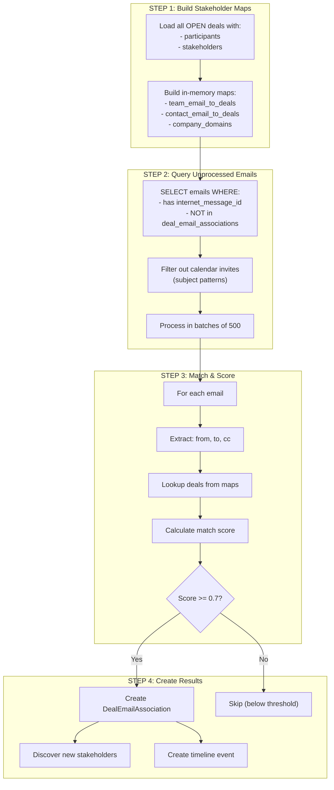

# Deal Email Mapping - Comprehensive Guide

> **Purpose**: This document provides a detailed explanation of how emails are matched to CRM deals based on stakeholder participation. It covers the matching algorithm, scoring logic, stakeholder discovery, and the complete data flow.

## Overview

Email matching links email messages to CRM deals when they involve both internal team members and external customer contacts. The system uses an **email-first batch approach** for efficient processing.

```
┌─────────────────────────────────────────────────────────────────────────────┐
│                       EMAIL-TO-DEAL MAPPING OVERVIEW                         │
├─────────────────────────────────────────────────────────────────────────────┤
│                                                                              │
│   ┌────────────────────┐                  ┌────────────────────┐            │
│   │    Email           │                  │    CRM Deal        │            │
│   │                    │                  │                    │            │
│   │  from: rep@co.com  │                  │  Team Emails:      │            │
│   │  to: ceo@cust.com  │◀───MATCHING────▶│   - rep@co.com     │            │
│   │  cc: cto@cust.com  │                  │                    │            │
│   │                    │                  │  Stakeholders:     │            │
│   │  subject: Proposal │                  │   - ceo@cust.com   │            │
│   │  date: 2024-01-15  │                  │   - cto@cust.com   │            │
│   └────────────────────┘                  └────────────────────┘            │
│              │                                      │                        │
│              │                                      │                        │
│              ▼                                      ▼                        │
│   ┌─────────────────────────────────────────────────────────────────────┐   │
│   │                    DealEmailAssociation                              │   │
│   │                                                                      │   │
│   │  - internet_message_id (unique across all copies)                   │   │
│   │  - deal_id (FK to CRMDeal)                                          │   │
│   │  - match_score (0.7 - 1.0)                                          │   │
│   │  - direction (INBOUND / OUTBOUND / INTERNAL)                        │   │
│   │  - matched_stakeholder_emails                                       │   │
│   └─────────────────────────────────────────────────────────────────────┘   │
│                                                                              │
└─────────────────────────────────────────────────────────────────────────────┘
```

---

## Architecture

### Three-Tier Task Structure

```
┌─────────────────────────────────────────────────────────────────────────────┐
│                           EMAIL MATCHING TASK HIERARCHY                      │
├─────────────────────────────────────────────────────────────────────────────┤
│                                                                              │
│   TIER 1: All Organizations (Coordinator)                                    │
│   ┌─────────────────────────────────────────────────────────────────────┐   │
│   │ match_email_to_deals_all_orgs_task()                                │   │
│   │                                                                     │   │
│   │ - Triggered: Hourly schedule, manual                                │   │
│   │ - Time Limit: 5 minutes                                             │   │
│   │ - Purpose: Query approved orgs, dispatch Tier 2                     │   │
│   │ - No retries (coordinator only)                                     │   │
│   └──────────────────────────────────┬──────────────────────────────────┘   │
│                                      │                                       │
│                                      │ For each approved org                 │
│                                      ▼                                       │
│   TIER 2: Organization Level (Primary Processing)                            │
│   ┌─────────────────────────────────────────────────────────────────────┐   │
│   │ match_email_to_deals_org_task(organisation_id)                      │   │
│   │                                                                     │   │
│   │ - Triggered: Tier 1, after email sync                               │   │
│   │ - Time Limit: 10 minutes                                            │   │
│   │ - Retries: 2 (60s exponential backoff)                              │   │
│   │ - Purpose: Batch process ALL unmatched emails                       │   │
│   │ - Batch Size: 500 emails per run                                    │   │
│   └──────────────────────────────────┬──────────────────────────────────┘   │
│                                      │                                       │
│                                      │ For specific deal re-matching         │
│                                      ▼                                       │
│   TIER 3: Deal Level (Re-matching)                                           │
│   ┌─────────────────────────────────────────────────────────────────────┐   │
│   │ match_email_to_deals_task(organisation_id, deal_id)                 │   │
│   │                                                                     │   │
│   │ - Triggered: After new stakeholder added                            │   │
│   │ - Time Limit: 2 minutes                                             │   │
│   │ - Retries: 3 (30s exponential backoff)                              │   │
│   │ - Purpose: Re-match historical emails for specific deal             │   │
│   │ - Max Emails: 1,000 per deal                                        │   │
│   └─────────────────────────────────────────────────────────────────────┘   │
│                                                                              │
└─────────────────────────────────────────────────────────────────────────────┘
```

---

## Email-First Batch Approach

### Why Email-First?

```
┌─────────────────────────────────────────────────────────────────────────────┐
│                    PROCESSING STRATEGY COMPARISON                            │
├─────────────────────────────────────────────────────────────────────────────┤
│                                                                              │
│   DEAL-FIRST (Rejected)                  EMAIL-FIRST (Chosen)               │
│   ═════════════════════                  ════════════════════               │
│                                                                              │
│   for each deal:                         # One-time setup                    │
│     for each email:                      stakeholder_maps = build_maps()    │
│       check if matches                                                       │
│                                          for each NEW email:                 │
│   DB Queries: N deals × M emails           lookup in memory                 │
│   Complexity: O(deals × emails)            create association               │
│                                                                              │
│   Problems:                              DB Queries: 2 (deals + emails)     │
│   - Re-scans ALL emails every hour       Complexity: O(new_emails)          │
│   - Doesn't scale with email volume                                         │
│   - Wastes resources on old emails       Benefits:                          │
│                                          - Only processes NEW emails        │
│                                          - In-memory lookup is O(1)         │
│                                          - Scales linearly                  │
│                                                                              │
└─────────────────────────────────────────────────────────────────────────────┘
```

### Processing Flow



---

## Matching Algorithm

### Step 1: Build Stakeholder-to-Deal Maps

```python
# Location: src/workers/deal_worker/services/deal_email_matcher.py

def _build_stakeholder_maps(
    deals: list[CRMDeal],
) -> tuple[dict[str, set[UUID]], dict[str, set[UUID]], dict[UUID, set[str]]]:
    """
    Build in-memory lookup maps for efficient matching.

    Returns:
        team_email_to_deals: Maps internal email -> set of deal IDs
        contact_email_to_deals: Maps stakeholder email -> set of deal IDs
        company_domains_by_deal: Maps deal ID -> set of customer domains
    """

    team_email_to_deals: dict[str, set[UUID]] = defaultdict(set)
    contact_email_to_deals: dict[str, set[UUID]] = defaultdict(set)
    company_domains_by_deal: dict[UUID, set[str]] = defaultdict(set)

    for deal in deals:
        deal_id = deal.deal_id

        # Team emails (internal users)
        if deal.owner_email:
            team_email_to_deals[deal.owner_email.lower()].add(deal_id)

        for participant in deal.participants:
            if participant.participant_type == ParticipantType.USER:
                if participant.related_email:
                    email = participant.related_email.lower()
                    team_email_to_deals[email].add(deal_id)

        # Contact emails (approved stakeholders)
        for stakeholder in deal.stakeholders:
            if stakeholder.approval_status == ApprovalStatus.APPROVED:
                email = stakeholder.email.lower()
                contact_email_to_deals[email].add(deal_id)
                # Extract domain for stakeholder discovery
                domain = email.split("@")[-1]
                company_domains_by_deal[deal_id].add(domain)

    return team_email_to_deals, contact_email_to_deals, company_domains_by_deal
```

### Step 2: Match Scoring Logic

```
┌─────────────────────────────────────────────────────────────────────────────┐
│                         MATCH SCORING SYSTEM                                 │
├─────────────────────────────────────────────────────────────────────────────┤
│                                                                              │
│   HIGH CONFIDENCE (Score: 1.0)                                               │
│   ═════════════════════════════                                             │
│                                                                              │
│   OUTBOUND: Team → Customer                                                  │
│   ┌─────────────────────────────────────────────────────────────────────┐   │
│   │ from: rep@company.com (TEAM)                                        │   │
│   │ to: ceo@customer.com (CONTACT)                                      │   │
│   │                                                                     │   │
│   │ Score: 1.0 - Sales rep emailing customer contact                    │   │
│   └─────────────────────────────────────────────────────────────────────┘   │
│                                                                              │
│   INBOUND: Customer → Team                                                   │
│   ┌─────────────────────────────────────────────────────────────────────┐   │
│   │ from: ceo@customer.com (CONTACT)                                    │   │
│   │ to: rep@company.com (TEAM)                                          │   │
│   │                                                                     │   │
│   │ Score: 1.0 - Customer contacting sales rep                          │   │
│   └─────────────────────────────────────────────────────────────────────┘   │
│                                                                              │
│   ─────────────────────────────────────────────────────────────────────────  │
│                                                                              │
│   MEDIUM CONFIDENCE (Score: 0.7)                                             │
│   ══════════════════════════════                                            │
│                                                                              │
│   CC Scenarios:                                                              │
│   ┌─────────────────────────────────────────────────────────────────────┐   │
│   │ from: ceo@customer.com (CONTACT)                                    │   │
│   │ to: someone@external.com                                            │   │
│   │ cc: rep@company.com (TEAM)                                          │   │
│   │                                                                     │   │
│   │ Score: 0.7 - Team CC'd on customer communication                    │   │
│   └─────────────────────────────────────────────────────────────────────┘   │
│                                                                              │
│   ─────────────────────────────────────────────────────────────────────────  │
│                                                                              │
│   BONUS SCORING                                                              │
│   ═════════════                                                             │
│                                                                              │
│   ┌─────────────────────────────────────────────────────────────────────┐   │
│   │ +0.1 bonus if MULTIPLE stakeholders involved                        │   │
│   │                                                                     │   │
│   │ Example:                                                            │   │
│   │ from: rep@company.com                                               │   │
│   │ to: ceo@customer.com, cto@customer.com  ← 2 stakeholders            │   │
│   │                                                                     │   │
│   │ Base Score: 1.0                                                     │   │
│   │ Bonus: +0.1                                                         │   │
│   │ Final: 1.0 (capped)                                                 │   │
│   └─────────────────────────────────────────────────────────────────────┘   │
│                                                                              │
│   MINIMUM THRESHOLD                                                          │
│   ═════════════════                                                         │
│                                                                              │
│   MIN_MATCH_SCORE = 0.7                                                      │
│                                                                              │
│   Only emails with score >= 0.7 create associations                          │
│                                                                              │
└─────────────────────────────────────────────────────────────────────────────┘
```

### Score Calculation Code

```python
# Location: src/workers/deal_worker/services/deal_email_matcher.py:185-240

def _calculate_match_score(
    email: Email,
    deal_id: UUID,
    team_emails: set[str],
    contact_emails: set[str],
) -> tuple[float, str, list[str]]:
    """
    Calculate match score for email-deal pair.

    Returns:
        score: Match confidence (0.0 - 1.0)
        direction: INBOUND / OUTBOUND / INTERNAL
        matched_emails: List of stakeholder emails that matched
    """

    from_email = email.from_email.lower() if email.from_email else ""
    to_emails = {e.lower() for e in (email.to_emails or [])}
    cc_emails = {e.lower() for e in (email.cc_emails or [])}
    all_recipients = to_emails | cc_emails

    matched_stakeholder_emails = []
    score = 0.0
    direction = "INTERNAL"

    # Check sender
    sender_is_team = from_email in team_emails
    sender_is_contact = from_email in contact_emails

    # Check recipients
    team_in_recipients = bool(all_recipients & team_emails)
    team_in_to = bool(to_emails & team_emails)
    team_in_cc = bool(cc_emails & team_emails)

    contacts_in_recipients = all_recipients & contact_emails
    contacts_in_to = to_emails & contact_emails

    # HIGH CONFIDENCE: Direct team-customer communication
    if sender_is_team and contacts_in_to:
        score = 1.0
        direction = "OUTBOUND"
        matched_stakeholder_emails = list(contacts_in_recipients)

    elif sender_is_contact and team_in_to:
        score = 1.0
        direction = "INBOUND"
        matched_stakeholder_emails = [from_email]

    # MEDIUM CONFIDENCE: CC scenarios
    elif sender_is_contact and team_in_cc:
        score = 0.7
        direction = "INBOUND"
        matched_stakeholder_emails = [from_email]

    elif sender_is_team and contacts_in_recipients and not contacts_in_to:
        # Contact only in CC
        score = 0.7
        direction = "OUTBOUND"
        matched_stakeholder_emails = list(contacts_in_recipients)

    # BONUS: Multiple stakeholders
    if len(matched_stakeholder_emails) > 1:
        score = min(score + 0.1, 1.0)

    return score, direction, matched_stakeholder_emails
```

---

## Email Direction

```
┌─────────────────────────────────────────────────────────────────────────────┐
│                           EMAIL DIRECTION TYPES                              │
├─────────────────────────────────────────────────────────────────────────────┤
│                                                                              │
│   OUTBOUND (Team → Customer)                                                 │
│   ══════════════════════════                                                │
│                                                                              │
│   ┌─────────────────┐         ┌─────────────────┐                           │
│   │   TEAM          │ ──────▶ │   CUSTOMER      │                           │
│   │   (Sender)      │         │   (Recipient)   │                           │
│   └─────────────────┘         └─────────────────┘                           │
│                                                                              │
│   Use Cases:                                                                 │
│   - Proposal sent to customer                                                │
│   - Follow-up after meeting                                                  │
│   - Pricing information                                                      │
│                                                                              │
│   ─────────────────────────────────────────────────────────────────────────  │
│                                                                              │
│   INBOUND (Customer → Team)                                                  │
│   ═════════════════════════                                                 │
│                                                                              │
│   ┌─────────────────┐         ┌─────────────────┐                           │
│   │   CUSTOMER      │ ──────▶ │   TEAM          │                           │
│   │   (Sender)      │         │   (Recipient)   │                           │
│   └─────────────────┘         └─────────────────┘                           │
│                                                                              │
│   Use Cases:                                                                 │
│   - Customer inquiry                                                         │
│   - Questions about proposal                                                 │
│   - Purchase order                                                           │
│                                                                              │
│   ─────────────────────────────────────────────────────────────────────────  │
│                                                                              │
│   INTERNAL (Team ↔ Team with Customer CC)                                   │
│   ═══════════════════════════════════════                                   │
│                                                                              │
│   ┌─────────────────┐         ┌─────────────────┐                           │
│   │   TEAM          │ ──────▶ │   TEAM          │                           │
│   │   (Sender)      │    cc   │   (Recipient)   │                           │
│   └─────────────────┘   ▼     └─────────────────┘                           │
│                    ┌─────────┐                                               │
│                    │ CUSTOMER│                                               │
│                    └─────────┘                                               │
│                                                                              │
│   Use Cases:                                                                 │
│   - Internal discussion with customer visibility                             │
│   - Team coordination                                                        │
│                                                                              │
└─────────────────────────────────────────────────────────────────────────────┘
```

---

## Stakeholder Discovery from Email

```
┌─────────────────────────────────────────────────────────────────────────────┐
│                    STAKEHOLDER DISCOVERY FROM EMAIL                          │
├─────────────────────────────────────────────────────────────────────────────┤
│                                                                              │
│   For each MATCHED email:                                                    │
│   ┌─────────────────────────────────────────────────────────────────────┐   │
│   │ _discover_stakeholders_from_email(email, deal_id)                   │   │
│   └──────────────────────────────────┬──────────────────────────────────┘   │
│                                      │                                       │
│                                      ▼                                       │
│   PRE-FILTER: Skip Calendar Invites                                          │
│   ┌─────────────────────────────────────────────────────────────────────┐   │
│   │ subject_lower = email.subject.lower()                               │   │
│   │                                                                     │   │
│   │ SKIP if subject contains:                                           │   │
│   │ - "invitation:"    - "meeting request:"                             │   │
│   │ - "invite:"        - "meeting response:"                            │   │
│   │ - "accepted:"      - "tentative:"                                   │   │
│   │ - "declined:"                                                       │   │
│   │                                                                     │   │
│   │ Reason: Calendar invites are handled by calendar matching           │   │
│   └──────────────────────────────────┬──────────────────────────────────┘   │
│                                      │                                       │
│                                      ▼                                       │
│   EXTRACT ALL PARTICIPANTS                                                   │
│   ┌─────────────────────────────────────────────────────────────────────┐   │
│   │ participants = {                                                    │   │
│   │     email.from_email,      # Sender                                 │   │
│   │     *email.to_emails,      # Direct recipients                      │   │
│   │     *email.cc_emails,      # CC recipients                          │   │
│   │ }                                                                   │   │
│   └──────────────────────────────────┬──────────────────────────────────┘   │
│                                      │                                       │
│                                      ▼                                       │
│   FOR EACH PARTICIPANT:                                                      │
│   ┌─────────────────────────────────────────────────────────────────────┐   │
│   │                                                                     │   │
│   │   ┌────────────────────┐                                            │   │
│   │   │ participant email  │                                            │   │
│   │   │ john@customer.com  │                                            │   │
│   │   └─────────┬──────────┘                                            │   │
│   │             │                                                       │   │
│   │             ▼                                                       │   │
│   │   ┌─────────────────────────────────────────────────────┐          │   │
│   │   │ CHECK 1: Is domain in company_domains?              │          │   │
│   │   │                                                     │          │   │
│   │   │ company_domains = {customer.com, partner.org}       │          │   │
│   │   └─────────┬───────────────────────────────────────────┘          │   │
│   │             │                                                       │   │
│   │        YES  │  NO ────────────────────────────▶ SKIP               │   │
│   │             ▼                                                       │   │
│   │   ┌─────────────────────────────────────────────────────┐          │   │
│   │   │ CHECK 2: Is email NOT in team_emails?               │          │   │
│   │   └─────────┬───────────────────────────────────────────┘          │   │
│   │             │                                                       │   │
│   │        YES  │  NO ────────────────────────────▶ SKIP               │   │
│   │             ▼                                                       │   │
│   │   ┌─────────────────────────────────────────────────────┐          │   │
│   │   │ CHECK 3: Is email NOT in contact_emails?            │          │   │
│   │   │         (not already a known stakeholder)           │          │   │
│   │   └─────────┬───────────────────────────────────────────┘          │   │
│   │             │                                                       │   │
│   │        YES  │  NO ────────────────────────────▶ SKIP               │   │
│   │             ▼                                                       │   │
│   │   ┌─────────────────────────────────────────────────────┐          │   │
│   │   │ CHECK 4: Is email NOT already a stakeholder?        │          │   │
│   │   │         (for this specific deal)                    │          │   │
│   │   └─────────┬───────────────────────────────────────────┘          │   │
│   │             │                                                       │   │
│   │        YES  │  NO ────────────────────────────▶ SKIP               │   │
│   │             ▼                                                       │   │
│   │   ┌─────────────────────────────────────────────────────┐          │   │
│   │   │ CREATE DealStakeholder                              │          │   │
│   │   │                                                     │          │   │
│   │   │ email = john@customer.com                           │          │   │
│   │   │ name = None (not available from email)              │          │   │
│   │   │ source = EMAIL_DISCOVERY                            │          │   │
│   │   │ approval_status = APPROVED (first 5) or PENDING     │          │   │
│   │   └─────────────────────────────────────────────────────┘          │   │
│   │                                                                     │   │
│   └─────────────────────────────────────────────────────────────────────┘   │
│                                                                              │
│   5-LIMIT RULE:                                                              │
│   ┌─────────────────────────────────────────────────────────────────────┐   │
│   │ MAX_EMAIL_DISCOVERY_AUTO_APPROVED = 5                               │   │
│   │                                                                     │   │
│   │ - First 5 discovered stakeholders per deal → APPROVED               │   │
│   │ - 6th and beyond → PENDING (require user approval)                  │   │
│   │                                                                     │   │
│   │ Note: This limit is INDEPENDENT of calendar discovery limit         │   │
│   └─────────────────────────────────────────────────────────────────────┘   │
│                                                                              │
└─────────────────────────────────────────────────────────────────────────────┘
```

---

## Data Model

### DealEmailAssociation

```python
class DealEmailAssociation(SQLModel, table=True):
    """
    Links emails to deals using internet_message_id for cross-user deduplication.
    One association covers ALL copies of the same email across different mailboxes.
    """

    __tablename__ = "deal_email_associations"
    __table_args__ = (
        UniqueConstraint("deal_id", "internet_message_id", name="uq_deal_email"),
        Index("ix_deal_email_org_status", "organisation_id", "status"),
        Index("ix_deal_email_deal", "deal_id"),
        Index("ix_deal_email_internet_msg", "internet_message_id"),
    )

    association_id: UUID = Field(default_factory=uuid4, primary_key=True)
    organisation_id: UUID
    deal_id: UUID  # FK to CRMDeal

    # Unique identifier across ALL copies of the email
    internet_message_id: str  # RFC 822 Message-ID

    # Matching metadata
    status: AssociationStatus = Field(default=AssociationStatus.SUGGESTED)
    match_score: float  # 0.7 - 1.0

    # Email classification
    direction: EmailDirection  # INBOUND / OUTBOUND / INTERNAL
    matched_stakeholder_emails: list[str] | None  # JSONB - for audit trail

    # Denormalized fields (for quick access)
    email_subject: str | None
    email_date: datetime | None

    # Timestamps
    created_at: datetime
    updated_at: datetime
```

### Why `internet_message_id`?

```
┌─────────────────────────────────────────────────────────────────────────────┐
│                    INTERNET_MESSAGE_ID vs EMAIL_ID                           │
├─────────────────────────────────────────────────────────────────────────────┤
│                                                                              │
│   PROBLEM: Same email exists in multiple mailboxes                           │
│   ═════════════════════════════════════════════════                         │
│                                                                              │
│   Email sent: rep@company.com → ceo@customer.com, cc: manager@company.com   │
│                                                                              │
│   This creates 3 copies:                                                     │
│   1. rep@company.com's Sent folder       (email_id: uuid-1)                 │
│   2. manager@company.com's Inbox         (email_id: uuid-2)                 │
│   3. ceo@customer.com's Inbox            (email_id: uuid-3)                 │
│                                                                              │
│   But ALL share the same: internet_message_id = "<abc123@mail.company.com>" │
│                                                                              │
│   ─────────────────────────────────────────────────────────────────────────  │
│                                                                              │
│   SOLUTION: Use internet_message_id                                          │
│   ═══════════════════════════════════                                       │
│                                                                              │
│   Using email_id:                                                            │
│   ┌─────────────────────────────────────────────────────────────────────┐   │
│   │ Need 3 separate associations                                        │   │
│   │ Can cause duplicate timeline entries                                │   │
│   │ Complex deduplication logic                                         │   │
│   └─────────────────────────────────────────────────────────────────────┘   │
│                                                                              │
│   Using internet_message_id:                                                 │
│   ┌─────────────────────────────────────────────────────────────────────┐   │
│   │ ONE association covers ALL copies                                   │   │
│   │ Single timeline entry                                               │   │
│   │ Query returns all users' email records                              │   │
│   └─────────────────────────────────────────────────────────────────────┘   │
│                                                                              │
└─────────────────────────────────────────────────────────────────────────────┘
```

---

## Complete Processing Flow

```
┌─────────────────────────────────────────────────────────────────────────────┐
│                    COMPLETE EMAIL MATCHING FLOW                              │
└─────────────────────────────────────────────────────────────────────────────┘

STEP 0: EMAIL SYNC (Prerequisite)
═══════════════════════════════════════════════════════════════════════════════

  Email Provider (Google/Microsoft)
         │
         ▼
  integrations.sync_integration_data (email/emails)
         │
         ▼
  ┌─────────────────────────────────────────────────────────────────────────┐
  │ Email Table                                                             │
  │                                                                         │
  │ - email_id (unique per copy)                                            │
  │ - internet_message_id (shared across copies)                            │
  │ - from_email, to_emails, cc_emails                                      │
  │ - subject, body, received_at                                            │
  └─────────────────────────────────────────────────────────────────────────┘

STEP 1: TASK TRIGGER
═══════════════════════════════════════════════════════════════════════════════

  Hourly Schedule ─────────────────▶ match_email_to_deals_all_orgs_task()
         │
         │ For each APPROVED org
         ▼
  match_email_to_deals_org_task(organisation_id)

STEP 2: BUILD STAKEHOLDER MAPS
═══════════════════════════════════════════════════════════════════════════════

  ┌─────────────────────────────────────────────────────────────────────────┐
  │ DealEmailMatcher._build_stakeholder_maps()                              │
  │                                                                         │
  │ Load all OPEN deals with:                                               │
  │ - participants (USER type → team_emails)                                │
  │ - stakeholders (APPROVED → contact_emails)                              │
  │                                                                         │
  │ Build:                                                                  │
  │ - team_email_to_deals: {email: {deal_ids}}                              │
  │ - contact_email_to_deals: {email: {deal_ids}}                           │
  │ - company_domains_by_deal: {deal_id: {domains}}                         │
  └─────────────────────────────────────────────────────────────────────────┘

STEP 3: QUERY UNPROCESSED EMAILS
═══════════════════════════════════════════════════════════════════════════════

  ┌─────────────────────────────────────────────────────────────────────────┐
  │ SELECT DISTINCT internet_message_id, from_email, to_emails, cc_emails,  │
  │        subject, received_at                                             │
  │ FROM emails                                                             │
  │ WHERE organisation_id = :org_id                                         │
  │   AND internet_message_id IS NOT NULL                                   │
  │   AND NOT EXISTS (                                                      │
  │       SELECT 1 FROM deal_email_associations                             │
  │       WHERE internet_message_id = emails.internet_message_id            │
  │   )                                                                     │
  │ LIMIT 500                                                               │
  └─────────────────────────────────────────────────────────────────────────┘

STEP 4: MATCH AND SCORE EACH EMAIL
═══════════════════════════════════════════════════════════════════════════════

  For each unprocessed email:
  ┌─────────────────────────────────────────────────────────────────────────┐
  │                                                                         │
  │ 1. EXTRACT PARTICIPANTS                                                 │
  │    from_email = "rep@company.com"                                       │
  │    to_emails = ["ceo@customer.com"]                                     │
  │    cc_emails = ["cto@customer.com"]                                     │
  │                                                                         │
  │ 2. LOOKUP POTENTIAL DEALS                                               │
  │    team_deals = team_email_to_deals["rep@company.com"]                  │
  │    contact_deals = contact_email_to_deals["ceo@customer.com"]           │
  │    matching_deals = team_deals & contact_deals                          │
  │                                                                         │
  │ 3. CALCULATE SCORE (per deal)                                           │
  │    score = 1.0 (team sender + contact recipient)                        │
  │    direction = OUTBOUND                                                 │
  │    matched_emails = ["ceo@customer.com", "cto@customer.com"]            │
  │                                                                         │
  │ 4. CHECK THRESHOLD                                                      │
  │    if score >= 0.7:                                                     │
  │        create_association()                                             │
  │                                                                         │
  └─────────────────────────────────────────────────────────────────────────┘

STEP 5: CREATE ASSOCIATION
═══════════════════════════════════════════════════════════════════════════════

  ┌─────────────────────────────────────────────────────────────────────────┐
  │ DealEmailAssociation(                                                   │
  │     organisation_id = org_id,                                           │
  │     deal_id = deal_id,                                                  │
  │     internet_message_id = email.internet_message_id,                    │
  │     status = AssociationStatus.SUGGESTED,                               │
  │     match_score = 1.0,                                                  │
  │     direction = EmailDirection.OUTBOUND,                                │
  │     matched_stakeholder_emails = ["ceo@customer.com", "cto@customer.com"]│
  │     email_subject = email.subject,                                      │
  │     email_date = email.received_at,                                     │
  │ )                                                                       │
  └─────────────────────────────────────────────────────────────────────────┘

STEP 6: DISCOVER STAKEHOLDERS
═══════════════════════════════════════════════════════════════════════════════

  ┌─────────────────────────────────────────────────────────────────────────┐
  │ _discover_stakeholders_from_email(email, deal_id)                       │
  │                                                                         │
  │ Skip if calendar invite (subject pattern check)                         │
  │                                                                         │
  │ For each participant not already known:                                 │
  │ - Check domain matches company_domains                                  │
  │ - Check not in team_emails                                              │
  │ - Check not already a stakeholder                                       │
  │                                                                         │
  │ Create DealStakeholder(                                                 │
  │     source = EMAIL_DISCOVERY,                                           │
  │     approval_status = APPROVED (first 5) or PENDING                     │
  │ )                                                                       │
  └─────────────────────────────────────────────────────────────────────────┘

STEP 7: CREATE ACTIVITY-FEED PROJECTION
═══════════════════════════════════════════════════════════════════════════════

  ┌─────────────────────────────────────────────────────────────────────────┐
  │ CRMActivity projection(                                                 │
  │     deal_id = deal_id,                                                  │
  │     activity_type = EMAIL,                                              │
  │     source_id = internet_message_id,                                    │
  │     event_datetime = email.received_at,                                 │
  │     title = email.subject,                                              │
  │     metadata = {                                                        │
  │         direction: OUTBOUND,                                            │
  │         participants: [...],                                            │
  │     }                                                                   │
  │ )                                                                       │
  └─────────────────────────────────────────────────────────────────────────┘
```

---

## Code References

### Key Files

| File | Purpose |
|------|---------|
| `src/workers/deal_worker/services/deal_email_matcher.py` | Core matching logic |
| `src/workers/deal_worker/tasks/deal_mappers/email_matching_tasks.py` | Task orchestration |
| `src/domain/models/organisation_tables/sync/email_models.py` | Data models |

### Key Functions

| Function | Location | Purpose |
|----------|----------|---------|
| `process_organisation()` | `deal_email_matcher.py:52` | Process all emails in org |
| `process_deal()` | `deal_email_matcher.py:118` | Re-match emails for deal |
| `_build_stakeholder_maps()` | `deal_email_matcher.py:145` | Build lookup maps |
| `_calculate_match_score()` | `deal_email_matcher.py:185` | Score calculation |
| `_discover_stakeholders_from_email()` | `deal_email_matcher.py:250` | Stakeholder discovery |

---

## Configuration

| Parameter | Value | Description |
|-----------|-------|-------------|
| `MIN_MATCH_SCORE` | 0.7 | Minimum score to create association |
| `BATCH_SIZE` | 500 | Emails per org processing run |
| `MAX_DEAL_EMAILS` | 1,000 | Max emails for single deal re-match |
| `MAX_EMAIL_DISCOVERY_AUTO_APPROVED` | 5 | Auto-approve first 5 discovered |

---

## Summary

The email-to-deal mapping system:

1. **Email-First Batch Processing**: Efficiently processes only NEW emails using in-memory stakeholder maps
2. **Smart Scoring**: High confidence (1.0) for direct team-customer communication, medium (0.7) for CC scenarios
3. **Cross-User Deduplication**: Uses `internet_message_id` for single association across all email copies
4. **Stakeholder Discovery**: Automatically identifies new stakeholders from email participants
5. **5-Limit Rule**: Auto-approves first 5 discovered stakeholders per deal
6. **Calendar Invite Filtering**: Skips calendar invites to avoid duplicate associations
7. **Timeline Integration**: Creates timeline events for deal activity feeds
