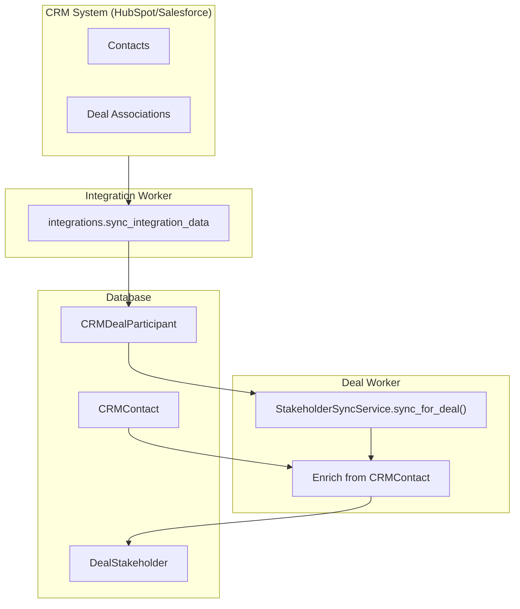
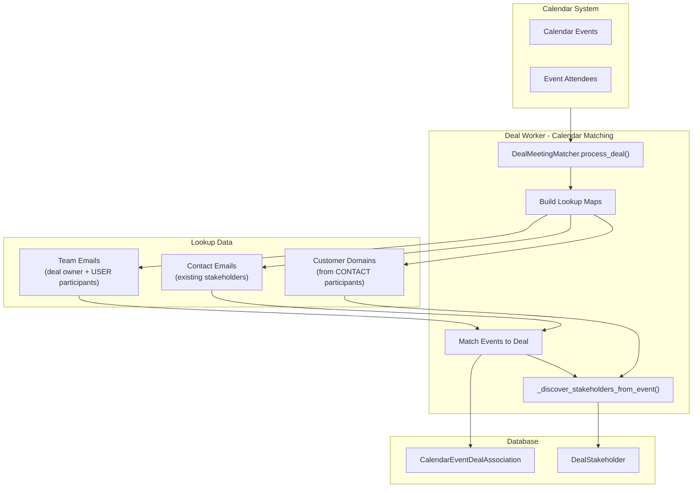
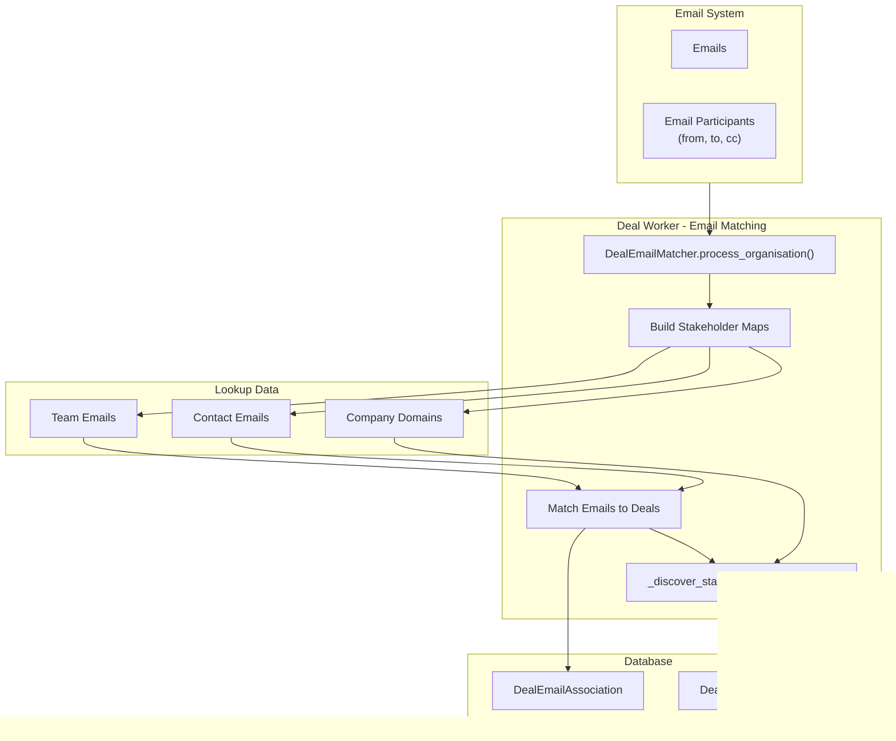

# Stakeholder Identification Guide

> **Purpose**: This document explains how stakeholders are identified and created from different data sources (CRM, Calendar, Email). It provides a comprehensive understanding of the identification logic, data flow, and approval mechanisms.

## Overview

Stakeholders are external people (customers, partners, prospects) involved in deals. The system identifies stakeholders from three primary sources:

```
┌─────────────────────────────────────────────────────────────────────────────┐
│                        STAKEHOLDER SOURCES                                   │
├─────────────────────────────────────────────────────────────────────────────┤
│                                                                              │
│   ┌──────────────┐      ┌──────────────┐      ┌──────────────┐              │
│   │     CRM      │      │   CALENDAR   │      │    EMAIL     │              │
│   │   (Primary)  │      │  (Discovery) │      │  (Discovery) │              │
│   └──────┬───────┘      └──────┬───────┘      └──────┬───────┘              │
│          │                     │                     │                       │
│          ▼                     ▼                     ▼                       │
│   ┌──────────────┐      ┌──────────────┐      ┌──────────────┐              │
│   │  CRM Deal    │      │   Calendar   │      │    Email     │              │
│   │ Participants │      │   Attendees  │      │ Participants │              │
│   └──────┬───────┘      └──────┬───────┘      └──────┬───────┘              │
│          │                     │                     │                       │
│          └─────────────────────┼─────────────────────┘                       │
│                                │                                             │
│                                ▼                                             │
│                    ┌────────────────────┐                                    │
│                    │   DealStakeholder  │                                    │
│                    │       Table        │                                    │
│                    └────────────────────┘                                    │
│                                                                              │
└─────────────────────────────────────────────────────────────────────────────┘
```

## Source Comparison

| Attribute | CRM | Calendar Discovery | Email Discovery |
|-----------|-----|-------------------|-----------------|
| **Trust Level** | High (authoritative) | Medium | Medium |
| **Approval** | Always APPROVED | First 5: APPROVED | First 5: APPROVED |
| **Name Available** | Yes | Yes (display_name) | No |
| **Job Title** | Yes (enriched) | No | No |
| **Trigger** | CRM sync | Calendar matching | Email matching |
| **Source Enum** | `CRM` | `CALENDAR_DISCOVERY` | `EMAIL_DISCOVERY` |

---

## Source 1: CRM (Primary Source)

CRM is the authoritative source for stakeholders. All CONTACT-type participants from the CRM are automatically added as approved stakeholders.

### Data Flow



### Identification Logic

```python
# Location: src/workers/deal_worker/services/stakeholder_sync_service.py

def sync_for_deal(deal_id: UUID) -> StakeholderSyncResult:
    """
    Sync CRM participants to DealStakeholder table.

    Selection Criteria:
    1. participant_type == ParticipantType.CONTACT (not USER or COMPANY)
    2. related_email is not None (must have email)

    Steps:
    1. Load deal with participants
    2. Filter to CONTACT type only
    3. For each contact participant:
       - Normalize email (lowercase)
       - Check if stakeholder exists
       - Create or update stakeholder
       - Enrich job_title from CRMContact
    4. Soft-delete removed stakeholders
    """
```

### Fields Populated

| Field | Source | Notes |
|-------|--------|-------|
| `email` | `CRMDealParticipant.related_email` | Normalized to lowercase |
| `name` | `CRMDealParticipant.related_name` | Display name |
| `job_title` | `CRMContact.job_title` | Enriched via email lookup |
| `source` | Hardcoded | `StakeholderSource.CRM` |
| `source_reference_id` | `CRMDealParticipant.participant_id` | For traceability |
| `approval_status` | Hardcoded | `ApprovalStatus.APPROVED` |

### Key Code Reference

```python
# src/workers/deal_worker/services/stakeholder_sync_service.py:89-142

async def _ensure_stakeholder(
    self,
    deal: CRMDeal,
    participant: CRMDealParticipant,
    existing_map: dict[str, DealStakeholder],
) -> DealStakeholder | None:
    """Create or update a stakeholder from CRM participant."""

    email = participant.related_email.lower().strip()

    # Check if already exists
    if email in existing_map:
        stakeholder = existing_map[email]
        # Update source reference for traceability
        stakeholder.source_reference_id = participant.participant_id
        return stakeholder

    # Create new stakeholder
    stakeholder = DealStakeholder(
        deal_id=deal.deal_id,
        email=email,
        name=participant.related_name,
        source=StakeholderSource.CRM,
        source_reference_id=participant.participant_id,
        approval_status=ApprovalStatus.APPROVED,
    )

    # Enrich job_title from CRMContact
    await self._enrich_from_contact(stakeholder)

    return stakeholder
```

---

## Source 2: Calendar Discovery

Calendar discovery identifies new stakeholders from meeting attendees whose email domain matches the customer's domain.

### Data Flow



### Identification Logic

```python
# Location: src/workers/deal_worker/services/deal_meeting_matcher.py

def _discover_stakeholders_from_event(
    event: CalendarEvent,
    deal_id: UUID,
    customer_domains: set[str],
    team_emails: set[str],
    existing_stakeholder_emails: set[str],
) -> list[DealStakeholder]:
    """
    Discover new stakeholders from calendar event attendees.

    Selection Criteria:
    1. Attendee email domain IN customer_domains
    2. Attendee email NOT IN team_emails
    3. Attendee email NOT IN existing_stakeholder_emails

    Approval Logic:
    - First 5 discovered per deal -> APPROVED
    - Beyond 5 -> PENDING (requires user approval)
    """
```

### Discovery Criteria Diagram

```
┌─────────────────────────────────────────────────────────────────────────────┐
│                    CALENDAR STAKEHOLDER DISCOVERY                            │
├─────────────────────────────────────────────────────────────────────────────┤
│                                                                              │
│   For each Calendar Event Attendee:                                          │
│                                                                              │
│   ┌─────────────────────┐                                                    │
│   │  Extract Email      │                                                    │
│   │  john@customer.com  │                                                    │
│   └──────────┬──────────┘                                                    │
│              │                                                               │
│              ▼                                                               │
│   ┌─────────────────────┐     ┌───────────────────────────────┐             │
│   │  Extract Domain     │────▶│  customer.com                 │             │
│   └──────────┬──────────┘     └───────────────────────────────┘             │
│              │                                                               │
│              ▼                                                               │
│   ┌─────────────────────────────────────────────────────────────┐           │
│   │  CHECK 1: Is domain in customer_domains?                    │           │
│   │                                                             │           │
│   │  customer_domains = {customer.com, partner.org}             │           │
│   │  (extracted from CRM CONTACT participants)                  │           │
│   └──────────┬──────────────────────────────────────────────────┘           │
│              │                                                               │
│         YES  │  NO ──────────────────────────────────▶ SKIP                 │
│              ▼                                                               │
│   ┌─────────────────────────────────────────────────────────────┐           │
│   │  CHECK 2: Is email NOT in team_emails?                      │           │
│   │                                                             │           │
│   │  team_emails = {owner@company.com, rep@company.com}         │           │
│   │  (deal owner + USER participants)                           │           │
│   └──────────┬──────────────────────────────────────────────────┘           │
│              │                                                               │
│         YES  │  NO ──────────────────────────────────▶ SKIP                 │
│              ▼                                                               │
│   ┌─────────────────────────────────────────────────────────────┐           │
│   │  CHECK 3: Is email NOT in existing_stakeholder_emails?      │           │
│   │                                                             │           │
│   │  existing_stakeholder_emails = {jane@customer.com, ...}     │           │
│   │  (already discovered stakeholders)                          │           │
│   └──────────┬──────────────────────────────────────────────────┘           │
│              │                                                               │
│         YES  │  NO ──────────────────────────────────▶ SKIP                 │
│              ▼                                                               │
│   ┌─────────────────────────────────────────────────────────────┐           │
│   │  CREATE DealStakeholder                                     │           │
│   │                                                             │           │
│   │  source = CALENDAR_DISCOVERY                                │           │
│   │  approval_status = APPROVED (first 5) or PENDING (rest)     │           │
│   │  name = attendee.display_name                               │           │
│   └─────────────────────────────────────────────────────────────┘           │
│                                                                              │
└─────────────────────────────────────────────────────────────────────────────┘
```

### 5-Limit Approval Rule

```python
MAX_CALENDAR_DISCOVERY_AUTO_APPROVED = 5

# First 5 discovered stakeholders per deal are auto-approved
# 6th and beyond require manual user approval

def _get_approval_status(deal_id: UUID, discovered_count: int) -> ApprovalStatus:
    if discovered_count <= MAX_CALENDAR_DISCOVERY_AUTO_APPROVED:
        return ApprovalStatus.APPROVED
    else:
        return ApprovalStatus.PENDING
```

### Fields Populated

| Field | Source | Notes |
|-------|--------|-------|
| `email` | `CalendarAttendee.email` | Normalized to lowercase |
| `name` | `CalendarAttendee.display_name` | May be None |
| `job_title` | N/A | Not available from calendar |
| `source` | Hardcoded | `StakeholderSource.CALENDAR_DISCOVERY` |
| `approval_status` | Calculated | First 5: APPROVED, rest: PENDING |

---

## Source 3: Email Discovery

Email discovery identifies new stakeholders from email participants (from, to, cc) whose domain matches the customer's domain.

### Data Flow



### Identification Logic

```python
# Location: src/workers/deal_worker/services/deal_email_matcher.py

def _discover_stakeholders_from_email(
    email: Email,
    deal_id: UUID,
    company_domains: set[str],
    team_emails: set[str],
    contact_emails: set[str],
    existing_stakeholder_emails: set[str],
) -> list[DealStakeholder]:
    """
    Discover new stakeholders from email participants.

    Selection Criteria:
    1. Email is NOT a calendar invite (filtered by subject)
    2. Participant email domain IN company_domains
    3. Participant email NOT IN team_emails
    4. Participant email NOT IN contact_emails
    5. Participant email NOT IN existing_stakeholder_emails

    Approval Logic:
    - First 5 discovered per deal -> APPROVED
    - Beyond 5 -> PENDING (requires user approval)
    """
```

### Calendar Invite Filtering

```python
# Email subjects that indicate calendar invites (skipped for stakeholder discovery)
CALENDAR_INVITE_PATTERNS = [
    "invitation:",
    "invite:",
    "accepted:",
    "declined:",
    "tentative:",
    "meeting request:",
    "meeting response:",
]

def _is_calendar_invite(subject: str) -> bool:
    """Check if email is a calendar invite (to skip for stakeholder discovery)."""
    subject_lower = subject.lower()
    return any(pattern in subject_lower for pattern in CALENDAR_INVITE_PATTERNS)
```

### Fields Populated

| Field | Source | Notes |
|-------|--------|-------|
| `email` | Email participant | Normalized to lowercase |
| `name` | N/A | Not available from email |
| `job_title` | N/A | Not available from email |
| `source` | Hardcoded | `StakeholderSource.EMAIL_DISCOVERY` |
| `approval_status` | Calculated | First 5: APPROVED, rest: PENDING |

---

## Stakeholder Model

### Data Structure

```python
class DealStakeholder(FlexibleSyncedRecordMixin):
    """
    Represents an external person (customer, partner) involved in a deal.
    Unique constraint: (deal_id, email)
    """

    # Identity
    stakeholder_id: UUID = Field(default_factory=uuid4, primary_key=True)
    email: str  # Normalized lowercase, unique per deal
    name: str | None
    job_title: str | None  # Enriched from CRMContact

    # Deal Association
    deal_id: UUID  # FK to CRMDeal
    contact_id: UUID | None  # FK to CRMContact (if matched)

    # Source Tracking
    source: StakeholderSource  # CRM | CALENDAR_DISCOVERY | EMAIL_DISCOVERY | MANUAL
    source_reference_id: UUID | None  # e.g., CRMDealParticipant.participant_id
    approval_status: ApprovalStatus  # APPROVED | PENDING | REJECTED

    # Analysis Fields (populated by AI)
    stance: StakeholderStance  # CHAMPION | SUPPORTER | NEUTRAL | DETRACTOR | BLOCKER
    decision_power: DecisionPower  # DECISION_MAKER | INFLUENCER | EVALUATOR | END_USER
    temperature: StakeholderTemperature  # HOT | WARM | COLD | UNKNOWN
    engagement_score: float  # 0-100

    # Soft-delete
    is_deleted: bool = False
```

### Source Enum

```python
class StakeholderSource(str, Enum):
    """Where the stakeholder was identified from."""
    CRM = "CRM"                          # From CRMDealParticipant
    CALENDAR_DISCOVERY = "CALENDAR_DISCOVERY"  # From calendar attendee
    EMAIL_DISCOVERY = "EMAIL_DISCOVERY"        # From email participant
    MANUAL = "MANUAL"                          # Manually added by user
```

### Approval Status Enum

```python
class ApprovalStatus(str, Enum):
    """Approval state for discovered stakeholders."""
    APPROVED = "APPROVED"    # Visible in UI, included in analysis
    PENDING = "PENDING"      # Awaiting user approval
    REJECTED = "REJECTED"    # User rejected, excluded from analysis
```

---

## Complete Identification Flow

```
┌─────────────────────────────────────────────────────────────────────────────┐
│                    COMPLETE STAKEHOLDER IDENTIFICATION FLOW                  │
└─────────────────────────────────────────────────────────────────────────────┘

STEP 1: CRM SYNC (Primary Source)
═══════════════════════════════════════════════════════════════════════════════

  CRM (HubSpot/Salesforce)
         │
         ▼
  ┌─────────────────────────────────────────────────────────────────────────┐
  │ integrations.sync_integration_data (crm/contacts, crm/deals)            │
  │                                                                         │
  │ Creates/Updates:                                                        │
  │ - CRMDeal records                                                       │
  │ - CRMContact records                                                    │
  │ - CRMDealParticipant records (linking deals to contacts)                │
  └────────────────────────────────────┬────────────────────────────────────┘
                                       │
                                       ▼
  ┌─────────────────────────────────────────────────────────────────────────┐
  │ CRMDealSyncService._dispatch_stakeholder_sync()                         │
  │                                                                         │
  │ Triggers: sync_deal_stakeholders_task(deal_id, trigger_rematching=True) │
  └────────────────────────────────────┬────────────────────────────────────┘
                                       │
                                       ▼
STEP 2: STAKEHOLDER SYNC (Creates CRM Stakeholders)
═══════════════════════════════════════════════════════════════════════════════

  ┌─────────────────────────────────────────────────────────────────────────┐
  │ sync_deal_stakeholders_task(organisation_id, deal_id)                   │
  │                                                                         │
  │ 1. Load CRMDeal with participants                                       │
  │ 2. Filter: participant_type == CONTACT                                  │
  │ 3. For each CONTACT participant:                                        │
  │    a. Normalize email (lowercase)                                       │
  │    b. Create/update DealStakeholder                                     │
  │    c. Set source = CRM, approval_status = APPROVED                      │
  │    d. Enrich job_title from CRMContact                                  │
  │ 4. Soft-delete removed stakeholders                                     │
  │ 5. Return StakeholderSyncResult { requires_rematching: bool }           │
  └────────────────────────────────────┬────────────────────────────────────┘
                                       │
                                       │ IF requires_rematching = True
                                       │ (new stakeholders were created)
                                       │
              ┌────────────────────────┴────────────────────────┐
              │                                                  │
              ▼                                                  ▼
STEP 3: CALENDAR MATCHING                           STEP 4: EMAIL MATCHING
(Parallel)                                          (Parallel)
═══════════════════════════════════════════════════════════════════════════════

  ┌───────────────────────────────┐     ┌───────────────────────────────┐
  │ match_calendar_to_deals_task │     │ match_email_to_deals_task     │
  │                               │     │                               │
  │ 1. Build lookup maps:         │     │ 1. Build stakeholder maps:    │
  │    - team_emails              │     │    - team_email_to_deals      │
  │    - contact_emails           │     │    - contact_email_to_deals   │
  │    - customer_domains         │     │    - company_domains          │
  │                               │     │                               │
  │ 2. Query calendar events      │     │ 2. Query unprocessed emails   │
  │                               │     │                               │
  │ 3. Two-pass matching:         │     │ 3. For each email:            │
  │    Pass 1: Team = organizer   │     │    - Calculate match score    │
  │    Pass 2: Team = attendee    │     │    - If score >= 0.7:         │
  │                               │     │      Create association       │
  │ 4. Create associations        │     │                               │
  │                               │     │ 4. Discover stakeholders:     │
  │ 5. Discover stakeholders:     │     │    - Filter by domain         │
  │    - Filter by domain         │     │    - Exclude team/contacts    │
  │    - Exclude team members     │     │    - Apply 5-limit rule       │
  │    - Apply 5-limit rule       │     │                               │
  └───────────────────────────────┘     └───────────────────────────────┘
              │                                          │
              │                                          │
              ▼                                          ▼
  ┌─────────────────────────────────────────────────────────────────────────┐
  │                          DealStakeholder Table                          │
  │                                                                         │
  │  ┌─────────┬──────────────────┬───────────────────┬────────────────┐   │
  │  │ Source  │ email            │ approval_status   │ job_title      │   │
  │  ├─────────┼──────────────────┼───────────────────┼────────────────┤   │
  │  │ CRM     │ ceo@customer.com │ APPROVED          │ CEO            │   │
  │  │ CRM     │ cto@customer.com │ APPROVED          │ CTO            │   │
  │  │ CAL_DIS │ dev@customer.com │ APPROVED          │ NULL           │   │
  │  │ EMAIL   │ pm@customer.com  │ PENDING           │ NULL           │   │
  │  └─────────┴──────────────────┴───────────────────┴────────────────┘   │
  │                                                                         │
  └─────────────────────────────────────────────────────────────────────────┘

STEP 5: STAKEHOLDER ANALYSIS (AI Enrichment)
═══════════════════════════════════════════════════════════════════════════════

  ┌─────────────────────────────────────────────────────────────────────────┐
  │ analyze_deal_stakeholders_task(organisation_id, deal_id)                │
  │                                                                         │
  │ 1. Load all APPROVED stakeholders for deal                              │
  │ 2. Load meeting transcripts                                             │
  │ 3. Call StakeholderAnalysisAgent with context                           │
  │ 4. Update stakeholder fields:                                           │
  │    - stance (CHAMPION, SUPPORTER, NEUTRAL, DETRACTOR, BLOCKER)          │
  │    - decision_power (DECISION_MAKER, INFLUENCER, EVALUATOR, END_USER)   │
  │    - temperature (HOT, WARM, COLD)                                      │
  │    - engagement_score (0-100)                                           │
  │ 5. Generate stakeholder insights                                        │
  └─────────────────────────────────────────────────────────────────────────┘
```

---

## Key Files Reference

| Component | File Path | Purpose |
|-----------|-----------|---------|
| **StakeholderSyncService** | `src/workers/deal_worker/services/stakeholder_sync_service.py` | CRM stakeholder sync |
| **DealMeetingMatcher** | `src/workers/deal_worker/services/deal_meeting_matcher.py` | Calendar matching & discovery |
| **DealEmailMatcher** | `src/workers/deal_worker/services/deal_email_matcher.py` | Email matching & discovery |
| **StakeholderAnalysisService** | `src/workers/deal_worker/services/stakeholder_analysis_service.py` | AI analysis |
| **Stakeholder Tasks** | `src/workers/deal_worker/tasks/deal_mappers/stakeholder_tasks.py` | Task orchestration |
| **DealStakeholder Model** | `src/domain/models/organisation_tables/sync/crm/stakeholders.py` | Data model |

---

## Summary

| Source | Trigger | Trust Level | Auto-Approved | Enrichment |
|--------|---------|-------------|---------------|------------|
| **CRM** | CRM sync | High | Always | job_title from CRMContact |
| **Calendar** | Calendar matching | Medium | First 5 per deal | display_name only |
| **Email** | Email matching | Medium | First 5 per deal | None |
| **Manual** | User action | User-defined | User decides | User provides |

The stakeholder identification system ensures comprehensive coverage of deal participants while maintaining data quality through approval workflows and source tracking.
