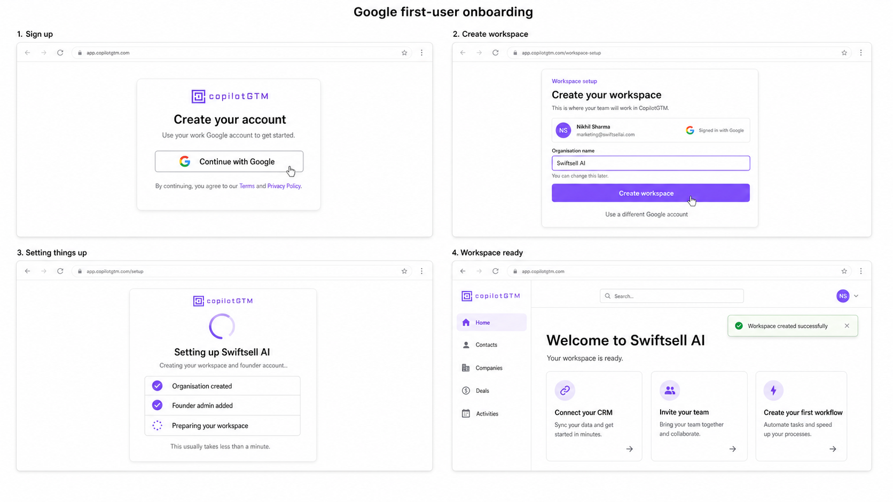
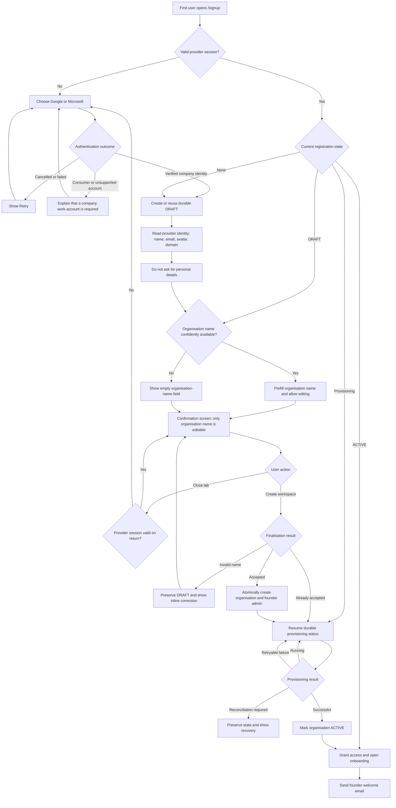

# First-User Self-Service Signup Flow

## Status

**Backend implemented. Frontend implementation remains pending.**

This document defines only the flow for the first person creating a new CopilotGTM
organisation. Joining an existing organisation, automatic domain joining, access requests,
administrator approval, and member-notification emails are intentionally deferred to a separate
flow.

This document refines the founding-user experience described in
[Self-Service Signup and Organisation Invitations](./self-service-signup-and-organisation-invitations.md).
The existing provider-verification and durable-provisioning boundaries remain valid; this proposal
changes what is collected before provisioning and adds resumable pre-provisioning state.

## Desired outcome

For the normal Google Workspace or Microsoft Entra founder, registration should be:

> Authenticate -> confirm one organisation name -> create workspace.

Personal identity and organisation information must remain separate even when they appear on the
same confirmation screen:

- the identity provider supplies the person's identity;
- the user supplies or confirms the organisation name;
- the backend derives all authority fields;
- optional personal and organisation enrichment happens after activation.

## Research summary

The target flow combines the strongest parts of current CRM onboarding patterns without copying
their unnecessary steps:

- Attio's public entry asks only for a work email or Google authentication. Attio separately models
  a user, a workspace, and a workspace membership; one user may belong to multiple workspaces.
- HubSpot supports provider-backed account creation and treats profile preferences, company
  branding, team invitations, and account configuration as later setup activities.
- Pipedrive creates the first user and company account together but separates company settings from
  personal preferences after creation.

CopilotGTM should go one step further through progressive profiling: do not ask for information
that the verified provider supplies or that the product can derive later without blocking access.

## Product decisions

1. There is no CopilotGTM username. The provider-backed identity is the login identity.
2. Provider email, name, provider subject, tenant, domain, and authentication method are never
   browser-authored authority fields.
3. The normal founding-user flow has one editable field: `organisation_name`.
4. Registration never asks for personal details. If the provider does not return a usable name,
   create a non-authoritative display fallback and request profile completion after activation.
5. The first user becomes organisation `admin` only after organisation creation is accepted.
6. A verified session is not application access. A draft or provisioning user remains restricted
   until the organisation is active.
7. Closing the tab does not sign the user out or discard their server-side progress.
8. A draft does not reserve a company domain. Domain ownership is decided transactionally when the
   user submits organisation creation.
9. The user explicitly cancelling registration is the only normal action that abandons the draft
   and signs them out.

## Information collected

### Before organisation creation

| Information | Source | User action |
| --- | --- | --- |
| Email | Verified provider session | Read-only |
| Provider subject | Verified provider session | Hidden |
| Provider tenant or hosted domain | Verified provider session | Hidden |
| Authentication method | Verified provider session | Hidden |
| Full name | Verified provider profile | Read-only; complete or correct after activation |
| Profile image | Trusted provider profile | Optional and read-only |
| Primary domain | Backend-derived provider claim | Read-only |
| Organisation name | User or confident enrichment result | Confirm or edit |
| Terms and privacy versions | Server configuration | Accepted by the Create workspace action |

The final button should state that creating the workspace accepts the linked Terms of Service and
Privacy Policy. Whether policy or jurisdiction requires a separate checkbox must be confirmed with
legal counsel; the backend must record the exact accepted versions either way.

### Deferred until after activation

These fields must not block workspace creation:

- job title;
- country, unless it becomes necessary for a concrete legal, billing, or data-residency decision;
- sales-team size;
- company website beyond the provider-derived domain;
- LinkedIn URL;
- company logo, description, address, industry, and employee count;
- CRM selection, data import, email/calendar connection, and teammate invitations.

Existing best-effort organisation research may populate company information asynchronously. It must
never delay or fail signup.

## Confirmation screen

The personal identity section provides context but is not normally a form.

```text
Create your workspace

YOU
[Avatar] Nikhil Kumar
         marketing@swiftsellai.com
         Verified with Google Workspace

WORKSPACE
Organisation name
[ Swiftsell AI                         ]

Domain
swiftsellai.com                         Verified

By creating this workspace, you agree to the
Terms of Service and Privacy Policy.

[ Create workspace ]
```

If a company name is enriched with high confidence, prefill it and keep it editable. If enrichment
is unavailable or slow, render the screen immediately with an empty organisation-name field.

## First-user decision tree

The normal path contains no user-details form. The `YOU` card is provider-derived, read-only
context. Only `organisation_name` is editable before workspace creation.

### Actual Google signup screens



### Google flow infographic


### Complete decision tree



## Registration states

| State | Durable? | Organisation exists? | Application access? | Resume destination |
| --- | --- | --- | --- | --- |
| `UNAUTHENTICATED` | No | No | No | `/signup` |
| `DRAFT` | Yes | No | No | `/signup/continue` |
| `RECEIVED` | Yes | Not guaranteed | No | Provisioning status |
| `CONTROL_PLANE_CREATED` | Yes | Yes, provisioning | No | Provisioning status |
| `TENANT_DEFAULTS_CREATED` | Yes | Yes, provisioning | No | Provisioning status |
| `STORAGE_CREATED` | Yes | Yes, provisioning | No | Provisioning status |
| `ACTIVE` | Yes | Yes, active | Yes | Onboarding or application |
| `RECONCILIATION_REQUIRED` | Yes | Possibly partial | No | Recovery screen |
| `FAILED` | Yes | Possibly partial | No | Retry or support screen |
| `ABANDONED` | Yes until cleanup | No | No | Fresh signup |

`DRAFT` is the only new pre-provisioning milestone required. The current `SignupRequest` state
machine should be reused rather than introducing a second signup orchestration system. Draft rows
may contain incomplete organisation fields, but the database and service must enforce that all
required final fields exist before transition to `RECEIVED`. Workers must never process `DRAFT`.

## Resume and session behaviour

On every visit to `/signup`, `/signin`, or a protected route, the frontend should resolve the
verified identity's current application state:

| Current state | Behaviour |
| --- | --- |
| No provider session | Show authentication choices |
| Valid session plus draft | Redirect to `/signup/continue` |
| Valid session plus provisioning request | Redirect to durable status screen |
| Valid session plus active user and organisation | Open onboarding/application |
| Expired session plus known local signup intent | Reauthenticate, then resolve server state |
| Different provider account selected | Do not merge; offer Switch account or Start separately |

Draft data must be stored server-side. Browser storage may remember only non-authoritative routing
intent such as the chosen provider. It must not be the source of registration progress.

Recommended draft expiry is 14 days after the last update. Expiry abandons only the application
draft; it does not attempt to delete the Google/Microsoft or Supabase identity. A later verified
login can create a new draft.

## Backend ownership and finalisation

The browser may submit only:

```json
{
  "organisation_name": "Swiftsell AI"
}
```

If the provider name is unavailable, the backend records a safe, non-authoritative display fallback
and marks the personal profile incomplete. Profile completion occurs after activation and is not
part of the organisation-creation payload. Policy versions should be selected by the server and
recorded against the final Create workspace action; the browser must not choose arbitrary
historical versions.

The browser must never submit or choose:

- primary domain;
- provider user or tenant IDs;
- authentication method;
- organisation status;
- user role or approval status;
- organisation or user IDs;
- provisioning milestone.

Finalisation must reverify the provider session, acquire the existing identity and domain locks,
and atomically create the organisation, founder user, external identity mapping, membership/role
state, and audit records. The existing background milestones then create tenant defaults and
storage before activating the organisation.

A draft does not lock or reserve the primary domain. If another founder completes creation first,
finalisation must not create a duplicate organisation. Handling that authenticated person as a
member or access requester belongs to the separate existing-organisation flow.

## Email behaviour

The first-user flow sends no administrator access-request email because an administrator does not
exist before finalisation. After the organisation becomes active, send the founder one welcome
email containing the organisation name and a direct application link.

Member-join and access-request notification emails are out of scope for this document.

## Observability

Record one correlated event per meaningful transition:

- `signup_identity_verified`;
- `signup_draft_created`;
- `signup_draft_resumed`;
- `signup_workspace_submitted`;
- `signup_control_plane_created`;
- `signup_tenant_defaults_created`;
- `signup_storage_created`;
- `signup_activated`;
- `signup_failed`;
- `signup_abandoned`.

Events must include the signup request ID, provider, current milestone, elapsed time, and stable
error code. Do not log OAuth tokens or raw provider payloads.

Measure at least:

- provider authentication success rate;
- identity-to-workspace-submission conversion;
- median time from verified identity to submission;
- provisioning completion rate and duration;
- draft resume rate;
- failures by stable error code.

## Acceptance criteria

1. A founder with a complete provider profile enters no personal information.
2. The normal registration form contains only the editable organisation name.
3. A missing provider name does not add a registration step; profile completion is deferred.
4. Email, provider, domain, and derived identity values cannot be edited by the browser.
5. Closing the tab before submission resumes the same server-side draft.
6. An expired provider session requires reauthentication but does not lose the draft.
7. Closing the tab during provisioning resumes the same durable request and milestone.
8. Repeated Create workspace requests do not create duplicate organisations, users, jobs, or
   storage.
9. A draft never grants protected API or CRM access.
10. A draft never reserves a domain indefinitely.
11. The founder receives administrator access only after organisation creation is committed.
12. The application becomes accessible only after the organisation reaches `ACTIVE`.
13. Optional enrichment and onboarding failures cannot fail or roll back an active signup.
14. The founder receives one welcome email after activation.

## Explicitly out of scope

- a second user with the same company identity;
- invitation acceptance;
- automatic verified-domain membership;
- administrator-approved access requests;
- access-request email delivery;
- multi-organisation switching;
- SCIM or just-in-time enterprise provisioning;
- password or consumer-email self-service signup.

## References

- [Attio: Users and workspaces](https://docs.attio.com/docs/users-and-workspaces)
- [Attio: Signing in](https://attio.com/help/reference/account-settings/signing-into-attio)
- [Attio: Managing members and admins](https://attio.com/help/reference/workspace-settings-billing/manage-members-and-admins)
- [HubSpot: Set up your account](https://knowledge.hubspot.com/get-started/set-up-your-account)
- [Pipedrive: Organisation versus company account](https://support.pipedrive.com/en/article/organization-vs-company-account)
- [Pipedrive: Company settings and personal preferences](https://support.pipedrive.com/en/article/pipedrive-settings)
