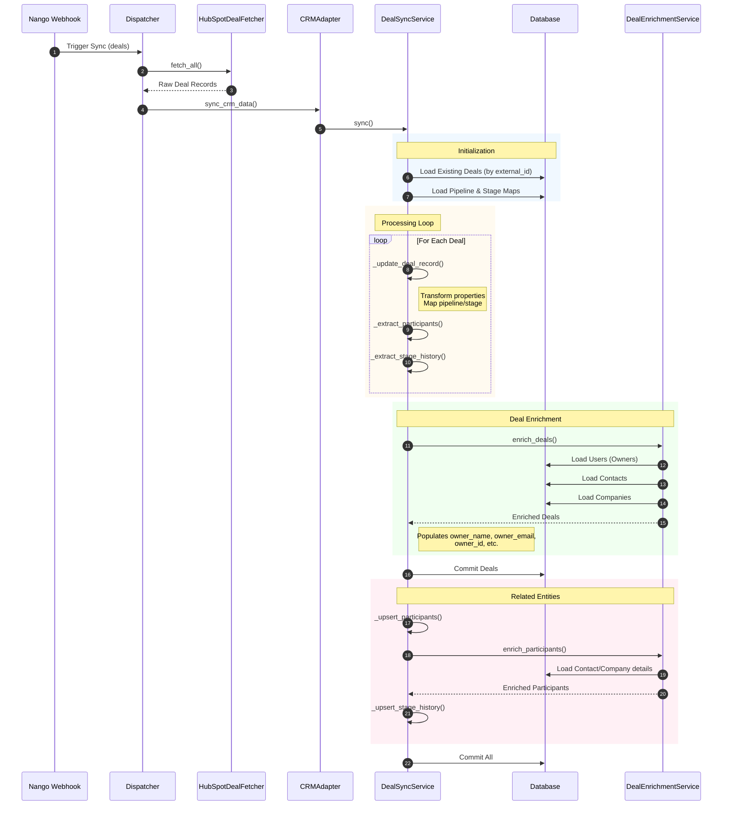
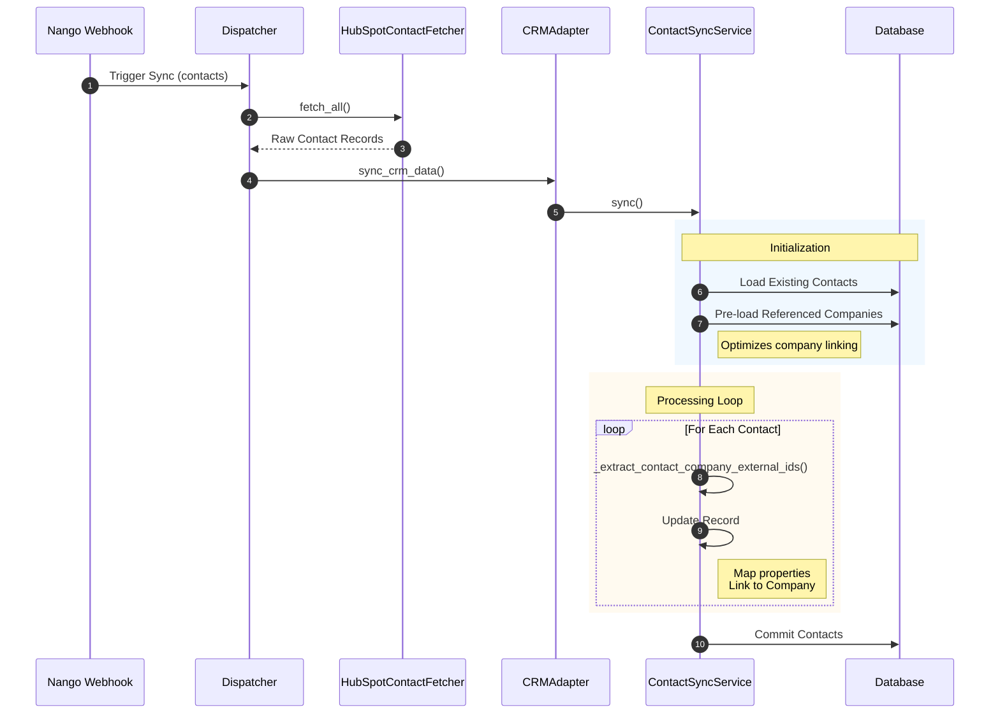
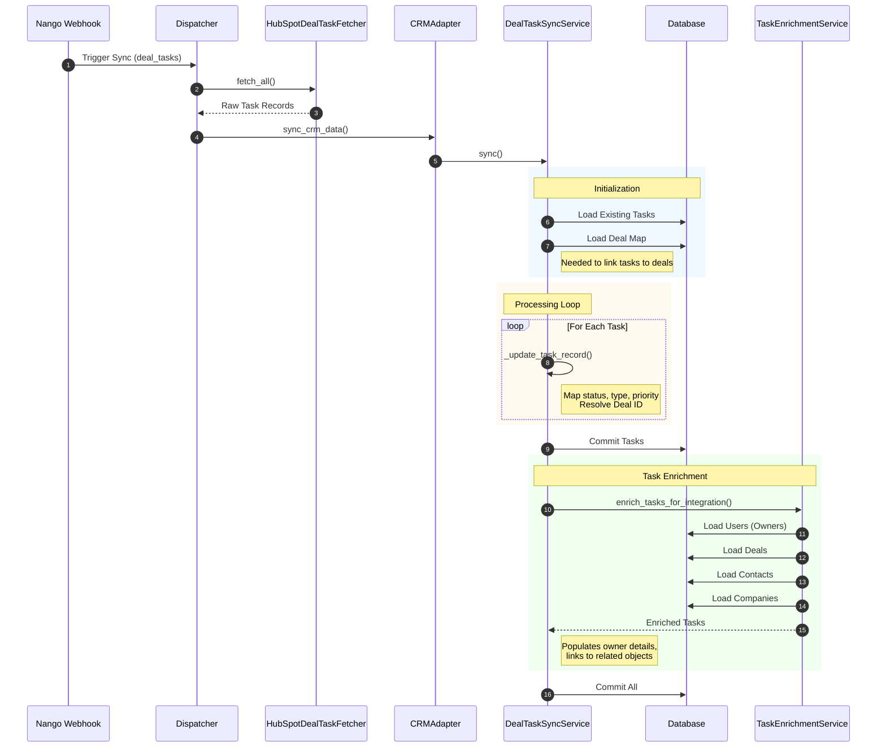
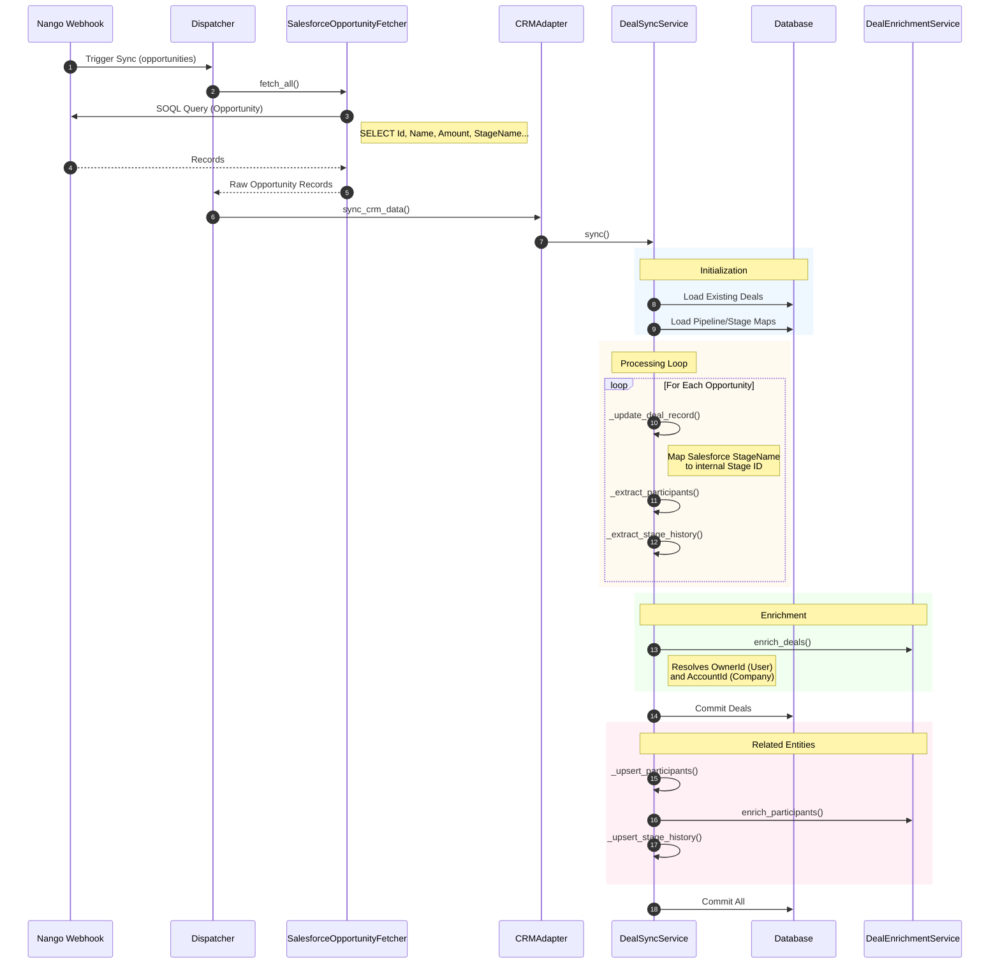
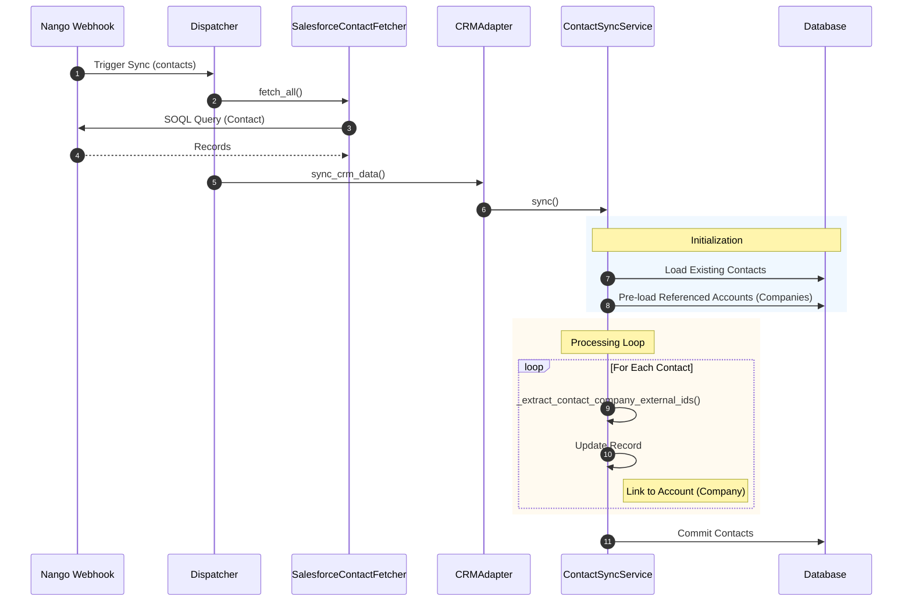
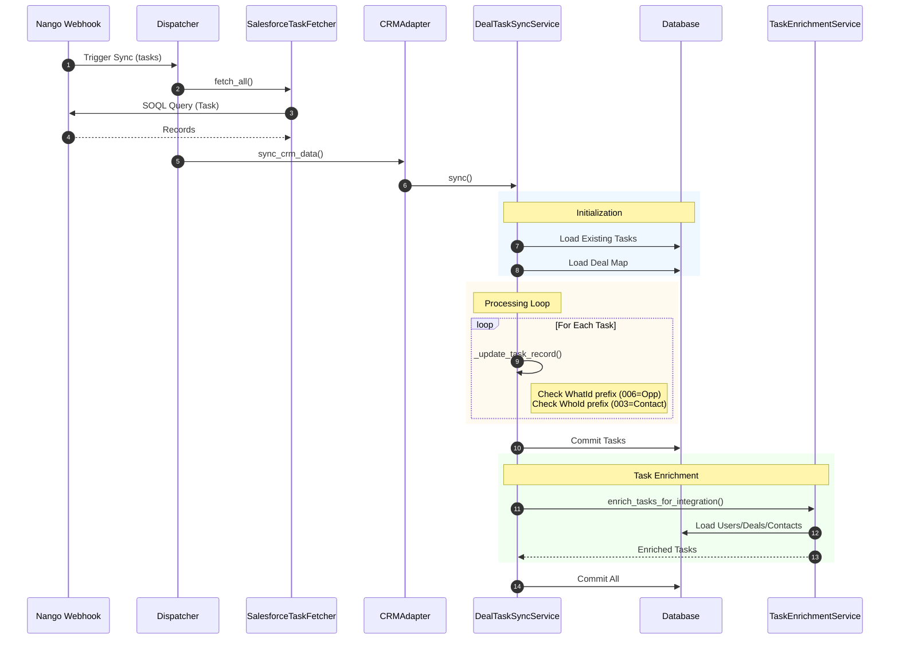

# CRM Integration Flow Charts

This document visualizes the internal flow of CRM integration services, showing how data moves from the provider (via Nango) through our internal services and enrichment processes.

## 1. HubSpot Deal Sync Flow

This flow illustrates how HubSpot deals are fetched, transformed, and enriched.

## 2. HubSpot Contact Sync Flow

This flow shows the synchronization of contact records.

## 3. HubSpot Task Sync Flow

This flow details how tasks (calls, meetings, emails) are synced and linked to deals.

## 4. Salesforce Deal (Opportunity) Sync Flow

Salesforce follows a similar pattern but uses SOQL queries and handles "Opportunities".

## 5. Salesforce Contact Sync Flow

## 6. Salesforce Task Sync Flow

Salesforce tasks use polymorphic `WhatId` and `WhoId` fields which are resolved during sync.

