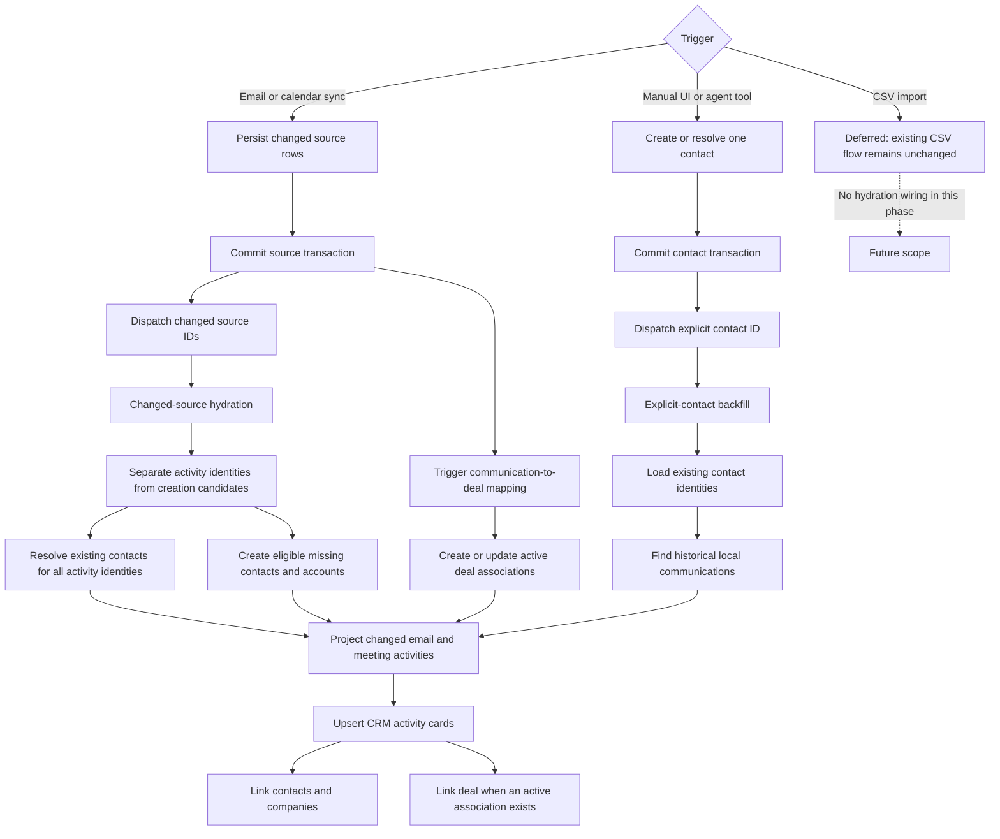
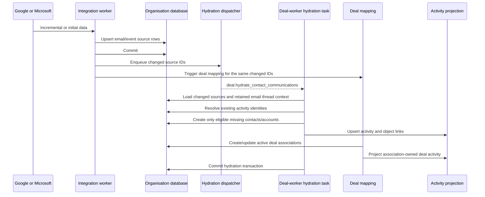
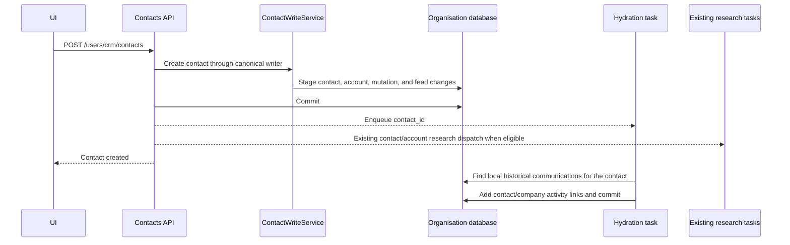
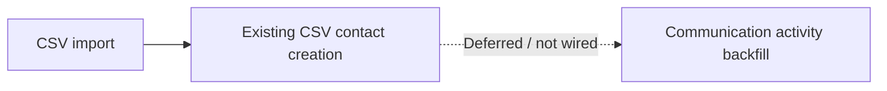

# Contact and Communication Hydration Flow

This document is the source of truth for how CopilotGTM turns synced Google/Microsoft email and calendar data into CRM contacts, accounts, activities, and object links. It also defines what happens after a contact is created manually through the web application or agent tool.

The central rule is:

> Persist the source record or contact first, commit it, and then enqueue one bounded, replay-safe local hydration task.

The hydration task reads only CopilotGTM's databases. It does not fetch Gmail or Calendar data and does not call Apollo or another research provider.

## Responsibilities

The flow deliberately separates four concerns:

| Concern | Owner | Result |
|---|---|---|
| Fetch and persist provider data | Email/calendar integration workers | Canonical `emails`, `calendar_events`, and attendee rows |
| Resolve external identities | Contact communication hydration | Existing contacts are reused; eligible missing contacts are created |
| Determine deal relevance | Communication deal mapping | Active email/meeting-to-deal association rows |
| Build the activity read model | Activity projection | `crm_activities` cards plus contact, company, and deal links |

Contact hydration does not decide which deal owns a communication. Deal mapping does not own contact creation. They are independent post-commit jobs that converge on the same activity projection.

## End-to-End Flow



## Trigger Matrix

| Trigger | Payload | When it runs | May create contacts? | Communication scope | Research behavior |
|---|---|---|---|---|---|
| Email sync | `changed_email_ids` | After the email sync service has persisted its records | Yes | Changed rows and their retained provider threads | No research |
| Calendar sync | `changed_event_ids` | After the calendar transaction commits | Yes | Only changed event rows | No research |
| Manual contact API | One `contact_id` | After the contact transaction commits | No; the contact already exists | All locally stored emails/events matching that contact's identities | Hydration does not research; the existing API research dispatch still runs separately |
| Agent `create_contact` tool | One `contact_id` for a newly created contact | After the contact transaction commits | No; the contact already exists | All locally stored emails/events matching that contact's identities | Hydration does not research |
| CRM CSV import | None | Not wired in this phase | Existing import behavior only | No communication backfill | Existing import behavior remains unchanged |

This means Gmail is no longer missing from the process: active email and active calendar syncs both dispatch the same hydration task with their changed record IDs.

## Flow A: Email or Calendar Sync



The email and calendar workers pass IDs returned by their sync services:

- Email: `changed_email_ids`
- Calendar: `changed_event_ids`

No full-table scan is performed in this mode. Email context is bounded to the provider threads named by the changed rows, while calendar hydration still loads only changed events. Initial sync and later incremental/webhook-driven sync use the same integration task, so the same post-commit logic applies.

### Automatic Contact Eligibility

Automatic contact creation is conservative. A source communication is considered only when it contains at least one known internal participant. Internal identity is built from:

- exact email addresses of master users belonging to the organisation;
- the organisation's configured domains;
- exact connected integration email addresses.

Only the organisation's configured domains are applied as domain-wide exclusions. A user or integration address never causes its whole domain to become internal. Public/free email domains are also not treated as organisation-wide internal domains; one internal Gmail address does not make every `gmail.com` participant internal.

Email creation uses demonstrated relationship evidence rather than inbound frequency:

- an internal sender makes every eligible external participant in that provider thread a creation candidate, including `to`, `cc`, and available `bcc` recipients;
- an inbound-only thread never creates missing contacts, even when the sender follows up repeatedly;
- when an internal reply changes the thread, retained earlier senders and copied participants become candidates and the retained thread is reprojected so their history is attached;
- thread matching uses the Gmail/Outlook provider thread ID and never mutable subject text.

For a qualifying communication, activity identities are normalized and deduplicated by email across the whole task batch. Activity matching excludes:

- malformed email addresses;
- exact internal email addresses;
- addresses on an internal organisation domain;
- declined calendar attendees;
- calendar resource attendees such as rooms.

Automatic creation also excludes shared role and functional mailboxes such as `noreply`, `marketing`, `sales`, `support`, `apply`, and `newsletter`. Local parts are normalized across punctuation, regional variants, and `+` aliases before comparison. If such an address already belongs to a CRM contact, it remains eligible for activity matching.

A calendar event with more than 25 attendees cannot create missing contacts automatically. Existing contacts in that event are still resolved and receive the meeting activity. This prevents large webinars or company-wide events from becoming accidental bulk imports without hiding legitimate history from contacts already in the CRM. These skip reasons are returned as counters in the task result.

### Contact and Account Resolution

The planner keeps activity identities separate from automatic-creation candidates. Existing contacts can therefore receive activities even when a creation guardrail excludes that identity. For the remaining creation candidates:

1. The task takes an organisation-scoped PostgreSQL advisory transaction lock when it has contacts to resolve. This serializes concurrent automatic identity creation for that organisation.
2. `ContactWriteService.find_or_create_contacts_by_email_batch(...)` performs one prefetch for active contacts whose primary email or `additional_emails` matches a candidate.
3. Existing contacts are reused.
4. Missing contacts are created through the canonical `ContactWriteService`, not by inserting CRM rows directly.
5. The canonical writer applies the existing account resolution/creation policy for the contact's email domain and records the normal CRM mutation/feed data.
6. Suppressed creation identities are resolved through the same batch contact lookup without creating misses, then included when activity links are projected.

Hydration creates candidates from local email and display-name data only. It does not supply LinkedIn identities or invoke Apollo/provider research.

The advisory lock is an intentional current simplification. A database-enforced normalized-email identity constraint can replace it if throughput requires more concurrency later.

## Flow B: Manual UI Contact Creation



The hydration enqueue happens after commit. If enqueueing fails, the failure is logged but the already-created contact is not rolled back or reported as failed.

The API's existing research behavior remains separate:

- contact research is dispatched when the created contact has an email or the request supplied a LinkedIn URL;
- account research is dispatched when the contact writer resolved or created a company;
- neither research path is part of the hydration worker.

## Flow C: Agent Tool Contact Creation

The agent tool first searches by normalized email. If the contact already exists, it reuses it and does not dispatch a new contact backfill. If it creates a new contact, it:

1. uses `ContactWriteService`;
2. commits the contact transaction;
3. dispatches the new `contact_id` for local communication backfill;
4. handles any requested deal link separately.

As with the API, a hydration dispatch failure is logged and does not invalidate the committed contact.

## Flow D: CSV Import — Deferred

Status: **not implemented in the contact communication hydration flow**.



The existing CSV service continues to create contacts exactly as it did before this work. This phase does not collect imported contact IDs, dispatch hydration tasks, change CSV research behavior, or add activity backfill to the importer. That integration can be designed separately when bulk hydration requirements and limits are explicitly approved.

## The Two Hydration Modes

The dispatcher chooses exactly one mode for each task.

### 1. Changed-Source Mode

Input: `changed_email_ids` and/or `changed_event_ids`.

Behavior:

1. Load active changed emails, their retained provider-thread context, and the requested calendar events.
2. Build the organisation's internal identity context.
3. Identify valid external activity identities and whether each email thread contains an internal sender.
4. Create from internally-sent threads while keeping inbound-only and role-mailbox identities activity-only.
5. Reuse or create eligible contacts, then resolve existing contacts for suppressed identities.
6. Project changed events and the retained email threads that established the relationship.
7. Replace contact/company links for those source records with the complete resolved participant set.

This is the integration sync path and is the only hydration mode that automatically creates missing contacts.

### 2. Explicit-Contact Mode

Input: `contact_ids`.

Behavior:

1. Load the active contacts.
2. Build an identity map from each contact's primary email and `additional_emails`.
3. Search local email rows across sender, `to`, `cc`, and `bcc` fields.
4. Search local calendar rows across organiser and attendee identities.
5. Project matching communications and add links for the supplied contacts and their companies.

This path does not fetch provider history and does not create other participants as contacts. It uses add-only activity links (`replace_links=False`) so backfilling one contact cannot remove links already created for other contacts on the same communication.

## Activity Projection Rules

The source email or calendar event remains the source of truth. `crm_activities` is a replayable read model.

| Situation | Activity identity | Links |
|---|---|---|
| Email without active deal association | Deterministic direct communication ID | Contact `RELATED`; company `RELATED` |
| Meeting without active deal association | Deterministic direct communication ID | Contact `ATTENDEE`; company `RELATED` |
| Email with active deal association | `DealEmailAssociation.association_id` | Deal-mapper links plus hydration-owned contact/company `PARTICIPANT` links |
| Meeting with active deal association | `CalendarEventDealAssociation.association_id` | Deal-mapper links plus hydration-owned contact/company `PARTICIPANT` links |

Direct activity IDs are deterministic UUIDv5 values:

```text
uuid5(NAMESPACE_URL, "crm-communication:{organisation_id}:{source_kind}:{source_id}")
```

For email, `source_id` is `internet_message_id` when available, otherwise `email_id`. For calendar, it is `event_id`.

If a deal association exists, the association owns the visible activity card. Direct and association projection take the same per-communication advisory transaction lock, and direct projection rechecks for an active association while holding that lock. This prevents either worker ordering from leaving a duplicate direct card. Hydration uses the separate `PARTICIPANT` link role on association cards, so deal-mapper replays cannot remove participant links and hydration replays cannot remove deal-owned links.

Activity and object-link upserts are replay-safe. Re-running a task updates the same deterministic/association activity identity rather than creating a new card.

## Batching, Queue, and Retry Policy

All work is sent to the `deal` queue as `deal.hydrate_contact_communications`.

| Setting | Value |
|---|---|
| Changed email/event IDs per task | 100 |
| Explicit contact IDs per task | 100 |
| Late acknowledgement | Enabled |
| Retries | 2 after the initial attempt |
| Retry delay | 60 seconds |
| Soft time limit | 600 seconds |
| Hard time limit | 660 seconds |

Each task opens organisation and master sessions, performs one bounded batch, commits on success, and returns counts for considered sources, contacts created/reused, activities projected, and candidate skip reasons.

## Transaction and Failure Boundaries

- Provider data is committed before hydration or deal mapping is enqueued. A worker never tries to read an uncommitted source ID.
- Manual/tool contacts are committed before historical backfill is enqueued.
- A hydration task failure rolls back that task's database transaction and is retried by Celery.
- A post-commit enqueue failure cannot roll back the original source/contact transaction.
- API and agent-tool enqueue failures are currently best-effort and logged. There is no general reconciliation scheduler for those missed handoffs yet.

## Research Policy

Research is intentionally outside this flow:

- Integration hydration: never research.
- CSV import: outside this flow; existing behavior is unchanged.
- Explicit-contact activity backfill: never research.
- Manual single-contact API: preserves its existing separate contact/account research dispatch.
- Future bulk research: should be an explicit user-selected job over chosen contact IDs, with its own limits, progress, retries, and cost controls.

This prevents provider sync from causing an uncontrolled number of paid or slow enrichment calls.

## Legacy Calendar Discovery

The legacy calendar-only discovery task has been retired. Initial sync dispatches enabled email and calendar capabilities independently, and each integration task invokes the shared hydration flow after its source records are committed.

New callers should use `deal.hydrate_contact_communications` rather than the calendar-only discovery task.

## Current Limitations and Upgrade Points

- Manual/API/tool enqueue is best-effort after commit. A periodic reconciliation job could be added if missed handoffs become operationally significant.
- Explicit-contact mode searches all locally stored historical communications for up to 100 contacts. It is currently used by manual web/tool creation; very large tenants may eventually need time windows or cursor-based reconciliation.
- Changed-email mode reloads the complete retained provider thread for each changed batch. This intentionally preserves all discussion participants; exceptionally large threads may eventually need a participant projection table.
- Automatic identity creation uses one advisory transaction lock per organisation. A normalized contact-identity table with a database unique constraint is the clean upgrade if this lock becomes a throughput bottleneck.
- Hydration can only connect data already persisted locally. It does not ask a provider for older history that was never synced.

## Implementation Map

| Responsibility | Code |
|---|---|
| Hydration planning and execution | `src/service/crm/discovery/contact_communication_hydration.py` |
| Communication activity projection | `src/service/crm/activity_feed_projection_service.py` |
| Post-commit batching/dispatch | `src/workers/deal_worker/utils/contact_communication_hydration_dispatch.py` |
| Celery task and retry policy | `src/workers/deal_worker/tasks/deal_mappers/contact_communication_hydration_tasks.py` |
| Canonical contact batch lookup/write | `src/service/crm/contacts/write_service.py` |
| Direct activity identity and association cleanup | `src/service/crm/activity_feed_projection_service.py` |
| Email integration trigger | `src/workers/integrations_worker/tasks/email/integration_task.py` |
| Calendar integration trigger | `src/workers/integrations_worker/tasks/calendar/integration_task.py` |
| Manual contact trigger | `src/api/routers/crm/contacts_handler.py` |
| Agent tool trigger | `src/agents/tools/crm/create_contact.py` |
