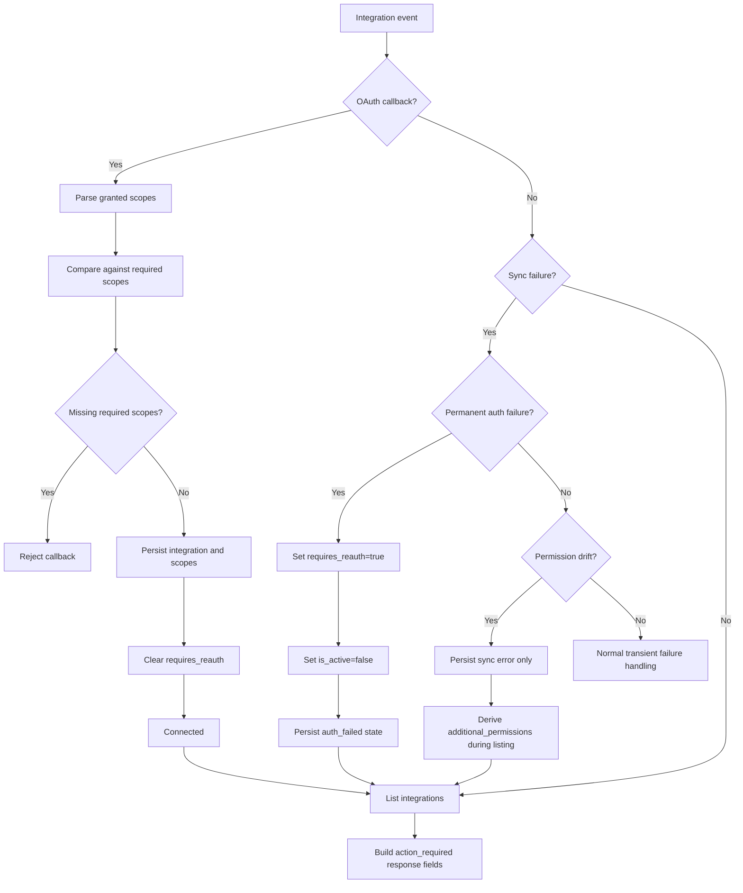

# Integration Re-Auth and Permission Recovery

## Purpose

This document defines how the backend decides that an integration needs user action, and how that state is exposed through the integrations API.

It covers only the reconnect model:

- broken auth
- missing newly required scopes
- manual disconnect

It does not cover provider-specific sync details or retry behavior.

## Core Rules

- `requires_reauth` is for broken auth only.
- missing required scopes are treated as permission drift, not expired auth.
- manual disconnect must not be surfaced as reconnect-required.
- OAuth callback must reject partial consent when required scopes are missing.
- sync must persist permanent auth failures immediately.
- integration listing derives permission drift from stored scopes vs current required scopes.

## State Model

| Situation | `is_active` | `requires_reauth` | Derived `action_required` | Recovery |
|---|---:|---:|---|---|
| Healthy integration | `true` | `false` | `none` | none |
| Refresh token revoked / expired / interactive re-auth required | `false` | `true` | `reauth_expired` | reconnect |
| Stored scopes no longer satisfy current required scopes | usually `true` | `false` | `additional_permissions` | reconnect with new scopes |
| Manual disconnect | `false` | `false` | `none` | user reconnects manually if desired |

## Reconnect Flow

## Backend Responsibilities

### OAuth Callback

Owner:

- `src/service/integrations/copilot_callback_service.py`

Rules:

- exchange auth code for token payload
- parse granted scopes from the returned payload
- compare granted scopes with required scopes for the integration type
- reject the callback if any required scope is missing
- clear `requires_reauth` only after a successful reconnect

Expected outcome:

- partial consent is rejected early
- bad integrations are not accepted and allowed to fail later during sync

### Sync Health

Owner:

- `src/service/integrations/sync_health.py`

Rules:

- permanent auth failures set `requires_reauth=True`
- permanent auth failures set `is_active=False`
- permission failures do not set `requires_reauth`
- transient failures do not participate in reconnect state

Expected outcome:

- expired auth is persisted
- permission drift is not mislabeled as token expiry

### Integration Listing

Owners:

- `src/api/routers/integrations/integration_routes.py`
- `src/api/routers/integrations/deal_integration_routes.py`
- `src/api/schemas/integrations/response_builders.py`
- `src/service/integrations/scope_validation.py`

Rules:

- list active integrations
- also list inactive integrations where `requires_reauth=True`
- do not include manually disconnected integrations as action-required
- derive missing scopes from stored scopes vs required scopes
- expose reconnect state through response fields, not ad hoc frontend logic

Expected outcome:

- expired integrations appear as reconnect-required
- active but outdated integrations appear as additional-permissions-required

## API Contract

Per integration instance:

- `requires_reauth`
- `action_required`
  - `none`
  - `reauth_expired`
  - `additional_permissions`
- `action_message`
- `missing_scopes`
- `missing_scope_labels`

Per integration type:

- `is_connected`
- `has_action_required`
- `connected_integrations`
- `action_required_integrations`

## Scope Comparison

Required scopes are defined in:

- `src/service/integrations/scope_validation.py`

The validator also accepts a narrow set of Google satisfying scopes during reconnect:

- `https://mail.google.com/` satisfies `gmail.readonly`
- `https://www.googleapis.com/auth/calendar` satisfies `calendar.readonly`
- `https://www.googleapis.com/auth/calendar` satisfies `calendar.events`

Reason:

- Google can return previously granted broader scopes when `include_granted_scopes=true`

This compatibility rule is only for validation of returned grants. It does not change what the app requests.

## Non-Goals

- frontend behavior design
- provider-by-provider sync walkthrough
- token refresh internals
- retry, rate limit, or circuit breaker strategy

## Related Documents

- [oauth-and-token-management.md](oauth-and-token-management.md)
- [error-handling-and-resilience.md](error-handling-and-resilience.md)
- [sync-by-provider.md](sync-by-provider.md)
