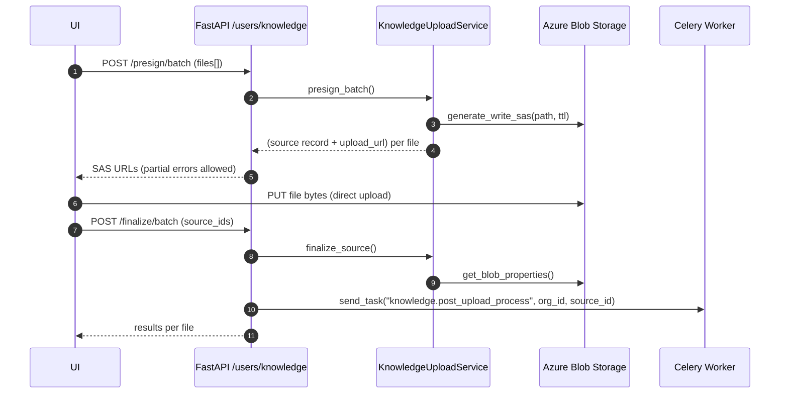

Knowledge Base Upload & Access (Technical)

Scope: src/api/routers/knowledge_base and services it uses

Overview
- Upload flow: Client requests presigned SAS URLs, uploads blobs directly to Azure, then calls finalize to trigger background processing.
- Access flow: List sources with key‑set pagination and filters; generate short‑lived read SAS URLs; stream status via SSE (Redis pub/sub).
- Tenancy: Every DB operation runs under an organisation‑scoped Session with search_path set to the org schema, then public.

API surface (mounted under `/users/knowledge`)
- POST `/presign/batch` → returns per‑file SAS upload URLs.
- POST `/finalize/batch` → marks sources uploaded, creates jobs, enqueues processing.
- GET `/source/{source_id}` → returns current state + optional read SAS link + metadata.
- GET `/sources/stream` → SSE stream of status updates for specified IDs or all non‑terminal IDs.
- GET `/sources` → paginated list (cursor) with optional filters; optional thumbnail/read URLs.
- GET `/source/{source_id}/download` → read SAS URL for original blob.
- DELETE `/source/{source_id}` → soft‑delete and enqueue async cleanup.

Key models and schemas
- DB: `OrganisationSource` (status enum, blob paths, checksum, thumbnails), `KnowledgeProcessingJob` (per‑source jobs), `OrganisationDocument` (derived chunks).
- Pydantic (requests/responses):
  - Upload: `KnowledgeBatchPresignRequest`, `KnowledgeBatchPresignResponse`, `KnowledgeBatchFinalizeRequest`, `KnowledgeSourceResponse`, `KnowledgeSourceEventUpdate`.
  - Access: `KnowledgeSourcesPage`, `KnowledgeSourceListItem`, `KnowledgeDownloadResponse`, `KnowledgeSourcesStats`, `KnowledgeDeleteResponse`.
- Response envelope: `GenericResponse[T]` via `src/api/utils/http_response.Response` helpers.

Architecture and dependencies
- Routers: `upload_handler.py`, `access_handler.py`.
- Services: `KnowledgeUploadService`, `KnowledgeAccessService`, `KnowledgeSourceSSEService`.
- Infra: `AzureOrganisationBlobStorage` (SAS read/write, thumbnails), `AsyncRedisPubSub` (Redis channels: `kb:{org_id}:sources`).
- Background: Celery app `src/workers/knowledge_worker/celery_app.py` publishes tasks:
  - `knowledge.post_upload_process` (checksum, thumbnails, extraction, etc.)
  - `knowledge.delete_source` (cleanup DB + blobs)
- Tenancy: `get_org_session(org_id)` applies search_path to `"{tenant_schema}", public` for the lifetime of the request.

Upload batch flow


SSE status flow
```mermaid
sequenceDiagram
  participant UI
  participant API as /sources/stream (SSE)
  participant SSE as KnowledgeSourceSSEService
  participant Redis as Redis Pub/Sub
  participant DB as Org DB (search_path)

  UI->>API: GET /sources/stream?source_ids=...
  API->>SSE: stream_events(explicit_ids)
  SSE->>DB: select non‑terminal sources (user+org scoped)
  SSE-->>UI: "status" event with initial snapshot
  Redis-->>SSE: messages {source_id, status, ...}
  SSE-->>UI: "status" events; emits "complete" when all terminal
```

Listing and download
- List: key‑set pagination over `(created_at DESC, source_id DESC)` with `limit+1` probe row. Cursor is `encode_cursor(ts, id)`.
- Filters: status (enum values), type (file/integration), filename search (`ILIKE %q%`). Soft‑deleted rows (`is_deleted`) are excluded.
- Optional URLs: when `include_urls=true`, SAS URLs for thumbnails are generated concurrently via `asyncio.gather`.
- Download: validates org+user ownership and `storage_path`, then returns a read SAS URL with optional Content‑Disposition filename.

Tenancy and security
- Session scoping: `get_org_session()` yields a Session with `SET search_path TO "{tenant}", public` and resets it after response. No code should mutate search_path inside services.
- Access control: All DB queries constrain by `organisation_id` and `user_id`. SSE limits updates to the current user’s sources.
- SAS links: Short‑lived, generated per request. Upload uses write permissions; downloads use read permissions with optional download filename.

Error handling
- Domain errors: `KnowledgeUploadServiceError`, `KnowledgeAccessServiceError`, `KnowledgeSSEError` carry `status_code` for router translation.
- Envelope: `Response.error_response(status_code, message, data?)` used for consistent API shape.
- Partial success: Batch presign/finalize accumulates errors per item and returns successes alongside failures.

Configuration knobs (env)
- Upload limits: `KNOWLEDGE_MAX_UPLOAD_FILE_SIZE_BYTES` (default 100MB), `KNOWLEDGE_ALLOWED_MIMETYPES` (defaults include `application/pdf`, `text/plain`).
- Redis: From `Config().get_redis_client_details`; async client required (redis>=5 recommended).
- Azure Storage: `ORGANISATION_STORAGE_NAME` (single account, container per org). Credentials via Default/Workload/Managed Identity depending on env.

Data model highlights
- `OrganisationSource` fields: `status`, `storage_path`, `thumbnail_small_path`, `thumbnail_medium_path`, `checksum`, `is_deleted`, timestamps.
- Terminal statuses: `COMPLETED`, `FAILED`. SSE treats others as active.
- Jobs: `KnowledgeProcessingJob` tracks `post_upload_process` and `document_extraction` phases.

Performance notes
- Presign: No DB write until upload SAS is issued and record is prepared; errors per file don’t block the batch.
- SSE: Streams only relevant IDs; heartbeats every ~25s; returns `complete` when all watched sources reach terminal state.
- Thumbnails: URL generation deferred unless requested; concurrency used when building page items.

Operational tips
- Look for logs under loggers: `knowledge_upload_handler`, `knowledge_access_handler`, `knowledge_sse_service`, `azure_org_blob_storage`, `redis_pubsub`.
- Redis channels: `kb:{org_id}:sources` for knowledge updates. Ensure workers publish here after state changes.
- Be careful to close async clients (`service.close()` in routers) to avoid unclosed session warnings.

