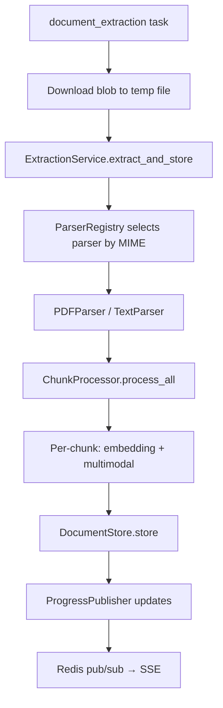

# Knowledge Base Upload & Access (Technical)

Scope: src/api/routers/knowledge_base, src/service/knowledge, src/api/schemas/knowledge_*.py

Overview

- Upload flow: client requests presigned SAS URLs, uploads blobs directly to Azure, then calls finalize to trigger background processing.
- Access flow: list sources with cursor pagination and filters; generate short-lived read SAS URLs; stream status via SSE (Redis pub/sub).
- Tenancy: every DB operation runs under an organisation-scoped Session with `search_path` set to the org schema.

API Surface (mounted under `/users/knowledge`)

- POST `/presign/batch` — returns per-file SAS upload URLs.
- POST `/finalize/batch` — marks sources uploaded; enqueues processing.
- GET `/source/{source_id}` — returns current state + optional read SAS + metadata.
- GET `/sources/stream` — SSE stream for specified IDs or all non-terminal IDs.
- GET `/sources` — paginated list (cursor) with optional filters; optional thumbnail/read URLs.
- GET `/source/{source_id}/download` — read SAS URL for original blob.
- DELETE `/source/{source_id}` — soft-delete and enqueue async cleanup.

Response Envelope

- All endpoints respond with `GenericResponse[T]` (see `src/api/schemas/base_models.py`).

Pydantic Schemas (Uploads)

- Source of truth: `src/api/schemas/knowledge_upload_models.py`
- Optional fields are declared as `Optional[...]` or have defaults; all others are required.

```python
from typing import Optional, List, Dict, Any
from uuid import UUID
from pydantic import BaseModel, Field, HttpUrl

class KnowledgePresignFileRequest(BaseModel):
    filename: str = Field(..., min_length=1, max_length=255)
    mimetype: str
    size_bytes: int = Field(..., gt=0)

class KnowledgeBatchPresignRequest(BaseModel):
    files: List[KnowledgePresignFileRequest]
    default_filters: Dict[str, Any] | None = None
    client_batch_id: Optional[str] = Field(default=None, max_length=100)

class KnowledgePresignFileResponse(BaseModel):
    source_id: UUID
    filename: str
    mimetype: str
    size_bytes: int
    upload_url: Optional[HttpUrl] = None
    expires_in_seconds: int = 0
    status: str
    error_message: Optional[str] = None
    success: bool = True

class KnowledgeBatchPresignResponse(BaseModel):
    files: List[KnowledgePresignFileResponse]
    errors: List[Dict[str, Any]] = []

class KnowledgeFinalizeRequest(BaseModel):
    source_id: UUID
    checksum: Optional[str] = None

class KnowledgeBatchFinalizeRequest(BaseModel):
    files: List[KnowledgeFinalizeRequest]

class KnowledgeSourceResponse(BaseModel):
    source_id: UUID
    filename: Optional[str]
    mimetype: Optional[str]
    size_bytes: Optional[int]
    status: str
    created_at: str  # ISO8601
    updated_at: str  # ISO8601
    error_message: Optional[str] = None
    storage_path: Optional[str] = None
    read_url: Optional[HttpUrl] = None
    filters: Dict[str, Any] = {}
    checksum: Optional[str] = None
    thumbnail_small_path: Optional[str] = None
    thumbnail_medium_path: Optional[str] = None

class KnowledgeSourceEventUpdate(BaseModel):
    source_id: str
    status: str
    updated_at: Optional[str] = None
    error_message: Optional[str] = None
    progress: Optional[int] = None
    thumbnail_small_url: Optional[str] = None
    thumbnail_medium_url: Optional[str] = None
```

Pydantic Schemas (Access)

- Source of truth: `src/api/schemas/knowledge_access_models.py`

```python
from typing import List, Optional, Dict
from uuid import UUID
from pydantic import BaseModel, HttpUrl, Field

class KnowledgeSourceListItem(BaseModel):
    source_id: UUID
    filename: Optional[str]
    mimetype: Optional[str]
    size_bytes: Optional[int]
    status: str
    created_at: str  # ISO8601
    updated_at: str  # ISO8601
    error_message: Optional[str] = None
    checksum: Optional[str] = None
    thumbnail_small_url: Optional[HttpUrl] = None
    thumbnail_medium_url: Optional[HttpUrl] = None

class KnowledgeSourcesPage(BaseModel):
    items: List[KnowledgeSourceListItem]
    cursor: Optional[str] = None

class KnowledgeDownloadResponse(BaseModel):
    source_id: UUID
    download_url: HttpUrl
    expires_in_seconds: int = Field(default=120 * 60)

class KnowledgeSourcesStats(BaseModel):
    total: int
    by_status: Dict[str, int]
    by_type: Dict[str, int]

class KnowledgeDeleteResponse(BaseModel):
    source_id: UUID
    status: str
```

Examples

- Batch presign request

```json
{
  "files": [
    { "filename": "a.pdf", "mimetype": "application/pdf", "size_bytes": 1000 },
    { "filename": "b.txt", "mimetype": "text/plain", "size_bytes": 2000 }
  ]
}
```

- List page (truncated)

```json
{
  "items": [
    {
      "source_id": "...",
      "filename": "a.pdf",
      "status": "processing",
      "thumbnail_small_url": null
    }
  ],
  "cursor": null
}
```

## Architecture and Dependencies

- Routers: `upload_handler.py`, `access_handler.py`.
- Services: `KnowledgeUploadService`, `KnowledgeAccessService`, `KnowledgeSourceSSEService`.
- Infra: `AzureOrganisationBlobStorage` (SAS read/write, thumbnails), `AsyncRedisPubSub` (channels `kb:{org_id}:sources`).
- Background: Celery `src/workers/knowledge_worker/celery_app.py` tasks.

## Background Worker Tasks

|Task|Purpose|Trigger|
|-----|---------|--------|
| `knowledge.post_upload_process` | Checksum validation, thumbnail generation | `finalize/batch` API |
| `knowledge.document_extraction` | PDF/DOC text extraction, chunking, embeddings | After post_upload_process |
| `knowledge.delete_source` | Blob cleanup, DB hard-delete | `DELETE /source/{id}` API |

### Extraction Pipeline Architecture



### Key Services (src/workers/knowledge_worker/services/)

|Service|Responsibility|
|---------|---------------|
| `ExtractionService` | Orchestrates parse → process → store pipeline |
| `ChunkProcessor` | Handles embedding generation, multimodal analysis |
| `ProgressPublisher` | Publishes progress events to Redis |
| `TaskHelperService` | Status management, job validation |

### Task Configuration

```python
@app.task(
    name="knowledge.document_extraction",
    bind=True,
    acks_late=True,
    max_retries=3,
    default_retry_delay=60,
    time_limit=1800,       # 30 min hard limit
    soft_time_limit=1680,  # 28 min soft limit
)
```

SSE Status Flow

```mermaid
sequenceDiagram
  participant UI
  participant API as /sources/stream (SSE)
  participant SSE as KnowledgeSourceSSEService
  participant Redis as Redis Pub/Sub
  participant DB as Org DB (search_path)

  UI->>API: GET /sources/stream?source_ids=...
  API->>SSE: stream_events(explicit_ids)
  SSE->>DB: select non-terminal sources (user+org scoped)
  SSE-->>UI: "status" event (initial snapshot)
  Redis-->>SSE: messages {source_id, status, ...}
  SSE-->>UI: "status" events; emits "complete" when all terminal
```

### SSE Event Types

|Event Type|Purpose|Payload|
|------------|---------|--------|
| `status` | Source status/progress update | `KnowledgeSourceEventUpdate[]` |
| `deleted` | Source permanently removed | `[{source_id, status: "deleted", progress: 100}]` |
| `complete` | All watched sources terminal | `{message: "all_sources_completed"}` |
| `ping` | Heartbeat (every 25s) | `{timestamp: <unix_epoch>}` |
| `timeout` | Stream timeout (15 min) | `{message, timeout_seconds, reconnect: true}` |
| `error` | Server error occurred | `{message, error_type, reconnect: true}` |

### Terminal Statuses

SSE stops tracking when source reaches: `completed`, `failed`, `deleting`, `deleted`

```python
TERMINAL_STATUSES = {
    OrganisationSourceStatus.COMPLETED,
    OrganisationSourceStatus.FAILED,
    OrganisationSourceStatus.DELETING,
}
DELETION_COMPLETE_STATUSES = {"deleted"}
```

### Extraction Progress Stages

During `extracting` status, `progress` field updates through these stages:

|Progress|Stage|Description|
|----------|-------|-------------|
| 5% | Job started | Task picked up by Celery worker |
| 20% | Document parsed | PDF/DOC parsed, pages extracted |
| 20-80% | Chunk processing | Per-chunk embedding + multimodal analysis |
| 90% | Storing results | Writing chunks to knowledge base |
| 100% | Complete | Extraction finished successfully |

Progress formula during chunk processing: `progress = 20 + (chunk_index / total_chunks) * 60`

Listing and Download

- List: cursor over `(created_at DESC, source_id DESC)`; cursor is opaque and must be echoed back verbatim.
- Filters: status (enum), type (file/integration), filename search (`ILIKE %q%`), `updated_after` (datetime). Soft-deleted rows are excluded.
- **Failed exclusion**: By default, `failed` status is excluded from results. To fetch failed files, explicitly pass `statuses=failed`.
- **Time filter**: Use `updated_after` parameter to fetch recent failures (e.g., last 7 days).
- **is_active field**: Each list item includes `is_active: bool` indicating if SSE monitoring is needed.
- Optional URLs: when `include_urls=true`, SAS URLs for thumbnails are generated concurrently.
- Download: validates org+user ownership and `storage_path`, then returns a read SAS URL.

Tenancy and Security

- Session scoping: `get_org_session()` applies `SET search_path TO "{tenant}", public` for the request lifetime.
- Access control: all DB queries constrain by `organisation_id` and `user_id`. SSE limited to current user.
- SAS links: short-lived; uploads use write permission; downloads use read permission with optional filename.

Error Handling

- Domain errors carry `status_code` for router translation.
- Envelope helpers produce consistent responses; batch operations accumulate per-file errors.

Configuration

- Upload limits: `KNOWLEDGE_MAX_UPLOAD_FILE_SIZE_BYTES` (default 100MB), `KNOWLEDGE_ALLOWED_MIMETYPES`.
- Redis: from `Config().get_redis_client_details`; async client required (redis>=5 recommended).
- Azure Storage: `ORGANISATION_STORAGE_NAME` (single account, container per org).

Performance Notes

- Presign: per-file validation; partial failures do not block the batch.
- SSE: heartbeats every 25s; stream timeout after 900s (15 min); returns `complete` when all watched sources reach terminal state.
- Thumbnails: generated at ~20% extraction progress; SAS URLs expire after 120 minutes.
- Progress updates: published per-chunk during extraction for granular UI feedback.
- Redis channel pattern: `kb:{org_id}:sources` - one channel per organisation.

Operational Tips

- Logs: `knowledge_upload_handler`, `knowledge_access_handler`, `knowledge_sse_service`, `azure_org_blob_storage`, `redis_pubsub`.
- Close async clients in routers to avoid unclosed session warnings.
