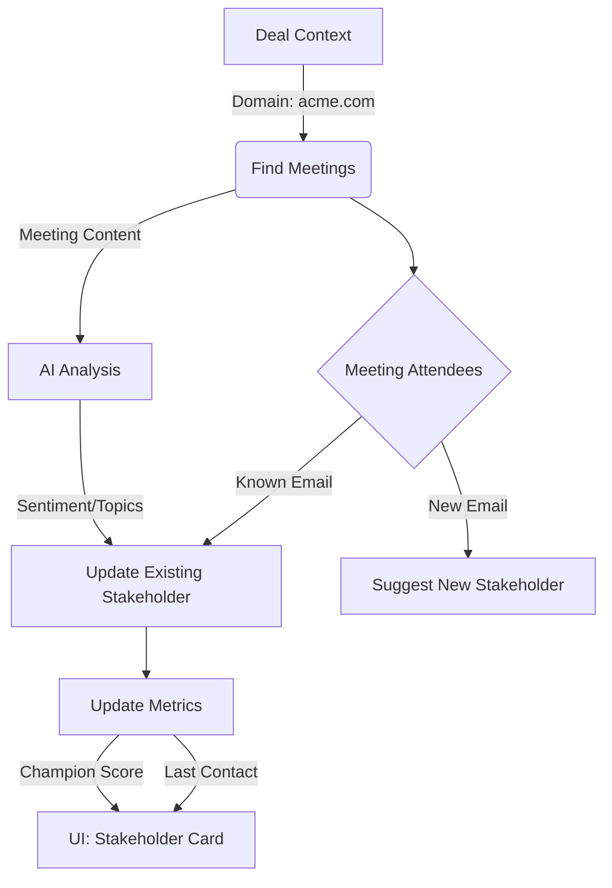

# Stakeholder Discovery & Enrichment Strategy

## Executive Summary

**Recommendation: Find Meetings First.**

To populate the "Stakeholders" screen with high-value insights (like "Champion Potential", "Last Contact", and "Motivation"), you should treat **Meetings (and Communications)** as the primary source of truth.

Static CRM Contact lists are often outdated. The people *actually attending meetings* are your real stakeholders.

## The "Activity-First" Workflow

### Step 1: The Foundation (Deal Context)

* **Input:** Deal ID + Company Domain (e.g., `acme.com`).
* **Action:** Identify the "Search Space".

### Step 2: Activity Discovery (The "Net")

* **Action:** Run the `DealMeetingMatcher` (which we just designed).
* **Output:** A timeline of all meetings linked to this deal.
* **Why First?** This dataset contains the raw evidence of *who* is involved and *how often*.

### Step 3: Stakeholder Extraction & Enrichment

Once you have the meetings, you derive the Stakeholder data from them:

1. **Identify Participants:** Extract all unique email addresses from the meeting attendees.
2. **Map to CRM:**
    * **Match:** If the email exists in `CRMContact`, link it.
    * **Discover:** If the email is *new* (but matches the domain), flag it as a "New Stakeholder" to be added.
3. **Calculate Metrics (The "Stakeholder Screen" Data):**
    * **Last Contact:** `MAX(meeting_date)` for that person.
    * **Engagement Score:** Count of meetings attended in the last 30/60/90 days.
    * **Role Identification:** If they organize the meetings, they might be a "Project Lead".

### Step 4: AI Insight Generation (The "Briefing Room" & "Insights")

* **Input:** Meeting Transcripts / Notes from the identified meetings.
* **Processing:**
  * **Motivation:** Analyze what this person asks about (e.g., "Security" vs. "Budget").
  * **Sentiment:** Are they objecting or supporting? (Drives "Champion Potential").
  * **Blockers:** Did they say "No"? (Drives "Blocker" tag).

## Data Flow Diagram

## Comparative Analysis: Stakeholders First vs. Meetings First

### Option A: Stakeholders First (Traditional CRM Approach)

*Start by fetching all `CRMContact` records linked to the Company.*

| **Pros** | **Cons** |
| :--- | :--- |
| **Simplicity:** Very easy to query (`SELECT * FROM contacts WHERE company_id = X`). | **Misses Hidden Players:** Won't find the "Shadow Buying Committee" (Legal, Security, IT) who attend meetings but aren't in the CRM yet. |
| **Official Record:** Matches exactly what is in Salesforce/HubSpot, avoiding "unofficial" data. | **No Engagement Context:** You get a list of names, but no idea who is active. "Last Contact" requires a separate, heavy query anyway. |
| **Speed:** Instant initial load time (no processing required). | **Stale Data:** Includes people who left the company or moved roles but weren't updated in the CRM. |
| | **Low AI Value:** Without meeting content linked to them, you can't generate "Motivation" or "Champion Potential". |

### Option B: Meetings First (Activity-Led Growth Approach)

*Start by finding all `CalendarEvents` linked to the Deal, then extract attendees.*

| **Pros** | **Cons** |
| :--- | :--- |
| **High Accuracy:** Shows who is *actually* showing up to calls. Filters out inactive contacts automatically. | **Complexity:** Requires the `DealMeetingMatcher` logic to run first (Domain/Owner matching). |
| **Discovery:** Automatically finds new stakeholders (e.g., the external consultant invited to the call) and suggests adding them. | **Potential Noise:** Might pick up an admin assistant or recruiter if the matching logic isn't tight. |
| **Rich Insights:** You immediately have the data for "Last Contact", "Meeting Count", and "Topics Discussed". | **Privacy:** Needs careful handling to ensure personal meetings aren't accidentally linked (mitigated by Domain matching). |
| **AI-Ready:** Directly links the person to the *content* of the meeting, enabling Sentiment and Motivation analysis. | |

## Why "Stakeholders First" is the Wrong Approach

If you start by just fetching the list of Contacts attached to the Company in the CRM:

1. **You miss the "Shadow Buying Committee":** People from other departments (Legal, Security) who were invited to a call but aren't formally in your CRM yet.
2. **No Context:** You have a name, but you don't know if they are active. "Last Contact" would be empty without the meeting data.
3. **Stale Data:** CRM data is often manually entered and old. Meeting data is real-time and automatic.

## Implementation Impact

1. **`DealMeetingMatcher` is Critical:** It is the engine that powers the Stakeholder view.
2. **New Service Needed:** `StakeholderService`.
    * Method: `sync_stakeholders_from_meetings(deal_id)`
    * Logic: Iterates through the `CalendarEventDealAssociation` records, aggregates attendee data, and updates the `CRMContact` or a specific `DealStakeholder` table.
