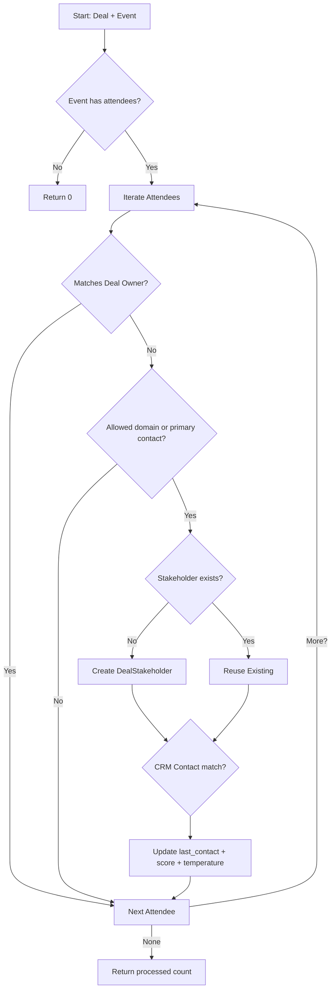

# Stakeholder Sync Logic Flow

## 1. Objective

When a calendar event is associated with a CRM deal we automatically extract the external attendees to keep the deal's stakeholder list fresh. The Stakeholder Service converts raw meeting attendees into `DealStakeholder` rows, links them to existing CRM contacts when possible, and updates engagement metrics the Briefing Room/Stakeholder views rely on.

## 2. Logic Overview

The sync runs per `(deal, event)` pair and follows these steps:

### Step 1: Validate Inputs

- Skip processing if the `CalendarEvent` has no attendees.
- Normalise comparison emails (lowercase) to avoid duplicates.

### Step 2: Filter Internal Owners & Validate Domains

- If the attendee email matches the deal owner's email (or the technical owner) we ignore it to avoid adding internal reps as stakeholders.
- Derive the internal domains from these owner emails and drop any attendee whose domain matches.
- Build the "allowed" customer domain set from the deal's company domain and primary contact emails (including any linked CRM contact addresses).
- Only attendees from the allowed customer domains proceed, **except** when the attendee email matches the primary contact — primary contacts are always accepted even if domain inference fails.

### Step 3: Resolve Existing Stakeholder

- Query `DealStakeholder` by `deal_id` + attendee email.
- If found, reuse the record; otherwise create a new stakeholder with:
  - `organisation_id`, `integration_id`, `deal_id`
  - `email`, optional `name` (from attendee display name)
  - Initial defaults: `source=CALENDAR_DISCOVERY`, `stance=UNKNOWN`, `temperature=COLD`, `engagement_score=0`.

### Step 4: Link to CRM Contact (Optional)

- Look up `CRMContact` by organisation + email.
- If found:
  - Set `contact_id` and upgrade `source` to `CRM`.
  - Backfill `name`/`job_title` from the contact when missing.

### Step 5: Update Engagement Metrics

- `last_contact_at`: overwrite when this event's `start_at` is newer than the stored timestamp.
- `engagement_score`: increment by `1.0` for each processed meeting.
- `temperature`: simple heuristic (`>5 → HOT`, `>2 → WARM`, otherwise COLD).

### Step 6: Persist

- Add newly created stakeholders to the session.
- Commit handled by the caller (deal worker or API) after processing all events.

## 3. Process Flow Chart

## 4. Implementation Details

- **Service:** `src/workers/deal_worker/services/stakeholder_service.py`
- **Entry Point:** `StakeholderService.sync_stakeholders_from_event`
- **Models Used:**
  - `CalendarEvent` & `CalendarEvent.attendees`
  - `DealStakeholder`
  - `CRMContact`
- **Current Trigger:** Called by `DealMeetingMatcher` after linking an event to a deal. Upcoming work will route this through a dedicated Celery task so APIs (manual meeting confirmations) can reuse the same sync flow asynchronously.

This logic keeps the stakeholder graph aligned with the latest meetings, ensuring downstream features (Briefing Room, Validation Plan, Stakeholder tab) have accurate names, titles, and engagement data.
