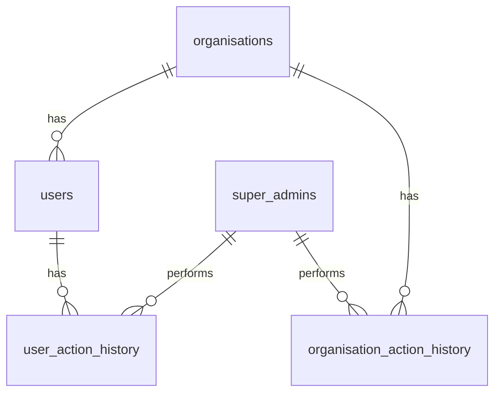

# Master Database Schema Documentation

This document provides a comprehensive overview of the database schema for the master tables.

## Table of Contents

- [Overview](#overview)
- [Entity-Relationship Diagram](#entity-relationship-diagram)
- [Tables](#tables)
  - [organisations](#organisations)
  - [organisation_action_history](#organisation_action_history)
  - [users](#users)
  - [user_action_history](#user_action_history)
  - [super_admins](#super_admins)
- [Production-Grade Considerations](#production-grade-considerations)

## Overview

The master database schema is designed to manage organisations, users, and super admins. It is responsible for storing data related to organisation profiles, user accounts, and administrative actions. The schema is built using SQLModel, which provides a clean and modern way to define database models in Python.

## Entity-Relationship Diagram

## Tables

### `organisations`

-   **Purpose**: Stores information about each organisation.
-   **Columns**:
    -   `organisation_id` (UUID, PK): Unique UUID for the organisation.
    -   `organisation_name` (str): Organisation/company name.
    -   `sales_team_size` (int): Headcount for the organisation's sales team.
    -   `country` (str): Primary country of registration or operation.
    -   `company_address` (str): Physical or mailing address for the company.
    -   `linked_urls` (JSON): List of linked URLs related to the organisation.
    -   `website_urls` (JSON): List of primary website URLs for the organisation.
    -   `summary` (Text): Freeform summary or overview about the organisation.
    -   `is_active` (bool): Status flag indicating if the organisation is active.
    -   `logo_url` (str): URL pointing to the organisation's logo.
    -   `status` (Enum): Lifecycle status for the organisation.
    -   `created_by_auth_user_id` (str): Supabase auth.users.id of the user who created the organisation.
    -   `approved_by` (UUID, FK): UUID of the admin who approved the organisation.
    -   `approved_at` (datetime): Timestamp when the organisation was approved.

### `organisation_action_history`

-   **Purpose**: Records major events and actions related to an organisation.
-   **Columns**:
    -   `id` (UUID, PK): Unique UUID for this organisation action history record.
    -   `organisation_id` (UUID, FK): UUID of the organisation this action references.
    -   `actor_admin_id` (UUID, FK): UUID of admin who performed this organisation action.
    -   `request_id` (str): Client request ID for this action.
    -   `action` (Enum): Type of organisation event recorded.
    -   `note` (Text): Optional comment or note for this action.
    -   `details` (JSON): Additional structured data or metadata for the action.

### `users`

-   **Purpose**: Stores information about each user.
-   **Columns**:
    -   `user_id` (UUID, PK): Unique UUID for the user record.
    -   `supabase_user_id` (str): Unique user ID from Supabase authentication provider.
    -   `organisation_id` (UUID, FK): UUID of the organisation this user belongs to.
    -   `first_name` (str): User's first name.
    -   `last_name` (str): User's last name.
    -   `email` (EmailStr): User's primary email address.
    -   `user_role` (Enum): Application-level role (MEMBER, ADMIN, etc.).
    -   `organisation_role` (str): User's job designation within the organisation.
    -   `job_title` (str): Optional job title for the user.
    -   `status` (Enum): Supabase authentication status.
    -   `admin_status` (Enum): Admin approval status.
    -   `email_verified` (bool): Indicates if the user's email address has been verified.
    -   `last_login_at` (datetime): Timestamp of the user's most recent login.
    -   `created_by_auth_user_id` (str): Supabase auth.users.id of the admin who created the user.
    -   `approved_by` (UUID, FK): UUID of the admin who approved the user.
    -   `approved_at` (datetime): Timestamp when the user was approved by an admin.

### `user_action_history`

-   **Purpose**: Records major events and actions related to a user.
-   **Columns**:
    -   `id` (UUID, PK): Unique UUID for this action history record.
    -   `user_id` (UUID, FK): User UUID this action is associated with.
    -   `actor_admin_id` (UUID, FK): UUID of the admin who performed the action.
    -   `request_id` (str): Client request ID for idempotency/debugging.
    -   `action` (Enum): Type of user action/event recorded.
    -   `note` (Text): Optional human-readable note for this action event.
    -   `details` (JSON): Arbitrary structured data or metadata about the action.

### `super_admins`

-   **Purpose**: Stores information about super admins.
-   **Columns**:
    -   `admin_id` (UUID, PK): Unique UUID for the super admin record.
    -   `supabase_user_id` (str): Unique user ID from Supabase authentication provider.
    -   `email` (EmailStr): Super admin's email address.
    -   `first_name` (str): Super admin's first name.
    -   `last_name` (str): Super admin's last name.
    -   `role` (Enum): Role type of the super admin.
    -   `status` (Enum): Supabase authentication status for the super admin account.
    -   `admin_status` (Enum): Admin approval status.
    -   `last_login_at` (datetime): Timestamp of the super admin's most recent login.
    -   `email_verified` (bool): Whether the super admin's email has been verified.

## Production-Grade Considerations

The database schema is designed with several production-grade considerations in mind:

-   **Data Integrity**:
    -   Foreign key constraints are used to maintain referential integrity between tables.
    -   Unique constraints are used to prevent duplicate entries.
    -   Enum types are used to restrict the values of certain columns to a predefined set.
-   **Scalability**:
    -   UUIDs are used as primary keys to allow for distributed database setups.
    -   Indexing is used on frequently queried columns to improve query performance.
    -   The use of JSON columns provides flexibility for storing unstructured data without requiring schema migrations.
-   **Security**:
    -   The schema separates user and admin data into different tables.
    -   Action history tables provide an audit trail of all major events.
-   **Maintainability**:
    -   The schema is well-documented and organized into logical domains.
    -   The use of SQLModel makes the schema easy to understand and maintain.
    -   Timestamp mixins (`CreatedAtMixin`, `TimestampMixin`) provide consistent tracking of record creation and updates.