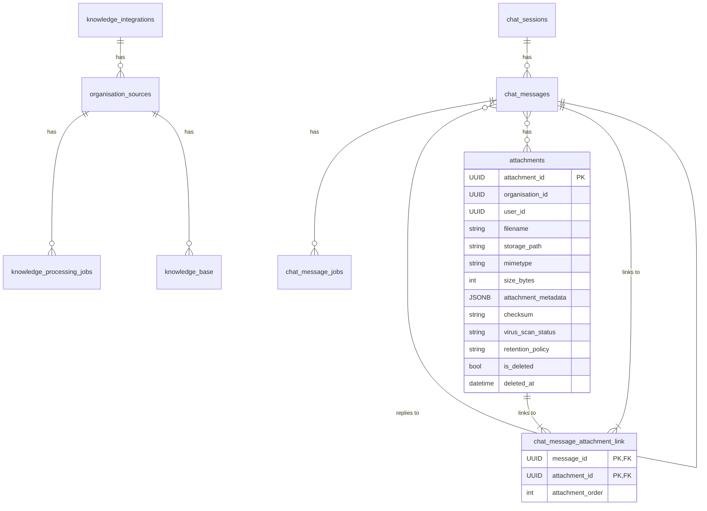

# Database Schema Documentation

This document provides a comprehensive overview of the database schema for the organisation-specific tables.

## Table of Contents

- [Overview](#overview)
- [Entity-Relationship Diagram](#entity-relationship-diagram)
- [Tables](#tables)
  - [chat_sessions](#chat_sessions)
  - [chat_messages](#chat_messages)
  - [attachments](#attachments)
  - [chat_message_attachment_link](#chat_message_attachment_link)
  - [chat_message_jobs](#chat_message_jobs)
  - [knowledge_integrations](#knowledge_integrations)
  - [organisation_sources](#organisation_sources)
  - [knowledge_base](#knowledge_base)
  - [knowledge_processing_jobs](#knowledge_processing_jobs)
- [Production-Grade Considerations](#production-grade-considerations)

## Overview

The database schema is designed to support a robust and scalable chat application with knowledge base integration. It is responsible for storing data related to chat sessions, messages, attachments, background jobs, and knowledge base documents. The schema is built using SQLModel, which provides a clean and modern way to define database models in Python.

## Entity-Relationship Diagram

## Tables

### `chat_sessions`

-   **Purpose**: Stores metadata for each chat session.
-   **Columns**:
    -   `session_id` (UUID, PK): Primary key for the chat session.
    -   `user_id` (UUID): The ID of the user who created the session.
    -   `organisation_id` (UUID): The ID of the organisation this session belongs to.
    -   `title` (str): The title of the chat session.
    -   `chat_type` (Enum): The type of chat, used for categorization (e.g., `GENERAL_CHAT`, `TECHNICAL_DECK`).
    -   `chat_version` (str): Version of the chat schema.
    -   `properties` (JSONB): A flexible JSONB column for storing additional session properties.
    -   `tags` (JSONB): A list of tags for categorizing the chat session.
    -   `is_deleted` (bool): Flag to mark the session as deleted without permanent removal.

### `chat_messages`

-   **Purpose**: Stores individual chat messages for all sessions.
-   **Columns**:
    -   `message_id` (UUID, PK): Primary key for the chat message.
    -   `session_id` (UUID, FK): Foreign key linking to the chat session.
    -   `parent_message_id` (UUID, FK): The ID of the parent message if this is a reply.
    -   `role` (Enum): The role of the message sender (e.g., `user`, `assistant`).
    -   `message_type` (Enum): The type of message, used for categorization.
    -   `message_version` (int): Version of the message schema.
    -   `content` (JSONB): The JSON content of the message.
    -   `is_edited` (bool): Flag to indicate if the message has been edited.
    -   `feedback_score` (int): User feedback score for the message.
    -   `token_usage` (JSONB): Token usage for the message.
    -   `model_name` (str): The name of the model that generated this message.
    -   `extra` (JSONB): Extra metadata for the message.
    -   `technical_deck_details` (JSONB): Details specific to technical deck generation.
    -   `rfp_details` (JSONB): Details specific to RFP sheet processing.

### `attachments`

-   **Purpose**: Represents a centrally-managed file attachment.
-   **Columns**:
    -   `attachment_id` (UUID, PK): Primary key for the attachment.
    -   `organisation_id` (UUID): The organisation this attachment belongs to.
    -   `user_id` (UUID): The user who uploaded the attachment.
    -   `filename` (str): The original filename of the attachment.
    -   `storage_path` (str): The path to the file in the storage backend.
    -   `mimetype` (str): The MIME type of the file.
    -   `size_bytes` (int): The size of the file in bytes.
    -   `attachment_metadata` (JSONB): Additional metadata for the attachment.
    -   `checksum` (str): File checksum for integrity verification.
    -   `virus_scan_status` (str): Virus scan status.
    -   `retention_policy` (str): Data retention policy identifier.
    -   `is_deleted` (bool): Soft delete flag.
    -   `deleted_at` (datetime): Soft delete timestamp.

### `chat_message_attachment_link`

-   **Purpose**: Association table for the many-to-many relationship between chat messages and attachments.
-   **Columns**:
    -   `message_id` (UUID, PK, FK): Foreign key to `chat_messages`.
    -   `attachment_id` (UUID, PK, FK): Foreign key to `attachments`.
    -   `attachment_order` (int): Display order of attachment in message.

### `chat_message_jobs`

-   **Purpose**: Represents a job associated with a chat message, such as generating a technical deck.
-   **Columns**:
    -   `job_id` (UUID, PK): Primary key for the job.
    -   `message_id` (UUID, FK): Foreign key linking to the chat message.
    -   `job_type` (str): The type of job.
    -   `status` (Enum): The current status of the job.
    -   `job_metadata` (JSONB): Additional metadata for the job.
    -   `result_data` (JSONB): Result data of the job upon completion or failure.
    -   `error_message` (str): Error message if the job failed.

### `knowledge_integrations`

-   **Purpose**: Stores information about integrations with external knowledge sources (e.g., Slack, Jira).
-   **Columns**:
    -   `integration_id` (UUID, PK): Primary key for the integration.
    -   `organisation_id` (UUID): The organisation this integration belongs to.
    -   `integration_type` (Enum): The type of integration.
    -   `name` (str): User-defined name for the integration.
    -   `credentials` (JSONB): Encrypted credentials for the integration.
    -   `is_active` (bool): Whether the integration is active.
    -   `last_synced_at` (datetime): When the integration was last synced.

### `organisation_sources`

-   **Purpose**: Represents an original, uploaded document or an integration that serves as a source for the knowledge base.
-   **Columns**:
    -   `source_id` (UUID, PK): Primary key for the knowledge source.
    -   `organisation_id` (UUID): The organisation this source belongs to.
    -   `user_id` (UUID): The user who uploaded the source.
    -   `source_type` (Enum): The type of source (`FILE` or `INTEGRATION`).
    -   `filename` (str): The original filename of the source document.
    -   `storage_path` (str): The path to the file in the storage backend.
    -   `mimetype` (str): The MIME type of the file.
    -   `size_bytes` (int): The size of the file in bytes.
    -   `integration_id` (UUID, FK): Foreign key to `knowledge_integrations`.
    -   `last_synced_at` (datetime): When the integration was last synced.
    -   `status` (Enum): The current processing status of the document.
    -   `error_message` (str): Stores any error message if processing failed.

### `knowledge_base`

-   **Purpose**: Stores the processed chunks of documents from the knowledge sources, along with their embeddings.
-   **Columns**:
    -   `document_id` (UUID, PK): Primary key for the knowledge base document/chunk.
    -   `source_id` (UUID, FK): Foreign key to the original source document.
    -   `name` (str): Name of the document.
    -   `meta_data` (JSONB): Metadata for the document.
    -   `filters` (JSONB): Filters for the document.
    -   `content` (str): The text content of the document chunk.
    -   `embedding` (Vector): The vector embedding of the content.
    -   `usage` (JSONB): Usage statistics for the document.
    -   `content_hash` (str): Hash of the content to detect duplicates.

### `knowledge_processing_jobs`

-   **Purpose**: Represents a job for processing a knowledge source.
-   **Columns**:
    -   `job_id` (UUID, PK): Primary key for the job.
    -   `source_id` (UUID, FK): Foreign key linking to the knowledge source.
    -   `job_type` (str): The type of job.
    -   `status` (Enum): The current status of the job.
    -   `job_metadata` (JSONB): Additional metadata for the job.
    -   `result_data` (JSONB): Result data of the job upon completion or failure.
    -   `error_message` (str): Error message if the job failed.

## Production-Grade Considerations

The database schema is designed with several production-grade considerations in mind:

-   **Data Integrity**:
    -   Foreign key constraints are used to maintain referential integrity between tables.
    -   Check constraints (e.g., `chat_message_version_positive`) ensure data validity.
    -   Enum types are used to restrict the values of certain columns to a predefined set.
-   **Scalability**:
    -   UUIDs are used as primary keys to allow for distributed database setups.
    -   Indexing is used on frequently queried columns to improve query performance.
    -   The use of JSONB columns provides flexibility for storing unstructured data without requiring schema migrations.
-   **Security**:
    -   Soft deletes (`is_deleted` flag) are used to prevent accidental data loss.
    -   Sensitive data, such as credentials in `knowledge_integrations`, should be encrypted.
-   **Maintainability**:
    -   The schema is well-documented and organized into logical domains.
    -   The use of SQLModel makes the schema easy to understand and maintain.
    -   Timestamp mixins (`CreatedAtMixin`, `TimestampMixin`) provide consistent tracking of record creation and updates.