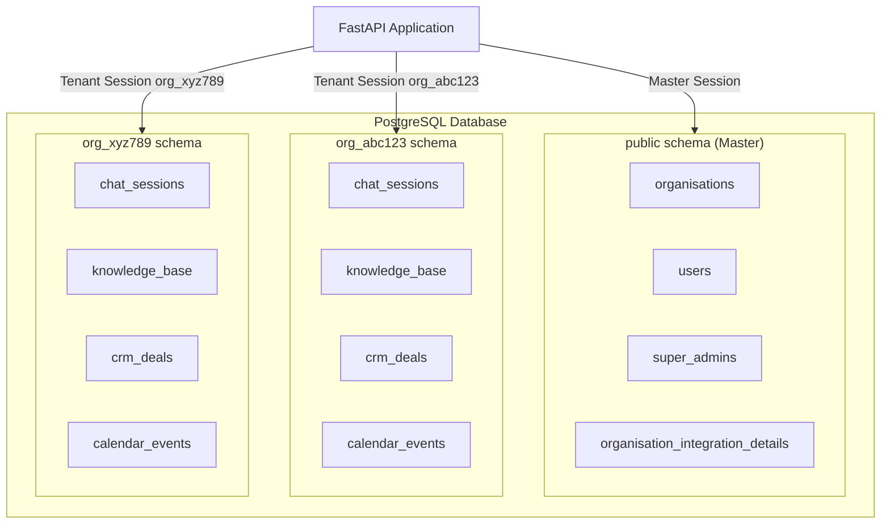
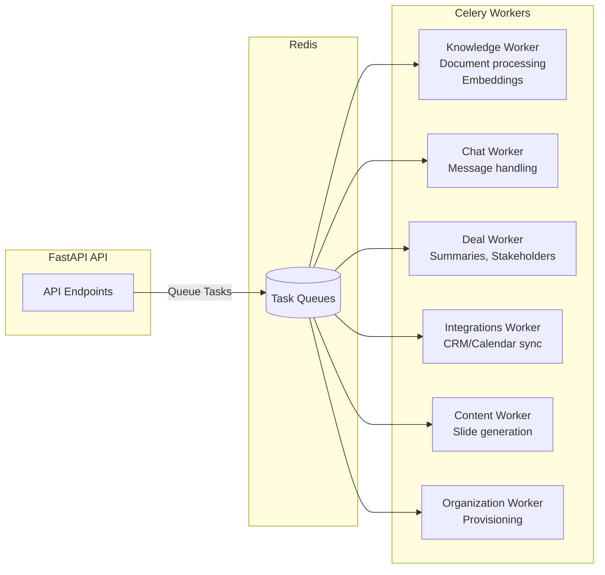

# CopilotGTM Backend - Project Overview

This document provides a comprehensive overview of the CopilotGTM backend application for new developers and stakeholders.

## Introduction

CopilotGTM is a **B2B Pre-Sales and Sales Application** designed to help sales teams manage their deals, engage with prospects, and leverage AI-powered insights throughout the sales cycle.

**Key Characteristics:**

- **Multi-tenant SaaS Architecture**: Each organization operates in its own isolated database schema
- **AI-Powered**: Leverages Azure OpenAI for intelligent deal analysis, stakeholder insights, and automated content generation
- **Integration-First**: Connects with popular CRM, calendar, email, and communication platforms

## Multi-Tenant Database Architecture

The system implements a **schema-based multi-tenancy model** where each organization gets its own isolated PostgreSQL schema while sharing the same database instance.

### Two Database Connection Types

1. **Master Connection**: Connects to the `public` schema for global/administrative data
2. **Organization Connection**: Connects to tenant-specific schemas (`org_{organisation_id}`)



### Master Tables (Global Data)

Located in `src/domain/models/master_tables/`:

| Table | Purpose |
|-------|---------|
| `organisations` | Organization registry, lifecycle status, settings |
| `users` | Platform users linked to organizations via Supabase auth |
| `super_admins` | Platform administrators for approval workflows |
| `organisation_integration_details` | Master-level integration connection mappings |
| `organisation_action_history` | Audit log for organization lifecycle events |
| `user_action_history` | Audit log for user events |

### Organization Tables (Tenant-Scoped Data)

Located in `src/domain/models/organisation_tables/`:

- **Chat**: Sessions, messages, attachments, processing jobs
- **Knowledge Base**: Sources, documents/chunks, embeddings (pgvector)
- **CRM**: Deals, contacts, companies, activities, pipelines
- **Calendar**: Events, attendees, deal associations
- **Integrations**: Connection configs, sync history
- **Deal Intelligence**: Risks/blockers, stakeholders, timeline, notes

## Technology Stack

| Category | Technology |
|----------|------------|
| **Language** | Python 3.11+ |
| **Framework** | FastAPI with Uvicorn (ASGI) |
| **Database** | PostgreSQL 16 with pgvector extension |
| **ORM** | SQLModel / SQLAlchemy 2.0 |
| **Migrations** | Alembic (separate master + org migrations) |
| **Task Queue** | Celery 5.5 with Redis broker |
| **AI/ML** | Azure OpenAI, Agno framework, Transformers |
| **Authentication** | Supabase (JWT-based) |
| **Cloud Services** | Azure (Blob Storage, Key Vault, OpenAI) |
| **Package Manager** | UV (fast Python package manager) |
| **Document Processing** | Docling, PyPDF, python-docx, python-pptx |
| **Integrations** | Nango (OAuth provider management) |

## Project Structure

```
copilot-backend/
├── src/
│   ├── main.py              # FastAPI application entry point
│   ├── api/                 # REST API layer
│   │   ├── routers/         # Endpoint handlers by domain
│   │   ├── dependencies/    # FastAPI dependency injection
│   │   └── fastapi_app.py   # App configuration and middleware
│   ├── agents/              # AI agent workflows
│   │   ├── workflows/       # Specialized agents (deal summary, stakeholder, etc.)
│   │   ├── tools/           # Agent tools (search, CRM access)
│   │   └── context/         # Execution context management
│   ├── domain/              # Database models
│   │   └── models/
│   │       ├── master_tables/       # Global schema models
│   │       └── organisation_tables/ # Tenant-scoped models
│   ├── service/             # Business logic layer
│   │   ├── chat/            # Chat session/message services
│   │   ├── crm/             # Deal, stakeholder, risk services
│   │   ├── integrations/    # Integration and sync services
│   │   └── knowledge_base/  # Document processing services
│   ├── workers/             # Celery background workers
│   │   ├── knowledge_worker/    # Heavy ML processing
│   │   ├── chat_worker/         # Chat message handling
│   │   ├── deal_worker/         # Deal analysis jobs
│   │   └── integrations_worker/ # CRM/calendar sync
│   └── infra/               # Infrastructure layer
│       ├── database/        # Connection providers (sync/async)
│       ├── auth/            # Authentication handlers
│       ├── storage/         # Azure Blob Storage
│       ├── secrets/         # Azure Key Vault
│       └── messaging/       # Redis pub/sub
├── migrations/
│   ├── master_migrations/   # Public schema migrations
│   └── org_migrations/      # Per-tenant schema migrations
├── tests/                   # Unit and integration tests
├── docs/                    # Documentation
├── charts/                  # Kubernetes Helm charts
├── Dockerfile               # Multi-stage production build
└── pyproject.toml           # Project configuration
```

## Key Features & Functionality

### 1. Chat System

AI-powered conversational interface with:

- Multiple chat types (General Chat, Technical Deck, RFP Sheet)
- File attachments with processing status tracking
- Server-Sent Events (SSE) for real-time streaming
- Message threading support

### 2. Knowledge Base

Document management and semantic search:

- Upload support: PDF, Word, PowerPoint, text files
- Automated document parsing and chunking
- Vector embeddings (pgvector) for semantic search
- RAG (Retrieval-Augmented Generation) for AI responses
- Organization-wide or user-specific document visibility

### 3. CRM Integration

Synchronized CRM data from external providers:

- **HubSpot** - Full sync (Available)
- **Salesforce** - Leads, opportunities (Beta)

Synced entities: Deals, Contacts, Companies, Activities, Owners, Pipelines

### 4. Calendar Integration

Meeting and event synchronization:

- **Google Calendar** (Beta)
- **Outlook Calendar** (Available)

Features: Event sync, attendee tracking, deal-meeting associations

### 5. Communication Integration

Email and messaging platform connectivity:

- **Email**: Gmail, Outlook Email
- **Messaging**: Microsoft Teams, Slack
- **Conversation Intelligence**: Gong (Beta)

### 6. Deal Management

Comprehensive deal tracking and intelligence:

- **Timeline**: Stage progression and event history
- **Risks & Blockers**: Track deal obstacles with severity levels
- **Stakeholders**: Contact roles, engagement levels, champion scores
- **Notes**: Deal-specific notes with participant context
- **Tasks**: Action items and follow-ups

### 7. AI Agents

Specialized AI workflows for sales intelligence:

| Agent | Purpose |
|-------|---------|
| **General Agent** | Chat with knowledge base search and web search |
| **Deal Summary Agent** | Generate comprehensive deal summaries |
| **Stakeholder Analysis** | Extract stance, decision power, engagement levels |
| **Risk/Blocker Extraction** | Identify risks from meetings and emails |
| **Briefing Agent** | Generate executive briefing documents |

## Worker Architecture

Background job processing via Celery with Redis as the message broker:



### Worker Responsibilities

| Worker | Dependencies | Tasks |
|--------|--------------|-------|
| **Knowledge Worker** | Docling, Transformers, Torch | Document extraction, chunking, embedding generation |
| **Chat Worker** | Light | Post-upload processing, message handling |
| **Deal Worker** | Light | Deal summaries, stakeholder analysis, meeting jobs |
| **Integrations Worker** | CRM adapters | Token refresh, CRM sync, calendar sync, email sync |
| **Content Worker** | python-pptx | Slide outline generation, presentation creation |
| **Organization Worker** | Light | Organization provisioning, schema creation |

## API Structure

### Admin Endpoints (`/api/admin/`)

- **Auth**: Admin login, password management
- **Organizations**: Create, manage, approve organizations
- **Users**: User management, role assignment

### Chat Endpoints (`/api/chat/`)

- Sessions: Create, list, delete chat sessions
- Messages: Send messages, list history, feedback
- Attachments: Upload, access file attachments

### CRM Endpoints (`/api/crm/`)

- **Deals**: List deals, get details, statistics, health indicators
- **Meetings**: Meeting data linked to deals
- **Stakeholders**: Stakeholder information and insights
- **Risks & Blockers**: CRUD for deal risks
- **Notes**: Deal notes management
- **Timeline**: Deal stage progression history

### Integration Endpoints (`/api/integrations/`)

- OAuth: Connect/disconnect integrations
- Status: Integration connection status
- Deal Integrations: Link messaging channels to deals

### Knowledge Base Endpoints (`/api/knowledge-base/`)

- Upload: Document upload with processing
- Access: Query knowledge base

## Integration Framework

### Nango OAuth Management

Third-party integrations are managed via [Nango](https://www.nango.dev/), which handles:

- OAuth 2.0 authentication flows
- Token storage and automatic refresh
- Connection lifecycle management

### Supported Integrations

| Integration | Type | Status |
|-------------|------|--------|
| HubSpot | CRM | Available |
| Salesforce | CRM | Beta |
| Google Calendar | Calendar | Beta |
| Outlook Calendar | Calendar | Available |
| Gmail | Email | Available |
| Outlook Email | Email | Available |
| Microsoft Teams | Messaging | Available |
| Slack | Messaging | Available |
| Gong | Conversation Intelligence | Beta |
| Google Drive | Storage | Coming Soon |
| OneDrive | Storage | Coming Soon |
| Notion | Knowledge | Coming Soon |
| Confluence | Knowledge | Coming Soon |

## Getting Started

### Prerequisites

- Python 3.11+
- PostgreSQL 16 with pgvector extension
- Redis 6+
- Azure account (for storage, Key Vault, OpenAI)
- Supabase project (for authentication)

### Local Development

1. Install dependencies:

   ```bash
   uv sync --all-extras
   ```

2. Configure environment variables (see `.env.example`)

3. Run migrations:

   ```bash
   python -m scripts.run_master_migrations
   python -m scripts.run_org_migrations
   ```

4. Start the API:

   ```bash
   uvicorn src.main:app --reload --port 8080
   ```

5. Start workers (in separate terminals):

   ```bash
   celery -A src.workers.knowledge_worker worker --loglevel=info
   celery -A src.workers.integrations_worker worker --loglevel=info
   ```

### Docker Development

```bash
docker-compose up
```

## Further Reading

For more detailed documentation, see:

- [Database Architecture](Technical%20Documentation/database/database-architecture.md)
- [CRM Integration Architecture](Technical%20Documentation/integration/crm-integration-architecture.md)
- [Knowledge Base](Technical%20Documentation/knowledge-base.md)
- [Chat System](Technical%20Documentation/chat/chat.md)
- [Local Development Setup](Technical%20Documentation/local-development-setup-guide.md)
