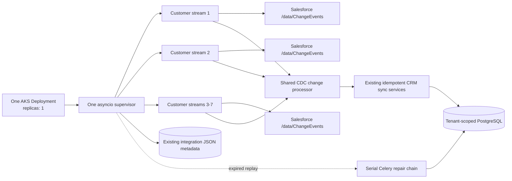

# Shared Salesforce CDC Connector Worker Implementation Plan

> **For agentic workers:** REQUIRED SUB-SKILL: Use superpowers:subagent-driven-development
> (recommended) or superpowers:executing-plans to implement this plan task-by-task. Steps use
> checkbox (`- [ ]`) syntax for tracking.

**Status:** Ready for implementation. Production enablement remains a separate explicitly approved
operation.

**Goal:** Replace per-object, hour-bounded Salesforce CDC Celery subscribers with one continuously
running Kubernetes worker that safely serves at most seven Salesforce customer integrations for the
next twelve months without creating a pod or process per customer.

**Architecture:** Deploy exactly one `salesforce-cdc-worker` pod containing one Python asyncio
supervisor process. The supervisor discovers eligible tenant integrations and runs at most seven
independent coroutines, one aggregate `/data/ChangeEvents` Pub/Sub stream per Salesforce integration.
Each stream rotates its gRPC session every 45 minutes to refresh credentials and release transport
state, while the process itself runs continuously; replay cursors, leases, and health remain durable
in existing `knowledge_integrations.connection_metadata` JSON.

**Tech Stack:** Python 3.11, asyncio, Salesforce Pub/Sub gRPC/Avro client already installed in the
integrations image, SQLAlchemy/SQLModel tenant sessions, PostgreSQL JSON metadata, existing CRM
record sync services, Celery only for serial full-state repair, OpenTelemetry, pytest, Helm, AKS.

---

## Non-negotiable production contract

| Concern | Fixed decision for the next year |
|---|---|
| Customer capacity | Maximum 7 active Salesforce integrations across all tenants |
| Kubernetes shape | One Deployment, one replica, one pod |
| Runtime shape | One Python process and up to 7 asyncio stream coroutines |
| Salesforce subscription | One aggregate `/data/ChangeEvents` stream per integration |
| Customer isolation | Per-integration coroutine, lease, token, replay cursor, retry state, and logs |
| Pod scaling | Disabled; no HPA/KEDA and no pod-per-customer behavior |
| Eighth integration | Existing seven continue; the eighth is marked `capacity_exceeded`, is not started, and emits an alert |
| Stream lifetime | 45-minute gRPC sessions with immediate cursor-based reconnect inside the same process |
| Worker lifetime | Continuous until Kubernetes sends SIGTERM or restarts the pod |
| Crash recovery | Kubernetes restarts the same Deployment; supervisor resumes from committed replay cursors |
| Replay expiry | Serial current-state repair, then aggregate replay from `EARLIEST`; never reuse per-object replay IDs |
| Database | Reuse `knowledge_integrations.connection_metadata`; no migration or new event table |
| Image | Reuse the existing `integrations-worker` image and installed dependencies |

This design intentionally accepts a brief replay-backed interruption during a pod restart or
deployment. The single-replica requirement rules out runtime high availability, but Salesforce's
72-hour event retention makes a controlled restart safe when the committed cursor is healthy. A
second replica is not part of this plan.

## Why this replaces the current design

The current code creates one long-lived Celery task per object channel, caps each run at 3,300
seconds, and depends on that task to enqueue its successor. A pod OOM or hard kill bypasses the
handoff. One customer can also occupy more slots than the production integrations worker owns.

The new process owns the lifecycle instead:



There is no streaming Celery queue in the final state. Celery remains responsible only for bounded
full-state repair tasks, which already exist and are operationally observable.

## Runtime invariants

1. The supervisor never holds a master or tenant database session while waiting on Salesforce.
2. One integration failure cannot cancel or delay another integration coroutine.
3. Replay advances only after every supported record ID in the event is committed successfully.
4. Unsupported or disabled entity types are explicitly skipped and counted before replay advances.
5. A replay failure changes durable state to `repairing` before one serial repair chain is published.
6. A stream in `repairing`, `repair_failed`, or `capacity_exceeded` is not subscribed.
7. Lease renewal runs every 30 seconds independently of Salesforce events and keepalives.
8. The 120-second lease permits crash recovery without waiting for the 270-second Salesforce
   keepalive interval.
9. Each gRPC session runs for 2,700 seconds, then reconnects with a refreshed access token and the
   last committed aggregate replay ID.
10. SIGTERM stops discovery, cancels streams, closes gRPC clients, releases owned leases, flushes
    telemetry, and exits within 90 seconds.
11. A configured maximum above seven is rejected at startup. Capacity does not silently expand.
12. Per-object replay IDs are never copied into the aggregate cursor because replay IDs are
    stream-specific.
13. Aggregate subscription does not start while any legacy per-object lease is unexpired. Switching
    mode makes subsequent legacy renewals fail, so the old subscribers drain before the aggregate
    stream acquires its lease.

## Durable metadata contract

Keep legacy per-object entries during migration, but make this aggregate block authoritative when
`mode == "aggregate"`:

```json
{
  "salesforce_cdc": {
    "mode": "aggregate",
    "aggregate": {
      "enabled": true,
      "channel": "/data/ChangeEvents",
      "status": "pending",
      "replay_preset": "EARLIEST",
      "last_replay_id": null,
      "lease_owner": null,
      "lease_expires_at": null,
      "heartbeat_at": null,
      "last_event_at": null,
      "last_connected_at": null,
      "last_disconnected_at": null,
      "repair_attempts": 0,
      "repair_next_retry_at": null,
      "last_error_class": null,
      "last_error_message": null
    }
  }
}
```

Allowed aggregate statuses are `pending`, `active`, `error`, `repairing`, `repair_failed`,
`capacity_exceeded`, and `disabled`. The first committed replay ID changes `replay_preset` to
`CUSTOM`. A successful current-state repair resets the preset to `EARLIEST` and clears the old
aggregate replay ID.

## Planned file map

```text
src/
  infra/observability/metrics.py
  service/integrations/crm/orchestration/
    salesforce_cdc_repair_chain.py
  service/integrations/webhooks/salesforce/
    change_processor.py
    decoder.py
    metadata.py
    subscription_state.py
    types.py
  workers/integrations_worker/
    config.py
    tasks/__init__.py
    tasks/crm/__init__.py
    tasks/crm/salesforce/
      __init__.py
      salesforce_cdc_repair_tasks.py
      salesforce_cdc_subscriber_task.py
      salesforce_initial_sync_succeeded_task.py
  workers/salesforce_cdc_worker/
    __init__.py
    config.py
    connector.py
    healthcheck.py
    main.py
    supervisor.py

scripts/maintenance/
  enable_salesforce_aggregate_cdc.py
scripts/validation/
  salesforce_cdc_soak.py

tests/
  charts/test_worker_cronjobs.py
  infra/test_otel_runtime.py
  scripts/test_backend_pipeline_deploy.py
  scripts/test_enable_salesforce_aggregate_cdc.py
  scripts/test_salesforce_cdc_soak.py
  service/integrations/webhooks/salesforce/
    test_change_processor.py
    test_decoder.py
    test_metadata.py
    test_subscription_state.py
  workers/integrations_worker/
    providers/crm/salesforce/test_pubsub_client.py
    test_salesforce_cdc_repair_tasks.py
    test_salesforce_cdc_subscriber_task.py
    test_salesforce_initial_sync_succeeded_task.py
  workers/salesforce_cdc_worker/
    __init__.py
    test_config.py
    test_connector.py
    test_healthcheck.py
    test_supervisor.py

charts/application/
  Chart.yaml
  Chart.lock
  values.yaml
  values-dev.yaml
  values-prod.yaml
  charts/worker/values.yaml
  charts/worker/templates/deployment.yaml

.azure-pipelines/
  azure-backend-pipeline-dev.yml
  azure-backend-pipeline-prod.yml

scripts/deployment/local-deploy.ps1
docs/Technical Documentation/integrations/
  salesforce-cdc-webhook-sync.md
  salesforce-cdc-operations.md
```

No new package, database table, migration, Docker target, queue, or customer-specific manifest is
planned.

## Task 1: Add the aggregate event contract without changing current subscribers

**Files:**

- Modify: `src/service/integrations/webhooks/salesforce/types.py`
- Modify: `src/service/integrations/webhooks/salesforce/decoder.py`
- Modify: `src/service/integrations/webhooks/salesforce/metadata.py`
- Modify: `src/workers/integrations_worker/providers/crm/salesforce/pubsub_client.py`
- Test: `tests/service/integrations/webhooks/salesforce/test_decoder.py`
- Test: `tests/service/integrations/webhooks/salesforce/test_metadata.py`
- Test: `tests/workers/integrations_worker/providers/crm/salesforce/test_pubsub_client.py`

- [ ] **Step 1: Write failing aggregate decoder and replay-preset tests**

Add tests proving that `ChangeEventHeader.entityName` is returned, `/data/ChangeEvents` maps to the
`aggregate` metadata key, a cursor always selects `CUSTOM`, and no cursor can select `EARLIEST`.

```python
def test_decode_aggregate_change_event_returns_entity_name() -> None:
    event = decode_salesforce_change_event(
        replay_id=b"replay",
        schema_id="schema",
        payload={
            "ChangeEventHeader": {
                "entityName": "Opportunity",
                "recordIds": ["006xx0000000001AAA"],
                "changeType": "UPDATE",
            }
        },
        object_name=None,
        id_prefix=None,
    )
    assert event.entity_name == "Opportunity"


def test_salesforce_pubsub_can_start_aggregate_stream_from_earliest() -> None:
    pb2 = SimpleNamespace(
        ReplayPreset=SimpleNamespace(LATEST="latest", EARLIEST="earliest", CUSTOM="custom")
    )
    assert _replay_preset_for(None, pb2, start_from_earliest=True) == "earliest"
```

- [ ] **Step 2: Run the focused tests and confirm the contract is missing**

Run:

```powershell
uv run pytest tests/service/integrations/webhooks/salesforce/test_decoder.py tests/service/integrations/webhooks/salesforce/test_metadata.py tests/workers/integrations_worker/providers/crm/salesforce/test_pubsub_client.py -q
```

Expected: FAIL because `entity_name`, `AGGREGATE_CDC_CHANNEL`, and `start_from_earliest` do not yet
exist.

- [ ] **Step 3: Add the minimum aggregate contract**

Use these exact public shapes:

```python
AGGREGATE_CDC_CHANNEL = "/data/ChangeEvents"


@dataclass(slots=True, frozen=True)
class SalesforceChangeEvent:
    replay_id: bytes
    schema_id: str
    entity_name: str
    record_ids: tuple[str, ...]
    change_type: str
```

Make `decode_salesforce_change_event()` derive `entity_name` from
`ChangeEventHeader.entityName`. Preserve the current per-object name and ID-prefix validation when
those arguments are supplied; aggregate callers pass `None` and validate against the routing map
later.

Change `_replay_preset_for()` and `SalesforcePubSubClient.subscribe()` to accept
`start_from_earliest: bool = False`. Selection order must be `CUSTOM` when a cursor exists,
otherwise `EARLIEST` when requested, otherwise `LATEST`.

- [ ] **Step 4: Run focused tests**

Run the Step 2 command. Expected: PASS.

- [ ] **Step 5: Commit the event contract**

```powershell
git add src/service/integrations/webhooks/salesforce/types.py src/service/integrations/webhooks/salesforce/decoder.py src/service/integrations/webhooks/salesforce/metadata.py src/workers/integrations_worker/providers/crm/salesforce/pubsub_client.py tests/service/integrations/webhooks/salesforce/test_decoder.py tests/service/integrations/webhooks/salesforce/test_metadata.py tests/workers/integrations_worker/providers/crm/salesforce/test_pubsub_client.py
git commit -m "feat: add aggregate Salesforce CDC event contract"
```

## Task 2: Extract one shared record-change processor

**Files:**

- Create: `src/service/integrations/webhooks/salesforce/change_processor.py`
- Modify: `src/workers/integrations_worker/tasks/crm/salesforce/salesforce_cdc_subscriber_task.py`
- Create: `tests/service/integrations/webhooks/salesforce/test_change_processor.py`
- Modify: `tests/workers/integrations_worker/test_salesforce_cdc_subscriber_task.py`

- [ ] **Step 1: Add a failing routing test for the shared processor**

```python
@pytest.mark.asyncio
async def test_processor_routes_opportunity_without_importing_celery_task(monkeypatch) -> None:
    processed: list[str] = []

    async def capture_record(*, record_id: str, **_kwargs: object) -> None:
        processed.append(record_id)

    monkeypatch.setitem(change_processor._HANDLERS, "Opportunity", capture_record)

    await SalesforceCdcChangeProcessor().process(
        organisation_id=uuid4(),
        integration_id=uuid4(),
        entity_name="Opportunity",
        record_id="006xx0000000001AAA",
        change_type="UPDATE",
        instance_url="https://acme.my.salesforce.com",
    )

    assert processed == ["006xx0000000001AAA"]
```

- [ ] **Step 2: Verify the shared module is absent**

Run:

```powershell
uv run pytest tests/service/integrations/webhooks/salesforce/test_change_processor.py -q
```

Expected: collection FAIL because `change_processor.py` does not exist.

- [ ] **Step 3: Move, do not duplicate, the existing processing logic**

Move `_process_record_change`, all seven `_process_*_record_change` functions, and their delete/
source-mapping helpers from `salesforce_cdc_subscriber_task.py` into `change_processor.py`. Preserve
their current implementations and tests. Expose only this class:

```python
class SalesforceCdcChangeProcessor:
    async def process(
        self,
        *,
        organisation_id: UUID,
        integration_id: UUID,
        entity_name: str,
        record_id: str,
        change_type: str,
        instance_url: str,
    ) -> None:
        handler = _HANDLERS.get(entity_name)
        if handler is None:
            raise ValueError(f"Unsupported Salesforce CDC entity: {entity_name}")
        await handler(
            organisation_id=organisation_id,
            integration_id=integration_id,
            record_id=record_id,
            change_type=change_type,
            instance_url=instance_url,
        )
```

The legacy subscriber must call this class using the decoded `entity_name`; it must retain current
behavior while aggregate mode is disabled.

- [ ] **Step 4: Run processor and legacy regression tests**

```powershell
uv run pytest tests/service/integrations/webhooks/salesforce/test_change_processor.py tests/workers/integrations_worker/test_salesforce_cdc_subscriber_task.py -q
```

Expected: PASS with the same create/update/delete coverage as before extraction.

- [ ] **Step 5: Commit the extraction**

```powershell
git add src/service/integrations/webhooks/salesforce/change_processor.py src/workers/integrations_worker/tasks/crm/salesforce/salesforce_cdc_subscriber_task.py tests/service/integrations/webhooks/salesforce/test_change_processor.py tests/workers/integrations_worker/test_salesforce_cdc_subscriber_task.py
git commit -m "refactor: share Salesforce CDC change processing"
```

## Task 3: Make aggregate state and leases durable in existing metadata

**Files:**

- Modify: `src/service/integrations/webhooks/salesforce/subscription_state.py`
- Modify: `src/service/integrations/webhooks/salesforce/metadata.py`
- Test: `tests/service/integrations/webhooks/salesforce/test_subscription_state.py`
- Test: `tests/service/integrations/webhooks/salesforce/test_metadata.py`

- [ ] **Step 1: Add failing tests for aggregate state transitions**

Cover these exact transitions with the existing fake session/integration pattern: the owning worker
can stamp `heartbeat_at`; the first `mark_repairing` call returns `True`; a second call returns
`False`; `mark_repair_succeeded` returns `True`, changes status to `pending`, clears
`last_replay_id`, and sets `replay_preset` to `EARLIEST`; and an integration with no unexpired
per-object lease returns `False` from `has_active_legacy_leases`.

Also prove that a wrong lease owner cannot renew a lease or advance replay, and that changing mode
to `aggregate` makes a subsequent per-object lease renewal return `False`.

- [ ] **Step 2: Run tests and confirm missing fields/methods**

```powershell
uv run pytest tests/service/integrations/webhooks/salesforce/test_subscription_state.py tests/service/integrations/webhooks/salesforce/test_metadata.py -q
```

Expected: FAIL for the new aggregate fields and methods.

- [ ] **Step 3: Extend the existing row-locked state service**

Add `heartbeat_at`, `last_connected_at`, `last_disconnected_at`, `replay_preset`,
`repair_attempts`, and `repair_next_retry_at` to `SalesforceCdcSubscriptionState`. Reuse the existing
row-locking `SELECT FOR UPDATE` behavior for all transitions. Add `mark_heartbeat`,
`mark_connected`, `mark_disconnected`, `mark_repairing`, `mark_repair_failed`,
`mark_repair_succeeded`, `mark_capacity_exceeded`, and `has_active_legacy_leases`; every mutating
method takes `session`, `organisation_id`, `integration_id`, and aggregate `channel`, while
lease-owned transitions also require `lease_owner` and return `False` for a different owner.

`mark_repairing()` returns `False` when state is already `repairing`. `mark_repair_succeeded()`
clears the replay ID, sets `replay_preset="EARLIEST"`, resets attempts, and moves status to
`pending`. `has_active_legacy_leases()` checks every configured per-object entry against the current
UTC timestamp. `renew_lease()` refuses per-object renewal when aggregate mode is authoritative. Do
not create a migration; all fields are additive JSON keys.

- [ ] **Step 4: Run state tests**

Run the Step 2 command. Expected: PASS.

- [ ] **Step 5: Commit state support**

```powershell
git add src/service/integrations/webhooks/salesforce/subscription_state.py src/service/integrations/webhooks/salesforce/metadata.py tests/service/integrations/webhooks/salesforce/test_subscription_state.py tests/service/integrations/webhooks/salesforce/test_metadata.py
git commit -m "feat: persist aggregate Salesforce CDC state"
```

## Task 4: Build one per-integration aggregate connector coroutine

**Files:**

- Create: `src/workers/salesforce_cdc_worker/__init__.py`
- Create: `src/workers/salesforce_cdc_worker/connector.py`
- Create: `tests/workers/salesforce_cdc_worker/__init__.py`
- Create: `tests/workers/salesforce_cdc_worker/test_connector.py`

- [ ] **Step 1: Write failing connector tests**

Use fake Pub/Sub, state service, token provider, and processor objects. Prove:

- one aggregate channel is opened;
- `EARLIEST` is used only when no cursor exists and state requests it;
- each record ID is processed before replay is stored;
- keepalive updates heartbeat and replay without changing `last_event_at`;
- one failed record prevents replay advancement;
- a normal 45-minute stream exit reconnects inside the coroutine rather than enqueuing Celery;
- transport failures back off at `1, 2, 4, 8, 16, 32, 60` seconds plus bounded jitter;
- cancellation releases the owned lease;
- replay expiry publishes one repair and leaves the connector stopped in `repairing`.

The central ordering assertion is:

```python
assert operations == [
    "process:006xx0000000001AAA",
    "process:006xx0000000002AAA",
    "store_replay",
]
```

- [ ] **Step 2: Run the new test file**

```powershell
uv run pytest tests/workers/salesforce_cdc_worker/test_connector.py -q
```

Expected: collection FAIL because the connector module does not exist.

- [ ] **Step 3: Implement the connector with injected dependencies**

Use one object with a single public `run()` method:

```python
@dataclass(slots=True, frozen=True)
class SalesforceIntegrationRef:
    organisation_id: UUID
    integration_id: UUID
    instance_url: str
    salesforce_organization_id: str
    pubsub_endpoint: str
    enabled_entities: frozenset[str]


class SalesforceAggregateConnector:
    async def run(self, integration: SalesforceIntegrationRef, stop: asyncio.Event) -> None:
        """Maintain one replay-safe aggregate stream until stopped or repair is required."""
```

The connector acquires a 120-second aggregate lease, starts a 30-second lease-renewal coroutine,
refreshes the access token before every 2,700-second Pub/Sub session, and calls
`SalesforceCdcChangeProcessor.process()` sequentially. It must not import the Celery application or
hold a database session during gRPC waits/provider calls.

Map aggregate `entityName` values to the existing seven supported entities. Skip disabled or unknown
entities with a bounded metric/log label and advance replay after the deterministic skip.

- [ ] **Step 4: Run connector tests**

Run the Step 2 command. Expected: PASS.

- [ ] **Step 5: Commit the connector**

```powershell
git add src/workers/salesforce_cdc_worker/__init__.py src/workers/salesforce_cdc_worker/connector.py tests/workers/salesforce_cdc_worker/__init__.py tests/workers/salesforce_cdc_worker/test_connector.py
git commit -m "feat: add aggregate Salesforce connector"
```

## Task 5: Build the single-process seven-customer supervisor and health checks

**Files:**

- Create: `src/workers/salesforce_cdc_worker/config.py`
- Create: `src/workers/salesforce_cdc_worker/supervisor.py`
- Create: `src/workers/salesforce_cdc_worker/healthcheck.py`
- Create: `src/workers/salesforce_cdc_worker/main.py`
- Create: `tests/workers/salesforce_cdc_worker/test_config.py`
- Create: `tests/workers/salesforce_cdc_worker/test_supervisor.py`
- Create: `tests/workers/salesforce_cdc_worker/test_healthcheck.py`

- [ ] **Step 1: Write failing capacity, isolation, discovery, and shutdown tests**

Tests must prove all of the following:

```python
assert SalesforceCdcWorkerSettings(max_integrations=7).max_integrations == 7
with pytest.raises(ValueError, match="between 1 and 7"):
    SalesforceCdcWorkerSettings(max_integrations=8)
```

- approved organisations and active, initially synced Salesforce integrations are discovered through
  master then org-scoped sessions;
- sessions close before connector coroutines start;
- seven integrations create seven tasks inside one event loop;
- an eighth integration is not started and is marked `capacity_exceeded`;
- currently running integrations retain their slots when an eighth appears;
- a pending aggregate integration with any active legacy lease is not started;
- removing/deactivating an integration cancels only its task;
- an exception from one connector is logged/restarted without cancelling the other six;
- SIGTERM completes within 90 seconds;
- liveness checks only event-loop heartbeat freshness;
- readiness requires a successful discovery within 120 seconds and `running == desired` for all
  non-repairing integrations.

- [ ] **Step 2: Run the supervisor test set**

```powershell
uv run pytest tests/workers/salesforce_cdc_worker/test_config.py tests/workers/salesforce_cdc_worker/test_supervisor.py tests/workers/salesforce_cdc_worker/test_healthcheck.py -q
```

Expected: collection FAIL because the worker modules do not exist.

- [ ] **Step 3: Implement validated stdlib settings**

Use a frozen dataclass and `os.environ`; do not add a settings dependency.

```python
@dataclass(slots=True, frozen=True)
class SalesforceCdcWorkerSettings:
    max_integrations: int = 7
    discovery_seconds: int = 60
    stream_runtime_seconds: int = 2700
    lease_seconds: int = 120
    lease_renew_seconds: int = 30
    reconnect_max_seconds: int = 60
    shutdown_seconds: int = 90

    def __post_init__(self) -> None:
        if not 1 <= self.max_integrations <= 7:
            raise ValueError("max_integrations must be between 1 and 7")
```

- [ ] **Step 4: Implement tenant-safe discovery and reconciliation**

Follow the existing all-org Salesforce task pattern: query approved organisation IDs from the master
schema, then open one org-scoped session at a time to find active Salesforce integrations with
`initial_sync_status == "success"` and `salesforce_cdc.mode == "aggregate"`. Return detached
`SalesforceIntegrationRef` values only.

Reconcile every 60 seconds. Keep existing running keys first, then fill free slots in
`(created_at, organisation_id, integration_id)` order. Mark overflow entries without disrupting the
running seven. Before starting a pending aggregate connector, call
`has_active_legacy_leases()` and leave it pending until all old leases are expired or released.

- [ ] **Step 5: Implement process startup and health files**

`main.py` must configure logging, call `init_sentry()` and `async_init_otel("-salesforce-cdc-worker")`,
register SIGTERM/SIGINT, and run the supervisor. Update `/tmp/salesforce-cdc-worker-live` every 10
seconds and write readiness JSON atomically to `/tmp/salesforce-cdc-worker-ready.json`.

`healthcheck.py --live` exits nonzero when the heartbeat is older than 60 seconds.
`healthcheck.py --ready` exits nonzero when discovery is older than 120 seconds, capacity is exceeded,
or a desired non-repairing integration lacks a running connector.

- [ ] **Step 6: Run supervisor and import-boundary tests**

```powershell
uv run pytest tests/workers/salesforce_cdc_worker tests/workers/integrations_worker/test_import_boundary.py -q
```

Expected: PASS and no `src.api` import from the connector runtime.

- [ ] **Step 7: Commit the worker runtime**

```powershell
git add src/workers/salesforce_cdc_worker tests/workers/salesforce_cdc_worker
git commit -m "feat: supervise seven Salesforce CDC streams"
```

## Task 6: Add serial replay repair and cut over initial-sync handoff

**Files:**

- Create: `src/service/integrations/crm/orchestration/salesforce_cdc_repair_chain.py`
- Create: `src/workers/integrations_worker/tasks/crm/salesforce/salesforce_cdc_repair_tasks.py`
- Modify: `src/workers/integrations_worker/tasks/crm/salesforce/salesforce_initial_sync_succeeded_task.py`
- Modify: `src/workers/integrations_worker/tasks/crm/salesforce/salesforce_cdc_subscriber_task.py`
- Modify: `src/workers/integrations_worker/tasks/crm/salesforce/__init__.py`
- Modify: `src/workers/integrations_worker/tasks/crm/__init__.py`
- Modify: `src/workers/integrations_worker/tasks/__init__.py`
- Modify: `src/workers/integrations_worker/config.py`
- Create: `scripts/maintenance/enable_salesforce_aggregate_cdc.py`
- Create: `tests/workers/integrations_worker/test_salesforce_cdc_repair_tasks.py`
- Modify: `tests/workers/integrations_worker/test_salesforce_initial_sync_succeeded_task.py`
- Modify: `tests/workers/integrations_worker/test_salesforce_cdc_subscriber_task.py`
- Create: `tests/scripts/test_enable_salesforce_aggregate_cdc.py`

- [ ] **Step 1: Write failing repair and compatibility tests**

Prove the repair chain order is exactly:

```python
[
    "integrations.sync_salesforce_opportunity_schema",
    "integrations.sync_salesforce_pipelines",
    "integrations.sync_salesforce_users",
    "integrations.sync_salesforce_companies",
    "integrations.sync_salesforce_contacts",
    "integrations.sync_salesforce_deals",
    "integrations.sync_salesforce_tasks",
    "integrations.sync_salesforce_notes",
    "integrations.mark_salesforce_cdc_repair_succeeded",
]
```

Attach `integrations.mark_salesforce_cdc_repair_failed` as `link_error`. Also prove:

- aggregate replay failure publishes the repair chain only once;
- successful repair sets `pending` plus `EARLIEST` and does not enqueue a streaming Celery task;
- aggregate-enabled initial sync marks the connector pending instead of launching per-object tasks;
- a legacy subscriber seeing `mode == "aggregate"` returns `superseded` without requeue;
- an already-running legacy subscriber loses its next renewal after aggregate mode is selected;
- aggregate discovery waits until every legacy lease is expired/released;
- the maintenance script defaults to dry-run and never copies legacy replay IDs.

- [ ] **Step 2: Run focused tests and confirm missing repair flow**

```powershell
uv run pytest tests/workers/integrations_worker/test_salesforce_cdc_repair_tasks.py tests/workers/integrations_worker/test_salesforce_initial_sync_succeeded_task.py tests/workers/integrations_worker/test_salesforce_cdc_subscriber_task.py tests/scripts/test_enable_salesforce_aggregate_cdc.py -q
```

Expected: FAIL because aggregate repair/finalizer tasks do not exist.

- [ ] **Step 3: Implement a serial, fenced repair chain**

Build the exact chain above using existing task names and default
`start_cdc_after_success=False`. The connector must call an injected publisher only after
`mark_repairing()` wins its row lock. Failure state records bounded error text, increments
`repair_attempts`, and schedules no automatic full repair storm. Operations can rerun the repair
after resolving the error. Register the two finalizer tasks on the existing `integrations_priority`
queue with 120-second soft and 180-second hard limits; do not create a repair queue.

- [ ] **Step 4: Switch new and migrated integrations to supervisor discovery**

When `salesforce_cdc.mode == "aggregate"`, the initial-sync terminal writes aggregate `pending`
state and returns no `salesforce_cdc_task_ids`. Add an early aggregate-mode guard to the legacy task
before lease acquisition. Existing legacy subscribers must fail their next renewal and exit; the
supervisor must not start aggregate consumption until all legacy leases are inactive. Leave the
legacy task registered for one compatibility release so stale broker messages terminate harmlessly.

- [ ] **Step 5: Implement the safe migration CLI**

The script accepts one organisation and integration ID, validates active Salesforce identity and a
successful initial sync, displays the exact before/after metadata diff, and writes only when
`--apply` is passed. It sets `mode="aggregate"`, starts with `EARLIEST`, and preserves legacy entries
for rollback without copying their cursors.

```powershell
uv run python -m scripts.maintenance.enable_salesforce_aggregate_cdc --organisation-id d0a590bf-d364-4e0d-a4a1-4ad9d6525467 --integration-id f934b979-3024-45a3-8720-6455a3816343
```

Expected: dry-run output only; database unchanged.

- [ ] **Step 6: Run focused tests**

Run the Step 2 command. Expected: PASS.

- [ ] **Step 7: Commit repair and cutover support**

```powershell
git add src/service/integrations/crm/orchestration/salesforce_cdc_repair_chain.py src/workers/integrations_worker src/workers/salesforce_cdc_worker scripts/maintenance/enable_salesforce_aggregate_cdc.py tests/workers/integrations_worker tests/workers/salesforce_cdc_worker tests/scripts/test_enable_salesforce_aggregate_cdc.py
git commit -m "feat: repair and cut over aggregate Salesforce CDC"
```

## Task 7: Render exactly one dedicated worker pod

**Files:**

- Modify: `charts/application/Chart.yaml`
- Regenerate: `charts/application/Chart.lock`
- Modify: `charts/application/charts/worker/values.yaml`
- Modify: `charts/application/charts/worker/templates/deployment.yaml`
- Modify: `charts/application/values.yaml`
- Modify: `charts/application/values-dev.yaml`
- Modify: `charts/application/values-prod.yaml`
- Modify: `tests/charts/test_worker_cronjobs.py`

- [ ] **Step 1: Add failing Helm render assertions**

The production render must prove:

```python
assert deployment["spec"]["replicas"] == 1
assert deployment["spec"]["strategy"]["rollingUpdate"] == {
    "maxSurge": 0,
    "maxUnavailable": 1,
}
assert container["command"] == [
    "python", "-m", "src.workers.salesforce_cdc_worker.main"
]
assert container["resources"] == {
    "requests": {"cpu": "500m", "memory": "1Gi"},
    "limits": {"cpu": "1000m", "memory": "3Gi"},
}
assert "celery" not in " ".join(container["command"])
assert "SALESFORCE_CDC_MAX_INTEGRATIONS" in env_names
assert values["salesforce-cdc-worker"]["autoscaling"]["enabled"] is False
```

Also assert liveness/readiness call the custom healthcheck module, no Celery preStop hook is rendered,
and all existing Celery worker commands/probes remain byte-for-byte equivalent.

- [ ] **Step 2: Run the chart test and confirm the Deployment is missing**

```powershell
uv run pytest tests/charts/test_worker_cronjobs.py -q
```

Expected: FAIL because `copilot-backend-salesforce-cdc-worker` is absent.

- [ ] **Step 3: Extend the existing worker subchart without duplicating a Deployment template**

Add optional `config.command`, `config.env`, `probes.livenessCommand`, and
`probes.readinessCommand`. When command overrides are absent, preserve current Celery rendering.
When a command override is present, render it directly, use custom probes, and skip Celery consumer
drain logic.

- [ ] **Step 4: Add one chart alias and fixed values**

Add `salesforce-cdc-worker` as one alias of the existing worker chart. Use these production values:

```yaml
salesforce-cdc-worker:
  enabled: true
  replicaCount: 1
  image:
    repository: "copilotgtmacrprod.azurecr.io/copilot-backend-integrations-worker"
    tag: "latest"
  config:
    command: ["python", "-m", "src.workers.salesforce_cdc_worker.main"]
    env:
      - {name: SALESFORCE_CDC_MAX_INTEGRATIONS, value: "7"}
      - {name: SALESFORCE_CDC_DISCOVERY_SECONDS, value: "60"}
      - {name: SALESFORCE_CDC_STREAM_RUNTIME_SECONDS, value: "2700"}
      - {name: SALESFORCE_CDC_LEASE_SECONDS, value: "120"}
      - {name: SALESFORCE_CDC_LEASE_RENEW_SECONDS, value: "30"}
  updateStrategy:
    maxSurge: 0
    maxUnavailable: 1
  autoscaling:
    enabled: false
  shutdown:
    enabled: true
    gracefulPeriodSeconds: 90
  resources:
    requests: {cpu: "500m", memory: "1Gi"}
    limits: {cpu: "1000m", memory: "3Gi"}
  probes:
    livenessCommand: ["python", "-m", "src.workers.salesforce_cdc_worker.healthcheck", "--live"]
    readinessCommand: ["python", "-m", "src.workers.salesforce_cdc_worker.healthcheck", "--ready"]
```

Use the integrations-worker image and existing worker service account/workload identity. Do not add a
Service, HPA, KEDA ScaledObject, Redis queue, or customer-specific Helm value.

- [ ] **Step 5: Regenerate dependencies and run chart tests**

```powershell
helm dependency update charts/application
uv run pytest tests/charts/test_worker_cronjobs.py -q
helm template copilot-backend charts/application -f charts/application/values.yaml -f charts/application/values-prod.yaml > $null
```

Expected: PASS; one `copilot-backend-salesforce-cdc-worker` Deployment and zero scaler resources for
it.

- [ ] **Step 6: Commit the chart**

```powershell
git add charts/application tests/charts/test_worker_cronjobs.py
git commit -m "feat: deploy one shared Salesforce CDC worker"
```

## Task 8: Wire the shared image and rollout wait into deployment pipelines

**Files:**

- Modify: `.azure-pipelines/azure-backend-pipeline-dev.yml`
- Modify: `.azure-pipelines/azure-backend-pipeline-prod.yml`
- Modify: `scripts/deployment/local-deploy.ps1`
- Modify: `tests/scripts/test_backend_pipeline_deploy.py`

- [ ] **Step 1: Add failing pipeline assertions**

For both pipelines assert that the shared worker receives the same integrations image tag and worker
identity, and that rollout waits for `copilot-backend-salesforce-cdc-worker`. Assert no second image
build or repository variable is introduced.

- [ ] **Step 2: Run pipeline tests**

```powershell
uv run pytest tests/scripts/test_backend_pipeline_deploy.py -q
```

Expected: FAIL because the new Helm values and wait target are absent.

- [ ] **Step 3: Reuse the integrations image in dev, prod, and local deploy**

Add only these value overrides beside the existing integrations-worker overrides:

```text
--set salesforce-cdc-worker.image.repository="$ACR_LOGIN_SERVER/$(INTEGRATIONS_IMAGE_REPOSITORY)"
--set salesforce-cdc-worker.image.tag="$BUILD_BUILDID"
--set salesforce-cdc-worker.workloadIdentity.clientId="$(WORKLOAD_IDENTITY_WORKERS_CLIENT_ID)"
--set salesforce-cdc-worker.workloadIdentity.tenantId="$(WORKLOAD_IDENTITY_WORKERS_TENANT_ID)"
```

Use each pipeline's existing variables directly; do not add a new build target. Add
`wait_if_present copilot-backend-salesforce-cdc-worker` to rollout verification and diagnostics.

- [ ] **Step 4: Run pipeline tests**

Run the Step 2 command. Expected: PASS.

- [ ] **Step 5: Commit deployment wiring**

```powershell
git add .azure-pipelines/azure-backend-pipeline-dev.yml .azure-pipelines/azure-backend-pipeline-prod.yml scripts/deployment/local-deploy.ps1 tests/scripts/test_backend_pipeline_deploy.py
git commit -m "ci: deploy shared Salesforce CDC worker"
```

## Task 9: Add production observability and operations documentation

**Files:**

- Modify: `src/infra/observability/metrics.py`
- Modify: `tests/infra/test_otel_runtime.py`
- Modify: `docs/Technical Documentation/integrations/salesforce-cdc-webhook-sync.md`
- Create: `docs/Technical Documentation/integrations/salesforce-cdc-operations.md`

- [ ] **Step 1: Add failing low-cardinality metric tests**

Add instruments for stream connection outcomes, events, record outcomes, reconnect delay, repairs,
and capacity. Labels are limited to `outcome`, `entity`, and `reason`; organisation and integration
IDs belong only in structured logs.

Required metric names:

```text
copilotgtm.salesforce.cdc.connection.count
copilotgtm.salesforce.cdc.event.count
copilotgtm.salesforce.cdc.record.count
copilotgtm.salesforce.cdc.reconnect.delay
copilotgtm.salesforce.cdc.repair.count
copilotgtm.salesforce.cdc.capacity.count
```

- [ ] **Step 2: Run observability tests**

```powershell
uv run pytest tests/infra/test_otel_runtime.py -q
```

Expected: FAIL because the CDC instruments do not exist.

- [ ] **Step 3: Implement lazy metrics and structured event names**

Follow the existing lazy meter initialization pattern. Emit structured events named
`salesforce_cdc_discovery`, `salesforce_cdc_connected`, `salesforce_cdc_disconnected`,
`salesforce_cdc_replay_committed`, `salesforce_cdc_repair_started`,
`salesforce_cdc_repair_failed`, and `salesforce_cdc_capacity_exceeded`.

- [ ] **Step 4: Write the operating runbook**

The runbook must include exact read-only checks for:

- Deployment replica count, command, image, resources, restart count, and last termination reason;
- worker live/ready files and aggregate desired/running/capacity counts;
- per-integration aggregate status, heartbeat, lease expiry, replay presence, and last event time;
- repair task active/reserved/scheduled state and sync-history result;
- 72-hour replay-expiry consequence and serial repair procedure;
- rollback to legacy mode without copying aggregate replay to per-object entries;
- explicit statement that production enable/repair/rollback commands require fresh approval.

Alert thresholds:

- pod OOM or restart count increase: page immediately;
- process heartbeat older than 60 seconds: page immediately;
- desired stream not running for 5 minutes: page;
- aggregate heartbeat older than 6 minutes while Salesforce is reachable: page;
- `repair_failed`: page;
- capacity usage `7/7`: warning;
- `capacity_exceeded`: page and reject onboarding of the eighth integration.

- [ ] **Step 5: Update architecture documentation**

Replace per-object worker ownership with the single aggregate supervisor model. Retain the legacy
section only as migration/rollback history. Link these exact Salesforce sources:

- `https://developer.salesforce.com/docs/platform/pub-sub-api/references/methods/subscribe-rpc.html`
- `https://developer.salesforce.com/docs/platform/pub-sub-api/guide/event-message-durability.html`
- `https://developer.salesforce.com/docs/platform/pub-sub-api/guide/allocations.html`
- `https://developer.salesforce.com/blogs/2021/07/pub-sub-api-building-event-driven-integrations-just-got-even-easier`

- [ ] **Step 6: Run observability tests and documentation checks**

```powershell
uv run pytest tests/infra/test_otel_runtime.py -q
git diff --check
```

Expected: PASS with no whitespace errors.

- [ ] **Step 7: Commit observability and docs**

```powershell
git add src/infra/observability/metrics.py tests/infra/test_otel_runtime.py "docs/Technical Documentation/integrations/salesforce-cdc-webhook-sync.md" "docs/Technical Documentation/integrations/salesforce-cdc-operations.md"
git commit -m "docs: operate shared Salesforce CDC worker"
```

## Task 10: Run the complete implementation verification

**Files:**

- Create: `scripts/validation/salesforce_cdc_soak.py`
- Create: `tests/scripts/test_salesforce_cdc_soak.py`

- [ ] **Step 1: Run the complete focused suite**

```powershell
uv run pytest tests/service/integrations/webhooks/salesforce tests/workers/salesforce_cdc_worker tests/workers/integrations_worker/test_salesforce_cdc_subscriber_task.py tests/workers/integrations_worker/test_salesforce_cdc_repair_tasks.py tests/workers/integrations_worker/test_salesforce_initial_sync_succeeded_task.py tests/workers/integrations_worker/providers/crm/salesforce/test_pubsub_client.py tests/scripts/test_enable_salesforce_aggregate_cdc.py tests/scripts/test_backend_pipeline_deploy.py tests/charts/test_worker_cronjobs.py tests/infra/test_otel_runtime.py -q
```

Expected: PASS.

- [ ] **Step 2: Run static and packaging checks**

```powershell
uv run ruff check src/service/integrations/webhooks/salesforce src/workers/salesforce_cdc_worker src/workers/integrations_worker/tasks/crm/salesforce scripts/maintenance/enable_salesforce_aggregate_cdc.py tests/workers/salesforce_cdc_worker
uv run ruff format --check src/service/integrations/webhooks/salesforce src/workers/salesforce_cdc_worker src/workers/integrations_worker/tasks/crm/salesforce scripts/maintenance/enable_salesforce_aggregate_cdc.py tests/workers/salesforce_cdc_worker
docker build --target integrations-worker -t copilot-backend-integrations:cdc-plan-check .
docker run --rm --entrypoint python copilot-backend-integrations:cdc-plan-check -c "import src.workers.salesforce_cdc_worker.main"
helm dependency update charts/application
helm template copilot-backend charts/application -f charts/application/values.yaml -f charts/application/values-prod.yaml > $null
git diff --check
```

Expected: every command exits 0.

- [ ] **Step 3: Write and test the seven-customer soak harness**

The harness must instantiate the real supervisor and connector classes with fake Pub/Sub, token,
state, processor, and session dependencies. It accepts `--customers`, `--duration-seconds`, and
`--output`, then writes a JSON report containing process count, connector counts, reconnect
latencies, replay-order violations, peak/warmup/final RSS, task-count high-water mark, and leaked
session count.

```powershell
uv run pytest tests/scripts/test_salesforce_cdc_soak.py -q
uv run python -m scripts.validation.salesforce_cdc_soak --customers 7 --duration-seconds 30 --output .artifacts/salesforce-cdc-soak-smoke.json
```

Expected: PASS and a report with `customers=7`, `processes=1`, `peak_connectors=7`, and zero replay
ordering/session-leak violations.

- [ ] **Step 4: Run the 24-hour seven-customer soak gate**

Use fake Pub/Sub transports and seven deterministic tenant fixtures for 24 hours. Generate
keepalives every 240 seconds, events every 10 seconds per stream, one transport disconnect per
stream per hour, one expired replay, and one slow tenant processor. Acceptance criteria:

- exactly one OS process and seven connector tasks;
- all healthy streams reconnect within 120 seconds;
- slow/failing tenant does not delay heartbeat or event processing for the other six;
- zero replay advancement before successful processing;
- zero unbounded task growth;
- peak RSS below 2.4 GiB;
- RSS growth after the first-hour warmup below 256 MiB over the remaining 23 hours;
- zero OOM, deadlock, or leaked database sessions.

Run:

```powershell
uv run python -m scripts.validation.salesforce_cdc_soak --customers 7 --duration-seconds 86400 --output .artifacts/salesforce-cdc-soak-24h.json
```

Expected: exit 0 only when every acceptance threshold above is met.

- [ ] **Step 5: Review the final file and deployment boundary**

```powershell
git status --short
git diff --stat origin/main...HEAD
git diff --check origin/main...HEAD
```

Expected: only the files listed in this plan are part of the implementation slice; unrelated files
remain unstaged.

## Task 11: Roll out without creating customer-specific workloads

**Production mutation stop:** Every apply, metadata migration, task publication, and rollback below
requires fresh explicit approval. Read-only checks do not grant mutation authority.

- [ ] **Step 1: Deploy the worker disabled for customer discovery**

Ship the Deployment with `salesforce_cdc.mode` unchanged on every integration. Verify one pod, one
process, no scaler, fresh health files, and zero desired streams.

- [ ] **Step 2: Dry-run the Exotel metadata cutover**

```powershell
kubectl --context copilot-gtm-aks-prod -n copilotgtm exec deployment/copilot-backend-salesforce-cdc-worker -- python -m scripts.maintenance.enable_salesforce_aggregate_cdc --organisation-id d0a590bf-d364-4e0d-a4a1-4ad9d6525467 --integration-id f934b979-3024-45a3-8720-6455a3816343
```

Expected: a metadata diff showing aggregate `pending`/`EARLIEST`, no database write, and no legacy
cursor copied.

- [ ] **Step 3: After explicit approval, apply only the Exotel cutover**

Repeat Step 2 with `--apply`. Verify the supervisor discovers one desired integration, opens exactly
one `/data/ChangeEvents` stream only after every legacy per-object lease is inactive, commits an
aggregate replay ID, renews the lease, and leaves the pod restart count unchanged for 24 hours.

- [ ] **Step 4: Prove restart recovery**

During an approved maintenance window, restart the one Deployment once. Verify one replacement pod,
reconnection from the same aggregate cursor within five minutes, no full repair, and idempotent data
state.

- [ ] **Step 5: Enable future integrations through normal initial sync**

After the 24-hour Exotel gate passes, make aggregate mode the default for newly connected Salesforce
integrations. The same running pod discovers each customer automatically. At seven integrations,
verify seven connector tasks in one process and no new Deployment, ReplicaSet, pod, HPA, or KEDA
resource.

- [ ] **Step 6: Hold the twelve-month capacity boundary**

At `7/7`, block an eighth production Salesforce onboarding until this architecture is re-sized. The
worker must keep the existing seven healthy and report `capacity_exceeded`; it must never create a
pod or increase replicas automatically.

- [ ] **Step 7: Remove legacy streaming consumption after the compatibility window**

After seven consecutive production days with aggregate cursor advancement and no legacy task active,
reserved, scheduled, or queued:

- remove `integrations_streaming` from the ordinary integrations worker queues;
- remove the legacy task route, registration, implementation, and obsolete tests;
- retain legacy metadata for one rollback release, then remove it in a separately reviewed cleanup;
- re-run Tasks 10.1 and 10.2 before deployment.

## Completion checklist

- [ ] Exactly one shared `salesforce-cdc-worker` Deployment renders in dev and prod.
- [ ] Production replica count is exactly one and autoscaling is disabled.
- [ ] One Python process manages no more than seven aggregate streams.
- [ ] No customer-specific queue, worker, Deployment, or Helm value exists.
- [ ] Stream sessions rotate every 45 minutes without stopping the process.
- [ ] Replay commits only after successful record processing.
- [ ] Crash, reconnect, replay expiry, slow tenant, capacity overflow, and SIGTERM paths are tested.
- [ ] Aggregate repair is serial and cannot publish twice concurrently.
- [ ] New integrations enter aggregate mode after successful initial sync.
- [ ] Legacy subscribers terminate harmlessly during migration.
- [ ] Aggregate and legacy streams never overlap for the same integration during cutover.
- [ ] Seven-customer 24-hour soak stays below the memory gates.
- [ ] Runbook, metrics, alerts, rollback, and production authorization boundaries are documented.
- [ ] No production mutation is performed as part of the implementation PR.
