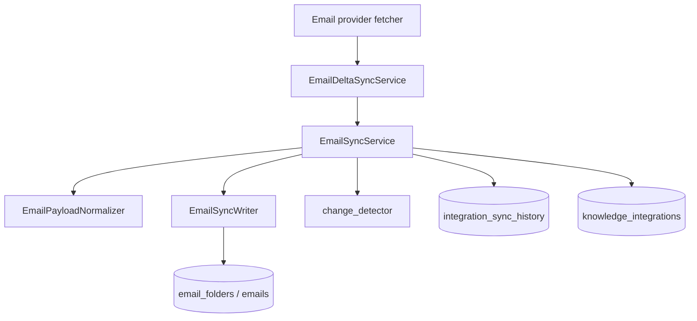
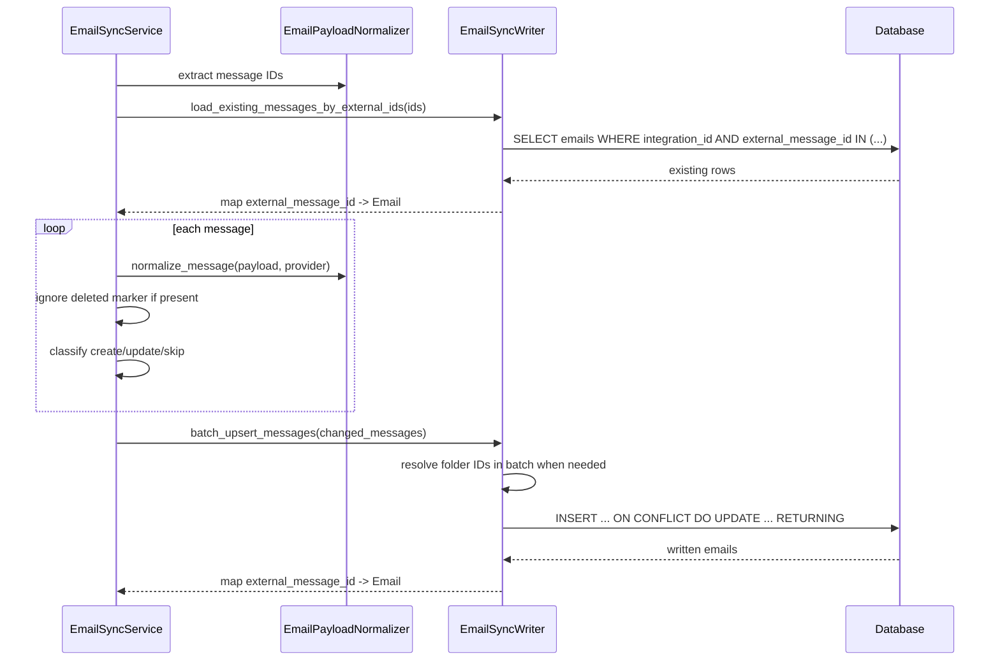

# Email Sync Service Refactor Design

## Context

The email sync N+1 work currently lives inside `src/service/integrations/email_sync_service.py`.
The staged change already moves the incremental path toward batched writes for folders, messages,
and message folder resolution, but the file still mixes four responsibilities:

- Provider payload parsing for Outlook, Gmail, and generic fallback payloads.
- Change detection for deciding whether an existing folder or message should be rewritten.
- SQL persistence, including single-row upserts, batch upserts, lookup preloads, and folder ID
  resolution.
- Sync orchestration, including sync history, counters, logs, commit boundaries, and error handling.

The refactor should preserve the behavior of the staged N+1 fix while making the service easier to
read and safer to extend. This is not a blind mirror of calendar sync. The calendar split is useful
because it separated the same real responsibilities, but the email package should keep email-specific
contracts visible.

## Goals

- Keep the public import contract stable through `src/service/integrations/email_sync_service.py`.
- Move provider parsing, change detection, and SQL persistence out of the orchestration class.
- Preserve current full-sync and incremental-sync behavior unless a change is explicitly called out.
- Preserve the staged incremental batching behavior:
  - one preload query for existing folders by external ID,
  - one preload query for existing messages by external ID,
  - one batch upsert for changed folders,
  - one batch upsert for changed messages,
  - one batch folder-ID resolution query for message parent folders when a concrete `folder_id` is not
    already supplied.
- Keep deletion markers intentionally ignored in the email sync service because email sync is scoped
  to monitored folders, not a complete mailbox mirror.
- Make each module readable in isolation and small enough that a new engineer can understand the flow
  in minutes.

## Non-Goals

- Do not add broad mailbox deletion reconciliation.
- Do not change which folders are monitored. Existing folder classification and `is_monitored` rules
  remain the source of truth.
- Do not introduce a generic framework shared by calendar and email. Calendar and email have similar
  seams but different domain contracts.
- Do not change provider fetchers in `src/workers/integrations_worker/providers/email/`.
- Do not change `Email` or `EmailFolder` schema.
- Do not alter `EmailDeltaSyncService` orchestration beyond import compatibility unless implementation
  proves a narrow call-site cleanup is necessary.

## Proposed Package

Create a focused email package:

```text
src/service/integrations/email/
├── __init__.py
├── change_detector.py
├── normalizer.py
├── sync_service.py
├── types.py
└── writer.py
```

Keep `src/service/integrations/email_sync_service.py` as a compatibility shim that re-exports
`EmailSyncService`. Existing imports from tests, delta sync, and external callers continue to work.

## Module Responsibilities

### `types.py`

Defines the provider-neutral shapes that flow through the pipeline.

- `NormalizedEmailFolder`
  - `external_id`
  - `provider`
  - `fields`
  - `data_payload`
  - `debug_sample`
- `NormalizedEmailMessage`
  - `external_id`
  - `provider`
  - `external_folder_id`
  - `fields`
  - `data_payload`
  - `debug_sample`
- `EmailFolderUpsertBatchItem`
- `EmailMessageUpsertBatchItem`

The DTOs should be frozen dataclasses. The orchestrator should not read raw Outlook or Gmail field
names after normalization.

### `normalizer.py`

Owns provider payload parsing and provider-specific defaults.

Responsibilities:

- Extract folder IDs and message IDs.
- Normalize Outlook folder fields.
- Normalize Gmail label fields.
- Normalize generic folder fields.
- Normalize Outlook message fields.
- Normalize Gmail message fields.
- Normalize generic message fields.
- Classify folder types.
- Extract message parent folder IDs.
- Parse ISO/RFC 2822 datetimes.
- Convert HTML bodies to plain text when no text body exists.
- Parse Gmail email headers and address lists.

This module can expose `EmailPayloadNormalizer` with small methods:

- `normalize_folder(folder_data, provider) -> NormalizedEmailFolder`
- `normalize_message(message_data, provider) -> NormalizedEmailMessage`
- `extract_folder_id(folder_data, provider) -> str | None`
- `extract_message_id(message_data, provider) -> str | None`
- `extract_external_folder_id_from_message(message_data, provider) -> str | None`

The current `MONITORED_FOLDER_TYPES` and Gmail label type mapping belong here because they are
provider-normalization rules, not database rules.

### `change_detector.py`

Owns decisions about whether a normalized provider row should rewrite an existing database row.

Functions:

- `has_meaningful_folder_changes(existing: EmailFolder, incoming: NormalizedEmailFolder) -> bool`
- `has_meaningful_message_changes(existing: Email, incoming: NormalizedEmailMessage) -> bool`

The detector should compare normalized fields only. It should not call provider parsing helpers.

Folder comparison remains focused on:

- folder name,
- folder type,
- total count,
- unread count.

Message comparison remains focused on:

- subject,
- sender email,
- read/starred/important/draft flags,
- labels,
- provider parent folder movement.

### `writer.py`

Owns all SQL reads and writes for `email_folders` and `emails`.

Class: `EmailSyncWriter(session: AsyncSession, organisation_id: UUID)`

Responsibilities:

- Single folder upsert for full sync.
- Batch folder upsert for incremental sync.
- Single message upsert for full sync.
- Batch message upsert for incremental sync.
- Existing folder preload by external IDs.
- Existing message preload by external IDs.
- Folder ID resolution and cache warming for message writes.
- Build upsert value dicts.
- Build `ON CONFLICT DO UPDATE` dictionaries.

Contracts:

- Every query must include `integration_id`; write values must include `organisation_id`.
- Batch upserts collapse duplicate provider IDs inside the same payload before writing. Last payload
  wins, matching the old per-row upsert behavior.
- Do not add new `is_deleted` write behavior in this refactor. Inserts keep the model/default
  behavior, and conflict updates continue to update only the existing upsert column set.
- Folder ID resolution should use one SELECT for missing external folder IDs and should warm the
  in-memory cache.
- Writer logs bounded debug samples if a batch write fails, then re-raises. The orchestrator owns
  sync failure accounting.

### `sync_service.py`

Owns orchestration only.

Class: `EmailSyncService(session: AsyncSession, organisation_id: UUID)`

Responsibilities:

- Full folder sync.
- Full message sync.
- Incremental folder sync.
- Incremental message sync.
- Sync history start/complete.
- Integration status updates.
- Counters and structured logs.
- Per-item error isolation in the full and incremental loops.
- Commit boundaries.
- Intentional deletion-marker policy.

The constructor should create:

- `SyncHistoryManager`
- `EmailPayloadNormalizer`
- `EmailSyncWriter`

The orchestration loop should read as:

1. Convert input iterable to a list.
2. Complete and return early for empty input.
3. Normalize IDs and preload existing rows in one query.
4. Walk each item and classify it as created, updated, skipped, deleted-marker-ignored, or failed.
5. Flush changed items through writer batch methods.
6. Commit.
7. Complete sync history and update integration status.

## Deletion Marker Policy

Email provider deletion markers remain intentionally ignored in this refactor.

Reason: this email sync is not a complete mailbox mirror. It targets monitored folders such as inbox
and sent folders. A delete marker may represent a move, archive, trash operation, label removal, or a
change outside the monitored folder set. Treating those markers as global deletes would create false
negatives in the local email tables.

Implementation rule:

- If `extract_sync_action(payload) == SyncAction.DELETED`, increment action counts and continue.
- Do not soft-delete `Email` or `EmailFolder` rows in this refactor.
- Name the counter/log metadata clearly, for example `deleted_marker_ignored`, so future maintainers
  do not mistake this branch for missing functionality.

If product requirements later change from monitored-folder sync to complete mailbox mirroring, deletion
reconciliation should be designed separately.

## Data Flow



Incremental message sync:



## Common Helper Extraction

The following helpers are currently mixed into `EmailSyncService` and should move:

- Provider parsing to `normalizer.py`:
  - `_extract_folder_id`
  - `_extract_message_id`
  - `_extract_folder_fields`
  - `_extract_outlook_folder_fields`
  - `_classify_folder_type`
  - `_extract_gmail_folder_fields`
  - `_extract_generic_folder_fields`
  - `_extract_message_fields`
  - `_extract_outlook_message_fields`
  - `_extract_gmail_message_fields`
  - `_extract_generic_message_fields`
  - `_parse_datetime`
  - `_html_to_text`
  - `_extract_external_folder_id_from_message`
  - `_parse_email_address`
  - `_parse_email_list`
- Change comparison to `change_detector.py`:
  - `_has_meaningful_folder_changes`
  - `_has_meaningful_message_changes`
- SQL and cache work to `writer.py`:
  - `_upsert_folder`
  - `_build_folder_upsert_values`
  - `_folder_upsert_update_dict`
  - `_batch_upsert_folders`
  - `_upsert_message`
  - `_build_message_upsert_values`
  - `_message_upsert_update_dict`
  - `_batch_upsert_messages`
  - `_get_folder_by_external_id`
  - `_ensure_folder_id`
  - `_resolve_folder_id`
  - `_load_folder_ids_by_external_ids`
  - `_resolve_message_folder_ids_for_batch`
  - `_load_existing_folders_by_external_ids`
  - `_load_existing_messages_by_external_ids`

To reduce test churn, `EmailSyncService` may temporarily keep thin private wrapper methods for the old
helper names if existing tests call them directly. The preferred end state is tests importing helpers
from the modules that own them.

## Logging and Observability

Keep existing structured log event names where possible so dashboards and Sentry grouping do not drift.
Add only targeted metadata:

- `changed_count` for folders/messages flushed in a batch.
- `deleted_marker_ignored` for intentionally ignored delete markers.
- Bounded samples on batch write or folder-resolution failure.

Batch failures should include at most five provider IDs or debug samples. Do not log whole batches or
message bodies.

## Error Handling

- Per-item normalization/classification failures are logged and counted as `records_failed`.
- Batch write failures fail the sync pass. This is intentional because a failed batch means none of
  the accumulated writes can be trusted.
- Folder ID resolution failure for changed messages fails the sync pass with a bounded sample of
  unresolved message IDs and parent folder IDs.
- Sync history completion and integration status updates stay in the orchestrator.

## Testing Plan

Refactor tests around the new module boundaries:

- `tests/service/integrations/email/test_normalizer.py`
  - Outlook folder normalization.
  - Gmail label normalization.
  - Outlook message normalization.
  - Gmail message normalization.
  - HTML-to-text fallback.
  - parent folder ID extraction.
- `tests/service/integrations/email/test_change_detector.py`
  - unchanged folder skip.
  - folder count/name/type change.
  - unchanged message skip.
  - message flag/label/folder movement changes.
- `tests/service/integrations/email/test_writer.py`
  - batch folder upsert emits one statement.
  - batch message upsert emits one statement.
  - folder ID preload emits one SELECT and warms cache.
  - duplicate external IDs collapse before bulk insert.
- Keep or adapt `tests/service/integrations/test_email_sync_service_incremental.py`
  - incremental sync batches created and updated messages.
  - deleted markers are counted/ignored intentionally.
  - empty payload closes sync history cleanly.
- Keep `tests/service/integrations/test_email_sync_service_gmail.py` passing either through wrapper
  compatibility or by moving expectations to the normalizer tests.

Focused verification:

```bash
uv run pytest tests/service/integrations/email tests/service/integrations/test_email_sync_service_incremental.py tests/service/integrations/test_email_sync_service_gmail.py -q
uv run ruff check src/service/integrations/email src/service/integrations/email_sync_service.py tests/service/integrations/email tests/service/integrations/test_email_sync_service_incremental.py tests/service/integrations/test_email_sync_service_gmail.py
```

## Rollout Plan

1. Add the new `email` package and move provider normalization first.
2. Add normalizer tests and keep the old public import path working.
3. Move change detection into `change_detector.py`.
4. Move SQL and folder cache behavior into `writer.py`.
5. Rewire `EmailSyncService` orchestration to call normalizer, detector, and writer.
6. Reduce `email_sync_service.py` to a compatibility shim.
7. Run focused email tests and lint.
8. Review the resulting diff for behavior drift, especially around counters, commit boundaries, and
   deleted marker handling.

## Risks

- Test churn from private helper imports. Mitigation: keep temporary wrappers or update tests in the
  same refactor.
- Counter drift in incremental sync. Mitigation: assert created/updated/skipped/deleted-marker counts
  in service-level tests.
- Folder resolution behavior drift for Gmail labels. Mitigation: explicit tests for `_gmail_label_id`
  and monitored label flows.
- Batch write failures become sync-pass failures rather than per-item failures. This matches the
  staged batching direction; document it clearly in writer and service tests.

## Decision

Use the package split:

- `types.py`
- `normalizer.py`
- `change_detector.py`
- `writer.py`
- `sync_service.py`
- compatibility shim `email_sync_service.py`

This is the best split for the current codebase because each module has one reason to change, the
incremental N+1 fix remains explicit, and the public caller contract stays stable.
