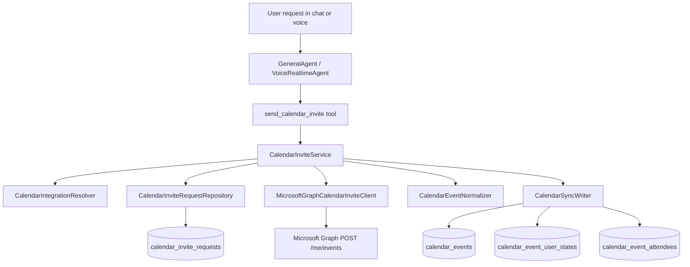

# Teams Calendar Invites Design

## Goal

Allow CopilotGTM users and AI agents to send Microsoft Teams calendar invites from the user's connected Outlook calendar, with durable auditability, organisation isolation, retry-safe provider calls, and a clean service boundary that can later support Google Calendar without rewriting agent tools.

## External API Decision

Use Microsoft Graph Outlook Calendar event creation:

- `POST /me/events`
- Scope: delegated `Calendars.ReadWrite`
- Payload sets `isOnlineMeeting=true` and `onlineMeetingProvider="teamsForBusiness"`

Do not use Microsoft Graph `onlineMeeting` creation as the primary path. Microsoft documents that standalone online meetings created through the onlineMeeting API are not calendar-backed and do not appear on the user's calendar. Calendar-backed events also preserve the path already used by sync, meeting matching, attendee snapshots, and transcript lookup.

References:

- Microsoft Graph create event: https://learn.microsoft.com/en-us/graph/api/user-post-events
- Microsoft Graph calendar-backed online meetings: https://learn.microsoft.com/en-us/graph/outlook-calendar-online-meetings
- Microsoft Graph onlineMeeting API caveat: https://learn.microsoft.com/en-us/graph/api/application-post-onlinemeetings

## Scope Boundary

This is a Microsoft Outlook Calendar integration feature, not a Teams bot permission feature.

The Teams bot app and the Microsoft user-owned integration app must remain separate:

- `IntegrationType.OUTLOOK_CALENDAR` gets `Calendars.ReadWrite`.
- `IntegrationType.TEAMS` remains chat/channel read only.
- No bot app registration permissions are changed for calendar invite sending.
- No application permission or admin-level calendar scope is required for the first implementation. Invites are sent as the connected user with delegated `Calendars.ReadWrite`.
- Tenant administrators can still disable user consent or require approval for all new delegated permissions. That is a tenant policy gate, not proof that this feature needs an application/admin calendar permission. The product must surface this as `calendar_consent_blocked_by_tenant_policy` with a reconnect/admin-approval message.
- Infra must update `terraform/azure/modules/microsoft_oauth_app/main.tf` in `copilot-infra` from delegated `Calendars.Read` to delegated `Calendars.ReadWrite` (`1ec239c2-d7c9-4623-a91a-a9775856bb36`). The application permission ID for `Calendars.ReadWrite` must not be used.

## User Stories

1. A seller asks Kai in Teams, Slack, WhatsApp, web chat, or voice: "Send a Teams invite to Priya and Sam tomorrow at 3pm for the Acme pricing review."
2. The agent extracts title, attendee emails, start/end time, optional deal context, and optional body.
3. Backend validates the current user owns an active Outlook calendar integration with `Calendars.ReadWrite`.
   If the user has multiple writable Outlook Calendar connections, the agent must ask which sender
   email to use and pass the selected `sender_email` before any invite is created.
4. Backend creates a durable invite request row before calling Graph.
5. Backend releases DB sessions before calling Microsoft Graph.
6. Backend creates the calendar-backed Teams meeting, stores provider IDs and join URL, and upserts the resulting event into existing `calendar_events`, `calendar_event_user_states`, and `calendar_event_attendees`.
7. The agent returns a concise receipt with subject, time, attendees, join URL, and whether the invite was linked to a deal.

## Non-Goals

- Creating standalone Teams online meetings without calendar invites.
- Acting as an application permission scheduler for users who have not connected Outlook Calendar.
- Editing, cancelling, or rescheduling invites in the first pass.
- Sending invites from arbitrary shared calendars or group calendars.
- Adding Google Calendar writes in the first pass.
- Changing the Teams bot app registration.

## Architecture



## Service Boundaries

### `CalendarInviteService`

Owns business orchestration:

- Validates organisation and user boundaries.
- Resolves the sender's active Outlook Calendar integration.
- Requires explicit sender selection when more than one writable Outlook Calendar account is
  available for the user.
- Validates required write scope.
- Creates a pending request before the external call.
- Releases the DB session before Microsoft Graph calls.
- Updates request status after Graph returns.
- Normalizes and persists the created event into existing calendar tables.
- Optionally links the event to a deal when the request included a valid deal.

This service is the only surface the API route and AI tool should call.

### `CalendarIntegrationResolver`

Owns selection of a usable calendar integration:

- Query `KnowledgeIntegration` by `organisation_id`, `created_by_user_id`, `IntegrationType.OUTLOOK_CALENDAR`, `is_active=True`.
  Keep `requires_reauth` rows in the candidate set so selected unhealthy accounts return a precise
  `calendar_reauth_required` error.
- If `sender_email` is provided, select only the current user's matching `integration_email`.
- If no `sender_email` is provided and more than one writable account exists, raise
  `calendar_sender_selection_required` with the available sender email addresses.
- Reject integrations missing `Calendars.ReadWrite`.
- Reject the selected integration if it requires reauth, has no usable token, or is missing any
  required Microsoft scope. Do not fall back to a different account after the user has selected a
  sender.
- Return a token info object via `IntegrationTokenInfo.from_integration`.

It must not fall back to a different user's integration.

### `MicrosoftGraphCalendarInviteClient`

Owns Microsoft Graph event creation only:

- Builds Graph event payloads.
- Calls Graph via `call_with_token_retry`.
- Uses `httpx.AsyncClient(timeout=30.0)`.
- Handles 429 through the existing `_microsoft_graph.graph_api_request` retry behavior where possible.
- Raises typed provider errors for missing permissions, invalid input, throttling exhaustion, and permanent auth failures.

It does not know about deals, agents, or database models.

### `CalendarInviteRequestRepository`

Owns persistence for outbound invite requests:

- Insert request as `PENDING`.
- Transition to `SENDING` immediately before external call.
- Transition to `SENT` with provider event ID, canonical event ID, join URL, and response payload.
- Transition to `FAILED` with a sanitized error code and short message.

### Agent Tool

Add `send_calendar_invite` as a write tool in the GeneralAgent and VoiceRealtimeAgent tool set.

Tool behavior:

- Call immediately when the user clearly asks to send/schedule a meeting invite and supplies enough timing and attendee information.
- Ask a clarifying question only when title, start time, or attendee emails are missing.
- Ask a sender-selection question when the service returns multiple writable Outlook Calendar
  accounts. The answer must be an email address from the returned options.
- Never call Microsoft Graph directly.
- Never invent attendee emails.
- Prefer direct send over preview cards in the same style as current `create_task`.

## Data Model

Create `calendar_invite_requests` in org schemas.

Fields:

- `request_id UUID PK`
- `organisation_id UUID NOT NULL INDEX`
- `requested_by_user_id UUID NOT NULL INDEX`
- `integration_id UUID NOT NULL FK knowledge_integrations.integration_id`
- `deal_id UUID NULL FK crm_deals.deal_id`
- `event_id UUID NULL FK calendar_events.event_id`
- `provider_event_id VARCHAR(255) NULL`
- `idempotency_key VARCHAR(128) NOT NULL`
- `status VARCHAR(32) NOT NULL`
- `title VARCHAR(500) NOT NULL`
- `body TEXT NULL`
- `location VARCHAR(500) NULL`
- `start_at TIMESTAMPTZ NOT NULL`
- `end_at TIMESTAMPTZ NOT NULL`
- `timezone VARCHAR(128) NOT NULL`
- `provider_timezone VARCHAR(128) NOT NULL`
- `attendees JSONB NOT NULL DEFAULT '[]'::jsonb`
- `conference_link TEXT NULL`
- `provider_response JSONB NULL`
- `error_code VARCHAR(128) NULL`
- `error_message TEXT NULL`
- `created_at TIMESTAMPTZ NOT NULL`
- `updated_at TIMESTAMPTZ NOT NULL`

Constraints:

- Unique `(organisation_id, requested_by_user_id, idempotency_key)`.
- Check `end_at > start_at`.
- Check status in `PENDING`, `SENDING`, `SENT`, `FAILED`.

The idempotency key is supplied by API clients when available. Agent tools compute one from stable request facts and also pass it to Microsoft Graph as the event `transactionId`. This gives us both local idempotency and provider-side duplicate protection for retry races where the first Graph call succeeds but the response path fails.

```text
sha256(user_id + title + start_at + end_at + sorted_attendee_emails + deal_id_or_empty)
```

## Deprecated / Future-Use API Contract

Do not register this endpoint right now. Calendar invite creation is currently driven through the
LLM/agent tool path. Keep this contract for future UI or non-agent client reuse:

```http
POST /users/calendar/invites
```

Request:

```json
{
  "title": "Acme pricing review",
  "body": "Review final proposal and procurement steps.",
  "start_at": "2026-05-12T15:00:00+05:30",
  "end_at": "2026-05-12T15:30:00+05:30",
  "timezone": "Asia/Calcutta",
  "attendees": [
    {"email": "priya@acme.com", "name": "Priya"},
    {"email": "sam@acme.com", "name": "Sam"}
  ],
  "sender_email": "seller@contoso.com",
  "deal_id": "00000000-0000-0000-0000-000000000000",
  "idempotency_key": "optional-client-key"
}
```

Response:

```json
{
  "request_id": "00000000-0000-0000-0000-000000000000",
  "event_id": "00000000-0000-0000-0000-000000000000",
  "provider_event_id": "AAMkAG...",
  "status": "SENT",
  "title": "Acme pricing review",
  "start_at": "2026-05-12T15:00:00+05:30",
  "end_at": "2026-05-12T15:30:00+05:30",
  "conference_link": "https://teams.microsoft.com/l/meetup-join/...",
  "attendees": [
    {"email": "priya@acme.com", "name": "Priya"},
    {"email": "sam@acme.com", "name": "Sam"}
  ]
}
```

Errors:

- `400 invalid_invite_request`: missing title, bad dates, invalid attendee email.
- `400 calendar_sender_not_found`: selected sender email is not a connected Outlook Calendar account for the current user.
- `400 calendar_write_scope_required`: connected Outlook calendar lacks `Calendars.ReadWrite`.
- `401 calendar_reauth_required`: integration requires reauth or token refresh is permanently invalid.
- `404 deal_not_found`: supplied deal does not belong to the current organisation.
- `409 calendar_sender_selection_required`: more than one writable Outlook Calendar account can send the invite; ask the user which sender email to use.
- `409 duplicate_invite_request`: idempotency key already sent.
- `409 provider_duplicate_invite_request`: Graph reports the `transactionId` was already used.
- `422 unsupported_online_meeting_provider`: the sender mailbox cannot create Teams meetings through Outlook calendar events.
- `423 calendar_consent_blocked_by_tenant_policy`: the tenant requires admin approval before the user can grant the delegated permission.
- `502 calendar_provider_error`: Graph rejected the request for a non-auth reason.

## Microsoft Graph Payload

```json
{
  "subject": "Acme pricing review",
  "body": {
    "contentType": "HTML",
    "content": "Review final proposal and procurement steps."
  },
  "start": {
    "dateTime": "2026-05-12T15:00:00",
    "timeZone": "India Standard Time"
  },
  "end": {
    "dateTime": "2026-05-12T15:30:00",
    "timeZone": "India Standard Time"
  },
  "attendees": [
    {
      "emailAddress": {"address": "priya@acme.com", "name": "Priya"},
      "type": "required"
    }
  ],
  "isOnlineMeeting": true,
  "onlineMeetingProvider": "teamsForBusiness",
  "transactionId": "sha256-derived-idempotency-key"
}
```

Use Microsoft-supported Outlook time zone IDs in the Graph payload and `Prefer: outlook.timezone="{provider_timezone}"`. The API request may accept the product/user timezone in IANA form, but the service must convert it before calling Graph, for example `Asia/Calcutta` -> `India Standard Time`. If no mapping exists, reject the request before Graph with `invalid_invite_request`.

## Confidence Review

The strategy is considered implementation-ready only if these loopholes are closed:

1. **Wrong permission class:** use delegated `Calendars.ReadWrite` scope ID `1ec239c2-d7c9-4623-a91a-a9775856bb36`; never use application permission `ef54d2bf-783f-4e0f-bca1-3210c0444d99`.
2. **Tenant consent policy:** treat admin approval requirements as a tenant policy block and surface a targeted reconnect/admin-approval message. Do not redesign around app permissions.
3. **Timezone mismatch:** translate IANA/user timezones to Microsoft-supported Outlook time zone IDs before Graph calls.
4. **Multiple sender accounts:** never guess when multiple writable Outlook Calendar accounts exist. Return the available sender emails and require an explicit `sender_email`.
5. **Selected account health:** validate the selected account's scope, reauth state, token availability, and current-user ownership before creating the event.
6. **Duplicate sends:** persist a local idempotency row and send the same stable key to Graph as `transactionId`.
7. **Teams meeting support:** `teamsForBusiness` can fail if the user's mailbox/tenant does not support Teams online meetings. Return `unsupported_online_meeting_provider`; do not silently create a non-online event.
8. **Graph succeeds but DB sync fails:** keep the request row with provider event ID and add a repair path that can fetch `/me/events/{provider_event_id}` and complete local calendar row sync.

## Security and Isolation

- Every DB query includes `organisation_id`.
- Deal lookup checks `CRMDeal.organisation_id == context.organisation_id`.
- Integration lookup checks both `organisation_id` and `created_by_user_id == current_user_id`.
- The agent cannot pass `organisation_id`, `created_by_user_id`, or `integration_id`.
- Attendees are external payload data and must be email-validated and normalized.
- Store raw provider response only in org schema JSONB.
- Do not log access tokens, refresh tokens, full event body, or full attendee lists at info level.

## Session Management

Follow the repo's fresh-session pattern:

1. Acquire org session.
2. Validate request, deal, and integration.
3. Insert request row and extract token info.
4. Commit and release session.
5. Call Microsoft Graph.
6. Acquire a fresh org session.
7. Update request and sync calendar event rows.
8. Commit.

This avoids holding a PostgreSQL connection during external provider latency.

## Calendar Sync Integration

After Graph returns the created event, reuse existing calendar normalization and writer code instead of adding a parallel event table:

- `CalendarEventNormalizer.normalize(event_data, provider="outlook")`
- `CalendarSyncWriter.upsert_event(...)`
- `CalendarSyncWriter.upsert_user_state(...)`
- `CalendarSyncWriter.sync_attendees(...)`

The created event becomes visible to existing:

- meeting/date tools,
- deal meeting matching,
- timeline sync,
- transcript fetch logic when Teams meeting metadata is present.

## Observability

Structured logs:

- `calendar_invite_request_created`
- `calendar_invite_graph_create_started`
- `calendar_invite_graph_create_succeeded`
- `calendar_invite_graph_create_failed`
- `calendar_invite_event_synced`

Fields:

- `organisation_id`
- `requested_by_user_id`
- `integration_id`
- `request_id`
- `deal_id`
- `status`
- `provider_status_code`
- `error_code`

Avoid logging attendee emails except debug-level bounded samples in local troubleshooting.

Metrics:

- count invites requested, sent, failed
- provider latency
- missing-write-scope count
- reauth-required count

## Rollout Plan

1. Ship infra and backend scope constants, validation labels, and tests.
2. Add data model and migration for invite request audit rows.
3. Add Microsoft Graph invite client with unit tests using mocked HTTP responses.
4. Add service orchestration with mocked repo/client tests.
5. Add API route and docs.
6. Add agent tool and registry/voice manifest tests.
7. Run focused integration tests and type checks.
8. Deploy behind normal code rollout. Existing connected Outlook Calendar users will show `additional_permissions` until they reconnect and grant `Calendars.ReadWrite`.

## Risks and Mitigations

- Existing Outlook Calendar users only granted `Calendars.Read`; mitigation: scope validation surfaces `Calendars.ReadWrite` as additional permissions.
- Tenant policy blocks user consent even though the permission is delegated; mitigation: surface `calendar_consent_blocked_by_tenant_policy` and do not claim app/admin calendar permissions are required.
- Users may ask the Teams bot to send an invite without Outlook Calendar connected; mitigation: tool returns connect/reconnect instruction instead of trying bot permissions.
- Duplicate sends from agent retries; mitigation: idempotency key, durable request row, and Graph `transactionId`.
- Graph creates event but DB update fails; mitigation: request row stores provider event ID before event sync where possible, and a repair job can re-fetch `/me/events/{id}`.
- Timezone ambiguity in natural language; mitigation: agent passes parsed date expression only when unambiguous, service normalizes with current user timezone, maps to Outlook timezone ID, or rejects.
- Sender mailbox does not support Teams online meetings; mitigation: return a hard unsupported-provider error rather than creating a plain calendar event.
