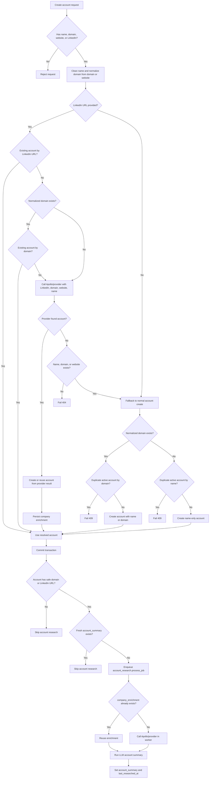

# Account Creation Flow

This document describes the current account create tree for `POST /accounts` and shared callers that use `AccountWriteService.create_account()`.

## Inputs

Accepted create identity fields:

- `name`
- `domain`
- `website`
- `industry`
- `linkedin_url`

Request validation requires at least one of `name`, `domain`, `website`, or `linkedin_url`.
When `linkedin_url` is supplied, it must be an account/company LinkedIn page:
`/company/`, `/school/`, or `/showcase/`. Person profile URLs (`/in/` or
`/pub/`) are rejected and should be routed to contact/stakeholder flows.

## API Flow

1. `accounts_handler.create_account()` receives `CreateAccountRequest`.
2. It calls `AccountWriteService.create_account()` with `AccountCreateCommand`.
3. The service stages the account write but does not commit.
4. The API commits the request transaction.
5. After commit, the API calls `dispatch_account_research_async()` with trigger `account_created`.
6. If dispatch fails, the account create still succeeds and the failure is logged.

## Mermaid Flow

## Service Decision Tree

Start with `create_account(command)`.

- If `linkedin_url` is provided:
  - Normalize `domain` from the original request `domain` or `website`.
  - Enter `AccountIdentityResolutionService`.
  - If an existing account matches `linkedin_url`, return that account with `matched_by=linkedin`.
  - If the original request had a normalized domain and an existing account matches it, return that account with `matched_by=domain`.
  - If Apollo/provider finds an account, create or reuse the account, persist provider enrichment, and return `matched_by=apollo`.
  - If Apollo/provider does not find an account but `name`, `domain`, or `website` exists, fall back to normal account creation.
  - If Apollo/provider does not find an account and only `linkedin_url` was provided, fail with `404`; no account row is created.
- If `linkedin_url` is missing, or LinkedIn resolution fell back because another identity exists:
  - Continue to `_create_account_record(command)`.

## Raw Account Record Creation

Start with `_create_account_record(command)`.

- Clean `name`.
- Normalize account domain from `domain` or `website`.
- If neither clean name nor normalized domain exists:
  - Fail with `400`: account name, domain, or website is required.
- If normalized domain exists:
  - Check for an active org account with the same domain.
  - If found, fail with `409` and return the existing `company_id`.
  - If not found, create the account.
  - The account name becomes clean `name` if supplied, otherwise the normalized domain.
- If no normalized domain exists:
  - Check for an active org account with the exact same name, case-insensitive.
  - If found, fail with `409` and return the existing `company_id`.
  - If not found, create a name-only account.

## Research Dispatch Tree

Start with `dispatch_account_research_async(company_id)`.

- If account is missing, deleted, or belongs to another org, skip.
- If account has no safe domain and no LinkedIn URL, skip.
- If `account_summary` exists and `last_researched_at` is recent, skip unless `force_refresh=True`.
- If an active `account_research` job already exists for this `company_id`, return that job id.
- Otherwise:
  - Create a `DealJobs` row.
  - Write account-enrichment-triggered activity.
  - Enqueue `account_research.process_job` on the `deal_jobs` queue.

## Research Worker Tree

Start with `account_research.process_job`.

- If `company_enrichment` already exists:
  - Reuse it.
  - Set provider status to `cached`.
- If no existing enrichment exists:
  - If there is no domain and no LinkedIn URL, skip provider and summary.
  - If Apollo/provider errors, raise a retryable job error.
  - If Apollo/provider returns `not_found`, skip summary.
  - If Apollo/provider returns `found`, persist `company_enrichment` and `company_enriched_at`.
- If enrichment exists from cache or provider:
  - Run the LLM account summary.
  - Persist `account_summary`.
  - Set `last_researched_at`.

## Important Ownership Rules

- Account create owns the `CRMCompany` row.
- Apollo/provider data owns `company_enrichment`, `company_enriched_at`, and `company_enrichment_source`.
- LLM summary owns `account_summary` and `last_researched_at`.
- `last_researched_at` must not be updated by provider-only enrichment.
- Name-only accounts can be created, but they do not dispatch research unless a safe domain or LinkedIn URL exists.
