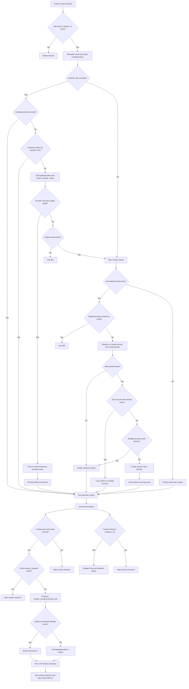

# Contact Creation Flow

This document describes the current contact create tree for `POST /contacts` and shared callers that use `ContactWriteService.create_contact()`.

## Inputs

Accepted create identity/profile fields:

- `email`
- `name`
- `job_title`
- `linkedin_url`

Request validation requires at least one of `email`, `linkedin_url`, or `name`.
When `linkedin_url` is supplied, it must be a person profile LinkedIn page:
`/in/` or `/pub/`. Account/company pages (`/company/`, `/school/`, or
`/showcase/`) are rejected and should be routed to account flows.

## API Flow

1. `contacts_handler.create_contact()` receives `CreateContactRequest`.
2. It calls `ContactWriteService.create_contact()` with `ContactCreateCommand`.
3. The service stages the contact write and any account created from the contact email domain.
4. The API commits the request transaction.
5. After commit, if the contact has an email, the API calls `dispatch_contact_research_async()` with trigger `contact_created`.
6. After commit, if the contact is linked to a company, the API calls `dispatch_account_research_async()` with trigger `contact_created_account`.
7. If either dispatch fails, contact creation still succeeds and the failure is logged.

## Mermaid Flow

## Service Decision Tree

Start with `create_contact(command)`.

- If `linkedin_url` is provided:
  - Resolve through `ContactIdentityResolutionService`.
  - If an existing contact matches email, return that contact with `matched_by=email`.
  - If an existing contact matches LinkedIn URL, return that contact with `matched_by=linkedin`.
  - If Apollo/provider finds a person with a usable email:
    - Find or create a contact by the resolved email.
    - Persist `profile_enrichment` and `profile_enriched_at`.
    - Return `matched_by=apollo`.
  - If Apollo/provider does not find a person but email exists:
    - Find or create contact by email.
    - Keep the provided LinkedIn URL on the contact.
  - If Apollo/provider does not find a person and no email exists:
    - Fail with `404`; no empty contact row is created.
- If `linkedin_url` is missing, or LinkedIn resolution fell back because email exists:
  - Continue to `_create_contact_record(command)`.

## Raw Contact Record Creation

Start with `_create_contact_record(command)`.

- Normalize email.
- If normalized email exists:
  - Check for an active org contact with the same email.
  - If found, fail with `409`.
  - If not found, continue.
- If no email exists:
  - Creation is still allowed because API validation already required `name` or `linkedin_url`.
- Create or get the internal CRM integration.
- Split name into `first_name`, `last_name`, and `full_name`.
- Resolve account from contact email.
- Create `CRMContact`.
- Write contact-created activity.

## What Happens If The Account Does Not Exist?

When a contact has a normalized email, `ContactWriteService` calls `AccountWriteService.resolve_or_create_account_for_contact_email_with_result()`.

- Derive a safe domain from the email.
- If there is no safe domain:
  - Return `None`.
  - The contact is created without `company_id`.
- If exactly one active org account exists with that domain:
  - Link the contact to that account.
  - `created_account_id` remains `None`.
- If multiple active org accounts exist with that domain:
  - Return `None`.
  - The contact is created without `company_id` because the account match is ambiguous.
- If no account exists with that domain:
  - Create an account with `name=domain` and `domain=domain`.
  - Link the contact to the new account.
  - Return `created_account_id`.

So if the account does not exist and the email domain is safe, the backend creates the account automatically and links the contact to it. If the email is missing or the domain is unsafe/ambiguous, the contact stays unlinked.

## Contact Research Dispatch Tree

Start with `dispatch_contact_research_async(contact_id)`.

- If contact is missing, deleted, or belongs to another org, skip.
- If the contact has no safe email domain, skip.
- If `contact_research` exists and `last_researched_at` is recent, skip unless `force_refresh=True`.
- If an active `contact_research` job already exists for this `contact_id`, return that job id.
- Otherwise:
  - Create a `DealJobs` row.
  - Write contact-enrichment-triggered activity.
  - Enqueue `contact_research.process_job` on the `deal_jobs` queue.

## Account Research Dispatch From Contact Create

After contact commit:

- If `result.created_account_id` exists:
  - Dispatch account research for that newly created account.
- Else if response `company_id` exists:
  - Dispatch account research for the linked existing account.
- Else:
  - Do not dispatch account research.

## Contact Research Worker Tree

Start with `contact_research.process_job`.

- If `profile_enrichment` already exists:
  - Reuse it.
  - Set provider status to `cached`.
- If no existing enrichment exists:
  - If there is no email or no company domain, skip provider and summary.
  - If Apollo/provider errors, raise a retryable job error.
  - If Apollo/provider returns `not_found`, persist the not-found enrichment marker and skip summary.
  - If Apollo/provider returns `found`, persist `profile_enrichment` and `profile_enriched_at`.
- If enrichment exists from cache or provider:
  - Run the LLM contact summary.
  - Persist `contact_research`.
  - Set `last_researched_at`.

## Input-Specific Outcomes

- Name only:
  - Create contact with name only.
  - Do not resolve account.
  - Do not dispatch contact research.
  - Do not dispatch account research.
- Email only:
  - Check duplicate by email.
  - Create contact.
  - Resolve or create account from safe email domain.
  - Dispatch contact research.
  - Dispatch account research if `company_id` exists.
- LinkedIn only:
  - Existing contact by LinkedIn URL wins.
  - Otherwise Apollo/provider must return a usable email.
  - If Apollo returns email, create or find contact and persist provider enrichment.
  - If Apollo does not return usable email, fail with `404`.
  - After commit, dispatch contact research if email exists and account research if linked.
- Email plus LinkedIn:
  - Existing email contact wins.
  - Otherwise existing LinkedIn contact wins.
  - Otherwise Apollo/provider tries to enrich.
  - If Apollo does not find a person, create or find by email and store LinkedIn URL.

## Important Ownership Rules

- Contact create owns the `CRMContact` row and account link.
- Contact email domain can create the account automatically when safe.
- Apollo/provider data owns `profile_enrichment`, `profile_enriched_at`, and `profile_enrichment_source`.
- LLM summary owns `contact_research` and `last_researched_at`.
- `last_researched_at` must not be updated by provider-only enrichment.
