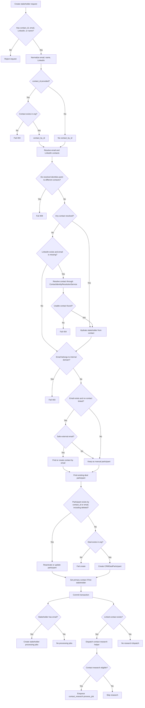

# Stakeholder Creation Flow

This document describes the current stakeholder create tree for `POST /deals/{deal_id}/stakeholders`, agent stakeholder tools, and `StakeholderWriteService.create_stakeholder()`.

## Inputs

Primary create identity fields:

- `contact_id`
- `email`
- `linkedin_url`
- `name`

Legacy accepted fields during rollout:

- `job_title`
- `phone_number`
- `department`
- `stance`
- `decision_power`
- `motivation`
- `pain_points`

At least one of `contact_id`, `email`, `linkedin_url`, or `name` should be supplied by create callers.
When `linkedin_url` is supplied, it must be a person profile LinkedIn page:
`/in/` or `/pub/`. Account/company pages (`/company/`, `/school/`, or
`/showcase/`) are rejected and should be routed to account flows.

## API Flow

1. `stakeholders_handler.create_stakeholder()` receives the request for one `deal_id`.
2. It calls `StakeholderWriteService.create_stakeholder()`.
3. The service stages contact resolution, participant creation/reactivation, primary-contact promotion, and activity projection.
4. The API commits the request transaction.
5. If the stakeholder has an email, the API creates stakeholder processing jobs for the deal participant.
6. If the stakeholder is linked to a contact, the API dispatches contact research through `dispatch_contact_research_for_contact()`.
7. Stakeholder create does not dispatch stakeholder-owned research.

## Mermaid Flow

## Service Decision Tree

Start with `create_stakeholder(deal_id, request)`.

- Normalize email, name, and LinkedIn URL.
- If `contact_id` is provided:
  - Load that contact inside the current org.
  - If it is not found, fail with `404`.
- If email is provided:
  - Find an existing contact by normalized email.
- If LinkedIn URL is provided:
  - Find an existing contact by LinkedIn URL.
- If supplied identity fields resolve to different contacts:
  - Fail with `409` and return the conflicting contact ids.
- If a contact is resolved by id, email, or LinkedIn:
  - Hydrate stakeholder display fields from the contact.
  - Contact data wins over manually typed fragments.
- If no contact is resolved and LinkedIn URL exists without email:
  - Resolve through `ContactIdentityResolutionService`.
  - If an existing contact is found, use it.
  - If Apollo/provider returns a person with usable email, create or find the contact and persist provider enrichment.
  - If Apollo/provider cannot resolve a usable contact, fail with `404`.
- If email belongs to an internal team domain:
  - Fail with `403`.
- If email exists and no contact is linked yet:
  - Run `_ensure_contact_for_stakeholder(email, ...)`.
  - If email is invalid, internal, or a personal email domain, do not create a contact.
  - If email is a safe external domain, find or create contact by email.
- Find an existing deal participant by `contact_id` or email, including deleted rows.
- If existing participant is found:
  - Reactivate or update the same participant row.
  - Apply durable profile fields to the linked contact only.
  - Apply deal-specific fields to the participant.
  - Set primary contact if this is the first stakeholder.
  - Return stakeholder detail.
- If no participant is found:
  - Ensure the deal exists in the org.
  - Create `CRMDealParticipant`.
  - Set `related_local_id=contact_id` when linked.
  - Set `participant_source=CRM` when contact linked, otherwise `MANUAL`.
  - Set primary contact if this is the first stakeholder.
  - Write stakeholder-added activity.
  - Return stakeholder detail.

## Input-Specific Outcomes

- `contact_id` only:
  - Load contact by id.
  - Hydrate stakeholder display fields from contact.
  - Create or reactivate deal participant linked to contact.
  - After commit, dispatch contact research if contact is eligible.
- Email only:
  - Find existing contact by email.
  - If no contact exists and email is a safe external domain, create or find contact by email.
  - If email is internal, fail with `403`.
  - If email uses a personal domain, create manual participant without contact link.
  - Create or reactivate participant by email/contact id.
  - After commit, dispatch contact research only if linked contact exists.
- LinkedIn only:
  - Find existing contact by LinkedIn URL.
  - Otherwise Apollo/provider must resolve a contact with usable email.
  - If resolved, create or reactivate participant linked to contact.
  - If not resolved, fail with `404`.
  - After commit, dispatch contact research if linked contact is eligible.
- Name only:
  - Do not resolve contact.
  - Create or reactivate deal-local manual participant.
  - Do not dispatch contact research.
  - Do not dispatch account research.
- Email plus LinkedIn:
  - Resolve email and LinkedIn independently.
  - If they point to different contacts, fail with `409`.
  - If one contact wins, hydrate from contact.
  - If no contact exists and email exists, create or find by email with LinkedIn profile update.
- `contact_id` plus email or LinkedIn:
  - Resolve each supplied identity.
  - If any supplied identity points to another contact, fail with `409`.
  - Otherwise the `contact_id` contact wins.

## Participant Creation Tree

Start with `_ensure_deal_participant(deal_id, contact_id, email)`.

- If there is no `user_id`, return `None`.
- Set up the internal CRM integration.
- If the deal does not exist in the org, return `None`.
- If an existing participant is found by `contact_id` or email, including deleted rows:
  - Reactivate it.
  - Preserve the row id.
  - Update identity, source, and status.
- Otherwise:
  - Create `CRMDealParticipant`.
  - Set `related_local_id` to `contact_id` when linked.
  - Set `related_email` to normalized email when present.
  - Set `stance` to provided value or `UNKNOWN`.
  - Set `decision_power` to provided value or `UNKNOWN`.
  - Set `participant_source=CRM` when contact linked, otherwise `MANUAL`.

## Post-Commit Jobs

After stakeholder commit:

- If `stakeholder.email` exists:
  - Create stakeholder processing jobs for the participant.
- If `stakeholder.contact_id` exists:
  - Dispatch contact research through the shared helper.
- If there is no `contact_id`:
  - Do not dispatch research.

The shared helper then applies normal contact research eligibility:

- If `contact_id` is missing, skip.
- If contact is missing, deleted, or belongs to another org, skip.
- If the contact has no safe email domain, skip.
- If `contact_research` exists and is recent, skip.
- If an active contact research job exists, return the existing job.
- Otherwise create and enqueue `contact_research.process_job`.

## Data Ownership Rules

- Stakeholder equals deal participation, not person research.
- `CRMDealParticipant` keeps deal-specific fields: stance, decision power, motivation, pain points, relationship context, primary-contact state.
- `CRMContact` owns person identity/profile fields: name, email, job title, phone, LinkedIn, department, external links, enrichment, and research.
- Contact-backed stakeholder reads should merge participant deal context with linked contact profile/research.
- Name-only stakeholders remain deal-local placeholders until a real contact identity is provided later.
