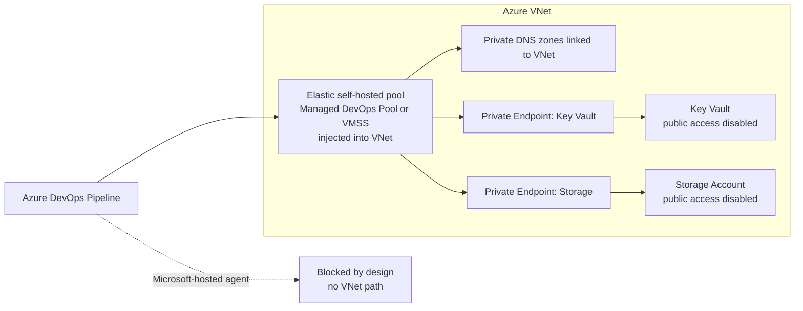

# DevOps Production Pipeline Setup (Terraform + Private Link)

## Why this exists

This repo enforces SOC2-style private-access controls (Key Vault and Storage are reachable only via Private Link + Private DNS). That means **Terraform runs that touch Key Vault data-plane (secrets) must execute from inside the VNet**.

This document defines:

- The **production pipeline architecture** (hosted vs self-hosted)
- The **branching + promotion model** (main → dev, release/* → uat → prod)
- The **required Azure DevOps objects** (variable groups, environments, approvals)
- Troubleshooting checks when Key Vault is private

## Architecture (network + pipeline)

### Key point

- Microsoft-hosted agents (e.g. `ubuntu-latest`) **cannot reach** Private Endpoint-only resources in your VNet.
- Therefore, **Terraform plan/apply must run on a self-hosted agent in the VNet**.
- For the backend app pipeline, avoid always-on static VMs. The target runner model is Managed DevOps Pools with VNet injection; use Azure VM Scale Set agents only as the fallback if Managed DevOps Pools cannot meet a compliance, region, or networking constraint.

### Diagram: network and execution location



### Required Azure pieces

- A VNet with a **dedicated Private Endpoints subnet** (policies disabled)
- Private DNS zones linked to that VNet:
  - `privatelink.vaultcore.azure.net`
  - `privatelink.blob.core.windows.net`
- A self-hosted Azure DevOps agent VM (or scale set) inside that VNet

## Target agent-pool design for speed and cost

The current static agent VM pattern is acceptable only as a bootstrap fallback. The production target is:

| Workload | Pool | Agent state | Scale settings | Reason |
|----------|------|-------------|----------------|--------|
| PR / feature validation | `copilot-devops-dev-fast` | Stateful | max 1-2 agents, 30-60 minute grace period during active development | Reuses dependency and Docker caches so normal validation is fast without keeping a VM online all month. |
| Dev deploy from `main`, `hotfix/*`, or manual run | `copilot-devops-dev-deploy` | Stateful or stateless | max 1 agent, optional 1 standby only during release windows | Keeps dev deploys fast while preventing feature branches from consuming build/deploy capacity. |
| Prod deploy | `copilot-devops-prod-deploy` | Stateless | max 1 agent, no default standby, approval-gated | Fresh prod runner reduces supply-chain persistence risk. Prod speed comes from the prebuilt image, not from reusing a mutable machine. |
| Terraform private-resource changes | Environment-specific deploy pool | Stateless for prod, stateful allowed for dev | max 1 agent | Terraform must stay on a VNet-connected self-hosted pool when Private Link is enabled. |

### Preferred option: Managed DevOps Pools

Use Managed DevOps Pools when available in the subscription/region because it removes most custom agent lifecycle code while still supporting:

- VNet injection through a delegated subnet, so agents can reach private Azure resources.
- Custom images and attached data disks, so Docker, `uv`, Python, Azure CLI, Helm, kubectl, Terraform, Trivy, and Hadolint do not install during every run.
- Stateful pools with a short grace period for dev speed, and stateless pools for prod security.
- Scheduled standby capacity during known work windows instead of 24/7 VM uptime.

Required guardrails:

- Use a dedicated subnet delegated to `Microsoft.DevOpsInfrastructure/pools`.
- Use separate dev and prod pools.
- Keep prod stateless and approval-gated.
- Use a managed identity and scoped access instead of embedding registration PATs into VM bootstrap material.
- Use a custom runner image built and patched on a fixed cadence.

### Terraform implementation in this repo

The repo includes a disabled-by-default Terraform path for this target model:

- `infra/terraform/azure/modules/managed_devops_pool/` creates `Microsoft.DevOpsInfrastructure/pools@2025-09-20` through `azapi_resource`.
- `infra/terraform/azure/modules/vnet/` can create dedicated subnets delegated to `Microsoft.DevOpsInfrastructure/pools`.
- `infra/terraform/azure/dev/main.tf` defines `copilot-devops-dev-fast` and `copilot-devops-dev-deploy` when `enable_managed_devops_pools = true`.
- `infra/terraform/azure/prod/main.tf` defines `copilot-devops-prod-deploy` when `enable_managed_devops_pools = true`.
- Current backend and infra YAML point to the Managed DevOps Pool names. Do not run those pipelines until the pools exist and have passed private-resource validation.

Before enabling `enable_managed_devops_pools`, provide:

- `managed_devops_dev_center_project_resource_id`
- one `managed_devops_pools_subnets` entry per pool
- DevOpsInfrastructure principal access to the VNet/subnets
- a dry-run validation plan for private DNS, Key Vault, Storage, ACR, AKS, and Helm access

### Fallback option: Azure VM Scale Set agents

Use VMSS agents only if Managed DevOps Pools is unavailable or blocked by compliance. Configure the scale set with:

- no public IP or load balancer unless there is an explicit firewall requirement,
- overprovisioning disabled,
- autoscaling disabled so Azure Pipelines controls scale,
- manual upgrade policy,
- max 1 agent initially,
- standby 0 for lowest cost or scheduled standby 1 only during deploy windows,
- tear down after every job for prod,
- a custom image rather than cloud-init remote installers.

This fallback is cheaper than static VMs, but cold starts can be slow. It is not the fastest option unless standby is enabled during expected deployment windows.

### Why not multiple agents on one VM

Do not install multiple agents on the current `Standard_D2as_v4` VM for this repo. Docker builds, Trivy scans, and Helm/Terraform jobs are CPU, disk, and network heavy. Multiple agents on one machine can make deploys slower and less deterministic. If concurrency is needed, increase the elastic pool `max agents` and buy the needed self-hosted parallel jobs instead.

## Pipeline flow (promotion model)

### Branching model

- **Feature work**: `feature/<name>`
  - creates PR to `main`
  - pipeline runs **plan only** (no apply)
- **Dev deployment**: merge to `main`
  - pipeline runs **plan + apply to dev**
- **Release**: create `release/<version>`
  - pipeline runs **plan + apply to uat automatically**
  - then runs **plan + apply to prod**, gated by approval

### Diagram: CI/CD flow

```mermaid
flowchart TD
  F[feature/* push] --> P1[Plan (dev)]
  PR[PR to main] --> P2[Plan (dev)]

  M[merge/push main] --> D1[Plan (dev)] --> D2[Apply (dev)]

  R[push release/*] --> U1[Plan (uat)] --> U2[Apply (uat)] --> G[Manual Approval] --> P3[Plan (prod)] --> P4[Apply (prod)]
```

### Implementation in this repo

- Pipeline definition: [pipelines/infra-terraform.yml](../../pipelines/infra-terraform.yml)
- Shared stage template: [pipelines/templates/terraform-env-stage.yml](../../pipelines/templates/terraform-env-stage.yml)

## Azure DevOps configuration checklist

### 1) Agent pools

Target pools:

- `copilot-devops-dev-fast` for PR and feature validation
- `copilot-devops-dev-deploy` for dev deploys
- `copilot-devops-prod-deploy` for prod deploys and prod Terraform

Temporary legacy pools retained only for rollback/manual fallback:

- `StaticAgentPool`
- `StaticAgentPool-prod`

Every target pool must:

- run inside the target VNet (or have routed access)
- use VNet DNS (or otherwise resolve private DNS records)
- be allowed by NSGs/UDRs to reach Private Endpoint IPs

If a new pool is not available yet, temporarily point YAML back to the legacy pool names. Otherwise, keep YAML on the Managed DevOps Pool names.

### 2) Variable groups

Create these variable groups:

- `terraform-dev-vars`
- `terraform-uat-vars`
- `terraform-prod-vars`

They must define the `TF_VAR_*` values consumed by the pipeline (examples: `TF_VAR_env`, `TF_VAR_subscription_id`, `TF_VAR_enable_key_vault_private_endpoints`, `TF_VAR_azuredevops_pat`, etc.).

Important:

- mark secrets (PAT, passwords, API keys) as **secret** variables
- for private Key Vault setups, ensure **`TF_VAR_azuredevops_pat` is provided** (otherwise Terraform may attempt to read it from Key Vault during provider initialization)

### 3) Environments (approvals)

Create Azure DevOps Environments:

- `terraform-dev` (optional approvals)
- `terraform-uat` (usually no approvals)
- `terraform-prod` (**approval required**)

Set `terraform-prod` to require manual approval (and optionally checks like branch controls).

### 4) Service connections

Create one Azure service connection per environment:

- `copilotgtm-arc-ci-cd-service--dev`
- `copilotgtm-arc-ci-cd-service--uat`
- `copilotgtm-arc-ci-cd-service--prod`

Auth recommendation:

- Prefer **Workload Identity Federation (OIDC)** over client secrets.
- The pipeline scripts in this repo support both:
  - SP secret: uses `servicePrincipalKey`
  - OIDC: uses `AZURE_FEDERATED_TOKEN_FILE` if present

## How Key Vault secrets work with Private Link

Terraform resources like `azurerm_key_vault_secret` talk to the Key Vault **data plane** (`https://<vault>.vault.azure.net/...`).

When public network access is disabled and Private Endpoint is enabled:

- requests must originate from the VNet
- DNS must resolve `*.vault.azure.net` to the private endpoint IP via `privatelink.vaultcore.azure.net`

This is why running Terraform locally (outside the VNet) fails for secret updates.

## Troubleshooting checklist (when pipeline fails)

If you see errors like “only reachable from VNet”, “403 forbidden”, or timeouts:

- Verify the job is running on the **self-hosted pool**, not `ubuntu-latest`.
- On the agent VM, confirm DNS resolution:
  - `nslookup <vault-name>.vault.azure.net` returns a private IP
- Confirm Key Vault networking:
  - public access disabled
  - private endpoint approved
  - private DNS zone linked to the VNet
- Confirm RBAC:
  - pipeline identity has at least `Key Vault Secrets Officer` for secret writes
- Confirm the pipeline variable group provides:
  - `TF_VAR_azuredevops_pat` (so Terraform doesn’t try to read it from Key Vault)

---

## Change control / safety rules

- Keep private-access rollouts **one service at a time** (Key Vault → Storage → ACR → Postgres → Redis)
- For prod:
  - require approval gates
  - prefer deploying from a `release/*` branch only
